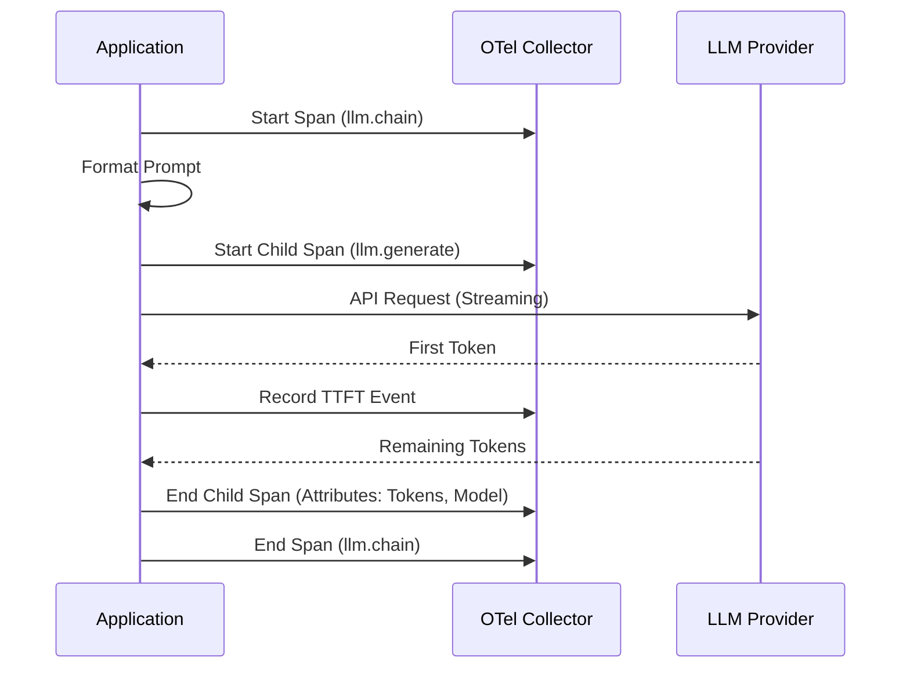
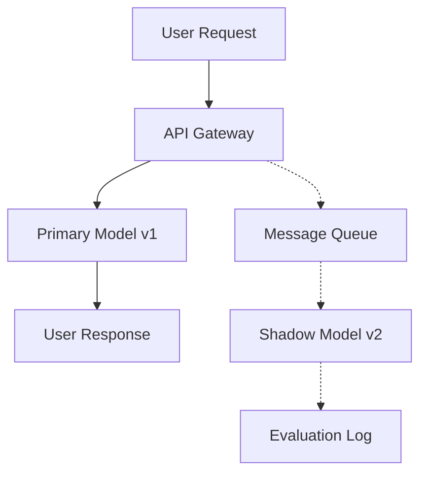
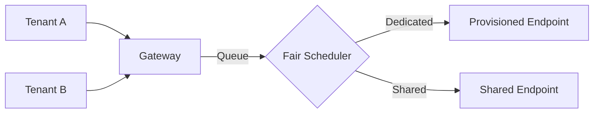

# LLMOps, Observability, Multi-Tenancy, and Cost Budgets

## 1. Introduction to LLMOps and Observability

LLMOps (Large Language Model Operations) extends traditional MLOps by addressing the unique challenges of operationalizing foundation models. Unlike standard machine learning models where outputs are deterministic or bounded, LLMs generate open-ended text, making them inherently more difficult to evaluate, monitor, and cost-control. 

Observability in this context is paramount. It involves tracking not just system metrics like CPU and memory, but token counts, generation latencies (Time to First Token - TTFT, Time per Output Token - TPOT), semantic similarity, and prompt/response payloads. A robust observability stack allows engineering teams to debug complex chains, attribute costs accurately, and maintain strict Service Level Objectives (SLOs).

### 1.1 Core Tenets of LLMOps
- **Traceability**: Every generation must be traceable back to a specific prompt template, model version, and user request.
- **Reproducibility**: Prompt registries and version control ensure that outputs can be evaluated consistently across different deployments.
- **Cost Awareness**: Given the API-driven nature of most LLMs, cost is a primary operational constraint, necessitating real-time tracking and quotas.
- **Security & Privacy**: Redaction of PII (Personally Identifiable Information) before data leaves the corporate boundary or enters logging systems.

## 2. OpenTelemetry (OTel) Tracing for LLMs

To achieve comprehensive observability, OpenTelemetry (OTel) is the industry standard. Instrumenting LLM calls with OTel involves creating custom spans for each stage of the generation process, including prompt construction, API invocation, and response parsing.

### 2.1 Instrumentation Strategy

When instrumenting an LLM chain (e.g., LangChain or LlamaIndex), spans should capture:
- **Span Name**: `llm.generate` or `llm.embedding`.
- **Attributes**: 
  - `llm.model_name` (e.g., `gpt-4-turbo`)
  - `llm.provider` (e.g., `openai`, `anthropic`)
  - `llm.prompt_tokens`
  - `llm.completion_tokens`
  - `llm.temperature`
- **Events**: Streaming chunks can be recorded as span events, though this can be noisy. It is often better to record TTFT as a specific event within the span.



## 3. Redaction and PII Handling

Logging prompts and responses is essential for debugging and fine-tuning, but it introduces severe privacy risks. Sensitive information must be redacted before logs are persisted to disk or sent to a centralized observability platform.

### 3.1 Redaction Strategies
1. **Rule-Based Redaction**: Using regex and heuristics to identify standard PII formats (SSN, credit card numbers, emails).
2. **NER-Based Redaction**: Utilizing lightweight Named Entity Recognition (NER) models (e.g., Presidio) to identify context-dependent PII like names, organizations, and addresses.
3. **In-Stream Redaction**: Redaction must occur *before* the OTel span is exported. This is typically implemented as a custom OTel processor.

## 4. Prompt and Model Registry

A prompt registry acts as a centralized repository for prompt templates, versioning them alongside the application code. This decoupling allows product teams to iterate on prompts without requiring a full application deployment.

### 4.1 Registry Architecture
- **Storage**: A key-value store or document database storing templates (e.g., Jinja or f-strings) and associated metadata.
- **Versioning**: Semantic versioning for prompts (e.g., `v1.2.0`).
- **A/B Testing**: The registry can dynamically serve different prompt versions to different user cohorts based on feature flags.
- **Model Binding**: Prompts are often heavily optimized for specific models. The registry should track which model version a prompt is compatible with.

## 5. Evaluation in CI with Regression Gates

Continuous Integration (CI) pipelines for LLM applications must include semantic evaluations. Unlike traditional unit tests that check for exact string matches, LLM evaluations use specialized metrics (e.g., BLEU, ROUGE, or LLM-as-a-Judge) to assess quality. For more details on evaluation techniques, refer to the cross-link [LLM Evaluation](../llm-evaluation/README.md).

### 5.1 CI Pipeline Integration
1. **Dataset Definition**: A golden dataset of input/output pairs is defined for the CI run.
2. **Execution**: The CI runner executes the new prompt/model combination against the dataset.
3. **Scoring**: An evaluator (often a stronger, more expensive LLM) scores the outputs on axes like relevance, toxicity, and hallucination.
4. **Regression Gates**: If the aggregate score drops below a predefined threshold compared to the `main` branch baseline, the CI pipeline fails.

## 6. Shadow and Canary Deployments

Deploying new LLM versions or prompts directly to production is risky due to unpredictable emergent behaviors. Shadow and canary deployments mitigate this risk.

### 6.1 Shadow Deployments
In a shadow deployment, production traffic is mirrored to the new model/prompt asynchronously. The responses are not returned to the user but are logged for offline comparison against the baseline model.



### 6.2 Canary Deployments
A canary deployment routes a small percentage (e.g., 5%) of live traffic to the new version. Observability metrics (latency, error rate, user feedback/thumbs down) are monitored closely. If the canary degrades SLOs, traffic is automatically rolled back.

## 7. Model Drift Monitoring

Model drift in LLMs manifests as changes in output length, formatting, or semantic distribution over time, often due to underlying API updates by the provider (e.g., silent updates to `gpt-4`).

### 7.1 Detecting Drift
- **Length Tracking**: Monitoring the average `completion_tokens` over time.
- **Format Adherence**: Tracking the failure rate of JSON parsing or regex extraction from the LLM output.
- **Semantic Clustering**: Periodically embedding a sample of outputs and plotting them to identify shifts in topic distribution.

## 8. Multi-Tenancy: Per-Tenant Cost Attribution and Quotas

In multi-tenant systems, isolating usage and costs per tenant is crucial for billing and capacity planning. For a high-level architectural view, see the [Multi-Tenant HLD](../../02-llm-hld-projects/multi-tenant-chat-assistant).

### 8.1 Cost Attribution
Every API request must carry a `tenant_id` context. This context is injected into the OTel spans and used to aggregate token usage in the observability backend.

### 8.2 Quotas and Rate Limiting
To prevent cost overruns, strict quotas must be enforced at the gateway layer.
- **Token Bucket Algorithm**: Used for standard rate limiting (requests per minute).
- **Budget Quotas**: A secondary check based on accumulated cost. If a tenant exceeds their daily budget (e.g., $50), subsequent requests are rejected with a `429 Too Many Requests` status, indicating quota exhaustion.

## 9. Noisy-Neighbour Isolation

In multi-tenant LLM gateways, a single tenant firing massive batch jobs can exhaust connection pools or trigger provider-level rate limits, impacting other tenants.

### 9.1 Isolation Techniques
- **Tenant Routing**: Dedicated model endpoints (e.g., Provisioned Throughput on Azure or AWS Bedrock) for enterprise tenants, while standard tenants share a pay-as-you-go endpoint.
- **Fair Queuing**: Implementing weighted fair queuing at the gateway to ensure smaller tenants are not starved by larger tenants' massive requests.



## 10. Reliability: Provider Failover, Retries, and SLOs

LLM provider APIs are susceptible to degradation and outages. A resilient LLMOps architecture must anticipate and gracefully handle these failures.

### 10.1 Provider Failover
A common strategy is to configure primary and fallback models. For example, if `gpt-4-turbo` experiences a `503 Service Unavailable` or times out, the gateway automatically retries the request against `claude-3-sonnet`.

### 10.2 Retry Strategies
- **Exponential Backoff**: Used for handling transient `429 Rate Limit` errors.
- **Jitter**: Adding randomness to the backoff duration to prevent thundering herd problems upon recovery.

### 10.3 Defining SLOs
Service Level Objectives (SLOs) for LLM applications typically include:
- **Availability**: 99.9% success rate for generation requests.
- **Latency (TTFT)**: 95th percentile Time to First Token < 1.5 seconds.
- **Quality**: < 1% hallucination rate as measured by offline evaluators.

## 11. Token Cost and Latency
Understanding the intricate relationship between token limits, caching, and overall system latency is critical. For an in-depth analysis, please refer to [Token Cost and Latency](../token-cost-latency/README.md).

## 12. Worked Monthly-Cost Example with Cache-Hit Sensitivity Table

Calculating the projected monthly cost for an LLM application requires understanding the expected traffic, token usage, and the impact of semantic caching.

### 12.1 Baseline Assumptions
- **Traffic**: 1,000,000 requests per month.
- **Average Input**: 2,000 tokens per request.
- **Average Output**: 500 tokens per request.
- **Model Pricing**: 
  - Input: $10.00 per 1M tokens ($0.00001 per token)
  - Output: $30.00 per 1M tokens ($0.00003 per token)

### 12.2 Arithmetic: 0% Cache Hit Rate (Baseline Cost)
- **Input Cost per Request**: 2,000 tokens * $0.00001 = $0.02
- **Output Cost per Request**: 500 tokens * $0.00003 = $0.015
- **Total Cost per Request**: $0.02 + $0.015 = $0.035
- **Total Monthly Cost (0% Cache)**: 1,000,000 requests * $0.035 = **$35,000**

### 12.3 Arithmetic: Cache Hit Impact
When a cache hit occurs, the input and output LLM costs are effectively $0 (excluding the marginal cost of the cache itself, e.g., Redis).
If the Cache Hit Rate (CHR) is 20%:
- 200,000 requests cost $0.
- 800,000 requests cost $0.035.
- Total Cost: 800,000 * $0.035 = $28,000.

### 12.4 Sensitivity Table

| Cache Hit Rate (%) | Missed Requests (LLM Calls) | Cached Requests | LLM Cost (Misses * $0.035) | Savings (Compared to Baseline) |
|--------------------|---------------------------|-----------------|----------------------------|--------------------------------|
| 0% (Baseline)      | 1,000,000                 | 0               | $35,000                    | $0                             |
| 10%                | 900,000                   | 100,000         | $31,500                    | $3,500                         |
| 20%                | 800,000                   | 200,000         | $28,000                    | $7,000                         |
| 30%                | 700,000                   | 300,000         | $24,500                    | $10,500                        |
| 40%                | 600,000                   | 400,000         | $21,000                    | $14,000                        |
| 50%                | 500,000                   | 500,000         | $17,500                    | $17,500                        |
| 60%                | 400,000                   | 600,000         | $14,000                    | $21,000                        |
| 70%                | 300,000                   | 700,000         | $10,500                    | $24,500                        |
| 80%                | 200,000                   | 800,000         | $7,000                     | $28,000                        |
| 90%                | 100,000                   | 900,000         | $3,500                     | $31,500                        |

This table clearly demonstrates that implementing a semantic cache with even a modest 20-30% hit rate yields substantial arithmetic cost reductions in the thousands of dollars, fundamentally altering the economics of the application.

## 13. Deep Dive: Implementing Regression Gates in CI/CD

Building a robust CI/CD pipeline requires more than just running unit tests. It demands a rigorous evaluation of the LLM's outputs.

### 13.1 Step-by-Step CI Flow
1. **Commit**: Developer commits a change to a prompt template.
2. **Trigger**: CI system (e.g., GitHub Actions) triggers the evaluation job.
3. **Data Loading**: The job pulls the golden dataset (e.g., 500 hand-curated examples).
4. **Batch Generation**: The pipeline runs the new prompt concurrently against the dataset.
5. **Evaluation**: An LLM-as-a-judge prompt evaluates the outputs, scoring them 1-5 on relevance.
6. **Assertion**: The average score must be >= the baseline score (e.g., 4.2). If it is 4.1, the build fails.

### 13.2 Handling Non-Determinism
Because LLMs are non-deterministic, running the exact same test twice might yield slightly different scores. To combat this:
- Set `temperature=0` during CI runs.
- Use a large enough dataset (n > 100) to ensure statistical significance.
- Implement a confidence interval check rather than a strict equality check.

## 14. Advanced Redaction Architectures

Redacting PII at scale requires high-performance architectures, as regex and NER models can introduce significant latency.

### 14.1 Asynchronous Redaction
Instead of blocking the request path, redaction can be performed asynchronously. The original request is temporarily stored in an encrypted, ephemeral queue. A dedicated worker pool pulls messages, redacts them, and forwards the scrubbed data to the permanent observability store.

### 14.2 Federated Redaction
For global deployments, redaction rules vary by region (e.g., GDPR in Europe, CCPA in California). The observability pipeline must dynamically apply region-specific redaction policies based on the origin of the request.

## 15. The Role of the Model Registry

The model registry is not just a storage layer; it is the control plane for model lifecycle management.

### 15.1 Artifact Tracking
It tracks not only the model weights (for self-hosted models) but also the fine-tuning datasets, hyperparameters, and evaluation metrics associated with a specific version.

### 15.2 Deployment Strategies
The registry integrates with deployment targets (e.g., Kubernetes, Ray Serve) to automate rollouts. When a new model version is marked as "Production Ready" in the registry, an automated pipeline can initiate the shadow or canary deployment process.

## 16. Provider Failover Intricacies

Failing over between providers (e.g., from OpenAI to Anthropic) is not a simple 1:1 switch.

### 16.1 Prompt Translation
Different models require different prompt structures (e.g., system prompts, specific XML tags). The gateway must translate the canonical prompt into the provider-specific format dynamically during a failover event.

### 16.2 Tokenizer Mismatches
Tokenizers differ between providers. A payload that fits within a 8k context window on one provider might exceed it on another. The gateway must preemptively check token counts using the target provider's specific tokenizer before attempting the failover request.

## 17. Final Thoughts on LLMOps

LLMOps is a rapidly evolving field. The shift from experimental prototypes to production-grade systems necessitates a rigorous approach to observability, cost control, and reliability. By implementing the patterns discussed above—OTel tracing, robust registries, semantic caching, and strict regression gates—organizations can safely and sustainably scale their generative AI initiatives.

## 18. Deep Dive: Implementing OTel in Python

Implementing OpenTelemetry requires specific boilerplate. Below is an exhaustive look at how a production system might configure the OTel SDK to export to a standard collector.

### 18.1 SDK Configuration
The SDK must be initialized early in the application lifecycle.

```python
from opentelemetry import trace
from opentelemetry.exporter.otlp.proto.grpc.trace_exporter import OTLPSpanExporter
from opentelemetry.sdk.trace import TracerProvider
from opentelemetry.sdk.trace.export import BatchSpanProcessor
from opentelemetry.sdk.resources import Resource

resource = Resource(attributes={
    "service.name": "llm-gateway"
})
provider = TracerProvider(resource=resource)
processor = BatchSpanProcessor(OTLPSpanExporter(endpoint="localhost:4317"))
provider.add_span_processor(processor)
trace.set_tracer_provider(provider)
tracer = trace.get_tracer(__name__)
```

### 18.2 Context Propagation
Context propagation ensures that span IDs traverse network boundaries. For LLM gateways calling external APIs, injecting the trace context into the HTTP headers is standard practice.

## 19. The Nuances of Semantic Versioning for Prompts

Semantic versioning (SemVer) for code is well understood (MAJOR.MINOR.PATCH). Applying it to prompts requires a different mental model.

### 19.1 MAJOR Updates
A major update indicates a breaking change in the required input variables or a fundamental shift in the output schema.
- Example: Changing the expected output from plain text to strict JSON.

### 19.2 MINOR Updates
A minor update introduces new instructions or context but maintains backward compatibility with the input schema.
- Example: Adding a rule to "Always respond in a polite tone."

### 19.3 PATCH Updates
A patch update addresses a specific bug, such as mitigating a hallucination or fixing a minor formatting issue, without changing the overall behavior.
- Example: Fixing a typo in the system prompt.

## 20. Comprehensive LLM Security Posture

Beyond PII redaction, observability pipelines must monitor for malicious interactions, such as prompt injection or jailbreak attempts.

### 20.1 Prompt Injection Detection
Observability systems can integrate with classifiers that score incoming prompts for injection probability. If a prompt scores above a threshold, the span is tagged with `security.injection_attempt = true`, and an alert is routed to the SecOps team.

### 20.2 Data Exfiltration Monitoring
Monitoring the output tokens is just as critical. If an LLM is given access to proprietary context via RAG, a malicious user might attempt to trick the model into printing the raw database credentials or confidential documents. Observability platforms must scan outputs for known sensitive data patterns.

## 21. FinOps for Generative AI

FinOps (Financial Operations) in the context of LLMs moves beyond simple cost attribution. It involves predictive forecasting and active cost optimization.

### 21.1 Forecasting
By analyzing historical token consumption trends (tracked via OTel), FinOps teams can forecast future API costs. This is critical for negotiating volume discounts or Provisioned Throughput contracts with providers like Microsoft Azure or AWS.

### 21.2 Optimization Strategies
- **Prompt Shortening**: Identifying overly verbose system prompts and optimizing them without degrading quality.
- **Model Downgrading**: Using a smaller, cheaper model (e.g., `gpt-3.5-turbo`) for simple tasks like classification, reserving the expensive models (`gpt-4`) for complex reasoning.

## 22. Architectural Trade-offs in Streaming Observability

Streaming responses (Server-Sent Events) complicate observability because the final token count and status are not known until the stream completes.

### 22.1 Asynchronous Logging
The application must aggregate the chunks in memory. Only when the `[DONE]` signal is received from the provider does the application finalize the span, calculate the total tokens, and export the telemetry. If the connection drops mid-stream, the system must log a partial success/failure state, which requires careful state management.

## 23. Continuous Evaluation and Human-in-the-Loop (HITL)

While CI gates use LLM-as-a-judge, production systems often require human validation for critical operations.

### 23.1 HITL Integration
Observability platforms can sample a percentage of production logs and route them to human annotators. The human scores are then compared against the automated evaluations to continuously calibrate the LLM judge.

## 24. Final Summary

The operationalization of Large Language Models requires a paradigm shift in how we monitor, evaluate, and control software systems. By embracing robust observability practices, implementing strict financial guardrails, and treating prompts as first-class versioned artifacts, organizations can harness the power of generative AI while mitigating its inherent risks and unpredictable costs.

## 25. Detailed Considerations for Prompt Registries

When building or selecting a prompt registry, the storage backend dictates the scalability and query capabilities.

### 25.1 Relational vs. NoSQL
Using a relational database (like PostgreSQL) allows for complex joins between prompt versions, evaluation results, and user metrics. However, a NoSQL document store (like MongoDB) offers more flexibility for storing diverse prompt schemas and metadata without frequent schema migrations.

### 25.2 Integration with Feature Flags
Prompt registries should integrate seamlessly with feature flag systems (like LaunchDarkly). This allows a specific prompt version to be toggled on for internal beta testers before rolling out to the general user base.

## 26. Advanced Drift Analysis Techniques

Standard drift analysis might miss subtle semantic shifts.

### 26.1 KL Divergence
By utilizing Kullback-Leibler (KL) divergence on the token probability distributions (if available from the provider), observability tools can detect if the model's fundamental vocabulary usage has shifted, even if the overall topic remains the same.

### 26.2 Cohort Analysis
Drift should be analyzed across different user cohorts. A prompt might remain stable for standard queries but degrade significantly for edge cases. Segmenting observability data by tenant or user type reveals these hidden regressions.

## 27. The Evolution of LLM Gateways

The gateway is the chokepoint for all LLM traffic.

### 27.1 Intelligent Routing
Future gateways will feature intelligent routing, dynamically selecting the best model for a given request based on the prompt's complexity, the current latency of various providers, and the tenant's remaining budget.

### 27.2 Local Fallbacks
For ultimate reliability, an LLM gateway might fallback to a small, locally hosted open-source model (like Llama 3 8B) if all external cloud providers are unavailable, ensuring continuous operation at the cost of slight quality degradation.

## 28. Conclusion on Cost Management

The sensitivity table provided earlier illustrates the raw arithmetic of caching. However, cost management is a continuous discipline. Teams must regularly audit their observability dashboards, identify inefficient prompts, and ruthlessly optimize their architecture to ensure generative AI remains a profitable endeavor.

## 29. Additional Notes on Observability
To truly master LLMOps, one must understand the lower-level network protocols. For instance, when monitoring latency, the overhead of TLS handshakes to the provider's API can sometimes account for a significant portion of TTFT, especially in serverless environments where connection pooling is difficult.

### 29.1 Connection Pooling
Implementing persistent connection pools (Keep-Alive) at the gateway layer drastically reduces this overhead. Observability tools should track not just the TTFT, but the underlying TCP connection acquisition time to identify bottlenecks.

### 29.2 Geo-Routing
Latency can also be optimized by routing requests to the provider's data center that is geographically closest to the user. This requires the observability stack to tag requests with geo-location metadata and dynamically adjust routing policies based on regional performance metrics.

## 30. Managing Quotas at the Edge
Enforcing quotas at a centralized gateway can introduce latency. A modern approach involves distributing the quota enforcement to edge nodes (e.g., Cloudflare Workers) using distributed counters or probabilistic data structures.

### 30.1 Eventual Consistency
In a distributed quota system, exact real-time enforcement is often traded for eventual consistency. A tenant might slightly exceed their budget before the edge nodes sync the final count, but this trade-off is usually acceptable for the massive reduction in latency.


## 31. Evaluation Frameworks and Methodologies

Evaluating Generative AI models is fundamentally different from evaluating deterministic software. It requires a combination of automated metrics and human-in-the-loop processes.

### 31.1 Automated Evaluation Metrics
- **Perplexity**: Measures how well a probability model predicts a sample. While useful for foundational model training, it is less applicable to end-user application evaluation.
- **BLEU & ROUGE**: Traditionally used for translation and summarization, these metrics compare n-gram overlaps between the generated text and a reference text. They are fast but struggle with semantic equivalence (e.g., scoring a perfectly valid paraphrase poorly).
- **BERTScore**: Uses pre-trained contextual embeddings from BERT models to compute the cosine similarity between the generated and reference sentences, capturing semantic similarity better than strict string matching.

### 31.2 LLM-as-a-Judge
The current state-of-the-art for evaluating open-ended generation is using a highly capable LLM (like GPT-4) to grade the outputs of another LLM based on a rubric.
- **Rubric Design**: The evaluating LLM is given a strict set of criteria, such as "Relevance (1-5)", "Clarity (1-5)", and "Factuality (1-5)".
- **Chain of Thought (CoT) Evaluators**: To improve the reliability of the judge, the evaluator is instructed to explain its reasoning before outputting the final score. This drastically reduces arbitrary scoring.

## 32. Handling Multi-Modal Observability

As models move beyond text to incorporate images, audio, and video, observability must adapt.

### 32.1 Tracing Image Generation
When an application uses a model like DALL-E 3 or Midjourney, the telemetry must capture:
- The base prompt and any negative prompts.
- The requested resolution and aspect ratio.
- The latency (which is often significantly higher than text generation).
- A reference (URI or hash) to the generated artifact in the log store.

### 32.2 Cost Implications of Multi-Modal
Multi-modal inputs and outputs drastically change the cost structure. An image generation might cost a flat fee (e.g., $0.04 per image) rather than a per-token fee. The observability backend must dynamically switch cost calculation logic based on the `model_type` attribute attached to the OTel span.

## 33. The Impact of Quantization on Observability

Running locally hosted models often involves quantization (e.g., converting 16-bit floats to 8-bit or 4-bit integers) to fit the model into available GPU VRAM.

### 33.1 Monitoring Quantized Degradation
Quantization introduces a slight loss in model quality. Observability pipelines must track metrics like the frequency of formatting errors or hallucination rates specifically segmented by the quantization level of the deployed model. If a 4-bit quantized model shows a 15% increase in JSON parsing failures compared to the 8-bit baseline, it may require intervention.

## 34. Security: Data Poisoning and Prompt Leakage

In a production environment, securing the LLM from external manipulation is critical.

### 34.1 Mitigating Prompt Leakage
Prompt leakage occurs when a user successfully convinces the LLM to output its own system instructions. Observability systems can implement real-time output scanners that calculate the Levenshtein distance between the generated output and the known, protected system prompt. If the similarity is too high, the output is blocked, and a security alert is triggered.

## 35. Final Architectural Considerations

The implementation of LLMOps requires a shift from reactive monitoring to proactive, continuous evaluation. The integration of robust OTel tracing, semantic caching, and strict CI/CD regression gates ensures that Generative AI applications remain secure, cost-effective, and aligned with user expectations. As the field matures, the standardizations around these practices will solidify, making the operationalization of foundation models as routine as traditional web services.
