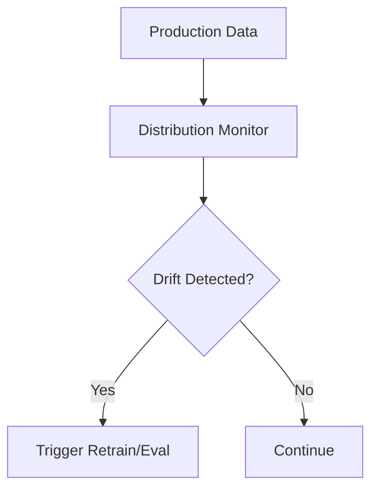
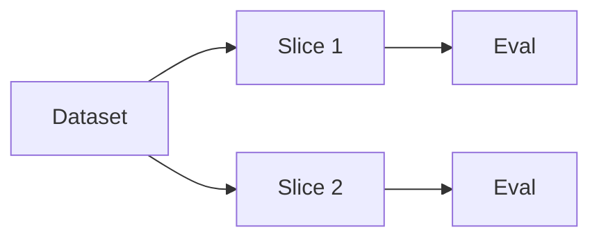

# ML Generalization in System Design

ML system design interviews often fail when candidates discuss models without discussing how those models behave after deployment. This note focuses on practical generalization signals and intervention strategy, particularly in ML and GenAI systems.

---

## What Generalization Means

Generalization is the ability of a model to perform well on unseen production data, not only on training or offline test slices. In both traditional ML and GenAI systems, this means ensuring that a model captures the underlying phenomena without merely memorizing the training set.

### Practical failure modes

1. **Overfitting:** training metrics improve while validation/online metrics degrade. The model has memorized the training data and noise.
2. **Underfitting:** both training and validation metrics remain weak. The model lacks the capacity or the right features to learn the pattern.
3. **Data drift:** input or label distributions shift over time.
4. **Objective mismatch:** model metric improves but product/business metric degrades.

---

## Model Evaluation: Training/Eval Split

Proper evaluation starts with correctly splitting data:
- **Training Set:** Used to update model weights.
- **Validation Set:** Used for hyperparameter tuning and early stopping.
- **Test/Eval Set:** Held-out data used only for final evaluation.

A strict training/eval split prevents the model from "cheating" and gives a realistic estimate of its performance. In GenAI, the "eval split" often takes the form of a "Golden Set" of prompts and expected behaviors (or rubrics).

### Data Leakage

Data leakage occurs when information from outside the training dataset is used to create the model. This often results in overly optimistic performance during evaluation but poor generalization in production.
- **Temporal Leakage:** Predicting the past using data from the future.
- **Feature Leakage:** Using a feature in training that would not be available at inference time.
- **Eval Leakage:** Accidental inclusion of test/eval data in the training set (a major issue for foundational GenAI models trained on web scrapes).

---

## Distribution Shifts

Models degrade when the production data distribution diverges from the training distribution.

### Covariate Shift

Covariate shift happens when the distribution of the input features $P(X)$ changes, but the relationship between the features and the target $P(Y|X)$ remains the same.
- **Example:** A medical diagnosis model trained on data from younger patients is deployed to a hospital with predominantly older patients.
- **Mitigation:** Importance weighting, retraining on new data, or domain adaptation techniques.

### Concept Drift

Concept drift happens when the underlying relationship between inputs and targets $P(Y|X)$ changes over time, even if the input distribution $P(X)$ remains the same.
- **Example:** A spam filter starts failing because spammers invent new tactics, changing the definition of what constitutes "spam". In GenAI, this could be users developing novel jailbreak techniques.
- **Mitigation:** Continuous monitoring, online learning, frequent retraining, and maintaining fresh datasets.

---

## Interview-Ready Diagnostic Flow

1. Confirm business objective and product metric first.
2. Compare train, validation, and online metric deltas.
3. Segment by cohort (region, device, content class, risk band).
4. Check label freshness, leakage risks, and delayed feedback bias.
5. Decide whether issue is model-capacity, data-quality, or policy-threshold related.

---

## Core Techniques

### Capacity and regularization

- Tune model capacity to data scale.
- Use L2/dropout/early stopping to reduce memorization.
- Prefer simpler models when labels are scarce.

### Data-centric improvements

- Improve label quality and consistency.
- Use targeted sampling for rare/important classes.
- Add domain-consistent augmentations where valid.

### Online Evaluation Guardrails

Relying solely on offline evaluation is dangerous. Online guardrails ensure safety during and after deployment.
- **A/B Testing & Canary Releases:** Gradually route traffic to the new model, comparing online metrics against the baseline.
- **Shadow Mode:** Run the new model in parallel with the old one without impacting users, logging its predictions for offline comparison.
- **Continuous Monitoring:** Track distribution shift metrics and operational metrics (latency, error rates).
- **Automated Rollbacks:** Trigger recalibration or automatic rollbacks on breach thresholds (e.g., if toxicity spikes or conversion rate drops).

---

## Common Interview Pitfalls

1. “We will avoid overfitting” without a detection plan.
2. No mention of cohort-level metrics.
3. No guardrails for delayed feedback loops.
4. Treating offline scores as sufficient for launch decisions.

---

## Recommended Follow-Up Questions

- Which online metric would invalidate this model fastest?
- How would you detect covariate shift vs concept drift?
- How do you run safe canaries with rollback criteria?
- How do you prioritize labels when annotation budget is constrained?

---

## Cross-links

- [Interview Framework](../../../resources/interview-tips/interview-framework.md)
- [LLM Evaluation](../llm-evaluation/)
- [Monitoring & Observability](../../../03-hld-concepts/monitoring-observability/)

## Architecture Diagrams

*Data Drift Monitoring*

*Data Slicing Evaluation*

