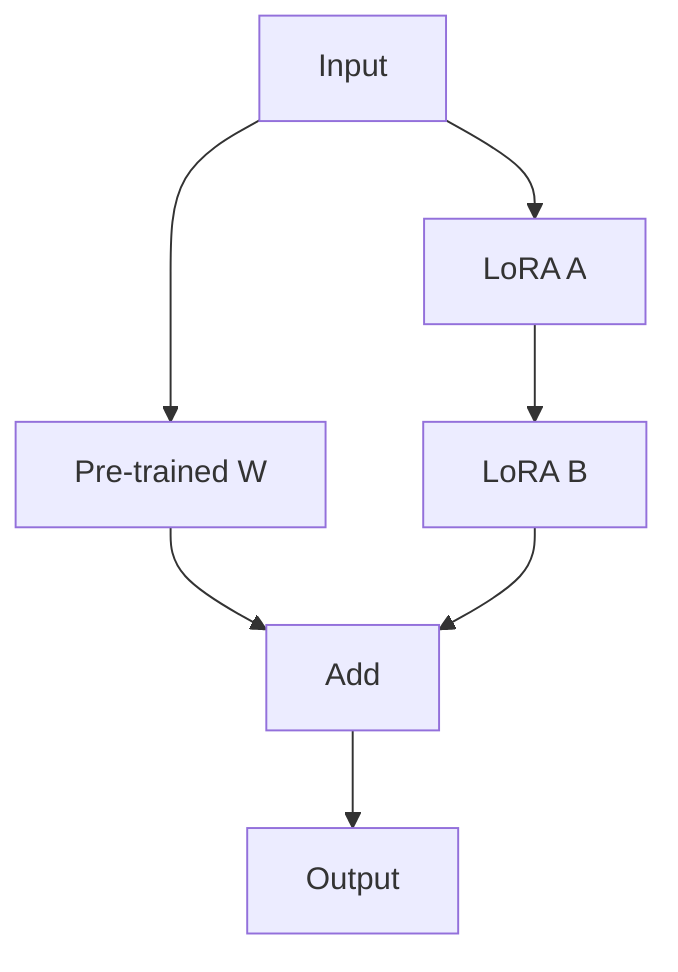
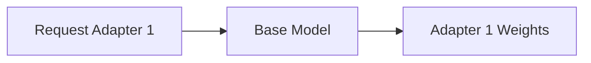

# Model Adaptation and LoRA

## Theory

When adapting large language models to new tasks, **Full Fine-Tuning (FFT)** updates all parameters in the model. This approach poses severe trade-offs.

First is **Storage Explosion**: Every fine-tuned model requires a complete copy of the model weights. This means storing hundreds of gigabytes for a single 70B parameter model.

Second is **Catastrophic Forgetting**: Tuning all weights simultaneously increases the risk of the model forgetting its pre-trained knowledge base.

Third is **Deployment Friction**: Serving multiple task-specific models independently demands massive compute clusters, as each model requires its own dedicated GPU VRAM.

**Parameter-Efficient Fine-Tuning (PEFT)** mitigates these issues by freezing the original model weights and training only a small number of extra parameters.

**Low-Rank Adaptation (LoRA)** is a dominant PEFT technique. It hypothesizes that changes in model weights during adaptation possess a low "intrinsic rank." Thus, the weight update matrix $\Delta W$ can be represented as the product of two low-rank matrices.

The mathematical formulation for the updated weight matrix $W$ is:
$$W = W_0 + \frac{\alpha}{r} B A$$

Where:
- $W_0 \in \mathbb{R}^{d \times k}$ is the frozen, pre-trained weight matrix.
- $B \in \mathbb{R}^{d \times r}$ is the first low-rank matrix.
- $A \in \mathbb{R}^{r \times k}$ is the second low-rank matrix.
- $r \ll \min(d, k)$ is the rank.
- $\alpha$ is a scaling factor.

**Parameter Count Comparison**:
A full weight update requires $d \times k$ parameters (approximated as $d^2$ if $d \approx k$). In contrast, LoRA only updates $(d \times r) + (r \times k)$ parameters.

Because $r$ is very small, $2rd \ll d^2$, drastically reducing the trainable parameter count by thousands of times.

## How It Works

### SVD Spectrum & Intrinsic Dimensionality

Research shows that neural network over-parameterization leads to representations that reside in a lower-dimensional space.

If you decompose a fully fine-tuned weight update matrix using Singular Value Decomposition (SVD), the spectrum of singular values drops off precipitously. This implies that the essential "learning" during adaptation has a low **intrinsic dimensionality** (or rank).

LoRA exploits this by constraining the update matrix to rank $r$, filtering out noise and focusing only on the most critical parameter shifts.

### Initialization Rationale

To ensure that the model starts training exactly as the base pre-trained model (without any initial degradation), the low-rank matrices are initialized carefully.

**Matrix A**: Initialized with a random Gaussian distribution, $A \sim \mathcal{N}(0, \sigma^2)$.

**Matrix B**: Initialized to strictly zero, $B = 0$.

Because $B = 0$, the product $B A = 0$ at the start of training. Therefore, $\Delta W = 0$, and the initial forward pass outputs match the frozen model exactly.

### Scaling Factor (alpha / r)

The update is scaled by $\frac{\alpha}{r}$. The constant $\alpha$ acts like a learning rate multiplier.

By dividing $\alpha$ by the rank $r$, we normalize the scale of the activations. This normalization is crucial because it allows you to change the rank $r$ during hyperparameter tuning without needing to significantly retune the base learning rate.

### QLoRA: Quantized LoRA

QLoRA pushes efficiency further by drastically reducing the memory footprint of the frozen base model during training. It introduces three core innovations.

1. **4-bit NormalFloat (NF4)**: An information-theoretically optimal quantization data type designed specifically for normally distributed neural network weights, ensuring high precision in a 4-bit footprint.

2. **Double Quantization (DQ)**: Quantizes the quantization constants themselves, saving an additional $\sim 0.37$ bits per parameter without performance loss.

3. **Paged Optimizers**: Leverages NVIDIA unified memory to page optimizer states to CPU RAM during memory spikes (e.g., during mini-batch processing), preventing Out-Of-Memory (OOM) errors.

### Multi-Tenant LoRA Serving Architecture

In production, it is common to serve a single base model paired with hundreds of user-specific or task-specific LoRA adapters. Loading separate full models into VRAM is impossible.

Modern serving architectures like **Punica** and **S-LoRA** enable dynamic adapter multiplexing.

**Base Model VRAM Sharing**: The heavy $W_0$ matrix is loaded into GPU VRAM exactly once.

**Host RAM Storage**: Hundreds of lightweight adapter weights ($A$ and $B$ matrices) are stored in cheap CPU Host RAM and dynamically fetched to the GPU as needed.

**Batched Segmented GEMM (BGMV)**: To process a batch of requests where different requests require different LoRA adapters, these systems utilize specialized BGMV CUDA kernels. These kernels efficiently compute the adapter matrix multiplications for different inputs in a single batched operation without padding overhead, maximizing GPU utilization.

## Trade-offs

- **Memory vs. Compute**: While LoRA saves massive amounts of memory during training and deployment, dynamically applying adapters at inference time (if not merged) adds a slight compute overhead.
- **Expressivity**: For completely novel tasks far outside the pre-trained distribution, the low-rank constraint might limit the model's ability to learn compared to full fine-tuning.
- **Complexity of Serving**: Implementing multi-tenant serving with BGMV requires specialized inference engines (like vLLM) and increases architectural complexity.

## When to Use

- **Task-Specific Specialization**: Adapting a foundation model to specific domains (e.g., medical, legal) or tasks (e.g., JSON extraction, SQL generation).
- **Resource-Constrained Environments**: Training large models on consumer-grade GPUs using QLoRA.
- **Multi-Tenant SaaS Platforms**: Serving personalized models to thousands of different users economically by multiplexing adapters over a shared base model.

## Cross-links

- [Prompting, Tools & Agents](../prompting-tools-agents/)
- [LLM-Oriented System Design](../llm-system-design/)
- [Streaming & KV-Cache](../streaming-kv-cache/)
- [Token Economics: Cost & Latency](../token-cost-latency/)

## Architecture Diagrams

*LoRA Architecture*

*Multi-LoRA Serving*

