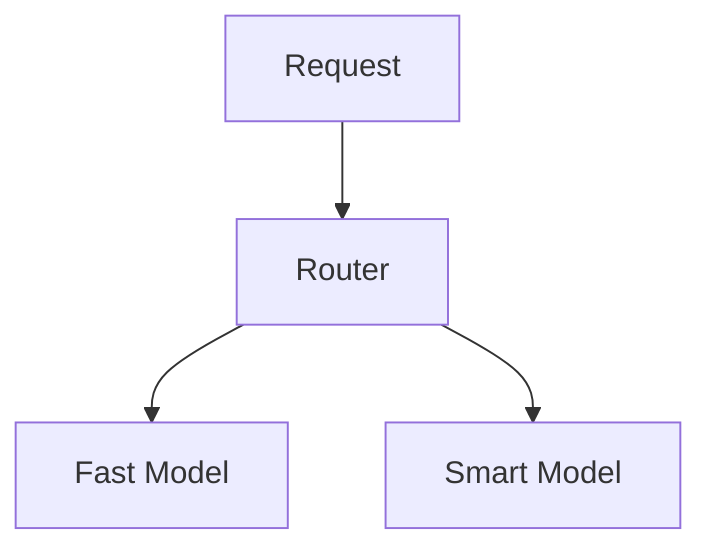
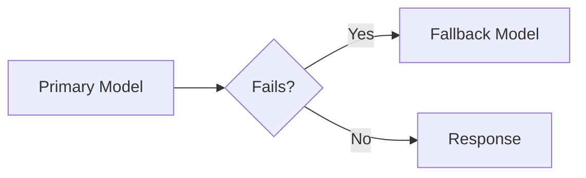

# Model Routing & Orchestration

## 📚 What is it?

**Model routing** is the practice of dynamically selecting which LLM (or combination of LLMs) handles a given request based on factors like query complexity, cost budget, latency requirements, and quality needs. **Orchestration** is the broader pattern of coordinating multiple models, tools, and processing steps into a coherent pipeline.

Together, routing and orchestration solve a fundamental production problem: no single model is optimal for every request. GPT-4 class models produce the best quality but cost 10–30× more than smaller models. A well-designed router sends simple queries to cheap/fast models and reserves expensive models for complex tasks — cutting costs 40–70% with minimal quality loss.

## Why do we need it?

**Problem it solves**: A production GenAI system handles thousands of diverse requests:
- "What's 2+2?" → A 7B model answers instantly for $0.0001
- "Summarize this 50-page legal contract and identify key risks" → Needs GPT-4 or Claude with 100K context
- Sending both to GPT-4 wastes ~$50K/month on trivial queries

**With routing & orchestration**:
- Each request is classified and routed to the right model tier
- Cost drops dramatically while quality stays high for complex tasks
- Latency improves (small models respond faster for simple queries)
- Fallback chains ensure reliability if a model is unavailable

## 🏗️ How It Works

### 1. Routing Strategies

```
                  ┌──────────────┐
                  │  User Query  │
                  └──────┬───────┘
                         │
                ┌────────▼────────┐
                │   Router        │
                │  (classify &    │
                │   dispatch)     │
                └──┬────┬────┬───┘
                   │    │    │
          ┌────────▼┐ ┌─▼──┐ ┌▼────────┐
          │ Small   │ │Med │ │ Large   │
          │ Model   │ │    │ │ Model   │
          │ (7-13B) │ │    │ │ (GPT-4) │
          └─────────┘ └────┘ └─────────┘
```

| Strategy | How It Works | Pros | Cons |
|----------|-------------|------|------|
| **Complexity-based** | Classify query difficulty (simple/medium/hard); route to matching tier | Intuitive, easy to explain | Classifier accuracy is critical |
| **Intent-based** | Detect task type (summarize, translate, code, chat); route to specialist | Leverages domain-specific models | Requires robust intent detection |
| **Cascading** | Start with cheapest model; escalate if confidence is low | Optimal cost on average | Higher latency for escalated queries |
| **Ensemble** | Run multiple models in parallel; merge or pick best output | Highest quality | Highest cost (multiplied by N models) |
| **Budget-aware** | Allocate per-user or per-tenant cost budgets; downgrade when depleted | Predictable spend | May degrade experience for heavy users |

### 2. Cascading Router (Deep Dive)

The cascading pattern is the most interview-relevant routing strategy. It optimizes cost while maintaining a quality floor.

```
  ┌──────────────┐
  │  User Query  │
  └──────┬───────┘
         │
  ┌──────▼───────┐     ┌─────────────┐
  │  Model A     │────►│  Confidence │
  │  (cheap/fast)│     │  Check      │
  └──────────────┘     └──────┬──────┘
                              │
                    ┌─────────┴─────────┐
                    │                   │
              confidence ≥ τ      confidence < τ
                    │                   │
              ┌─────▼─────┐     ┌──────▼───────┐
              │  Return   │     │  Model B     │
              │  answer A │     │  (expensive) │
              └───────────┘     └──────┬───────┘
                                       │
                                 ┌─────▼──────┐
                                 │  Return    │
                                 │  answer B  │
                                 └────────────┘
```

**Confidence signals**:
- Log-probability of generated tokens (low logprobs → uncertain)
- Self-consistency: run the query N times; if answers diverge, escalate
- Length heuristic: very short answers to complex questions may indicate failure
- Output validation: check formatting, factual anchors, or tool call success

### 3. Orchestration Patterns

Orchestration defines **how multiple models and tools are composed** into an end-to-end pipeline.

| Pattern | Flow | Use Case |
|---------|------|----------|
| **Sequential** | Model A → Model B → Model C | Summarize → translate → format |
| **Parallel (fan-out / fan-in)** | Query → [Model A, Model B] → merge | Ensemble, multi-perspective answers |
| **Chain-of-Thought** | Decompose → solve sub-problems → merge | Complex reasoning, math, multi-step |
| **Tool-Augmented** | LLM → calls tools → LLM reflects | Agents, [function calling](../prompting-tools-agents/) |
| **Recursive / Iterative** | Loop: plan → act → observe → repeat | Agentic workflows, research tasks |

```
  Sequential Orchestration:

  ┌─────────┐    ┌──────────┐    ┌──────────┐    ┌──────────┐
  │  Query  │───►│ Model A  │───►│ Model B  │───►│ Response │
  │         │    │ Summarize│    │ Translate │    │          │
  └─────────┘    └──────────┘    └──────────┘    └──────────┘

  Parallel Orchestration:

  ┌─────────┐    ┌──────────┐
  │         │───►│ Model A  │──┐
  │  Query  │    └──────────┘  │   ┌──────────┐    ┌──────────┐
  │         │    ┌──────────┐  ├──►│  Merger  │───►│ Response │
  │         │───►│ Model B  │──┘   └──────────┘    └──────────┘
  └─────────┘    └──────────┘
```

### 4. Building a Router

A practical router needs three components:

| Component | Role | Implementation Options |
|-----------|------|----------------------|
| **Classifier** | Categorize query complexity or intent | Fine-tuned BERT, logistic regression on embeddings, LLM-as-classifier |
| **Policy Engine** | Map classification → model selection | Rule-based config, weighted scoring, RL-learned policy |
| **Fallback Handler** | Handle model failures, timeouts, rate limits | Retry with backoff, cascade to next tier, return cached response |

**Classifier training data example**:

| Query | Label | Route |
|-------|-------|-------|
| "What time is it in Tokyo?" | simple | GPT-3.5 / small model |
| "Compare and contrast microservices vs monolith for a fintech startup" | complex | GPT-4 |
| "Translate 'hello' to French" | simple | GPT-3.5 / small model |
| "Write a Python async web scraper with error handling and rate limiting" | complex | GPT-4 |

### 5. Frameworks & Tools

| Framework | Routing Support | Orchestration | Notes |
|-----------|----------------|---------------|-------|
| **LangChain** | RouterChain, semantic router | LCEL chains, agents | Most popular; rich ecosystem |
| **LlamaIndex** | RouterQueryEngine | Query pipelines | Retrieval-focused |
| **Semantic Kernel** | Planner-based routing | Multi-step plans | Microsoft ecosystem |
| **Custom** | Lightweight classifier + config | Direct API calls | Full control, no framework overhead |

**Interview tip**: Mention that production routers often start rule-based ("if query length < 20 tokens → small model") and graduate to learned classifiers as traffic data accumulates.

## ⚖️ Trade-offs

| Aspect | Benefit | Cost |
|--------|---------|------|
| **Cost** | 40–70% reduction by avoiding GPT-4 on trivial queries | Router itself adds latency and complexity |
| **Quality** | Complex queries still get the best model | Misrouting degrades quality (wrong model for the task) |
| **Latency** | Simple queries return faster from small models | Cascading adds round-trips when escalation is needed |
| **Simplicity** | Single-model setup is trivial | Multi-model routing requires monitoring, A/B testing, fallback logic |
| **Reliability** | Fallback chains improve uptime | More models = more points of failure to monitor |
| **Observability** | Per-model metrics reveal optimization opportunities | Dashboard complexity grows with model count |

## 🎯 When to Use

✅ **Use model routing when:**
- Monthly LLM costs exceed $1K+ and query complexity varies widely
- Latency requirements differ by use case (chat vs batch processing)
- You serve multiple tenants with different quality/cost SLAs
- You want resilience via fallback when a primary model is down
- Regulatory constraints require specific models for certain data types

❌ **Avoid model routing when:**
- Traffic is low (< 1K requests/day) — single model is simpler
- All queries have similar complexity (no benefit from tiering)
- You're still validating product-market fit (optimize cost later)
- The routing overhead would dominate total latency

## Key Takeaways

1. **Not every query needs GPT-4**: A well-designed router can cut costs 40–70% by matching query complexity to model capability
2. **Cascading is the interview favorite**: Start cheap, escalate on low confidence — easy to explain, well-understood trade-offs
3. **Classify, don't guess**: Build a classifier on real traffic data; rule-based heuristics are a fine starting point
4. **Orchestration ≠ routing**: Routing picks the model; orchestration defines the flow (sequential, parallel, agentic)
5. **Monitor routing accuracy**: Track per-tier quality metrics to catch misrouting drift over time

---

## 🔗 See Also
- [LLM Request Orchestrator (LLD)](../../01-llm-lld-projects/llm-request-orchestrator/) — build a router and orchestrator hands-on
- [Prompt Builder (LLD)](../../01-llm-lld-projects/prompt-builder/) — constructing prompts for different model tiers
- [Prompting, Tools & Agents](../prompting-tools-agents/) — agent orchestration and tool calling
- [Agentic Workflow Orchestrator (HLD)](../../02-llm-hld-projects/agentic-workflow-orchestrator/) — full system design with multi-model orchestration
- [Multi-Tenant Chat Assistant (HLD)](../../02-llm-hld-projects/multi-tenant-chat-assistant/) — routing per tenant SLA
- [Load Balancing](../../../03-hld-concepts/load-balancing/) — classical load distribution concepts that apply to model routing
- [Rate Limiting](../../../03-hld-concepts/rate-limiting/) — protecting model endpoints from overload


## Architecture Diagrams


*Semantic Routing*


*Fallback Mechanism*

