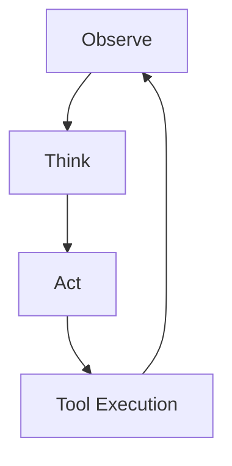
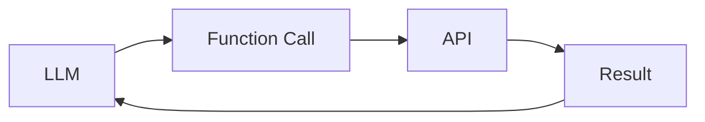

# Prompting, Tools & Agents

## What is it?

Prompting, tools, and agents are the three layers of **interacting with and extending Large Language Models (LLMs)**. Prompting shapes what the model generates, tools give the model the ability to act on the real world, and agents orchestrate multi-step reasoning loops that interleave planning with tool execution.

## Why do we need it?

**Problem it solves**: A raw LLM is a stateless text-completion engine. It cannot look up live data, call APIs, or carry out multi-step plans autonomously. Without these layers:
- The model hallucinates facts it doesn't know
- It cannot perform actions (book a flight, query a database)
- Complex tasks requiring multiple steps fail or produce shallow answers

**With prompting + tools + agents**:
- Structured prompts ground the model in context and persona
- Tool calls let the model fetch real-time data and trigger side effects
- Agent loops enable multi-step reasoning, self-correction, and task completion

## Core Ideas

### 1. Prompt Construction

A prompt is the **full input** sent to the LLM. Modern chat APIs structure it as a sequence of typed messages.

#### Message Roles

| Role | Purpose | Example |
|------|---------|---------|
| **system** | Sets persona, rules, output format | "You are a concise SQL expert. Respond only with valid SQL." |
| **user** | The end-user's request | "Find all orders placed last week." |
| **assistant** | Model's prior responses (for multi-turn) | "SELECT * FROM orders WHERE ..." |
| **tool** | Result returned from a tool call | `{"rows": 42}` |

#### Few-Shot Prompting

Provide example input/output pairs so the model learns the expected format **without fine-tuning**.

```
┌─────────────────────────────────────────────┐
│  system: "Classify sentiment as POS or NEG" │
├─────────────────────────────────────────────┤
│  user:  "I love this product!"              │
│  asst:  "POS"                               │
├─────────────────────────────────────────────┤
│  user:  "Terrible experience."              │
│  asst:  "NEG"                               │
├─────────────────────────────────────────────┤
│  user:  "The delivery was fast."  ◄── new   │
│  asst:  ???                                 │
└─────────────────────────────────────────────┘
```

**Key trade-off**: More examples improve accuracy but consume context window tokens.

#### Chain-of-Thought (CoT)

Instruct the model to **show intermediate reasoning** before the final answer. This dramatically improves accuracy on math, logic, and multi-hop questions.

```
┌───────────────────────────────────────┐
│ user: "If a train travels 60 mph for  │
│        2.5 hours, how far does it go?"│
├───────────────────────────────────────┤
│ asst (with CoT):                      │
│   Step 1: distance = speed * time      │
│   Step 2: distance = 60 * 2.5         │
│   Step 3: distance = 150 miles        │
│   Answer: 150 miles                   │
└───────────────────────────────────────┘
```

**Variants**: Zero-shot CoT ("Let's think step by step"), self-consistency (sample multiple CoT paths, majority vote).

### 2. Function Calling / Tool Use

Function calling lets the model **output structured requests** that your application intercepts and executes.

#### Schema Definition

You register tools as JSON schemas alongside the prompt:

```
┌─────────────────────────────────────────────┐
│  Tool: get_weather                          │
│  ┌────────────────────────────────────────┐ │
│  │ name: "get_weather"                    │ │
│  │ description: "Get current weather"     │ │
│  │ parameters:                            │ │
│  │   location: string (required)          │ │
│  │   units: enum [celsius, fahrenheit]    │ │
│  └────────────────────────────────────────┘ │
└─────────────────────────────────────────────┘
```

The model **never executes the tool itself**—it emits a structured call, and your code handles execution.

#### Invocation Flow

```
┌──────────┐  1. Prompt + tools  ┌───────────┐
│  Client   │ ─────────────────► │    LLM    │
└──────────┘                     └─────┬─────┘
                                       │
                          2. tool_call: │
                          get_weather(  │
                            "London")   │
                                       ▼
┌──────────┐  3. Execute tool    ┌───────────┐
│ Weather  │ ◄────────────────── │  Client   │
│   API    │ ─── 4. Result ────► │ (your app)│
└──────────┘                     └─────┬─────┘
                                       │
                          5. Send result│
                             as tool    │
                             message    ▼
                                 ┌───────────┐
                                 │    LLM    │
                                 │ 6. Final  │
                                 │   answer  │
                                 └───────────┘
```

**Key insight for interviews**: The client is the orchestrator. The LLM decides *what* to call; your code decides *whether* and *how* to execute it.

### 3. Tools and Agents

#### Tool Routing

When multiple tools are available, the system must **route** the model's intent to the correct tool. This is analogous to an [API Gateway](../../../03-hld-concepts/api-gateway/) dispatching requests.

| Routing Strategy | How It Works | Trade-off |
|-----------------|--------------|-----------|
| **LLM-native** | Model picks tool from schema list | Simple; accuracy depends on model |
| **Semantic router** | Embed query, nearest-neighbor match to tool | Fast; less flexible for novel queries |
| **Classifier** | Trained model maps intent → tool | Accurate; requires training data |
| **Hybrid** | Classifier narrows candidates, LLM picks | Best accuracy; more complexity |

#### The ReAct Pattern (Reason + Act)

ReAct interleaves **thinking** and **acting** in a loop. The model reasons about what to do, executes a tool, observes the result, and repeats.

```
┌─────────────────────────────────────────────────┐
│                  Agent Loop                      │
│                                                  │
│  ┌──────────┐    ┌─────────┐    ┌────────────┐  │
│  │ Thought  │───►│ Action  │───►│Observation │  │
│  │ (reason) │    │ (tool   │    │ (tool      │  │
│  │          │◄───│  call)  │◄───│  result)   │  │
│  └──────────┘    └─────────┘    └────────────┘  │
│       │                                          │
│       ▼                                          │
│  ┌──────────┐                                    │
│  │  Done?   │── yes ──► Final Answer             │
│  └──────────┘                                    │
│       │ no                                       │
│       └──────── loop back to Thought             │
└─────────────────────────────────────────────────┘
```

**Interview tip**: ReAct is the most common agent pattern asked about. Know that it adds **observability** (the thought trace) and **controllability** (you can inspect/halt at any step).

#### Agent Loop Execution

A production agent loop involves:

1. **Receive** user query
2. **Plan** or select next action (LLM call)
3. **Execute** tool (your code, sandboxed)
4. **Observe** result and append to context
5. **Decide** if done or loop (go to step 2)
6. **Respond** with final answer

Max-iteration guards and timeout limits prevent infinite loops. Tool results are appended to the conversation as `tool` messages, building up the agent's working memory.

### 4. Planning vs Acting

| Approach | Description | Pros | Cons |
|----------|-------------|------|------|
| **Plan-then-execute** | Generate full plan first, then execute each step | Predictable; easy to review plan | Brittle if a step fails; can't adapt |
| **Interleaved (ReAct)** | Plan one step, execute, observe, re-plan | Adaptive; handles errors | Harder to predict total cost/time |
| **Hybrid** | High-level plan + interleaved sub-steps | Balances predictability and adaptability | More complex orchestration |

```
Plan-Then-Execute:
┌────────┐   ┌────────┐   ┌────────┐   ┌────────┐
│ Plan   │──►│ Step 1 │──►│ Step 2 │──►│ Step 3 │
│ (all)  │   │ (exec) │   │ (exec) │   │ (exec) │
└────────┘   └────────┘   └────────┘   └────────┘

Interleaved (ReAct):
┌────────┐   ┌────────┐   ┌────────┐   ┌────────┐
│Think+  │──►│Observe │──►│Think+  │──►│Observe │──► ...
│ Act 1  │   │Result 1│   │ Act 2  │   │Result 2│
└────────┘   └────────┘   └────────┘   └────────┘
```

**When to choose**: Use plan-then-execute for deterministic workflows (e.g., data pipelines). Use interleaved for open-ended tasks (e.g., research questions). This maps to how [Message Queues](../../../03-hld-concepts/message-queues/) handle sequential vs event-driven workflows.

### 5. Idempotent Tool Design

An idempotent tool produces the **same result** when called multiple times with the same input. This is critical because agent loops may retry failed steps or re-execute on context window replays.

#### Why It Matters

```
Agent retry scenario:
┌───────┐    call_1     ┌──────────┐
│ Agent │──────────────►│  Tool    │──► Creates order #123
│       │               │(not idem)│
│       │    call_2     │          │
│       │──(retry)─────►│          │──► Creates order #124  ← BUG!
└───────┘               └──────────┘

With idempotent tool:
┌───────┐    call_1     ┌──────────┐
│ Agent │──────────────►│  Tool    │──► Creates order #123
│       │               │ (idemp.) │
│       │    call_2     │          │
│       │──(retry)─────►│          │──► Returns order #123  ← SAFE
└───────┘               └──────────┘
```

#### Idempotency Patterns

| Pattern | How It Works | Example |
|---------|-------------|---------|
| **Idempotency key** | Client sends unique key; server deduplicates | `tool_call_id` as dedup key |
| **Upsert** | Insert-or-update semantics | `PUT /users/123` instead of `POST /users` |
| **Check-then-act** | Read state before mutating | Only send email if `status != sent` |
| **Naturally idempotent** | Operation is inherently safe | `GET`, `DELETE` by ID, setting a value |

**Design rule**: Every tool exposed to an agent should be idempotent or guarded by confirmation. Read-only tools (search, lookup) are naturally safe. Write tools need explicit idempotency keys.

## How It Works

### End-to-End Agent Request Flow

```
┌────────┐    ┌───────────┐    ┌─────────┐    ┌──────────────┐
│  User  │───►│  Gateway  │───►│ Prompt  │───►│     LLM      │
│        │    │ / Router  │    │ Builder │    │              │
└────────┘    └───────────┘    └─────────┘    └──────┬───────┘
                                                     │
                                          tool_call  │
                                                     ▼
                                              ┌─────────────┐
                                              │Tool Router  │
                                              │(dispatch)   │
                                              └──────┬──────┘
                                                     │
                                    ┌────────────────┼────────────────┐
                                    ▼                ▼                ▼
                              ┌──────────┐    ┌──────────┐    ┌──────────┐
                              │ Search   │    │ Database │    │ External │
                              │   API    │    │  Query   │    │   API    │
                              └──────────┘    └──────────┘    └──────────┘
                                    │                │                │
                                    └────────────────┼────────────────┘
                                                     │
                                              ┌──────▼──────┐
                                              │   Agent     │
                                              │   Loop      │
                                              │ (continue   │
                                              │  or finish) │
                                              └─────────────┘
```

The [Prompt Builder](../../01-llm-lld-projects/) assembles system instructions, context, and tool schemas. The [Tool Router](../../01-llm-lld-projects/) dispatches tool calls to the right backend. The agent loop orchestrates the cycle until the task is complete—this is the core of an [Agentic Workflow System](../../02-llm-hld-projects/).

## When to Use

✅ **Use structured prompting when:**
- You need consistent output format (JSON, SQL, classification)
- Few-shot examples are available and context window permits
- The task benefits from chain-of-thought reasoning

✅ **Use tool calling when:**
- The model needs access to live or private data
- Actions must be performed (CRUD, notifications, calculations)
- Accuracy requires grounding in external sources (see [RAG Architecture](../rag-architecture/))

✅ **Use agents when:**
- The task requires multiple steps with branching logic
- Intermediate results inform the next action
- Human-in-the-loop checkpoints are acceptable

## When NOT to Use

❌ **Avoid complex prompting when:**
- A simple template or regex would suffice
- Latency budget is very tight (each LLM call adds 0.5–5s)
- The task is fully deterministic with no ambiguity

❌ **Avoid tool calling when:**
- All needed information is in the prompt/context
- The tool has dangerous side effects and no rollback mechanism
- Tool latency would make the user experience unacceptable

❌ **Avoid agents when:**
- The task is single-step (just use a direct LLM call)
- Cost per interaction must stay below a few cents (agent loops multiply API costs)
- Strict latency SLA under 2 seconds (each loop iteration adds an LLM call)
- You cannot tolerate unpredictable execution paths

## Trade-offs

| Aspect | Benefit | Cost |
|--------|---------|------|
| **Prompting** | Steers output without code changes | Uses context window; prompt injection risk |
| **Few-shot** | Improves format compliance | Token cost per example; maintenance burden |
| **CoT** | Better reasoning accuracy | Higher latency and token usage |
| **Tool calling** | Grounds model in real data | Added infrastructure; error handling |
| **Agents** | Handles complex, multi-step tasks | Unpredictable cost/latency; debugging difficulty |
| **Idempotency** | Safe retries and replay | Implementation overhead per tool |
| **Plan-then-execute** | Reviewable, predictable plans | Fragile to mid-plan failures |

## Real-World Examples

### OpenAI Function Calling
- Tools defined as JSON schemas in the API request
- Model returns `tool_calls` array; client executes and returns results

### LangChain / LangGraph Agents
- ReAct-style agents with configurable tool sets
- LangGraph adds stateful, graph-based orchestration for complex workflows

### GitHub Copilot
- System prompt sets coding assistant persona
- Agent loop plans edits, applies them, runs tests, and iterates

### Google Gemini
- Native tool use with function declarations
- Supports parallel tool calls in a single response

## Key Takeaways

1. **Prompt engineering is the first lever**: Get system messages, few-shot examples, and CoT right before adding tools or agents

2. **Tools extend the model's capabilities**: Define clear schemas, handle errors gracefully, and always sandbox execution

3. **Agents = LLM + tools + loop**: The ReAct pattern (Thought → Action → Observation) is the foundational agent architecture

4. **Idempotency is non-negotiable**: Any tool an agent can call must be safe to retry; use [idempotency keys](../../../03-hld-concepts/idempotency/) for write operations

5. **Choose the right orchestration**: Plan-then-execute for predictable workflows, interleaved for adaptive tasks, hybrid for production systems

6. **Guard against runaway agents**: Set max iterations, token budgets, and [safety guardrails](../safety-governance/) to prevent infinite loops and harmful actions

---

## See Also
- [Tool Router (LLD)](../../01-llm-lld-projects/) — building tool routing logic
- [Prompt Builder (LLD)](../../01-llm-lld-projects/) — prompt construction in practice
- [Agentic Workflow System (HLD)](../../02-llm-hld-projects/) — full agent system design
- [Conversational AI Chatbot (HLD)](../../02-llm-hld-projects/) — multi-turn conversation design
- [API Gateway](../../../03-hld-concepts/api-gateway/) — routing and function dispatch patterns
- [Idempotency](../../../03-hld-concepts/idempotency/) — retry-safe tool and API side effects
- [Message Queues](../../../03-hld-concepts/message-queues/) — async tool execution
- [Safety & Governance](../safety-governance/) — guardrails for agent actions
- [RAG Architecture](../rag-architecture/) — retrieval as a tool


## Architecture Diagrams


*Agentic Loop (ReAct)*


*Function Calling Pattern*

