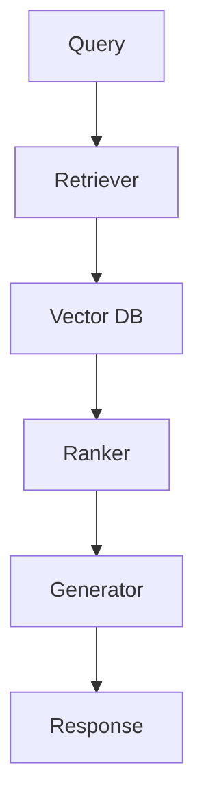
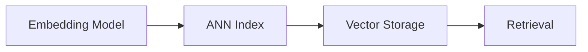

# RAG Architecture

## What is it?

Retrieval-Augmented Generation (RAG) is a pattern that **grounds LLM responses in external knowledge** by fetching relevant documents at query time and injecting them into the prompt context. Instead of relying solely on the model's parametric memory (training data), a retriever finds evidence from a live corpus and a generator synthesizes the final answer.

## Interview mental model

RAG is an evidence pipeline, not just "vector DB plus LLM." The index decides what knowledge is searchable, retrieval decides what evidence is available, reranking decides what gets attention, prompt assembly defines the model's evidence boundary, and evaluation tells you whether answers are grounded enough to ship.

## Why do we need it?

**Problem it solves**: Consider a company knowledge-base chatbot. A vanilla LLM:
- Hallucinates answers it was never trained on
- Cannot access private or post-training data
- Provides no citations; users cannot verify claims
- Retraining or fine-tuning on frequently changing knowledge is often slower, riskier, and more expensive than indexing the source corpus

**With RAG**:
- Answers are backed by retrieved source documents
- New knowledge is available after ingestion/indexing completes within the system's freshness SLA
- Users can receive citations or source snippets when the product needs verifiability
- Factual updates can be handled through indexing instead of model retraining when the needed knowledge fits retrieval

## Core Ideas

### 1. Retriever / Generator Split

```
                    ┌──────────────┐
                    │   User Query │
                    └──────┬───────┘
                           │
              ┌────────────▼────────────┐
              │       RETRIEVER         │
              │  (find relevant docs)   │
              └────────────┬────────────┘
                           │  top-k docs
              ┌────────────▼────────────┐
              │       GENERATOR         │
              │  (LLM synthesizes       │
              │   answer from context)  │
              └────────────┬────────────┘
                           │
                    ┌──────▼───────┐
                    │   Response   │
                    │  + citations │
                    └──────────────┘
```

| Component | Role | Typical Tech |
|-----------|------|--------------|
| **Retriever** | Encode query → search index → return top-k chunks | Vector DB, BM25, hybrid |
| **Generator** | Prompt = query + retrieved context → LLM completion | Hosted or self-managed LLM |
| **Orchestrator** | Coordinates retrieval, ranking, prompt assembly | LangChain, custom code |

### 2. Indexing Pipeline

Before any query is served, documents must be ingested, chunked, embedded, and stored. This offline pipeline is the backbone of RAG quality.

```
 ┌───────────┐    ┌───────────┐    ┌───────────┐    ┌───────────┐    ┌───────────┐
 │  Ingest   │───►│  Parse &  │───►│   Chunk   │───►│  Embed    │───►│  Store in │
 │  Sources  │    │  Clean    │    │ Documents │    │  Chunks   │    │ Vector DB │
 └───────────┘    └───────────┘    └───────────┘    └───────────┘    └───────────┘
  PDFs, APIs,      Extract text,    Split into        Generate          Write vectors
  databases,       strip markup,    overlapping       embeddings        + metadata to
  wikis, S3        normalize        segments          with chosen model  a vector index
```

**Key design decisions**:
- **Freshness**: re-index on schedule or via [message queue](../../../03-hld-concepts/message-queues/) events
- **Scale**: [shard](../../../03-hld-concepts/database-sharding/) the vector index by tenant or domain
- **Cost**: [cache](../../../03-hld-concepts/caching/) embeddings to avoid redundant API calls

### 3. Chunking Strategies

Chunk size and overlap directly affect retrieval precision. Too large → noisy context. Too small → lost coherence.

| Strategy | Description | Best For |
|----------|-------------|----------|
| **Fixed-size** | Split every N tokens with M overlap | General-purpose, simple baseline |
| **Sentence-based** | Break on sentence boundaries | FAQs, short-form content |
| **Paragraph / section** | Respect heading structure | Technical docs, wikis |
| **Recursive** | Split large → small using multiple delimiters | Heterogeneous corpora |
| **Semantic** | Cluster sentences by embedding similarity | Dense, mixed-topic docs |

**Rule of thumb for interviews**: Start with 256–512 tokens, 10–20% overlap. Tune based on retrieval recall metrics.

### 4. Vector DB Basics

A vector database stores high-dimensional embeddings and supports approximate nearest-neighbor (ANN) search.

```
 Query: "How does rate limiting work?"
                │
        ┌───────▼────────┐
        │  Embed query    │
        │  → [0.12, …]   │
        └───────┬─────────┘
                │  ANN search
        ┌───────▼─────────────────────────┐
        │         Vector Index            │
        │  ┌──────┐ ┌──────┐ ┌──────┐    │
        │  │ doc1 │ │ doc2 │ │ doc3 │ …  │
        │  └──────┘ └──────┘ └──────┘    │
        └───────┬─────────────────────────┘
                │  top-k results
                ▼
        [doc2 (0.93), doc1 (0.87), doc5 (0.81)]
```

| Index Type | Recall | Speed | Memory | Notes |
|------------|--------|-------|--------|-------|
| **Flat (brute)** | Perfect | Slow | O(n) | Baseline, < 100 K vectors |
| **IVF** | High | Fast | O(n) | Inverted file, good default |
| **HNSW** | Very high | Very fast | O(n·M) | Graph-based, most popular |
| **PQ** | Moderate | Fast | O(n/4) | Product quantization, low memory |

### 5. Query Routing

Not every question needs the same retrieval path. A **query router** classifies the intent and dispatches accordingly.

```
                   ┌──────────────┐
                   │  User Query  │
                   └──────┬───────┘
                          │
                 ┌────────▼────────┐
                 │  Query Router   │
                 └──┬─────┬─────┬──┘
                    │     │     │
          ┌─────────▼┐ ┌──▼──┐ ┌▼──────────┐
          │ Vector   │ │BM25 │ │ SQL / API  │
          │ Search   │ │     │ │ Lookup     │
          └──────────┘ └─────┘ └────────────┘
```

**Common routing rules**:
- Factual lookup → keyword (BM25) search
- Conceptual / semantic question → vector similarity
- Structured data question → SQL agent or API call
- Multi-hop reasoning → iterative retrieval chain

### 6. Ranking / Reranking

Initial retrieval (bi-encoder) optimizes for **recall**. A second-stage **reranker** (cross-encoder) optimizes for **precision**.

```
  top-100 from retriever
         │
  ┌──────▼──────┐
  │  Reranker   │   Cross-encoder scores each (query, doc) pair
  │  (stage 2)  │   Much slower but far more accurate
  └──────┬──────┘
         │
  top-5 reranked results → Generator
```

| Stage | Model Type | Latency | Accuracy | Purpose |
|-------|-----------|---------|----------|---------|
| **Retrieval** | Bi-encoder | ~10 ms | Moderate | Recall-oriented, narrows corpus |
| **Reranking** | Cross-encoder | ~100 ms | High | Precision-oriented, reorders top-k |

**Interview tip**: Mention the two-stage pattern when quality requirements justify the added latency and cost. For small corpora or low-latency paths, a single hybrid retrieval stage may be the better first version; for high-stakes answers, reranking is often worth the extra hop.

### 7. Context Fusion

Once top-k chunks are selected, they must be **fused into a coherent prompt** for the generator.

**Fusion techniques**:
- **Concatenation**: Simplest — join chunks in rank order with separators
- **Map-reduce**: Summarize each chunk independently, then merge summaries
- **Reciprocal Rank Fusion (RRF)**: Combine scores from multiple retrievers before building context
- **Lost-in-the-middle mitigation**: Place highest-relevance chunks at the **start and end** of context (LLMs attend less to the middle)

**Prompt template sketch**:
```
System: You are a helpful assistant. Use ONLY the provided context.
---
Context:
[chunk 1 — source: design-patterns/observer.md]
[chunk 2 — source: hld-concepts/rate-limiting.md]
---
Question: {user_query}
Answer (cite sources):
```

## How it works

End-to-end flow for a single RAG query:

```
 ┌─────────┐  1. query   ┌────────────┐  2. embed   ┌───────────┐
 │  User   │ ──────────► │ Orchestrator│ ──────────► │ Embedding │
 └─────────┘             └─────┬──────┘             │  Model    │
                               │                     └─────┬─────┘
                               │ 3. ANN search             │
                               │◄──────────────────────────┘
                               │                     ┌───────────┐
                               │ ───────────────────►│ Vector DB │
                               │  4. top-k chunks    └─────┬─────┘
                               │◄──────────────────────────┘
                               │                     ┌───────────┐
                               │  5. rerank ────────►│ Reranker  │
                               │  6. top-n reranked  └─────┬─────┘
                               │◄──────────────────────────┘
                               │
                               │  7. fuse context + query
                               │                     ┌───────────┐
                               │ ───────────────────►│    LLM    │
                               │  8. generated answer└─────┬─────┘
                               │◄──────────────────────────┘
                               │
                         ┌─────▼──────┐
                         │  Response  │
                         │ + sources  │
                         └────────────┘
```

**Latency budget** (typical):
| Step | Time |
|------|------|
| Embedding | 10–30 ms |
| ANN search | 10–50 ms |
| Reranking | 50–200 ms |
| LLM generation | 500–3000 ms |
| **Total** | **~0.6–3.3 s** |

## When to use

✅ **Use RAG when:**
- Knowledge changes frequently and retraining is impractical
- Answers must be grounded in verifiable sources
- The domain corpus is large but queries touch small subsets
- You need citations or audit trails
- Combining private data with a general-purpose LLM

**Specific scenarios:**
- Enterprise search over internal docs
- Customer support bots with product manuals
- Legal / compliance Q&A
- Medical literature assistants
- Code documentation search

## When NOT to use

❌ **Avoid RAG when:**
- The task is purely generative (creative writing, brainstorming)
- All required knowledge fits within the model's training data
- Latency budget is < 200 ms (retrieval adds overhead)
- The corpus has fewer than ~50 documents (prompt-stuffing is simpler)
- Answers require multi-step reasoning over structured data (use agents or SQL instead)

**Anti-patterns:**
- Retrieving hundreds of chunks and stuffing them all into context
- Skipping reranking and sending noisy results to the LLM
- Ignoring chunk quality — garbage in, garbage out
- Using RAG when a fine-tuned model would give better style/tone

## Trade-offs

| Aspect | Benefit | Cost |
|--------|---------|------|
| **Accuracy** | Grounded, verifiable answers | Dependent on retrieval quality |
| **Freshness** | New docs available immediately | Indexing pipeline to maintain |
| **Cost** | No retraining needed | Embedding + vector DB infra |
| **Latency** | N/A | Adds retrieval + rerank overhead |
| **Complexity** | Modular, swappable components | More moving parts than vanilla LLM |
| **Context window** | Efficiently uses limited tokens | Chunk selection is imperfect |

## Evaluation

| Layer | What to measure | Example failure it catches |
|---|---|---|
| Retrieval | recall@k, MRR/NDCG, filter correctness, source freshness | relevant doc exists but is not retrieved |
| Reranking | precision@k, citation support rate | noisy chunks crowd out the answer source |
| Generation | grounded answer rate, refusal correctness, citation accuracy | model answers from prior knowledge instead of context |
| Product | user correction rate, escalation rate, latency, cost/request | answer is technically grounded but not useful |

Build a regression set with representative questions, adversarial prompt injection attempts, stale-document cases, permission-boundary checks, and "answer not in corpus" examples. Treat online thumbs-up/down as weak signal until reviewed against source evidence.

## Failure modes

| Failure | Symptom | Control |
|---|---|---|
| Hallucination | Answer includes unsupported claims | Citation-required generation and refusal when evidence is missing |
| Stale context | Correct old answer after policy/product change | Freshness metadata, reindex SLA, stale-source alerts |
| Prompt injection | Retrieved document tells the model to ignore instructions | Context delimiting, instruction hierarchy, adversarial eval set |
| Leakage | User sees another tenant's source | ACL filters before retrieval and before prompt assembly |
| Eval drift | Offline pass rate no longer predicts user quality | Versioned regression set and periodic human review |
| Cost spike | Large top-k/rerank/context usage during traffic burst | Token budgets, caching, adaptive top-k, rate limits |

## Safety & governance

RAG expands the attack surface because retrieved text is untrusted input inside the prompt. Guard against prompt injection in retrieved documents, data leakage across tenants, unsafe tool calls based on retrieved instructions, and overreliance on unsupported generated claims.

Practical controls:

1. Enforce document-level ACL filters before retrieval and again before answer assembly.
2. Delimit retrieved context from system/developer instructions and tell the model not to follow instructions inside retrieved content.
3. Require citations for factual claims and refuse when evidence is missing.
4. Add content filters and human review for high-stakes outputs.
5. Red-team with malicious documents, hidden instructions, stale pages, and poisoned metadata.

Concrete enforcement sequence: quote retrieved text as data, never executable instruction; allow tools only through policy-gated allowlists; check post-generation citation support before returning; log blocked prompt-injection and missing-evidence cases for review.

## Cost, latency, and currentness

| Lever | Interview answer |
|---|---|
| Latency budget | Keep embedding/search/rerank under the non-LLM budget, stream generation when possible, and cache frequent retrieval results. |
| Cost | Control chunk count, top-k, reranker depth, context tokens, model choice, and embedding refresh frequency. |
| Freshness | Use event-driven indexing for critical docs, scheduled rebuilds for low-risk corpora, and freshness metadata in retrieval filters. |
| Currentness | Name vendors/models only with date context; keep the architecture vendor-neutral and refresh examples quarterly. |

## 60-90 Second Answer

Say: "I would design RAG as two pipelines. Offline, documents are ingested, cleaned, chunked, embedded, and indexed with metadata and ACLs. Online, the query is routed to keyword, vector, or hybrid retrieval, reranked, filtered by permissions, assembled into a bounded prompt, and answered with citations. I would evaluate retrieval recall, grounded answer rate, citation accuracy, latency, and cost per request. The main failure modes are bad chunking, stale indexes, prompt injection in retrieved text, cross-tenant leakage, and hallucinated answers when evidence is missing. For production, I would add ACL enforcement, red-team prompts, regression evals, source freshness tracking, and a refusal path."

## Product-pattern examples

Use these as architectural patterns, not vendor commitments:

- Web-grounded assistant: web index retrieval, reranking, snippet injection, and citations.
- Enterprise knowledge assistant: tenant-filtered document index, ACL-aware retrieval, answer with internal source links.
- Developer docs assistant: hybrid search over API docs/changelogs, code-aware chunking, citation-required answers.
- Support copilot: product manual retrieval, escalation when confidence or evidence is weak.

## Key Takeaways

1. **Retriever quality dominates**: The best LLM cannot fix bad retrieval — invest in chunking, embeddings, and reranking first

2. **Two-stage retrieval is a common quality upgrade**: Bi-encoder for recall, cross-encoder reranker for precision; use it when the latency budget and answer risk justify it

3. **Chunking is an art**: Start with 256–512 tokens and tune; respect document structure when possible

4. **Design the indexing pipeline early**: Freshness, scale, and cost decisions here ripple through the entire system

5. **Add citations when users need evidence**: RAG's strongest product value is verifiability, but citation UX depends on audience, corpus permissions, and whether source snippets are safe to show

---

## See Also
- [Advanced RAG Architecture](ADVANCED-RAG.md) — chunking, reranking, hybrid search, ColBERT, GraphRAG, and Agentic RAG
- [RAG Evaluation Metrics](RAG-EVALUATION.md) — evaluating retrieval recall, NDCG, and generation faithfulness
- [Retriever Ranker (LLD)](../../01-llm-lld-projects/retriever-ranker/) — build retrieval and ranking components hands-on
- [Chunker Metadata Indexer (LLD)](../../01-llm-lld-projects/chunker-metadata-indexer/) — chunking and metadata strategies in practice
- [Document Q&A RAG (HLD)](../../02-llm-hld-projects/document-qa-rag/) — full question-answering system design using RAG
- [Semantic Retrieval Platform (HLD)](../../02-llm-hld-projects/semantic-retrieval-platform/) — retrieval platform design beyond one assistant
- [Caching](../../../03-hld-concepts/caching/) — caching embeddings and LLM responses
- [Database Sharding](../../../03-hld-concepts/database-sharding/) — sharding vector databases
- [Message Queues](../../../03-hld-concepts/message-queues/) — async indexing pipelines
- [LLM Evaluation](../llm-evaluation/) — measuring RAG quality
- [Safety & Governance](../safety-governance/) — filtering RAG outputs

## Clean-room public standards checked on 2026-06-13

- [OpenAI Retrieval guide](https://developers.openai.com/api/docs/guides/retrieval)
- [OpenAI accuracy optimization guide](https://developers.openai.com/api/docs/guides/optimizing-llm-accuracy)
- [OpenAI safety best practices](https://developers.openai.com/api/docs/guides/safety-best-practices)
- [OWASP Top 10 for LLM Applications](https://genai.owasp.org/llm-top-10/)
- [NIST AI Risk Management Framework](https://www.nist.gov/itl/ai-risk-management-framework)


## Architecture Diagrams


*RAG Pipeline Flow*


*Vector Database Structure*

