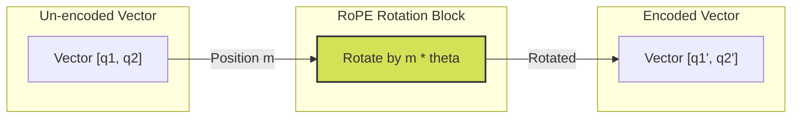
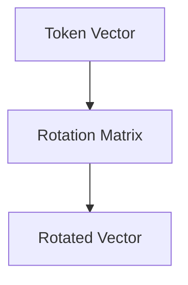
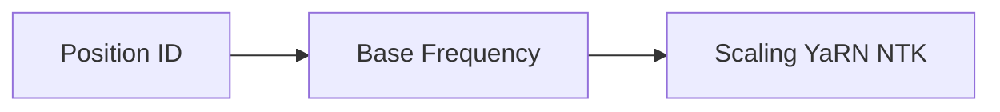

# Rotary Position Embedding (RoPE)

Rotary Position Embedding (RoPE) is a state-of-the-art technique used in Transformer-based Large Language Models to encode positional information. By mathematically rotating the query and key representations in a complex space, RoPE perfectly blends the strengths of absolute and relative positional embeddings, allowing models to scale to enormous context windows.

---

## Theory: The Positional Encoding Problem

Transformers are inherently permutation invariant; without positional embeddings, the attention mechanism treats the input sequence as a bag of words. To solve this, positional information must be injected.

### The Failure of Absolute Position Encodings
Early Transformers used absolute positional encodings (either static sinusoidal or learned parameters) that were simply added to the token embeddings ($x_m + p_m$). 

Absolute encodings struggle with **length generalization** (the ability to infer on sequences longer than those seen during training) because the model learns specific absolute positions rather than the *distance* between tokens. For a model predicting the next word, it is more important to know that word $B$ came 3 tokens after word $A$ (relative position), rather than knowing word $A$ is exactly at position 203.

### The RoPE Objective
RoPE aims to encode the relative position ($m - n$) directly through the inner product of the Query ($q$) and Key ($k$) vectors. We want to find a positional encoding function $f$ such that the attention score between position $m$ and position $n$ is only dependent on their representations and their relative distance:

$$ \langle f(q, m), f(k, n) \rangle = g(q, k, m - n) $$

RoPE achieves this elegant objective by formulating the positional encoding as a rotation operation in a 2D plane.

---

## How It Works

RoPE pairs the dimensions of the feature vector (e.g., $d$ dimensions paired into $d/2$ 2D coordinates) and rotates each pair by an angle proportional to its absolute position $m$.

### Mathematical Formulation
For a 2D vector $[x_1, x_2]$, the rotation by angle $m\theta$ is achieved by multiplying with a 2D Givens rotation matrix:

$$ f_{q, m} = \begin{pmatrix} \cos(m\theta) & -\sin(m\theta) \\ \sin(m\theta) & \cos(m\theta) \end{pmatrix} \begin{pmatrix} q_1 \\ q_2 \end{pmatrix} $$

When we compute the inner product of the rotated Query and rotated Key, the trigonometric identity $\cos(\alpha - \beta) = \cos\alpha \cos\beta + \sin\alpha \sin\beta$ ensures the result depends *only* on the relative difference $m - n$:

$$ \langle f_{q, m}, f_{k, n} \rangle = q^\top \begin{pmatrix} \cos((m-n)\theta) & -\sin((m-n)\theta) \\ \sin((m-n)\theta) & \cos((m-n)\theta) \end{pmatrix} k $$

### Base Frequencies
For a $d$-dimensional embedding, we have $d/2$ pairs of dimensions. Each pair $i \in [1, 2, \dots, d/2]$ has a different base frequency $\theta_i$, forming a geometric progression:

$$ \theta_i = 10000^{-2(i-1)/d} $$

Lower dimensions rotate rapidly (encoding local, high-frequency spatial information), while higher dimensions rotate slowly (encoding global, long-range structural information).

### Mermaid Diagram: 2D Coordinate Rotation

### Vectorized Implementation
Instead of building sparse block-diagonal matrices, standard implementations map the 2D pairs into the complex plane, perform element-wise complex multiplication (which naturally handles 2D rotation), and map back to real numbers. This provides extreme computational efficiency during inference.

---

## Context Window Scaling

Because RoPE encodes position as an angle, extending the context window beyond the pre-training length causes a phenomenon where the model encounters rotation angles it has never seen (extrapolation failure). Several techniques have been developed to extend RoPE context windows without full retraining:

### 1. Position Interpolation (Linear Scaling)
Instead of extrapolating to unseen positions (e.g., $m=2500$ when trained on 2048), Position Interpolation downscales the position index by a factor $L_{target} / L_{train}$. 
- If trained on 2K and extending to 8K, the position $m=8000$ is linearly scaled down to look like $m=2000$.
- **Downside:** Shrinks the "resolution" of the sequence, making local tokens appear closer together than they actually are, often hurting short-context performance.

### 2. NTK-Aware RoPE
Inspired by Neural Tangent Kernel (NTK) theory, this technique avoids linearly scaling the high-frequency dimensions (which need high resolution for local context) and only scales the low-frequency dimensions.
- Achieved by changing the base of the frequency formula (e.g., changing $10000$ to a larger number).
- Smoothly transitions from no interpolation (high frequencies) to aggressive interpolation (low frequencies).

### 3. Dynamic NTK
An improvement over static NTK. Dynamic NTK scales the frequency base dynamically *at inference time* based on the exact length of the current sequence.
- For short sequences, it behaves exactly like the base model (zero performance degradation).
- For long sequences, it scales precisely as much as needed.

### 4. YaRN (Yet another RoPE extensioN)
YaRN recognizes that dimensions can be grouped into bands:
- **High-frequency band:** Interpolation ruins local token relationships. (Do not interpolate).
- **Low-frequency band:** Extrapolation fails on long distances. (Perform linear interpolation).
- **Middle band:** Gradually ramp the interpolation factor between the two.
YaRN modifies the attention softmax temperature slightly and provides state-of-the-art context extension (e.g., up to 128k in Llama 2).

---

## Architectural Adoption

RoPE is the undisputed industry standard for positional encoding in modern LLM architecture.

* **LLaMA (1, 2, 3):** All Meta LLaMA models use standard RoPE. LLaMA 3 extended the base frequency dramatically to natively support 8k-128k contexts.
* **Mistral:** Employs RoPE alongside Sliding Window Attention (SWA).
* **Gemma:** Google's open-weights models use RoPE (unlike the proprietary Gemini which uses specific unreleased variants).
* **Qwen:** Alibaba's Qwen models use RoPE with Dual Chunk Attention to optimize long-context scaling.

---

## Trade-offs

| Pros | Cons |
|---|---|
| **True Relative Encoding:** Mathematically guarantees attention depends on distance. | **Implementation Complexity:** Harder to implement securely and efficiently than simple additions. |
| **No Extra Parameters:** Does not require learning an $N \times d$ embedding matrix. | **Extrapolation limits:** While better than absolute encodings, standard RoPE still requires techniques like YaRN to extrapolate perfectly to 100k+ lengths. |
| **Highly Extensible:** The foundation for modern context-scaling breakthroughs (YaRN, NTK). | **Cache Size:** The rotations must be computed and stored per-layer, although KV caching mitigates repetitive computation. |

---

## When to Use

RoPE should be the default choice for any new Transformer architecture being built today for autoregressive language modeling, particularly if scaling to context lengths above 4,096 tokens is a requirement.

## Cross-links
* [LLM System Design](../llm-system-design/README.md)
* [Model Generalization](../ml-generalization/README.md)
* [Streaming KV Cache](../streaming-kv-cache/README.md)

## Architecture Diagrams

*RoPE Rotation*

*Context Extension*

