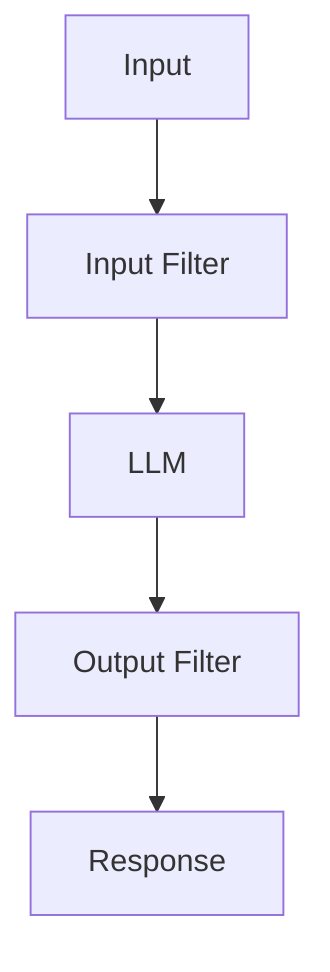
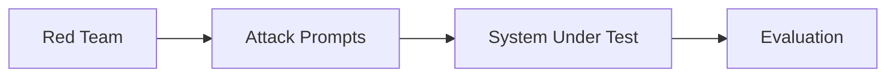

# Safety & Governance

## What Is It?

Safety & Governance is the set of **techniques, policies, and systems** that ensure
generative-AI applications produce outputs that are accurate, fair, non-toxic, and
compliant with privacy regulations. It spans the full request lifecycle — from
**input validation** through **model inference** to **output filtering** — and
includes the organizational processes (red-teaming, auditing, kill switches) that
keep AI systems trustworthy in production.

## Why Do We Need It?

| Problem | Impact |
|---------|--------|
| **Hallucinations** | Users act on fabricated facts → legal / financial harm |
| **Toxic / biased output** | Brand damage, regulatory fines, user harm |
| **PII leakage** | Violations of GDPR / CCPA → multi-million-dollar penalties |
| **Prompt injection** | Attackers bypass guardrails, exfiltrate data |
| **Uncontrolled agents** | Autonomous tools take irreversible real-world actions |

> **Interview tip:** Interviewers often ask *"How do you make sure your LLM doesn't
> hallucinate / leak PII / produce harmful content?"* — framing the answer around
> layered defences (input → model → output → monitoring) is the strongest approach.

## Core Ideas

### 1. Hallucination Mitigation

Hallucinations occur when a model generates plausible-sounding but **factually
incorrect** content. Three complementary strategies reduce the risk:

```
 ┌──────────────────────────────────────────────────────┐
 │                    User Query                        │
 └──────────────┬───────────────────────────────────────┘
                │
                ▼
 ┌──────────────────────────┐
 │   Retrieval (RAG)        │  ◄── Grounding: fetch authoritative docs
 └──────────────┬───────────┘
                │
                ▼
 ┌──────────────────────────┐
 │   LLM Generation         │  ◄── Prompt: "Answer ONLY from provided context"
 └──────────────┬───────────┘
                │
                ▼
 ┌──────────────────────────┐
 │   Post-processing        │
 │  • Citation extraction   │  ◄── Every claim maps to a source
 │  • Confidence scoring    │  ◄── Low-confidence → "I don't know"
 │  • Fact-check pass       │  ◄── Second LLM or rule verifies claims
 └──────────────────────────┘
```

| Technique | How It Works | Latency Cost |
|-----------|-------------|--------------|
| **Grounding (RAG)** | Retrieve relevant documents; inject into context | +100–300 ms (vector search) |
| **Citation enforcement** | Prompt model to cite `[source_id]` per claim; verify references exist | +50 ms (post-process) |
| **Confidence scoring** | Model outputs logprob-based score; threshold gates the response | Negligible |
| **Fact-check chain** | Second LLM call validates claims against sources | +500–1000 ms |

### 2. Toxicity & Bias

**Toxicity** — hate speech, threats, sexually explicit content.
**Bias** — systematic skew against demographic groups.

```
 Detection Pipeline
 ──────────────────
  Input ──► Toxicity       ──► Bias         ──► LLM ──► Output
            Classifier          Classifier              Classifier
            (block/flag)        (flag/rewrite)          (block/flag)
```

**Detection approaches:**

| Approach | Examples | Precision | Recall |
|----------|----------|-----------|--------|
| Keyword / regex blocklists | Slur lists, pattern rules | High | Low (easy to evade) |
| ML classifiers | Perspective API, OpenAI Moderation | High | High |
| LLM-as-judge | GPT-4 scores output on rubric | Very high | Very high |
| Human review | Escalation queue for edge cases | Highest | Variable |

**Mitigation strategies:**

- **Pre-training:** Curate training data, remove toxic corpora.
- **Fine-tuning / RLHF:** Align model with human preferences for safety.
- **System prompt guardrails:** Instruct model to refuse harmful requests.
- **Output rewriting:** Paraphrase flagged outputs to remove bias while
  preserving intent.
- **Demographic parity audits:** Regularly test across protected groups and
  publish bias reports.

### 3. Content Filtering

A **layered filter** architecture ensures defence in depth:

```
 ┌─────────────────────────────────────────────────────────────┐
 │                     Request Flow                            │
 │                                                             │
 │  User ──► [Input Filter] ──► LLM ──► [Output Filter] ──►  │
 │            │                           │                    │
 │            ├─ Prompt injection check   ├─ Toxicity check    │
 │            ├─ Topic blocklist          ├─ PII scan          │
 │            ├─ Rate / abuse limit       ├─ Format validator  │
 │            └─ PII redaction            └─ Citation check    │
 │                                                             │
 └─────────────────────────────────────────────────────────────┘
```

**Input filters** (pre-LLM):

| Filter | Purpose | Implementation |
|--------|---------|----------------|
| Prompt-injection detector | Block jailbreaks / system-prompt leaks | Classifier trained on adversarial examples |
| Topic blocklist | Refuse out-of-scope queries | Embedding similarity against deny-list |
| Abuse rate limiter | Prevent automated attacks | Token-bucket per user / IP ([Rate Limiting](../../../03-hld-concepts/rate-limiting/)) |
| PII redactor | Strip sensitive data before it reaches the model | NER + regex (see §4 below) |

**Output filters** (post-LLM):

| Filter | Purpose | Implementation |
|--------|---------|----------------|
| Toxicity classifier | Block harmful responses | ML model (e.g., OpenAI Moderation endpoint) |
| PII scanner | Catch any PII the model generated | Same NER pipeline as input side |
| Format / schema validator | Ensure structured outputs match contract | JSON Schema / Pydantic validation |
| Hallucination checker | Verify factual claims | Cross-reference with retrieved context |

### 4. PII Handling

Personally Identifiable Information (PII) — names, emails, SSNs, health data —
must never leak into model context without explicit consent.

```
 ┌───────────┐      ┌────────────┐      ┌───────────┐
 │  Raw      │      │  Redacted  │      │  LLM      │
 │  Input    │─────►│  Input     │─────►│  Response  │
 │           │  NER │ "Hi [NAME],│      │  (safe)    │
 │ "Hi John, │  +   │  my SSN is │      └─────┬─────┘
 │  my SSN   │ regex│  [SSN]"    │            │
 │  is 123-  │      └────────────┘            ▼
 │  45-6789" │                        ┌───────────────┐
 └───────────┘                        │ Re-hydrate     │
                                      │ (optional)     │
                                      │ Replace tokens │
                                      │ with originals │
                                      └───────────────┘
```

**Key practices:**

| Practice | Detail |
|----------|--------|
| **Detection** | NER models (spaCy, Presidio) + regex for structured patterns (SSN, credit card) |
| **Masking / redaction** | Replace with placeholder tokens `[EMAIL]`, `[PHONE]` before model call |
| **Tokenised vault** | Store original ↔ token mapping in encrypted, short-lived cache |
| **Data retention** | Log prompts/completions with PII stripped; set TTL ≤ 30 days |
| **Consent gating** | Only process PII categories the user has consented to |
| **Audit trail** | Log every PII access; integrate with [Monitoring & Observability](../../../03-hld-concepts/monitoring-observability/) |

### 5. Operational Safety Frameworks

Technical filters alone are insufficient. Organizational processes complete the
picture:

```
 ┌──────────────────────────────────────────────────┐
 │              Operational Safety Loop              │
 │                                                   │
 │  Red-team ──► Deploy ──► Monitor ──► Incident ──►│
 │    │          (canary)    (metrics)   response    │
 │    │                                    │         │
 │    └────────────────────────────────────┘         │
 │                  Continuous                       │
 └──────────────────────────────────────────────────┘
```

| Framework | Description |
|-----------|-------------|
| **Red-teaming** | Dedicated adversarial team probes the system for jailbreaks, bias, and safety gaps before and after launch |
| **Human-in-the-loop (HITL)** | High-risk actions (financial, medical) require human approval; low-confidence outputs are escalated |
| **Kill switches** | Feature flags or circuit breakers that instantly disable LLM features if safety metrics breach thresholds |
| **Canary deployments** | Roll out to a small user segment; compare safety metrics before full release |
| **Incident response playbook** | Pre-defined steps: detect → triage → mitigate → post-mortem, with on-call rotation |
| **Governance board** | Cross-functional review (legal, ethics, engineering) for new model deployments and policy changes |

## How It Works — End-to-End

```
 User
  │
  ▼
 ┌──────────────┐   ┌──────────────┐   ┌──────────────┐
 │ 1. Input     │   │ 2. Retrieval │   │ 3. LLM       │
 │    Filters   │──►│    + Context  │──►│    Inference  │
 │  • injection │   │  • RAG fetch │   │  • aligned    │
 │  • PII mask  │   │  • grounding │   │    model      │
 │  • rate limit│   │              │   │  • system     │
 └──────────────┘   └──────────────┘   │    prompt     │
                                       └──────┬───────┘
                                              │
                                              ▼
 ┌──────────────┐   ┌──────────────┐   ┌──────────────┐
 │ 6. Logging & │   │ 5. Human     │   │ 4. Output    │
 │    Metrics   │◄──│    Review    │◄──│    Filters   │
 │  • safety    │   │  (if needed) │   │  • toxicity  │
 │    dashboard │   │  • HITL gate │   │  • PII scan  │
 │  • alerting  │   │  • approval  │   │  • citations │
 └──────────────┘   └──────────────┘   └──────────────┘
```

**Latency budget example (P95):**

| Stage | Latency |
|-------|---------|
| Input filters | 20–50 ms |
| RAG retrieval | 100–300 ms |
| LLM inference | 500–2000 ms |
| Output filters | 30–80 ms |
| **Total** | **~650–2400 ms** |

## When to Use

✅ Any **user-facing** LLM application (chatbots, search, content generation).
✅ Systems handling **regulated data** (healthcare, finance, legal).
✅ **Agentic workflows** where the model takes real-world actions.
✅ Products serving **vulnerable populations** (children, patients).
✅ Enterprises with **compliance requirements** (SOC 2, HIPAA, GDPR).

## When NOT to Use

❌ **Internal-only prototypes** with no real data — minimal filters may suffice.
❌ **Fully deterministic pipelines** with no generative component.
❌ When safety overhead **exceeds latency SLA** — consider async moderation
   instead of synchronous blocking (but never skip it entirely).

> **Warning:** "When NOT to use" means *full-stack governance is overkill*, not
> that safety can be ignored. Even prototypes should have basic guardrails.

## Trade-offs

| Dimension | More Safety | Less Safety |
|-----------|------------|-------------|
| **Latency** | Higher (extra classifier calls) | Lower |
| **Cost** | More compute, human reviewers | Cheaper |
| **User experience** | May over-refuse valid queries (false positives) | More permissive but riskier |
| **Development speed** | Slower iteration (review gates) | Faster shipping |
| **Coverage** | Catches edge cases, adversarial attacks | Misses long-tail harms |
| **Flexibility** | Constrained model behaviour | Model acts more freely |

**Key insight:** Safety is not binary. Design a **tiered system** — strict for
high-risk actions, lighter for low-risk — and tune thresholds with data.

## Real-World Examples

| Company | Approach | Details |
|---------|----------|---------|
| **OpenAI** | RLHF + Moderation API + red-teaming | Multi-layer: model alignment, classifier filter, external red teams |
| **Google (Gemini)** | Constitutional AI-style rules + safety classifiers | Harm categories with per-category thresholds |
| **Meta (Llama Guard)** | Open-source safety classifier | Taxonomy-driven; classifies both prompts and responses |
| **Anthropic** | Constitutional AI + RLHF | Model self-critiques against a "constitution" of principles |
| **Microsoft (Azure AI)** | Content Safety API + abuse monitoring | Real-time classifiers + async human review pipeline |

## Key Takeaways

1. **Layer your defences** — no single technique catches everything; combine input
   filters, aligned models, output filters, and human review.
2. **Ground in evidence** — RAG + citation enforcement is the strongest
   hallucination mitigation for knowledge-intensive tasks.
3. **Treat PII as toxic** — redact before the model sees it, scan outputs, enforce
   retention policies, and maintain audit trails.
4. **Invest in operations** — red-teaming, kill switches, and incident playbooks
   matter as much as classifiers.
5. **Tune, don't maximise** — over-aggressive filters degrade UX; use tiered
   thresholds calibrated to risk level and monitor false-positive rates.

## See Also

- [Safety Filter (LLD)](../../01-llm-lld-projects/) — building input/output safety filters
- [Content Moderation Pipeline (HLD)](../../02-llm-hld-projects/) — full moderation system design
- [Conversational AI Chatbot (HLD)](../../02-llm-hld-projects/) — safety in conversational systems
- [Rate Limiting](../../../03-hld-concepts/rate-limiting/) — abuse prevention for LLM endpoints
- [Monitoring & Observability](../../../03-hld-concepts/monitoring-observability/) — tracking safety metrics
- [LLM Evaluation](../llm-evaluation/) — measuring safety and trustworthiness
- [Prompting, Tools & Agents](../prompting-tools-agents/) — guardrails for agent actions


## Architecture Diagrams


*Guardrail Sandwich*


*Red Teaming Process*

