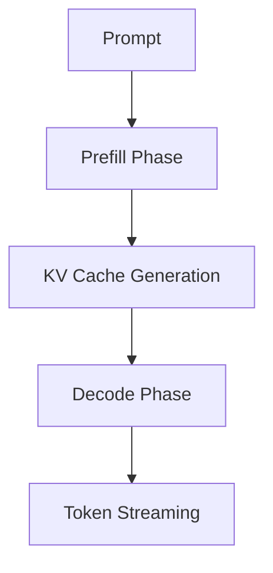
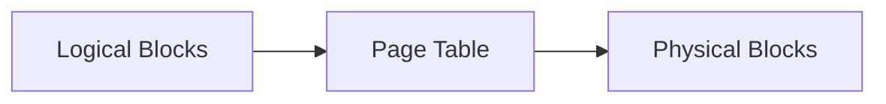

# Streaming & KV-Cache

## 📚 What is it?

**Streaming** in LLM systems refers to delivering generated tokens to the client **incrementally** as they are produced, rather than waiting for the full response. **KV-Cache** (Key-Value Cache) is an inference-time optimization that stores previously computed attention key-value pairs so the model doesn't recompute them for every new token. Together, these techniques dramatically improve the **perceived and actual latency** of LLM applications.

## Why do we need it?

**Problem it solves**: A typical GPT-4 response of 500 tokens takes 5–15 seconds to generate. Without streaming:
- Users stare at a blank screen for the entire generation time
- Time-to-first-byte (TTFB) equals total generation time
- Applications feel sluggish and unresponsive

Without KV-Cache:
- Each new token requires reprocessing the entire prompt + all prior output tokens
- Generation of N tokens costs O(N²) in attention computation
- Inference is 10–100× slower than necessary

**With streaming + KV-Cache**:
- First token appears in 100–500 ms (TTFB)
- Users see a typing effect and can start reading immediately
- KV-Cache avoids recomputing key/value projections for previous tokens and significantly reduces prefill/decoder work
- Overall attention during decoding still scales roughly O(N²) with sequence length, but with a much smaller constant factor than without KV-Cache
- Prompt caching avoids redundant computation for shared prefixes

## 🏗️ How It Works

### 1. Server-Sent Events (SSE) for LLM Streaming

SSE is the standard transport for streaming LLM responses. It uses a long-lived HTTP connection where the server pushes events as tokens are generated.

```
  Client                          Server (LLM API)
    │                                   │
    │  POST /chat/completions           │
    │  { stream: true, ... }            │
    │ ─────────────────────────────────► │
    │                                   │
    │  HTTP 200 OK                      │
    │  Content-Type: text/event-stream  │
    │ ◄───────────────────────────────── │
    │                                   │
    │  data: {"choices":[{"delta":      │
    │         {"content":"The"}}]}      │
    │ ◄───────────────────────────────── │
    │                                   │
    │  data: {"choices":[{"delta":      │
    │         {"content":" answer"}}]}  │
    │ ◄───────────────────────────────── │
    │                                   │
    │  data: {"choices":[{"delta":      │
    │         {"content":" is"}}]}      │
    │ ◄───────────────────────────────── │
    │                                   │
    │  data: [DONE]                     │
    │ ◄───────────────────────────────── │
```

**Key design considerations**:
- **Backpressure**: If the client can't consume tokens fast enough, buffer management is critical
- **Reconnection**: SSE supports `Last-Event-ID` for resuming after dropped connections
- **Aggregation**: For downstream processing (safety filters, logging), tokens must be accumulated server-side
- **Proxy compatibility**: Ensure [load balancers](../../../03-hld-concepts/load-balancing/) and [API gateways](../../../03-hld-concepts/api-gateway/) don't buffer the entire response before forwarding

**SSE vs WebSocket for LLM streaming**:

| Feature | SSE | WebSocket |
|---------|-----|-----------|
| Direction | Server → Client (unidirectional) | Bidirectional |
| Protocol | HTTP/1.1 or HTTP/2 | Upgrade from HTTP |
| Reconnection | Built-in auto-reconnect | Manual |
| Complexity | Simple | More complex |
| Best for | LLM token streaming (read-heavy) | Real-time chat with typing indicators |

### 2. KV-Cache: The Core Inference Optimization

In transformer inference, each attention layer computes **Key (K)** and **Value (V)** projections for every token. During autoregressive generation, previously computed K and V values don't change — so caching them avoids redundant computation.

```
  Without KV-Cache (generating token 4):

  ┌─────┬─────┬─────┬─────┐
  │ t1  │ t2  │ t3  │ t4  │  ← Compute K,V for ALL tokens
  └─────┴─────┴─────┴─────┘     every time a new token is generated
  Cost per token: O(sequence_length)
  Total for N tokens: O(N²)

  With KV-Cache (generating token 4):

  ┌─────┬─────┬─────┐ ┌─────┐
  │ t1  │ t2  │ t3  │ │ t4  │  ← Only compute K,V for new token
  │ cached K,V      │ │ new │     Attend against cached K,V
  └─────┴─────┴─────┘ └─────┘
  Cost per token: O(1) new-token compute + O(sequence_length) attention
  Total K/V recomputation for N tokens: O(N)  
  (overall attention FLOPs across N tokens still scale ≈ O(N²) due to the growing prefix)
```

**Memory cost of KV-Cache**:
```
  KV_Cache_Bytes = 2 * n_layers * n_kv_heads * d_head * seq_len * batch_size * dtype_bytes
```

**Example: LLaMA 70B (4096 seq_len, batch=1, FP16)**
Older models using Multi-Head Attention (MHA) cached every head (e.g., 64 KV heads):
`= 2 * 80 * 64 * 128 * 4096 * 1 * 2 bytes = 10,737,418,240 bytes (10.24 GB) per sequence`

However, LLaMA 70B uses **Grouped-Query Attention (GQA)**, caching only 8 KV heads:
`= 2 * 80 * 8 * 128 * 4096 * 1 * 2 bytes = 1,342,177,280 bytes (1.28 GB / 1.25 GiB) per sequence`

**Data Type Precision Table (`dtype_bytes`)**:
| Precision | Bytes per parameter | Description |
|-----------|---------------------|-------------|
| FP16      | 2 bytes             | Standard 16-bit floating point |
| BF16      | 2 bytes             | Brain Float 16 (wider range, less precision) |
| FP8       | 1 byte              | 8-bit floating point (newer hardware) |
| INT4      | 0.5 byte            | 4-bit integer quantization |

This massive memory footprint is why KV-Cache **memory management** is one of the biggest challenges in LLM serving.

### 3. Prompt Caching & Prefix Caching

When multiple requests share the same system prompt or prefix, the KV-Cache for that prefix can be computed once and reused.

```
  Request 1: [System prompt] + "What is caching?"
  Request 2: [System prompt] + "Explain load balancing"
  Request 3: [System prompt] + "Define sharding"

  Without prefix caching:
    Each request computes KV-Cache for the full system prompt → wasteful

  With prefix caching:
  ┌──────────────────────┐ ┌───────────────────┐
  │  System prompt       │ │  User query       │
  │  KV-Cache (shared)   │ │  KV-Cache (unique) │
  │  Computed ONCE       │ │  Computed per req  │
  └──────────────────────┘ └───────────────────┘
```

**Prefix caching implementations**:
- **Anthropic prompt caching**: Explicitly cache static prefixes via API; pay for cache writes, save on reads
- **vLLM automatic prefix caching**: Detects shared prefixes across concurrent requests automatically
- **SGLang RadixAttention**: Uses a radix tree to share KV-Cache across requests with common prefixes

**Cost savings**: If your system prompt is 2000 tokens and you serve 10K requests/day, prefix caching avoids recomputing 20M tokens of KV per day.

### 4. Semantic Caching

Beyond prefix caching, **semantic caching** stores full responses for queries that are semantically similar to previous ones.

```
  ┌──────────────┐
  │  User Query  │
  └──────┬───────┘
         │
  ┌──────▼───────┐     ┌─────────────────┐
  │  Embed query │────►│  Cache Lookup   │
  └──────────────┘     │  (vector search │
                       │   on past Q&A)  │
                       └──────┬──────────┘
                              │
                    ┌─────────┴─────────┐
                    │                   │
              similarity ≥ τ      similarity < τ
                    │                   │
              ┌─────▼─────┐     ┌──────▼───────┐
              │  Return   │     │  Call LLM    │
              │  cached   │     │  (generate   │
              │  response │     │   new answer)│
              └───────────┘     └──────┬───────┘
                                       │
                                 ┌─────▼──────┐
                                 │  Store in  │
                                 │  cache     │
                                 └────────────┘
```

**Semantic cache considerations**:
- **Similarity threshold**: Too low → stale/wrong answers; too high → low hit rate
- **TTL**: Cached answers become stale; set expiration based on content volatility
- **Personalization**: User-specific context makes semantic matching harder
- **Cache key**: Embedding of query + relevant context (not just the raw question)

### 5. KV-Cache Management at Scale

Serving thousands of concurrent requests requires sophisticated memory management for KV-Cache.

| Technique | Description | Used By |
|-----------|-------------|---------|
| **PagedAttention** | Allocate KV-Cache in fixed-size pages (like OS virtual memory) | vLLM |
| **Continuous batching** | Dynamically add/remove requests from a batch as they complete | vLLM, TGI |
| **Speculative decoding** | Draft tokens with small model; verify with large model in one pass | Medusa, EAGLE |
| **KV-Cache offloading** | Spill KV-Cache to CPU RAM or disk when GPU memory is full | FlexGen |
| **Quantized KV-Cache** | Store K,V in INT8/INT4 instead of FP16 | Many frameworks |

**PagedAttention Memory Formulation**:
- **Block Size ($B$)**: Typically 16 or 32 tokens per block.
- **Memory per Block**: `Block_Memory = 2 * n_layers * n_kv_heads * d_head * block_size * dtype_bytes`
- **Pool Sizing**: `Number of blocks in pool = Available_VRAM / Block_Memory`
- **Internal Fragmentation**: Occurs only in the last block. Bounded to `(B - 1) / L` where $L$ is the sequence length.

```
  PagedAttention (vLLM):

  GPU Memory
  ┌───────────────────────────────────┐
  │ ┌─────┐ ┌─────┐ ┌─────┐ ┌─────┐ │
  │ │Pg 1 │ │Pg 2 │ │Pg 3 │ │Pg 4 │ │  Physical pages
  │ └──┬──┘ └──┬──┘ └──┬──┘ └──┬──┘ │
  │    │       │       │       │     │
  │ ┌──┴──┐ ┌──┴──┐ ┌──┴──┐         │
  │ │Req A│ │Req A│ │Req B│         │  Page table maps
  │ │Blk 1│ │Blk 2│ │Blk 1│         │  logical → physical
  │ └─────┘ └─────┘ └─────┘         │
  └───────────────────────────────────┘
  
  Non-contiguous allocation eliminates external memory fragmentation
```

### 6. Shared Prefix & KV Cache Correctness in Multi-Tenant Serving

*(Disclaimer: The following is a conceptual checklist for system design and architecture, not a production security certification.)*

When serving multiple tenants or applying different security/authorization boundaries, **prefix/prompt caching (caching internal model states)** is fundamentally different from caching the final output (response caching) or caching vectors for semantic retrieval. Prefix/KV caches store intermediate attention state (Keys and Values), whereas response/vector caches store string responses or vector embeddings in a database. Because KV-Cache directly represents the internal activation state of the model, sharing it incorrectly across requests can leak data or corrupt output. This is a critical security consideration.

**Cache Identity and Isolation Parameters**
A common mistake is using only a hash of the text prompt to key the KV cache. To maintain correct tenant isolation and model semantics, the **cache identity must strictly bind to all variables that affect hidden states**. If policy requires tenant isolation, a content hash alone is insufficient. The key formulation is implementation-specific, but the inputs must include:
1. **Model & Revision:** The specific weights used.
2. **Tokenizer:** The exact tokenizer version mapping text to tokens.
3. **Adapter/LoRA:** Any active fine-tuning weights applied on top of the base model.
4. **Position/RoPE Settings:** Sequence offsets and positional embedding scaling.
5. **Tenant or Auth Boundary:** The explicit tenant ID, ensuring cross-tenant reuse is prevented if strict isolation is mandated by policy.
6. **Prompt/Policy Version:** Any system prompts or safety guardrails prepended to the request.

**Cache Lifecycle and Safe Reuse**
- **Reference Ownership (Copy-on-Write / Refcounting):** When multiple requests hit the same prefix cache, the system must track references. If one request diverges (generates a new token), the cache must use a copy-on-write mechanism to allocate new blocks for the diverging suffix without modifying the shared prefix blocks.
- **Request Cancellation/Freeing & Release:** If a client disconnects or times out, the serving engine must decrement the reference count and promptly free unreferenced KV blocks to avoid memory leaks.
- **Eviction Under Memory Pressure:** When VRAM is exhausted, the eviction policy (e.g., LRU) must safely reclaim blocks. Shared prefix blocks should be preserved longer than unique suffix blocks to maximize cache hit rates across requests.
- **Stale or Revoked Data (Context):** If a tenant's permissions change or a prompt version is revoked, the corresponding cache entries must be invalidated to prevent serving outputs based on stale or unauthorized context.

**Threat Considerations in Multi-Tenant Caching**

| Threat | Description | Mitigation |
|--------|-------------|------------|
| **Cross-Tenant Reuse** | Tenant A accesses Tenant B's cached internal state by crafting a matching prompt hash, potentially extracting sensitive context. | Include the Tenant ID in the cache key. Prevent logical cache collisions across boundaries. |
| **Cache Poisoning** | A malicious user crafts an adversarial prefix to corrupt the shared cache state, affecting subsequent users who hit the same prefix. | Enforce strict prefix boundaries; only cache vetted system prompts or isolate user-provided prompts. |
| **Side-Channel Attacks** | Observing response latency to infer if another tenant recently queried a specific, highly-sensitive prompt. | Add jitter to response times or disable shared caching for highly sensitive workloads. |
| **Sensitive Telemetry** | Logging raw cache keys (which contain full prompts or hashes) exposes PII or sensitive data in observability tools. | Hash the prompt with a salt or rely on aggregated cache hit/miss metrics without logging raw content. |

## ⚖️ Trade-offs

| Aspect | Benefit | Cost |
|--------|---------|------|
| **Streaming** | Low TTFB, better UX | Harder to apply safety filters before delivery |
| **KV-Cache** | 10–100× faster generation | Massive GPU memory consumption |
| **Prefix caching** | Save compute on shared prompts | Cache management overhead; stale if prompt changes |
| **Semantic caching** | Eliminate redundant LLM calls entirely | Risk of serving stale/wrong cached answers |
| **PagedAttention** | Near-zero memory waste | Implementation complexity, page management overhead |
| **Quantized KV** | 2–4× memory reduction | Small quality degradation |

## 🎯 When to Use

✅ **Use streaming when:**
- Building chat interfaces where perceived latency matters
- Responses are > 100 tokens (short responses don't benefit much)
- You need to show progress indicators to users

✅ **Use KV-Cache (always on in modern serving):**
- All autoregressive generation benefits; there is no reason to disable it

✅ **Use prefix/prompt caching when:**
- Many requests share the same system prompt (common in production)
- You serve high request volumes (> 1K/day) with similar prefixes
- System prompts are long (> 500 tokens)

✅ **Use semantic caching when:**
- Queries are repetitive (FAQ-style, common customer questions)
- Latency and cost reduction outweigh the risk of slightly stale answers
- You can tolerate approximate matching (not safety-critical)

❌ **Avoid semantic caching when:**
- Every query is unique (creative generation, code completion)
- Answers are highly time-sensitive or personalized
- The cost of a wrong cached answer exceeds the savings

## Key Takeaways

1. **Streaming is table stakes**: Every production LLM app should stream; SSE is the standard transport
2. **KV-Cache is the single biggest inference optimization**: Understand it at the memory-math level for interviews
3. **Prefix caching is free performance**: If you have a shared system prompt, you're leaving performance on the table without it
4. **Semantic caching is high-reward, high-risk**: Great for FAQ-like traffic; dangerous for open-ended queries
5. **PagedAttention revolutionized LLM serving**: Know the analogy to OS virtual memory for interview discussions

---

## 🔗 See Also
- [Caching](../../../03-hld-concepts/caching/) — classical caching patterns that apply to LLM responses
- [CDN](../../../03-hld-concepts/cdn/) — edge caching concepts applicable to cached completions
- [RAG Architecture](../rag-architecture/) — streaming RAG responses to users
- [LLM-Oriented System Design](../llm-system-design/) — token budgets and KV-Cache in system design context
- [Conversation Memory Store (LLD)](../../01-llm-lld-projects/conversation-memory-store/) — managing chat history and KV-Cache
- [Multi-Tenant Chat Assistant (HLD)](../../02-llm-hld-projects/multi-tenant-chat-assistant/) — streaming in production chat systems


## Architecture Diagrams


*KV Cache Lifecycle*


*PagedAttention Pattern*

