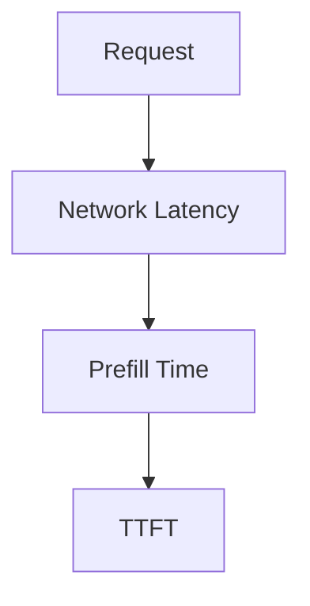
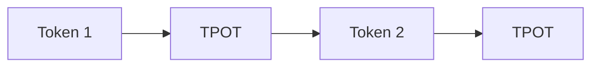

# Token Economics: Cost & Latency

## 📚 What is it?

**Token economics** is the discipline of understanding, modeling, and optimizing the cost and latency of LLM-powered systems. Every LLM interaction is priced and timed in **tokens** — the fundamental unit of text that models process. Mastering token economics is essential for building GenAI systems that are both performant and financially sustainable.

## Why do we need it?

**Problem it solves**: A team launches an LLM-powered feature and gets hit with a $47K cloud bill in the first month. Investigation reveals:
- System prompts were 3000 tokens (could have been 800)
- Every request used GPT-4 when 80% of queries were simple enough for GPT-3.5
- No caching meant identical queries were reprocessed hundreds of times
- No latency budgets meant p99 response times exceeded 15 seconds

**With token economics**:
- Cost is predictable and budgeted per feature, tenant, and model tier
- Latency is decomposed into measurable components (TTFT, TPS, total)
- Optimization techniques (prompt compression, caching, model routing) deliver 3–10× savings
- Engineering teams make informed trade-offs in the cost-quality-latency triangle

## 🏗️ How It Works

### 1. Token Fundamentals

LLMs don't process characters or words — they process **tokens**. Most modern models use **Byte-Pair Encoding (BPE)** to split text into subword units.

```
  Input: "Tokenization is fundamental"

  BPE Tokenization:
  ┌───────┬──────┬─────┬──┬─────────┬─────┬───┐
  │ Token │ izat │ ion │  │ is      │     │   │
  │       │      │     │  │         │     │   │
  │"Token"│"izat"│"ion"│" "│"is"    │"fund"│...│
  └───────┴──────┴─────┴──┴─────────┴─────┴───┘
  → 5 tokens (approximately)
```

**Rules of thumb for English text**:
- 1 token ≈ 4 characters ≈ ¾ of a word
- 100 tokens ≈ 75 words
- 1 page of text ≈ 400–500 tokens
- Code is typically less token-efficient (more tokens per semantic unit)

**Non-English text**: CJK languages, Arabic, and other scripts often require more tokens per word because BPE vocabularies are English-heavy.

### 2. Cost Modeling

LLM pricing usually follows a **per-token model** with separate rates for input and output tokens. Output tokens are often more expensive because they require autoregressive generation.

Pricing note (audited 2026-06-14): the dollar values below are historical interview-arithmetic examples, not current vendor pricing. Refresh them against provider pricing pages before quoting exact costs.

| Model | Input (per 1M tokens) | Output (per 1M tokens) | Context Window |
|-------|----------------------|------------------------|----------------|
| GPT-4o | $2.50 | $10.00 | 128K |
| GPT-4o-mini | $0.15 | $0.60 | 128K |
| Claude 3.5 Sonnet | $3.00 | $15.00 | 200K |
| Claude 3.5 Haiku | $0.80 | $4.00 | 200K |
| Llama 3 70B (self-hosted) | ~$0.50* | ~$0.50* | 8K |
| Llama 3 8B (self-hosted) | ~$0.05* | ~$0.05* | 8K |
| Llama 3.1 70B (self-hosted) | ~$0.50* | ~$0.50* | 128K |
| Llama 3.1 8B (self-hosted) | ~$0.05* | ~$0.05* | 128K |

*Self-hosted costs are approximate GPU-hour equivalents, not per-token pricing.*

**Cost formula**:
```
  Request cost = (input_tokens × input_price) + (output_tokens × output_price)

  Example: GPT-4o, 2000 input tokens, 500 output tokens
  = (2000 × $2.50/1M) + (500 × $10.00/1M)
  = $0.005 + $0.005
  = $0.01 per request

  At 100K requests/day:
  = $0.01 × 100,000 = $1,000/day = $30,000/month
```

### 3. Latency Breakdown

LLM latency is **not a single number** — it decomposes into distinct phases that each require different optimization strategies.

```
  ┌──────────────────────────────────────────────────────────┐
  │                    Total Latency                         │
  │                                                          │
  │  ┌──────────┐ ┌──────────┐ ┌─────────────────────────┐  │
  │  │  Network │ │  TTFT    │ │  Token Generation       │  │
  │  │  RTT     │ │ (Prefill)│ │  (Decode Phase)         │  │
  │  │  ~20ms   │ │ 100-500ms│ │  N × time_per_token     │  │
  │  └──────────┘ └──────────┘ └─────────────────────────┘  │
  └──────────────────────────────────────────────────────────┘
```

| Metric | Definition | Typical Range | Optimization |
|--------|-----------|---------------|--------------|
| **TTFT** (Time to First Token) | Time from request to first token arrival | 100–2000 ms | Smaller model, prefix caching, GPU upgrade |
| **TPS** (Tokens Per Second) | Rate of output token generation | 20–100 TPS | Batching, quantization, speculative decoding |
| **Time Per Output Token** | 1 / TPS | 10–50 ms | Same as TPS |
| **Total Latency** | TTFT + (output_tokens / TPS) | 0.5–30 s | All of the above + reduce output length |
| **Network Latency** | Client ↔ API round-trip | 10–200 ms | Edge deployment, regional endpoints |

**Worked example**:
```
  Model: GPT-4o
  Input tokens: 2000
  Output tokens: 500
  TTFT: 300 ms
  TPS: 50 tokens/second

  Total latency = TTFT + (output_tokens / TPS)
                = 300 ms + (500 / 50) × 1000 ms
                = 300 ms + 10,000 ms
                = 10.3 seconds

  With streaming: user sees first token at 300 ms
  Without streaming: user waits 10.3 seconds
```

### 4. Budget Planning

A structured approach to forecasting LLM costs for a feature or system.

**Step 1: Estimate traffic**
```
  Daily active users (DAU):        10,000
  Queries per user per day:        5
  Total daily requests:            50,000
```

**Step 2: Profile token usage**
```
  Average system prompt:           800 tokens
  Average user message:            100 tokens
  Average conversation context:    600 tokens (multi-turn)
  Average input per request:       1,500 tokens
  Average output per request:      400 tokens
```

**Step 3: Calculate daily cost**
```
  Model: GPT-4o-mini ($0.15/1M input, $0.60/1M output)

  Daily input tokens:  50,000 × 1,500 = 75M tokens
  Daily output tokens: 50,000 × 400   = 20M tokens

  Daily cost = (75M × $0.15/1M) + (20M × $0.60/1M)
             = $11.25 + $12.00
             = $23.25/day → ~$700/month
```

**Step 4: Model comparison**
```
  Same traffic with GPT-4o:
  = (75M × $2.50/1M) + (20M × $10.00/1M)
  = $187.50 + $200.00
  = $387.50/day → ~$11,600/month

  Savings from using GPT-4o-mini: ~$10,900/month (94% reduction)
```

### 5. Optimization Techniques

| Technique | Token Savings | Quality Impact | Implementation Effort |
|-----------|--------------|----------------|----------------------|
| **Prompt compression** | 30–60% input reduction | Minimal if done carefully | Low |
| **Model downsizing** | N/A (lower per-token price) | Moderate for complex tasks | Low |
| **[Semantic caching](../streaming-kv-cache/)** | 100% for cache hits | None (exact same response) | Medium |
| **[Model routing](../model-routing-orchestration/)** | N/A (cheaper model for simple queries) | Minimal (right model for right task) | Medium |
| **Output length control** | 20–50% output reduction | Possible loss of detail | Low |
| **[Prefix caching](../streaming-kv-cache/)** | 50–80% input savings (shared prefix) | None | Low (API flag) |
| **Batch processing** | 50% cost via batch APIs | Added latency (async) | Low |
| **Fine-tuning** | Shorter prompts (no few-shot) | Can improve for narrow domains | High |

**Prompt compression example**:
```
  Before (180 tokens):
  "You are a helpful customer support assistant for Acme Corp.
   You should always be polite and professional. When answering
   questions, reference the provided context. If you don't know
   the answer, say so honestly. Format your responses in a clear
   and organized manner using bullet points when appropriate..."

  After (60 tokens):
  "Acme Corp support assistant. Use provided context. Be concise.
   Bullet points for lists. Say 'I don't know' when uncertain."

  Savings: 120 tokens × 50K requests/day = 6M tokens/day saved
```

### 6. The Cost-Quality-Latency Triangle

Every GenAI system design involves balancing three competing constraints.

```
              Quality
               /\
              /  \
             /    \
            / Pick \
           /  Two   \
          /          \
         /____________\
     Cost ──────── Latency
```

| Priority | Strategy |
|----------|----------|
| **High quality + low latency** | Use the best model (GPT-4); accept high cost |
| **High quality + low cost** | Use best model with batching/caching; accept higher latency |
| **Low cost + low latency** | Use small/fast model (GPT-4o-mini, 8B); accept lower quality |
| **All three** | Model routing (big model for hard queries, small for easy) + caching |

## ⚖️ Trade-offs

| Aspect | Benefit | Cost |
|--------|---------|------|
| **Prompt compression** | Lower token costs | Risk of losing critical instructions |
| **Model downsizing** | Dramatic cost and latency reduction | Quality degradation on complex tasks |
| **Caching** | Eliminates cost for repeated queries | Stale responses, cache management complexity |
| **Longer context** | More information available to model | Linear cost increase, diminishing returns on attention |
| **Streaming** | Better perceived latency (low TTFB) | Harder to apply post-generation safety filters |
| **Self-hosting** | Lower marginal cost at scale | High fixed cost (GPUs), operational burden |

## 🎯 When to Use

✅ **Invest in token economics when:**
- Monthly LLM spend exceeds $500 and is growing
- You're designing a system that will serve > 10K requests/day
- Latency SLAs are defined (e.g., p95 < 3 seconds)
- You're in a system design interview discussing GenAI architecture

❌ **Don't over-optimize when:**
- You're in early prototyping (ship first, optimize later)
- Traffic is low (< 100 requests/day) — cost is negligible
- Quality is the only metric that matters (medical, legal, safety-critical)

## Key Takeaways

1. **Know your token math**: 1 token ≈ 4 chars ≈ ¾ word. Be able to estimate costs on a whiteboard.
2. **Output tokens cost more**: Optimize output length and model selection — they dominate the bill
3. **TTFT and TPS are different knobs**: Streaming helps perceived latency; batching helps throughput
4. **The triangle is real**: Cost, quality, and latency compete. Model routing + caching is the closest to "all three"
5. **Budget before you build**: Estimate daily token volume and cost before choosing your model tier

---

## 🔗 See Also
- [LLM-Oriented System Design](../llm-system-design/) — token budgets in system design context
- [Model Routing & Orchestration](../model-routing-orchestration/) — matching queries to optimal model tiers
- [Streaming & KV-Cache](../streaming-kv-cache/) — caching techniques that reduce cost and latency
- [LLM Request Orchestrator (LLD)](../../01-llm-lld-projects/llm-request-orchestrator/) — implementing cost-aware routing
- [Multi-Tenant Chat Assistant (HLD)](../../02-llm-hld-projects/multi-tenant-chat-assistant/) — per-tenant cost budgeting
- [Rate Limiting](../../../03-hld-concepts/rate-limiting/) — protecting cost budgets via request throttling
- [Monitoring & Observability](../../../03-hld-concepts/monitoring-observability/) — tracking cost and latency metrics


## Architecture Diagrams


*Time To First Token*


*Time Per Output Token*

