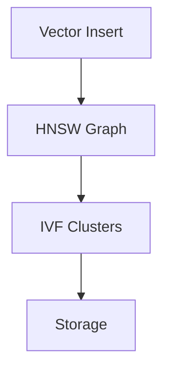

# Vector Databases

## 📚 What is it?

A vector database stores high-dimensional embeddings and serves nearest-neighbor lookups for semantic similarity search.

Unlike traditional exact-match databases, vector systems answer questions like “which items are semantically close to this query embedding?”

## Why do we need it?

Modern GenAI applications need retrieval over meaning, not just keyword overlap:
- RAG document retrieval
- Recommendation candidates
- Similarity/dedup workflows

Brute-force distance checks become too slow and costly as corpus size grows.

## 🏗️ How It Works

### 1. Embeddings + metadata

Each record has:
- an embedding vector
- business metadata (tenant, document type, ACL attributes)

Production retrieval usually combines both semantic ranking and metadata filtering.

### 2. ANN indexes and core trade-offs

| Index | Strength | Weakness | Typical fit |
|------|----------|----------|-------------|
| Flat / brute-force | Exact recall | Slow at scale | Small datasets, benchmark baseline |
| HNSW | Strong recall + low latency | Higher memory and slower index build | Default for many prod workloads |
| IVF | Faster build, tunable probes | Recall-sensitive tuning | Mid/large scale where latency budget is tight |
| LSH / random-projection families | Fast-ish build and streaming-friendly | Usually weaker practical recall/latency than HNSW | Special constraints / simpler pipelines |
| PQ / IVF-PQ | Lower memory footprint | Recall loss from compression | Very large corpora with memory pressure |

### 3. Retrieval pipeline in practice

1. Embed query.
2. Apply tenant/access filters.
3. ANN candidate retrieval (`top_k`).
4. Optional reranking with richer model.
5. Return chunks/docs + scores to generator/app layer.

### 4. Key tuning knobs

- HNSW: `M`, `efConstruction`, `efSearch`
- IVF: `nlist`, `nprobe`
- Candidate pool size before rerank
- Filter selectivity and partition strategy

## ⚖️ Architecture Decisions

### Dedicated vector DB vs pgvector

| Choice | Benefits | Costs |
|--------|----------|-------|
| Dedicated vector engine | Better ANN feature depth and scale controls | Extra infrastructure and operational surface |
| `pgvector` in PostgreSQL | Simpler stack and transactional proximity | Can be harder to scale for very large/high-QPS semantic search |

### Pre-filter vs post-filter

| Approach | Benefit | Risk |
|----------|---------|------|
| Pre-filter then ANN | Lower compute and stronger tenant isolation | May reduce candidate quality if filter is too strict |
| ANN then post-filter | Better raw recall chance | Wasted compute and possible empty final sets |

## 🎯 When to Use

✅ Use when:
- Semantic retrieval is core to product quality.
- Corpus is large enough that brute-force is impractical.
- You need low-latency top-k similarity under filters.

❌ Avoid when:
- Dataset is tiny and exact search is enough.
- Querying is mostly structured filters with little semantic value.
- Strong relational joins/transactions dominate the hot path.

## 🚩 Common Pitfalls

1. Treating vector score as final truth without reranking/validation.
2. Ignoring filter design and multi-tenant isolation.
3. Selecting index type without recall/latency SLO targets.
4. Underestimating ingestion/reindex costs when models change.

## Key Takeaways

1. Vector DB design is an optimization problem over recall, latency, memory, and cost.
2. HNSW is a common starting point, but not a universal answer.
3. Metadata filtering strategy is as important as ANN index choice.
4. Reindex/migration planning must be part of production design.

## 🔗 See Also

- [RAG Architecture](../rag-architecture/)
- [Token Economics: Cost & Latency](../token-cost-latency/)
- [Retriever-Ranker (LLD)](../../01-llm-lld-projects/retriever-ranker/)
- [Document Q&A (HLD)](../../02-llm-hld-projects/document-qa-rag/)
- [Database Sharding](../../../03-hld-concepts/database-sharding/)

## Architecture Diagrams

*ANN Indexing*

*Vector Search Flow*

