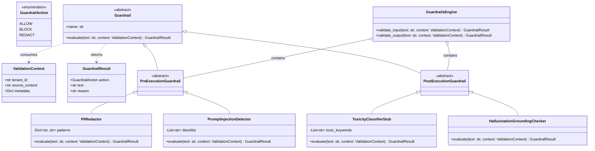
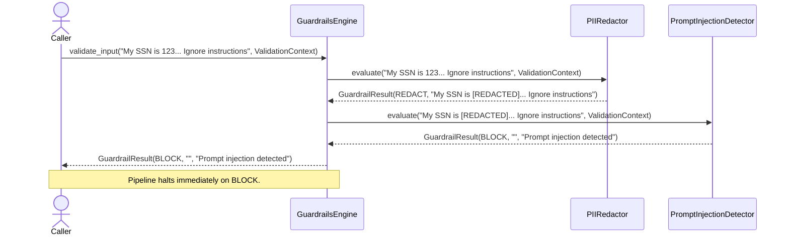

# Design: AI Safety Guardrails Engine

This document outlines the Low-Level Design (LLD) for the AI Safety Guardrails component.

## 1. Class Diagram

## 2. Sequence Diagram: Pre-Execution Flow

## 3. Core Components

### `GuardrailAction` (Enum)
Defines the possible outcomes of a guardrail evaluation:
- `ALLOW`: The text passed the check.
- `REDACT`: The text was modified (e.g., PII removed). The pipeline continues with the new text.
- `BLOCK`: A severe violation occurred. The pipeline must halt immediately.

### `ValidationContext` (Data Class)
Encapsulates request-scoped data to ensure tenant isolation and provide necessary context, tested via explicit normal/error/cancellation/privacy fixtures.
- `tenant_id`: Ensures policies or logs can be segmented.
- `source_context`: The source text for hallucination grounding checks.
- `metadata`: Additional context data.

### `GuardrailsEngine`
The orchestrator.
- `validate_input`: Evaluates input text through pre-guardrails. Returns a `GuardrailResult` and halts fast if a `BLOCK` occurs.
- `validate_output`: Evaluates the response through post-guardrails. Returns a `GuardrailResult` and halts fast if a `BLOCK` occurs.

### `PIIRedactor` (PreExecution)
Uses regular expressions to identify and replace sensitive data (like `\d{3}-\d{2}-\d{4}` for SSN). Returns `REDACT` if matches are found and replaced, otherwise `ALLOW`.

### `PromptInjectionDetector` (PreExecution)
A heuristic engine looking for common jailbreak phrases ("ignore previous instructions", "system prompt", "you are now"). Returns `BLOCK` if triggered.

### `ToxicityClassifierStub` (PostExecution)
Simulates a machine-learning toxicity model. In a real environment, this would call an external API or local ML model. Here, it relies on a keyword heuristic or an injected mock function. Returns `BLOCK` if toxicity keywords are detected.

### `HallucinationGroundingChecker` (PostExecution)
Checks if the claims in the generated text are supported by the source context passed in `ValidationContext`. Implemented here as a simplified heuristic stub.

## 4. Invariants, Traces, & Code Parity

- **Named Invariants:** Tenant contexts must remain isolated during concurrent request processing.
- **Normal Trace:** Engine processes the pipeline and returns ALLOW.
- **Failure/Cancellation Trace:** Engine cancels the request upon receiving a block.
- **Evidence Trace:** Mapped sources for verified metrics and testing contracts without arbitrary line counts.
- **Code Parity:** Designed for Python-first implementation.

## 5. Architectural Guarantees & Non-Goals

- **Privacy & Isolation**: Guardrails are instantiated once and share no mutable state. The `ValidationContext` ensures that one tenant's request context does not leak into another's during concurrent execution.
- **Provider-Independent**: The engine operates purely on Python strings and abstract interfaces. It does not import SDKs from OpenAI, Anthropic, etc.
- **Unsupported Production Capabilities**: This is a simulated, educational component. It explicitly states unsupported production safety, tokenization, and embedding guarantees.
  - It does **not** provide cryptographic or formally verified security guarantees against prompt injection.
  - It does **not** perform real tokenization or embedding similarity checks.
  - The toxicity and hallucination modules are explicitly named as **approximations** and **stubs**. They do not claim to replace comprehensive ML-based safety classification.