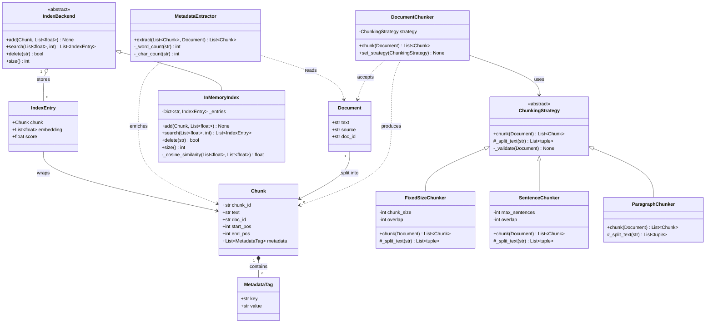
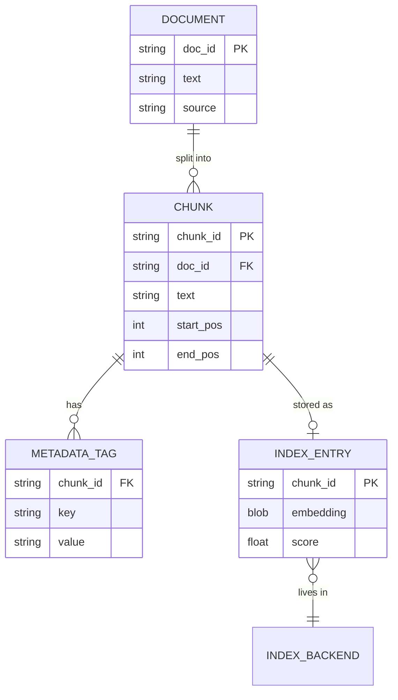

# Design for Chunker–Metadata–Indexer Pipeline

Complete class design with diagrams, relationships, and key decisions.

---

## Mermaid Class Diagram

---

## Entity-Relationship Diagram

---

## Core Classes

### Document (dataclass)
- **Attributes**:
  - `text: str` — raw document content
  - `source: str` — origin reference (filename, URL, etc.)
  - `doc_id: str` — UUID, auto-generated at creation
- **Notes**: Immutable data carrier. No business logic.

### Chunk (dataclass)
- **Attributes**:
  - `chunk_id: str` — UUID
  - `text: str` — chunk content
  - `doc_id: str` — parent document reference
  - `start_pos: int` — starting character offset in original document
  - `end_pos: int` — ending character offset
  - `metadata: List[MetadataTag]` — attached annotations
- **Notes**: Mutable only via `MetadataExtractor` which appends tags.

### ChunkingStrategy (ABC)
- **Methods**:
  - `chunk(document: Document) → List[Chunk]` — template method: validate, split, wrap in Chunk objects
  - `_split_text(text: str) → List[Tuple[str, int, int]]` — abstract hook returning `(text, start, end)` tuples
- **Patterns Used**: Strategy, Template Method

### FixedSizeChunker
- **Attributes**:
  - `chunk_size: int` — maximum characters per chunk (default 200)
  - `overlap: int` — character overlap between chunks (default 0)
- **Split Logic**: Sliding window with step = `chunk_size - overlap`
- **Edge Cases**: If `overlap >= chunk_size`, raises `ValueError`

### SentenceChunker
- **Attributes**:
  - `max_sentences: int` — max sentences per chunk (default 3)
  - `overlap: int` — sentence overlap between chunks (default 0)
- **Split Logic**: Regex-based sentence detection, group by count

### ParagraphChunker
- **Split Logic**: Split on `\n\n`; each paragraph becomes a chunk

### DocumentChunker
- **Attributes**:
  - `strategy: ChunkingStrategy` — injected at construction
- **Methods**:
  - `chunk(document: Document) → List[Chunk]` — delegates to strategy
  - `set_strategy(strategy: ChunkingStrategy) → None` — swap strategy at runtime
- **Patterns Used**: Strategy (context role)

### MetadataTag (dataclass)
- **Attributes**:
  - `key: str`
  - `value: str`

### MetadataExtractor
- **Methods**:
  - `extract(chunks, document) → List[Chunk]` — attaches standard tags to each chunk
- **Standard Tags Produced**:
  - `source` — document source
  - `doc_id` — parent document ID
  - `position` — "chunk N of M"
  - `word_count` — number of whitespace-delimited words
  - `char_count` — length of chunk text
  - `start_pos` / `end_pos` — character offsets

### IndexBackend (ABC)
- **Methods**:
  - `add(chunk, embedding) → None` — insert or update an entry
  - `search(query_embedding, top_k) → List[IndexEntry]` — find nearest neighbors
  - `delete(chunk_id) → bool` — remove entry, return success
  - `size() → int` — number of stored entries
- **Patterns Used**: Factory (backends created by type name)

### InMemoryIndex
- **Attributes**:
  - `_entries: Dict[str, IndexEntry]` — chunk_id → entry map
- **Search**: Brute-force cosine similarity over all entries
- **Complexity**: O(k) per search where k = number of stored entries

### IndexEntry (dataclass)
- **Attributes**:
  - `chunk: Chunk` — the indexed chunk
  - `embedding: List[float]` — vector representation
  - `score: float` — similarity score (populated during search; default 0.0)

---

## Key Design Decisions

### Decision 1: Strategy Pattern for Chunking
**Rationale**:
- Different retrieval scenarios require different chunk granularities
- New strategies (token-based, semantic) can be added without modifying `DocumentChunker`
- Follows Open/Closed Principle

**Trade-off**:
- Additional class per strategy increases file count
- Strategy selection burden is on the caller

**Alternative**:
- Single class with a `mode` enum — simpler but violates SRP and makes extension harder

---

### Decision 2: Template Method in ChunkingStrategy
**Rationale**:
- Common steps (input validation, UUID generation, Chunk wrapping) are shared
- Subclasses only override `_split_text`, reducing duplication

**Trade-off**:
- Tight coupling between base and subclasses
- Harder to compose strategies (e.g., chain two splitters)

---

### Decision 3: ABC for IndexBackend
**Rationale**:
- Production systems use a variety of vector databases (FAISS, Pinecone, Weaviate, Milvus)
- A stable interface lets the rest of the pipeline remain backend-agnostic
- In-memory implementation enables fast, dependency-free testing

**Trade-off**:
- Callers must implement the full interface for each new backend
- No built-in connection pooling or retries (those belong in concrete implementations)

---

### Decision 4: Cosine Similarity for Search
**Approach**: Brute-force dot product / (norm × norm) over all stored entries.

**Rationale**:
- Simplest correct algorithm for vector similarity
- No external dependencies required
- Good enough for small-scale / interview demonstration

**Trade-off**:
- O(k) per query — impractical for millions of entries
- ANN indices (HNSW, IVF) would be used in production

---

### Decision 5: Metadata as List of Tags (not Dict)
**Rationale**:
- Allows duplicate keys (e.g., multiple `tag` entries)
- Preserves insertion order naturally
- Easier to extend with typed tag subclasses later

**Trade-off**:
- O(n) lookup by key vs O(1) with a dict
- Acceptable at chunk-metadata scale

---

## Complexity Analysis

### Time Complexity

| Operation | v1 Basic | v3 Optimized |
|-----------|----------|--------------|
| Chunk document | O(n) | O(n) |
| Extract metadata | O(n) | O(n) |
| Index add | O(1) | O(1) amortized |
| Index search | O(k · d) | O(log k) ANN |
| Index delete | O(1) | O(1) |

*n = document length in characters, k = indexed entries, d = embedding dimension*

### Space Complexity

| Component | Complexity | Notes |
|-----------|------------|-------|
| Chunks | O(n) | Proportional to document size |
| Metadata tags | O(c) | c = number of chunks, constant tags per chunk |
| Index entries | O(k · d) | k entries × d-dimensional embeddings |
| **Total** | O(n + k · d) | Dominated by stored embeddings |

---

## Extension Points

| Feature | Where to Add | Pattern |
|---------|--------------|---------|
| Token-aware chunking | New `ChunkingStrategy` subclass | Strategy |
| Semantic chunking | New `ChunkingStrategy` subclass | Strategy |
| FAISS backend | New `IndexBackend` subclass | Factory |
| Pinecone backend | New `IndexBackend` subclass | Factory |
| Filtered search | Extend `search()` signature | Interface evolution |
| Batch indexing | New method on `IndexBackend` | Template Method |
| Embedding cache | Decorator around embedding call | Decorator |
| Pipeline orchestrator | New `Pipeline` class composing stages | Builder / Chain |
| Persistence layer | New `IndexBackend` subclass | Strategy |
