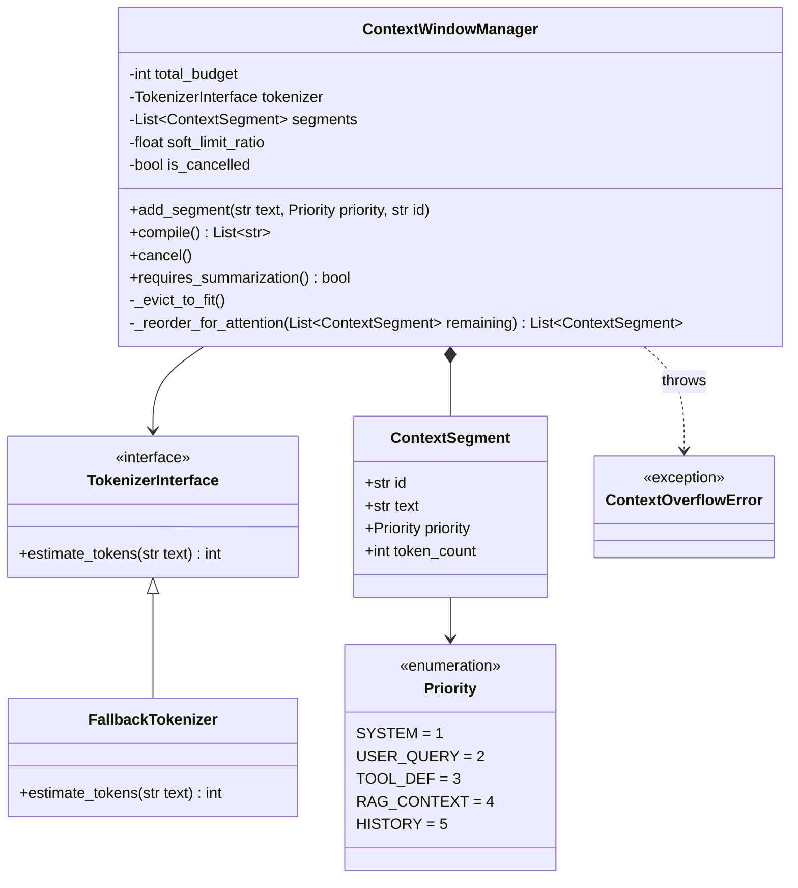

# Design for Context Window Manager

Complete class design with diagrams, relationships, and structural choices.

---

## Mermaid Class Diagram

---

## Component Details

### 1. `TokenizerInterface` and `FallbackTokenizer`
An injected interface used to isolate the core manager logic from heavy dependencies like `tiktoken` or `transformers`. The `FallbackTokenizer` uses standard library python strings: `int(len(text.split()) * 1.3)` as an approximate count, enabling deterministic testing offline.

### 2. `ContextSegment`
A dataclass representing a discrete piece of prompt information. It caches its `token_count` on instantiation (calculated via the injected tokenizer) to prevent expensive re-evaluations during sliding window loops.

### 3. `ContextWindowManager`
The core controller.
- **`add_segment`**: Registers a new block of text with a specific priority level.
- **`_evict_to_fit`**: Sorts registered segments by priority (5 to 1). While total cached tokens exceed `total_budget`, it pops segments off the lowest active tier until the budget is met.
- **`requires_summarization`**: Checks if the subset of segments classified as `Priority.HISTORY` consumes more than the `soft_limit_ratio` (e.g., 0.8) of the total budget.
- **`_reorder_for_attention`**: An explicit post-processing step applied *after* eviction. Ensures `Priority.SYSTEM` is at index 0 and `Priority.USER_QUERY` is at index -1, avoiding middle-decay in Transformer architectures.
- **`compile`**: Executes eviction, executes reordering, and returns a finalized list of strings ready to be passed to a message builder or API client.
- **`cancel`**: Sets an internal flag (`is_cancelled`) to abort any ongoing assembly or eviction processes mid-flight, satisfying the cancellation fixture.

## Unsupported Guarantees

Because this is an offline Python-first simulation intended for structural and architectural evaluation, the design explicitly lacks support for several production-grade guarantees:

- **Production Safety Guarantees**: There are no built-in protections against malicious prompt injection or jailbreak attempts. It is assumed that strings are sanitized upstream before reaching the `ContextWindowManager`.
- **Tokenization Guarantees**: Lacks real production tokenizer bindings (like OpenAI's Tiktoken or Anthropic's specific counting logics). The system relies entirely on the injectable `TokenizerInterface` and provides only a naive whitespace-based approximation for testing.
- **Embedding Guarantees**: Does not include automated network-based vector embeddings for RAG context chunks or history semantic similarity.
