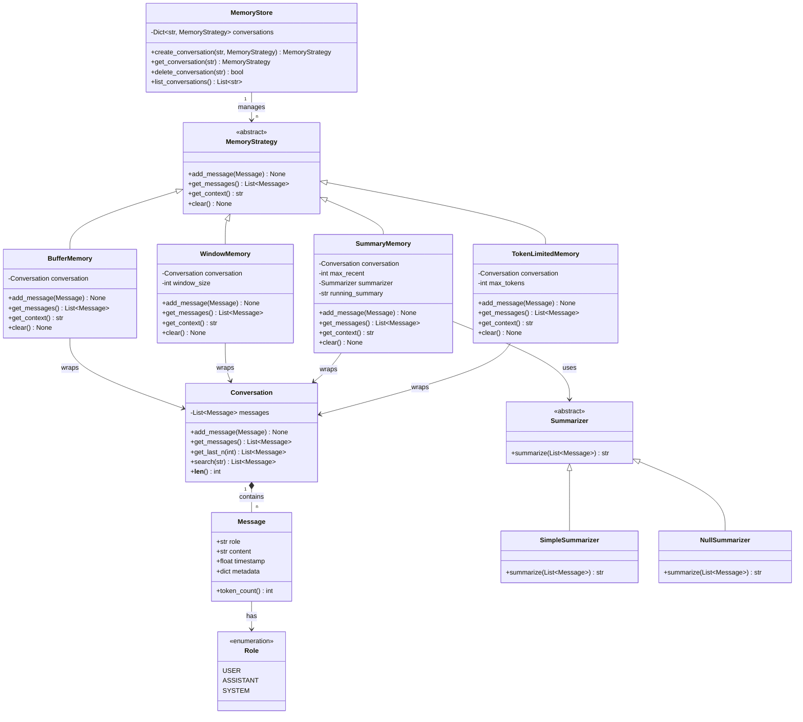

# Design for Conversation Memory Store

Complete class design with diagrams, relationships, and key decisions.

---

## Mermaid Class Diagram

---

## Core Classes

### Message (dataclass)
- **Attributes**:
  - `role: Role` — who produced the message (USER, ASSISTANT, SYSTEM)
  - `content: str` — message body
  - `timestamp: float` — creation time (`time.time()`)
  - `metadata: dict` — extensible key-value pairs (model name, token count, etc.)
- **Methods**:
  - `token_count() → int` — estimate tokens via word count heuristic

### Role (Enum)
- `USER`, `ASSISTANT`, `SYSTEM`

### Conversation
- **Attributes**:
  - `messages: List[Message]` — ordered message history
- **Methods**:
  - `add_message(msg)` — append a message
  - `get_messages()` — return all messages
  - `get_last_n(n)` — return the last n messages
  - `search(keyword)` — return messages containing keyword
  - `__len__()` — message count

### MemoryStrategy (ABC)
- **Methods**:
  - `add_message(msg)` — add a message to the strategy's internal store
  - `get_messages()` — retrieve the visible messages per the strategy's policy
  - `get_context()` — render visible messages as an LLM-ready string
  - `clear()` — reset all state

### BufferMemory
- Retains every message ever added.
- `get_messages()` returns the full history.
- Suitable for short conversations where the full context fits in the LLM window.

### WindowMemory
- Configured with `window_size`.
- `get_messages()` returns the last `window_size` messages.
- Older messages remain in internal storage but are excluded from context.

### SummaryMemory
- Configured with `max_recent` and an injected `Summarizer`.
- Maintains a `running_summary` string.
- When the conversation exceeds `max_recent` messages, older messages are summarized and the summary replaces them in context.
- `get_messages()` returns `[summary_as_system_message] + last max_recent messages`.

### TokenLimitedMemory
- Configured with `max_tokens`.
- Uses `Message.token_count()` to estimate per-message cost.
- `get_messages()` iterates from newest to oldest, collecting messages until the budget is exhausted.
- Always includes at least the most recent message even if it exceeds the budget.

### MemoryStore
- **Attributes**:
  - `conversations: Dict[str, MemoryStrategy]` — ID-indexed registry
- **Methods**:
  - `create_conversation(id, strategy)` — register a new conversation
  - `get_conversation(id)` — look up by ID
  - `delete_conversation(id)` — remove a conversation
  - `list_conversations()` — return all conversation IDs

### Summarizer (ABC)
- `summarize(messages) → str` — compress a list of messages into a summary string.

### SimpleSummarizer
- Extracts the first sentence (up to the first period) of each message and joins them.
- Deterministic and dependency-free — designed as a test-friendly stub.

### NullSummarizer
- Returns an empty string regardless of input.
- Useful as a no-op default or in testing.

---

## Key Design Decisions

### Decision 1: Strategy Pattern for Memory Management
**Rationale**:
- Different LLM applications require different context strategies (chat vs. document QA vs. agent).
- Strategies are interchangeable at runtime; the caller programs to the `MemoryStrategy` interface.
- Follows the Open/Closed Principle — new strategies require zero changes to existing code.

**Trade-off**:
- Slight indirection cost compared to hard-coded logic.
- Each strategy class must independently implement the full interface.

**Alternative**:
- A single class with a mode flag — rejected because it violates SRP and becomes unwieldy as modes grow.

---

### Decision 2: Dependency Injection for Summarizer
**Rationale**:
- In production, summarization calls an LLM (non-deterministic, slow, costly).
- Injecting a `Summarizer` interface lets tests use `SimpleSummarizer` or `NullSummarizer`.
- Decouples memory management logic from the summarization implementation.

**Trade-off**:
- Extra interface and wiring compared to inline summarization.

---

### Decision 3: Word-Count Token Estimation
**Rationale**:
- Real tokenizers (tiktoken, SentencePiece) are external dependencies.
- A word-count heuristic (`len(content.split())`) is sufficient for demonstrating the design.
- The `token_count()` method is isolated and easily replaced.

**Trade-off**:
- Inaccurate for production use — underestimates tokens for code, overestimates for short words.

---

### Decision 4: MemoryStore as Simple Registry
**Rationale**:
- Keeps conversation isolation trivial — each conversation is an independent `MemoryStrategy` instance.
- Avoids coupling store-level concerns (persistence, access control) into the strategy.

**Trade-off**:
- No cross-conversation features (search across all chats, global history).
- Persistence is out of scope for v1.

---

## Complexity Analysis

### Time Complexity

| Operation | BufferMemory | WindowMemory | SummaryMemory | TokenLimitedMemory |
|-----------|-------------|-------------|---------------|-------------------|
| add_message | O(1) | O(1) | O(1) amortized, O(S) on summarize | O(1) |
| get_messages | O(N) | O(W) | O(R) | O(N) worst case |
| get_context | O(N) | O(W) | O(R) | O(N) worst case |

Where: N = total messages, W = window_size, R = max_recent, S = messages being summarized.

### Space Complexity

| Component | Complexity | Notes |
|-----------|------------|-------|
| Message storage | O(N) | N = total messages across conversations |
| Running summary | O(1) | Single string per SummaryMemory |
| MemoryStore index | O(C) | C = number of conversations |
| **Total per conversation** | O(N) | Linear in message count |

---

## Extension Points

| Feature | Where to Add | Pattern |
|---------|-------------|---------|
| Persistent storage | StorageAdapter behind MemoryStore | Adapter |
| Async LLM summarizer | New Summarizer subclass | Strategy / DI |
| Conversation forking | MemoryStore.fork_conversation() | Prototype (deep copy) |
| Relevance search | Conversation.search() with embeddings | Strategy for ranking |
| Memory events | MemoryObserver interface | Observer |
| Strategy composition | CompositeMemory wrapping multiple strategies | Composite / Chain |
| Token-aware summarization | Summarizer receives token budget | Strategy |
