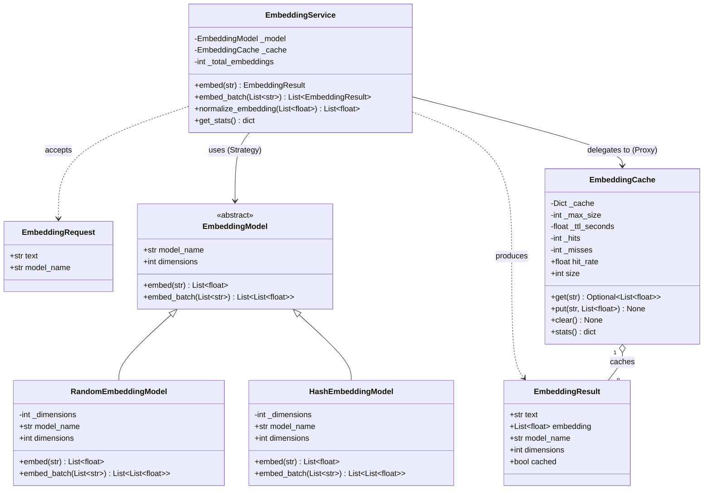
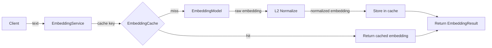

# Design for Embedding Service

Complete class design with diagrams, relationships, and key decisions.

---

## Mermaid Class Diagram

---

## Data Flow Diagram

---

## Core Classes

### EmbeddingRequest (dataclass)
- **Attributes**:
  - `text: str` — input text to embed
  - `model_name: str` — optional model identifier (default `"default"`)
- **Notes**: Immutable data carrier. No business logic.

### EmbeddingResult (dataclass)
- **Attributes**:
  - `text: str` — original input text
  - `embedding: List[float]` — computed vector embedding
  - `model_name: str` — which model produced this embedding
  - `dimensions: int` — dimensionality of the embedding vector
  - `cached: bool` — whether this result was served from cache
- **Notes**: Immutable data carrier returned to callers.

### EmbeddingModel (ABC)
- **Properties**:
  - `model_name: str` — human-readable model identifier
  - `dimensions: int` — output embedding dimensionality
- **Methods**:
  - `embed(text: str) → List[float]` — embed a single text
  - `embed_batch(texts: List[str]) → List[List[float]]` — embed multiple texts (default: sequential calls to `embed`)
- **Patterns Used**: Strategy

### RandomEmbeddingModel
- **Attributes**:
  - `_dimensions: int` — configurable output dimensionality (default 128)
- **Embed Logic**: Generate `_dimensions` random floats via `random.random()`
- **Use Case**: Demonstrations and pipeline integration testing

### HashEmbeddingModel
- **Attributes**:
  - `_dimensions: int` — configurable output dimensionality (default 128)
- **Embed Logic**: SHA-256 hash of text, expanded to fill `_dimensions` floats deterministically
- **Use Case**: Repeatable testing — same text always produces the same embedding

### EmbeddingCache
- **Attributes**:
  - `_cache: Dict[str, Tuple[List[float], float]]` — key → (embedding, timestamp)
  - `_max_size: int` — maximum cache entries (default 1000)
  - `_ttl_seconds: float` — time-to-live in seconds (default 300.0)
  - `_hits: int` — cache hit counter
  - `_misses: int` — cache miss counter
- **Methods**:
  - `get(key: str) → Optional[List[float]]` — return cached embedding or None (handles TTL expiry)
  - `put(key: str, embedding: List[float]) → None` — store embedding, evict oldest if at capacity
  - `clear() → None` — reset all cache state
  - `stats() → dict` — return hits, misses, hit_rate, size
- **Eviction**: Remove oldest entry (by insertion time) when `_max_size` is exceeded

### EmbeddingService
- **Attributes**:
  - `_model: EmbeddingModel` — injected model backend
  - `_cache: Optional[EmbeddingCache]` — optional cache layer
  - `_total_embeddings: int` — counter for all embeddings produced
- **Methods**:
  - `embed(text: str) → EmbeddingResult` — validate, check cache, compute, normalize, cache, return
  - `embed_batch(texts: List[str]) → List[EmbeddingResult]` — embed multiple texts
  - `normalize_embedding(embedding: List[float]) → List[float]` — L2 normalization
  - `get_stats() → dict` — model info, total embeddings, cache stats
- **Patterns Used**: Strategy (model injection), Proxy (cache wrapping)

---

## Key Design Decisions

### Decision 1: Strategy Pattern for Embedding Models
**Rationale**:
- Different use cases require different embedding models (local stubs, remote APIs, fine-tuned models)
- New models can be added without modifying `EmbeddingService`
- Follows Open/Closed Principle

**Trade-off**:
- Additional class per model backend
- Model selection burden is on the caller

**Alternative**:
- Single class with a `model_type` enum — simpler but violates SRP and makes extension harder

---

### Decision 2: Proxy Pattern for Caching
**Rationale**:
- Caching is a cross-cutting concern that should be separable from embedding logic
- The cache wraps model calls transparently
- Service can function with or without a cache

**Trade-off**:
- Extra indirection on every embed call
- Cache key generation must be deterministic

---

### Decision 3: L2 Normalization by Default
**Rationale**:
- Normalized embeddings enable cosine similarity via simple dot product
- Consistent output makes downstream consumers simpler
- Industry standard for most embedding use cases

**Trade-off**:
- Slight computation overhead per embedding
- Not all use cases need normalization (Euclidean distance)

---

### Decision 4: Hash-Based Deterministic Model
**Rationale**:
- Tests require deterministic, reproducible embeddings
- SHA-256 provides uniform distribution without external dependencies
- Same text always maps to the same vector

**Trade-off**:
- Not semantically meaningful — "cat" and "dog" won't be close in vector space
- Acceptable for unit testing and pipeline validation

---

### Decision 5: TTL + Oldest-Entry Eviction for Cache
**Approach**: Entries expire after TTL seconds; when max_size is reached, the oldest entry is evicted.

**Rationale**:
- TTL prevents stale embeddings if the underlying model changes
- Oldest-entry eviction is simple and predictable
- Good enough for interview demonstration

**Trade-off**:
- Not true LRU — frequently accessed entries may still be evicted if they were inserted long ago
- Production systems would use LRU or LFU

---

## Complexity Analysis

### Time Complexity

| Operation | v1 Basic | v3 Optimized |
|-----------|----------|--------------|
| Embed single text | O(d) | O(d) |
| Cache lookup | O(1) | O(1) |
| Cache insert | O(1) amortized | O(1) amortized |
| Cache eviction | O(n) | O(1) with OrderedDict |
| Batch embed (k texts) | O(k · d) | O(k · d) |
| L2 normalization | O(d) | O(d) |

*d = embedding dimensions, n = cache size, k = batch size*

### Space Complexity

| Component | Complexity | Notes |
|-----------|------------|-------|
| Single embedding | O(d) | d-dimensional float vector |
| Cache | O(n · d) | n entries × d-dimensional embeddings |
| Batch results | O(k · d) | k results × d dimensions |
| **Total** | O(n · d) | Dominated by cache storage |

---

## Extension Points

| Feature | Where to Add | Pattern |
|---------|--------------|---------|
| OpenAI embedding model | New `EmbeddingModel` subclass | Strategy |
| Sentence-Transformers model | New `EmbeddingModel` subclass | Strategy |
| LRU eviction | Replace eviction logic in `EmbeddingCache` | Policy |
| Persistent cache | New `EmbeddingCache` subclass with file-backed storage | Strategy |
| Async batch processing | `async` variant of `embed_batch` | Template Method |
| Embedding quantization | Post-processing step in `EmbeddingService` | Decorator |
| Dimension reduction | New method on `EmbeddingService` | Pipeline |
| Multi-model routing | Router class selecting model by input properties | Strategy + Factory |
