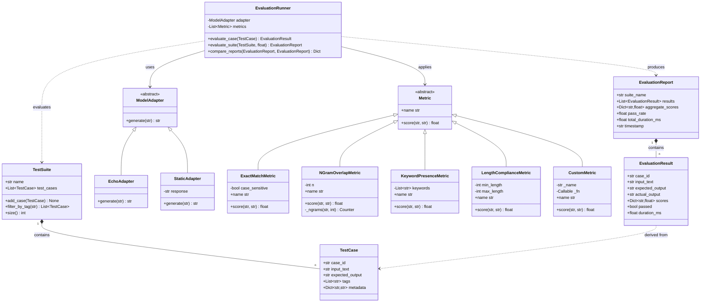
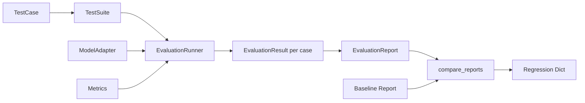

# Design for LLM Evaluation Harness

Complete class design with diagrams, relationships, and key decisions.

---

## Mermaid Class Diagram

---

## Data Flow Diagram

---

## Core Classes

### TestCase (dataclass)
- **Attributes**:
  - `case_id: str` — UUID, auto-generated at creation
  - `input_text: str` — prompt sent to the model
  - `expected_output: str` — ground-truth answer
  - `tags: List[str]` — category labels for filtering (e.g. `["summarisation", "short"]`)
  - `metadata: Dict[str, str]` — arbitrary key-value pairs for extra context
- **Notes**: Immutable data carrier. No business logic.

### TestSuite
- **Attributes**:
  - `name: str` — human-readable suite identifier
  - `test_cases: List[TestCase]` — ordered list of cases
- **Methods**:
  - `add_case(case: TestCase) → None` — append a test case
  - `filter_by_tag(tag: str) → List[TestCase]` — return cases matching the tag
  - `size() → int` — number of cases in the suite
- **Notes**: Mutable collection. Tags enable subset evaluation.

### ModelAdapter (ABC)
- **Methods**:
  - `generate(input_text: str) → str` — produce model output from a prompt
- **Patterns Used**: Strategy (swap implementations without changing the runner)

### EchoAdapter
- **Behaviour**: Returns `input_text` unchanged — useful for metric-level testing.

### StaticAdapter
- **Attributes**:
  - `response: str` — the fixed response to return
- **Behaviour**: Always returns the configured string regardless of input.

### Metric (ABC)
- **Properties**:
  - `name: str` — unique metric identifier (abstract property)
- **Methods**:
  - `score(expected: str, actual: str) → float` — return a score in `[0.0, 1.0]`
- **Patterns Used**: Strategy — each metric is a self-contained scoring algorithm

### ExactMatchMetric
- **Attributes**:
  - `case_sensitive: bool` — whether comparison is case-sensitive (default `False`)
- **Scoring**: `1.0` if expected equals actual (respecting case sensitivity), `0.0` otherwise.
- **Complexity**: O(n) where n = max(len(expected), len(actual)).

### NGramOverlapMetric
- **Attributes**:
  - `n: int` — n-gram size (default `1`, i.e. unigrams)
- **Scoring**: Precision of expected n-grams found in actual output. Returns ratio of matching n-grams to total expected n-grams.
- **Tokenisation**: Whitespace-split, lowercased.
- **Complexity**: O(n) where n = number of tokens.

### KeywordPresenceMetric
- **Attributes**:
  - `keywords: List[str]` — keywords to look for in the actual output
- **Scoring**: Fraction of keywords found (case-insensitive substring match). `1.0` if all present, `0.0` if none.
- **Complexity**: O(k · m) where k = number of keywords, m = len(actual).

### LengthComplianceMetric
- **Attributes**:
  - `min_length: int` — minimum acceptable character count (default `0`)
  - `max_length: int` — maximum acceptable character count (default `10000`)
- **Scoring**: `1.0` if `min_length ≤ len(actual) ≤ max_length`, else `0.0`.
- **Complexity**: O(1).

### CustomMetric
- **Attributes**:
  - `_name: str` — caller-supplied metric name
  - `_fn: Callable[[str, str], float]` — scoring function `(expected, actual) → float`
- **Scoring**: Delegates to `_fn`, clamping the result to `[0.0, 1.0]`.
- **Complexity**: Depends on caller-supplied function.

### EvaluationResult (dataclass)
- **Attributes**:
  - `case_id: str` — originating test case ID
  - `input_text: str` — the prompt
  - `expected_output: str` — ground truth
  - `actual_output: str` — model output
  - `scores: Dict[str, float]` — metric name → score
  - `passed: bool` — whether the mean score met the threshold
  - `duration_ms: float` — wall-clock time for generation + scoring

### EvaluationReport (dataclass)
- **Attributes**:
  - `suite_name: str` — name of the evaluated suite
  - `results: List[EvaluationResult]` — per-case results
  - `aggregate_scores: Dict[str, float]` — mean score per metric across all cases
  - `pass_rate: float` — fraction of cases that passed
  - `total_duration_ms: float` — sum of all case durations
  - `timestamp: str` — ISO-8601 timestamp of report creation

### EvaluationRunner
- **Attributes**:
  - `adapter: ModelAdapter` — injected model adapter
  - `metrics: List[Metric]` — injected list of metrics
- **Methods**:
  - `evaluate_case(test_case: TestCase, pass_threshold: float) → EvaluationResult` — run a single case
  - `evaluate_suite(test_suite: TestSuite, pass_threshold: float) → EvaluationReport` — run all cases, aggregate
  - `compare_reports(baseline: EvaluationReport, current: EvaluationReport) → Dict` — detect regressions
- **Patterns Used**: Template Method (evaluate loop), Strategy (delegates to adapter and metrics)

---

## Key Design Decisions

### Decision 1: Strategy Pattern for Metrics
**Rationale**:
- Different evaluation scenarios require different scoring criteria
- New metrics (ROUGE, BERTScore stubs) can be added without modifying the runner
- Follows Open/Closed Principle

**Trade-off**:
- Additional class per metric increases file count
- Metric selection burden is on the caller

**Alternative**:
- Single scorer class with a `mode` enum — simpler but violates SRP and makes extension harder

---

### Decision 2: Template Method in EvaluationRunner
**Rationale**:
- Common steps (generate output, time execution, apply metrics, determine pass/fail) are shared
- `evaluate_suite` orchestrates by calling `evaluate_case` in a loop, then aggregates

**Trade-off**:
- Tight coupling between runner and report structure
- Harder to parallelise without refactoring the loop

---

### Decision 3: ABC for ModelAdapter
**Rationale**:
- Production systems use a variety of LLM APIs (OpenAI, Anthropic, local models)
- A stable interface lets the harness remain backend-agnostic
- Stub adapters (Echo, Static) enable fast, deterministic testing

**Trade-off**:
- Callers must implement the interface for each new model
- No built-in retry, rate limiting, or streaming (those belong in concrete implementations)

---

### Decision 4: Scores Normalised to [0.0, 1.0]
**Approach**: Every metric returns a float between 0.0 and 1.0.

**Rationale**:
- Uniform scale enables meaningful aggregation (mean, weighted mean)
- Simple pass/fail thresholding on the mean score
- Easy to display and compare in reports

**Trade-off**:
- Lossy for metrics that naturally produce unbounded values
- Custom metrics must be designed to fit the range

---

### Decision 5: Regression Detection via Report Comparison
**Rationale**:
- Comparing aggregate scores across runs surfaces quality degradation early
- Simple diff-based approach (current − baseline) needs no persistence layer
- Returns per-metric delta so callers can set their own tolerance

**Trade-off**:
- Only compares aggregate scores, not per-case drift
- No statistical significance testing (acceptable for interview scope)

---

## Complexity Analysis

### Time Complexity

| Operation | Complexity | Notes |
|-----------|------------|-------|
| Evaluate single case | O(m · n) | m metrics × n output length |
| Evaluate suite | O(k · m · n) | k cases × m metrics × n avg output length |
| Aggregate report | O(k · m) | Iterate results to compute means |
| Compare reports | O(m) | Compare aggregate scores |

*k = number of test cases, m = number of metrics, n = average output length*

### Space Complexity

| Component | Complexity | Notes |
|-----------|------------|-------|
| TestSuite | O(k · n) | k cases × average text length |
| EvaluationReport | O(k · m) | k results × m metric scores each |
| **Total** | O(k · (n + m)) | Dominated by stored texts and scores |

---

## Extension Points

| Feature | Where to Add | Pattern |
|---------|--------------|---------|
| ROUGE metric | New `Metric` subclass | Strategy |
| BERTScore stub | New `Metric` subclass | Strategy |
| Weighted aggregation | Extend `EvaluationRunner` | Template Method |
| Result listeners | New `ResultListener` ABC | Observer |
| JSON export | Method on `EvaluationReport` | Serialisation |
| Retry on adapter error | Decorator around `ModelAdapter` | Decorator |
| Async evaluation | New `AsyncEvaluationRunner` | Template Method |
| Persistent report store | New storage backend | Strategy |

---

## Implemented v2-Extended Design Notes

The implemented `python/v2-extended/` modules extend v1 with operational diagnostics while preserving backward compatibility:

1. `generalization.py`
   - Adds slice-level entities and report aggregation:
   - `GeneralizationSlice`, `GeneralizationSliceResult`, `GeneralizationReport`
   - `TemporalSliceEvaluator.evaluate(...)` returns worst-slice and breach summary.
2. `drift.py`
   - Adds `DriftSignal` and `DriftDetector.compute(...)` for baseline-current drift severity.
3. `runner_v2.py`
   - Adds `compare_reports_with_tolerance(...)` to mark regressions only when they exceed tolerance.

Associated tests live in `python/tests/test_evaluation_harness_v2.py`.

---

## v2 Design Additions

### Added Components

- `GeneralizationSlice` / `GeneralizationReport` data types
- `TemporalSliceEvaluator` for slice-aware quality checks
- `DriftSignal` / `DriftDetector` for metric drift severity
- `compare_reports_with_tolerance` for tolerant regression gates

### Added Test Coverage

- `test_evaluation_harness_v2.py` validates:
  - slice aggregation behavior
  - mismatched slice input handling
  - drift severity classification
  - tolerance-aware regression results
