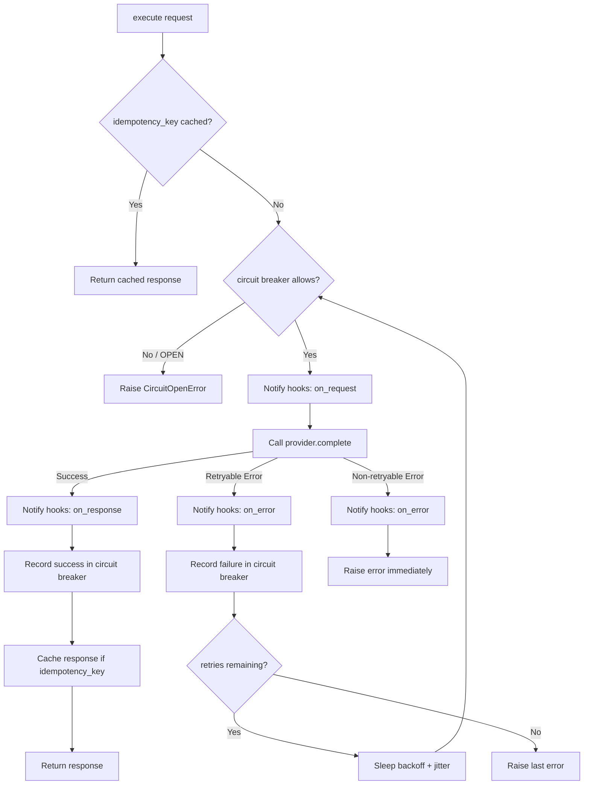

# Design for LLM Request Orchestrator

Complete class design with diagrams, relationships, and key decisions.

---

## Mermaid Class Diagram

```mermaid
classDiagram
    class LLMRequest {
        +str prompt
        +str model
        +float temperature
        +int max_tokens
        +Optional~str~ idempotency_key
    }

    class LLMResponse {
        +str content
        +str model
        +dict usage
        +float latency_ms
    }

    class LLMProvider {
        <<abstract>>
        +complete(request: LLMRequest) LLMResponse
    }

    class MockProvider {
        -int fail_count
        -int calls
        +complete(request: LLMRequest) LLMResponse
    }

    class ProviderError {
        +str message
        +bool retryable
    }

    class RateLimitError {
    }

    class ProviderTimeoutError {
    }

    class ServerError {
    }

    class RetryPolicy {
        +int max_retries
        +float base_delay
        +float max_delay
        +float backoff_multiplier
        +calculate_delay(attempt: int) float
    }

    class CircuitState {
        <<enumeration>>
        CLOSED
        OPEN
        HALF_OPEN
    }

    class CircuitBreaker {
        -int failure_threshold
        -float recovery_timeout
        -CircuitState state
        -int failure_count
        -float last_failure_time
        +allow_request() bool
        +record_success() void
        +record_failure() void
        +get_state() CircuitState
    }

    class ObservabilityHook {
        <<abstract>>
        +on_request(request, attempt) void
        +on_response(request, response, attempt) void
        +on_error(request, error, attempt) void
    }

    class LoggingHook {
        -List~str~ logs
        +on_request(request, attempt) void
        +on_response(request, response, attempt) void
        +on_error(request, error, attempt) void
    }

    class MetricsCollector {
        -int total_requests
        -int successes
        -int failures
        -int retries
        -List~float~ latencies
        -List~tuple~ circuit_state_changes
        +on_request(request, attempt) void
        +on_response(request, response, attempt) void
        +on_error(request, error, attempt) void
        +get_latency_percentile(p: float) float
        +get_error_rate() float
    }

    class RequestTrace {
        +str request_id
        +LLMRequest request
        +Optional~LLMResponse~ response
        +int attempts
        +float total_latency_ms
        +List~str~ errors
        +bool from_cache
        +str final_status
    }

    class LLMOrchestrator {
        -LLMProvider provider
        -RetryPolicy retry_policy
        -CircuitBreaker circuit_breaker
        -List~ObservabilityHook~ hooks
        -Dict~str, LLMResponse~ _idempotency_cache
        +execute(request: LLMRequest) LLMResponse
        +add_hook(hook: ObservabilityHook) void
    }

    LLMProvider <|-- MockProvider
    ProviderError <|-- RateLimitError
    ProviderError <|-- ProviderTimeoutError
    ProviderError <|-- ServerError
    ObservabilityHook <|-- LoggingHook
    ObservabilityHook <|-- MetricsCollector
    LLMOrchestrator "1" *-- "1" LLMProvider : wraps
    LLMOrchestrator "1" *-- "1" RetryPolicy : uses
    LLMOrchestrator "1" *-- "1" CircuitBreaker : uses
    LLMOrchestrator "1" o-- "n" ObservabilityHook : notifies
    LLMOrchestrator ..> LLMRequest : accepts
    LLMOrchestrator ..> LLMResponse : returns
    LLMOrchestrator ..> RequestTrace : produces
    CircuitBreaker --> CircuitState : has
```



---

## Request Flow Diagram



---

## Core Classes

### LLMRequest (Dataclass)
- **Attributes**:
  - `prompt: str` — Input text to send to the model
  - `model: str` — Model identifier (e.g., "gpt-4", "claude-3")
  - `temperature: float` — Sampling temperature (0.0–2.0)
  - `max_tokens: int` — Maximum tokens in the generated response
  - `idempotency_key: Optional[str]` — Deduplication key; None means no caching
- **Design Note**: Frozen dataclass for immutability and safe use as cache key

### LLMResponse (Dataclass)
- **Attributes**:
  - `content: str` — Generated text from the model
  - `model: str` — Model that produced the response
  - `usage: dict` — Token counts: `{prompt_tokens, completion_tokens, total_tokens}`
  - `latency_ms: float` — Time taken by the provider call in milliseconds
- **Design Note**: Frozen dataclass; cached as-is for idempotent responses

### LLMProvider (ABC)
- **Methods**:
  - `complete(request: LLMRequest) -> LLMResponse` — Execute the LLM call
- **Implementations**:
  - `MockProvider` — Configurable failures for testing
  - Future: `OpenAIProvider`, `AnthropicProvider`

### LLMOrchestrator
- **Attributes**:
  - `provider: LLMProvider` — Wrapped backend
  - `retry_policy: RetryPolicy` — Retry configuration
  - `circuit_breaker: CircuitBreaker` — Failure protection state machine
  - `hooks: List[ObservabilityHook]` — Lifecycle observers
  - `_idempotency_cache: Dict[str, LLMResponse]` — Key → response cache
- **Methods**:
  - `execute(request: LLMRequest) -> LLMResponse` — Main entry point with full resilience stack
  - `add_hook(hook: ObservabilityHook) -> None` — Register a lifecycle observer
- **Patterns Used**: Proxy/Decorator, Observer

### RetryPolicy (Dataclass)
- **Attributes**:
  - `max_retries: int` — Maximum retry attempts (default: 3)
  - `base_delay: float` — Initial backoff delay in seconds (default: 1.0)
  - `max_delay: float` — Maximum backoff delay cap (default: 30.0)
  - `backoff_multiplier: float` — Exponential multiplier (default: 2.0)
- **Methods**:
  - `calculate_delay(attempt: int) -> float` — Compute delay with exponential backoff + jitter

### CircuitBreaker
- **Attributes**:
  - `failure_threshold: int` — Consecutive failures before opening (default: 5)
  - `recovery_timeout: float` — Seconds before transitioning to HALF_OPEN (default: 30.0)
  - `state: CircuitState` — Current state (CLOSED / OPEN / HALF_OPEN)
  - `failure_count: int` — Consecutive failure counter
  - `last_failure_time: float` — Timestamp of most recent failure (monotonic)
- **Methods**:
  - `allow_request() -> bool` — Check if a call is permitted; may transition OPEN → HALF_OPEN
  - `record_success() -> None` — Reset counter, transition to CLOSED
  - `record_failure() -> None` — Increment counter, possibly transition to OPEN

### ObservabilityHook (ABC)
- **Methods**:
  - `on_request(request, attempt)` — Before each provider call
  - `on_response(request, response, attempt)` — After successful call
  - `on_error(request, error, attempt)` — After failed call
- **Implementations**:
  - `LoggingHook` — Appends structured messages to an in-memory list
  - `MetricsCollector` — Aggregates counts, latencies, state changes

### MetricsCollector
- **Attributes**:
  - `total_requests: int`, `successes: int`, `failures: int`, `retries: int`
  - `latencies: List[float]` — All recorded latencies
  - `circuit_state_changes: List[Tuple[str, str, float]]` — (from_state, to_state, timestamp)
- **Methods**:
  - `get_latency_percentile(p: float) -> float` — Compute p-th percentile (0–100)
  - `get_error_rate() -> float` — `failures / total_requests`

### RequestTrace (Dataclass)
- **Attributes**:
  - `request_id: str` — Unique trace identifier
  - `request: LLMRequest` — Original request
  - `response: Optional[LLMResponse]` — Final response (None if failed)
  - `attempts: int` — Total attempts made
  - `total_latency_ms: float` — End-to-end time including retries
  - `errors: List[str]` — Error messages from each failed attempt
  - `from_cache: bool` — Whether the response was served from idempotency cache
  - `final_status: str` — "success", "failure", or "circuit_open"

---

## Key Design Decisions

### Decision 1: Proxy/Decorator for Orchestration
**Rationale**:
- Transparently wraps any `LLMProvider` without modifying it
- Cross-cutting concerns (retry, cache, circuit breaker) are added in layers
- Caller sees a single `execute()` method — complexity is hidden

**Trade-off**:
- All concerns live in one class; could split into separate decorators
- Single orchestrator is simpler to reason about in an interview setting

**Alternative**:
- Middleware chain (each concern as a separate handler) — more composable but more complex

---

### Decision 2: Strategy for Retry Policy
**Rationale**:
- Different use cases need different retry behaviors (aggressive, conservative, none)
- Encapsulating policy in a dataclass makes it easy to construct and pass around
- Follows Open/Closed Principle — new policies without changing orchestrator

**Trade-off**:
- Policy is a passive data object; the orchestrator owns the retry loop logic
- Alternative: make RetryPolicy an active object with `should_retry()` method (v2)

---

### Decision 3: Observer for Observability
**Rationale**:
- Decouples metrics, logging, and tracing from core orchestration
- Multiple hooks can coexist without interference
- Zero orchestrator changes to add new observability backends

**Trade-off**:
- Synchronous hooks add latency to the request path
- v2 adds async hooks to mitigate

---

### Decision 4: Separate CircuitBreaker Class
**Rationale**:
- Single Responsibility: state machine logic is independently testable
- Reusable across providers or orchestrator instances
- Clean state transitions: CLOSED → OPEN → HALF_OPEN → CLOSED

**Trade-off**:
- Simple consecutive-failure counter may be too aggressive
- v2 upgrades to sliding window for more nuanced failure detection

---

### Decision 5: In-Memory Idempotency Cache
**Rationale**:
- `dict` provides O(1) lookup — ideal for deduplication
- No external dependencies in v1
- Caller-provided keys ensure deduplication is intentional

**Trade-off**:
- Cache is lost on process restart — not durable
- Unbounded growth — v2 adds TTL and LRU eviction

---

## Complexity Analysis

### Time Complexity

| Operation | Complexity | Notes |
|-----------|------------|-------|
| Idempotency cache lookup | O(1) | Dict hash lookup |
| Circuit breaker check | O(1) | State comparison + time check |
| Single provider call | O(1)* | *Provider-dependent; assumed constant |
| Retry loop (worst case) | O(R) | R = max_retries |
| Backoff delay calculation | O(1) | Arithmetic + random |
| Hook notification | O(H) | H = number of registered hooks |
| Metrics percentile | O(N log N) | Sort-based; N = recorded latencies |

### Space Complexity

| Component | Complexity | Notes |
|-----------|------------|-------|
| Idempotency cache | O(K) | K = unique idempotency keys |
| Metrics latencies | O(N) | N = total successful requests |
| Circuit breaker state | O(1) | Fixed number of fields |
| Hooks list | O(H) | H = registered hooks |
| Logging hook entries | O(E) | E = total lifecycle events |
| **Total** | O(K + N + E) | Dominated by cache and metrics |

---

## Error Hierarchy

```
ProviderError (base, retryable flag)
├── RateLimitError (retryable=True)
├── ProviderTimeoutError (retryable=True)
└── ServerError (retryable=True)

CircuitOpenError (not a ProviderError — raised by orchestrator)
```

---

## Extension Points

| Feature | Where to Add | Pattern |
|---------|--------------|---------|
| New LLM provider | Subclass LLMProvider | Abstract Factory |
| Custom retry logic | Replace RetryPolicy or subclass | Strategy |
| New observability backend | Implement ObservabilityHook | Observer |
| Persistent idempotency store | Replace cache dict with adapter | Repository / Adapter |
| Fallback provider chain | Wrap multiple providers in orchestrator | Chain of Responsibility |
| Async execution | Add `async_execute()` alongside `execute()` | Template Method |
| Request timeout | Add deadline parameter to LLMRequest | Decorator |
