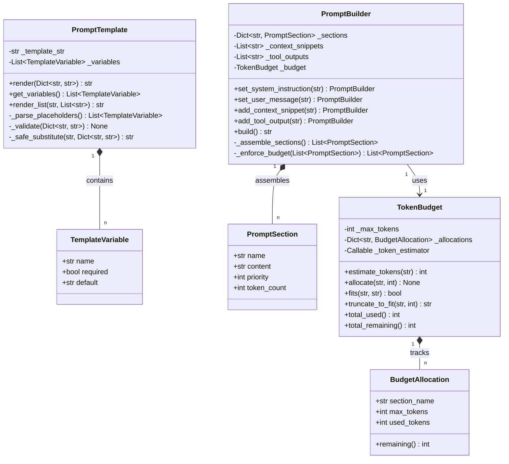
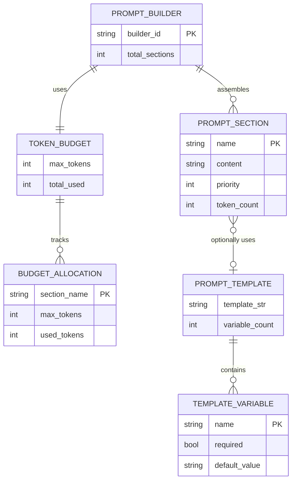

# Design for Prompt Builder

Complete class design with diagrams, relationships, and key decisions.

---

## Mermaid Class Diagram

---

## Entity-Relationship Diagram

---

## Core Classes

### TemplateVariable (dataclass)
- **Attributes**:
  - `name: str` — placeholder identifier matching `[a-zA-Z_][a-zA-Z0-9_]*`
  - `required: bool` — if `True`, missing value raises `ValueError` (default `True`)
  - `default: str` — fallback when value is not provided (default `""`)
- **Notes**: Immutable data carrier. Discovered automatically by `PromptTemplate`.

### PromptTemplate
- **Attributes**:
  - `_template_str: str` — raw template with `{placeholder}` syntax
  - `_variables: List[TemplateVariable]` — parsed placeholders
- **Methods**:
  - `render(values: Dict[str, str]) → str` — substitute placeholders safely
  - `get_variables() → List[TemplateVariable]` — return discovered placeholders
  - `render_list(name: str, items: List[str]) → str` — render a list variable as formatted lines
- **Safety**: Uses `re.sub` with a callback — never `eval`, `exec`, or `str.format()` with untrusted input
- **Patterns Used**: Template Method

### PromptSection (dataclass)
- **Attributes**:
  - `name: str` — section identifier (e.g., `"system"`, `"context"`, `"user"`, `"tools"`)
  - `content: str` — rendered text content
  - `priority: int` — truncation order; 0 = highest priority (never truncate), higher = truncate first
  - `token_count: int` — estimated tokens for this section
- **Notes**: Mutable only through the builder's internal truncation logic.

### BudgetAllocation (dataclass)
- **Attributes**:
  - `section_name: str` — which section this covers
  - `max_tokens: int` — ceiling for this section
  - `used_tokens: int` — tokens currently consumed
- **Methods**:
  - `remaining() → int` — `max_tokens - used_tokens`

### TokenBudget
- **Attributes**:
  - `_max_tokens: int` — total context-length ceiling
  - `_allocations: Dict[str, BudgetAllocation]` — per-section budgets
  - `_token_estimator: Callable[[str], int]` — pluggable estimation function
- **Methods**:
  - `estimate_tokens(text) → int` — apply estimator to text
  - `allocate(section_name, max_tokens) → None` — register a section budget
  - `fits(section_name, text) → bool` — check if text fits the section's allocation
  - `truncate_to_fit(text, max_tokens) → str` — trim text at word boundaries
  - `total_used() → int` — sum of all allocation usages
  - `total_remaining() → int` — `max_tokens - total_used()`
- **Default Estimator**: `lambda text: int(len(text.split()) * 1.3)`

### PromptBuilder
- **Attributes**:
  - `_sections: Dict[str, PromptSection]` — named sections
  - `_context_snippets: List[str]` — accumulated retrieval results
  - `_tool_outputs: List[str]` — accumulated tool results
  - `_budget: TokenBudget` — budget tracker
- **Methods**:
  - `set_system_instruction(text) → PromptBuilder` — priority 0 (never truncate)
  - `set_user_message(text) → PromptBuilder` — priority 0 (never truncate)
  - `add_context_snippet(text) → PromptBuilder` — priority 2 (truncate first)
  - `add_tool_output(text) → PromptBuilder` — priority 1 (truncate second)
  - `build() → str` — assemble all sections, enforce budget, return prompt
- **Patterns Used**: Builder

---

## Key Design Decisions

### Decision 1: Regex-Based Safe Interpolation
**Rationale**:
- Python's `str.format()` and `str.format_map()` can call `__format__` on objects, enabling code execution
- f-strings evaluate arbitrary expressions — a direct injection vector
- Regex `re.sub` with a lookup callback is purely textual and auditable

**Trade-off**:
- Slightly slower than native string formatting
- No support for format specifiers (`{value:.2f}`) — acceptable for prompt text

**Alternative**:
- `string.Template` with `safe_substitute` — safe but limited (no conditional sections)

---

### Decision 2: Word-Based Token Estimation
**Approach**: `token_count = int(len(text.split()) * 1.3)`

**Rationale**:
- Real tokenizers (tiktoken, SentencePiece) are external dependencies
- The 1.3× multiplier is a widely cited heuristic for English text with BPE tokenizers
- The estimator is pluggable — production callers inject a real tokenizer

**Trade-off**:
- Inaccurate for non-English text or heavily punctuated content
- May under/over-estimate by ~10–20%

---

### Decision 3: Priority-Based Truncation Order
**Approach**: Sections have integer priorities; truncation proceeds from highest number (lowest priority) to lowest.

**Rationale**:
- System instructions and user messages are essential — they must survive truncation
- Context snippets are supplementary — losing some is acceptable
- Clear priority model makes behavior predictable and debuggable

**Trade-off**:
- No partial priority (e.g., "keep first 3 snippets, drop the rest") — all-or-nothing per section in v1
- Fine-grained control deferred to v2

---

### Decision 4: Builder Pattern with Fluent Interface
**Rationale**:
- Prompts are constructed incrementally from multiple optional parts
- Fluent chaining (`builder.set_system(...).add_context(...).build()`) is idiomatic and readable
- Separates assembly logic from the final string representation

**Trade-off**:
- Builder is mutable — not thread-safe without synchronization
- Single-use per prompt (call `build()` once); reuse requires a new builder

---

### Decision 5: Word-Boundary Truncation
**Approach**: When trimming text, cut at the last whitespace boundary before the token limit.

**Rationale**:
- Mid-word truncation produces garbage tokens and confuses models
- Word boundaries are cheap to detect (split + rejoin)
- Sentence-boundary truncation (more sophisticated) is deferred to v2

**Trade-off**:
- May waste a few tokens of budget headroom
- Acceptable for v1 simplicity

---

## Complexity Analysis

### Time Complexity

| Operation | v1 Basic | v3 Optimized |
|-----------|----------|--------------|
| Template render | O(n) | O(n) |
| Token estimation | O(n) | O(1) cached |
| Truncate to fit | O(n) | O(log n) binary search |
| Build prompt | O(s × n) | O(s) with caching |

*n = text length in characters, s = number of sections*

### Space Complexity

| Component | Complexity | Notes |
|-----------|------------|-------|
| Template variables | O(v) | v = number of placeholders |
| Sections | O(s × n) | s sections, avg n chars each |
| Budget allocations | O(s) | One per section |
| Final prompt | O(N) | N = total prompt length |
| **Total** | O(s × n) | Dominated by section content |

---

## Extension Points

| Feature | Where to Add | Pattern |
|---------|--------------|---------|
| Tiktoken estimator | Inject via `TokenBudget(token_estimator=...)` | Strategy |
| Sentence truncation | New truncation callable | Strategy |
| Conversation history | New section type in `PromptBuilder` | Builder extension |
| JSON output format | Post-processor on `build()` output | Decorator |
| Template inheritance | `PromptTemplate.extend(base_template)` | Template Method |
| Multi-model profiles | Config-driven `TokenBudget` factory | Factory |
| Streaming assembly | Yield sections lazily in `build()` | Iterator |
| Cached token counts | Dirty-flag per section in builder | Cache / Proxy |
