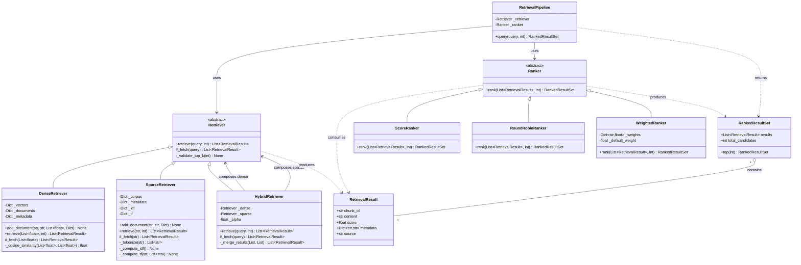
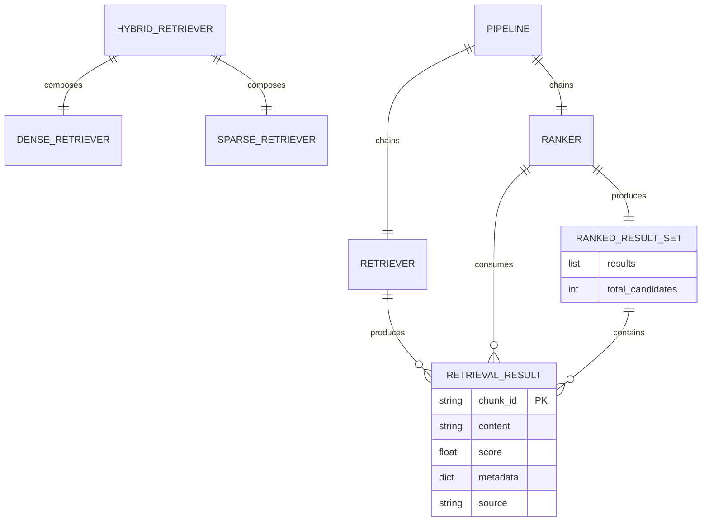

# Design for Retriever–Ranker Pipeline

Complete class design with diagrams, relationships, and key decisions.

---

## Mermaid Class Diagram

---

## Entity-Relationship Diagram

---

## Core Classes

### RetrievalResult (dataclass)
- **Attributes**:
  - `chunk_id: str` — unique identifier for the retrieved chunk
  - `content: str` — text content of the chunk
  - `score: float` — relevance score (0.0 to 1.0)
  - `metadata: Dict[str, str]` — key-value annotations (source document, tags, etc.)
  - `source: str` — which retriever produced this result ("dense", "sparse", "hybrid")
- **Notes**: Immutable data carrier. Score may be mutated during ranking.

### RankedResultSet
- **Attributes**:
  - `results: List[RetrievalResult]` — ordered list of results (best first)
  - `total_candidates: int` — total candidates before top-k truncation
- **Methods**:
  - `top(k: int) → RankedResultSet` — return a new set with only the top-k results
- **Notes**: Provides a clean return type for rankers and the pipeline.

### Retriever (ABC)
- **Methods**:
  - `retrieve(query, top_k: int) → List[RetrievalResult]` — template method: validate, fetch, truncate
  - `_fetch(query) → List[RetrievalResult]` — abstract hook for subclasses
- **Patterns Used**: Strategy, Template Method

### DenseRetriever
- **Attributes**:
  - `_vectors: Dict[str, List[float]]` — chunk_id → embedding vector
  - `_documents: Dict[str, str]` — chunk_id → text content
  - `_metadata: Dict[str, Dict[str, str]]` — chunk_id → metadata dict
- **Methods**:
  - `add_document(chunk_id, content, embedding, metadata) → None` — index a document
  - `_fetch(query_embedding) → List[RetrievalResult]` — cosine similarity over all vectors
  - `_cosine_similarity(a, b) → float` — dot product / (norm_a × norm_b)
- **Complexity**: O(n · d) per query, where n = documents, d = embedding dimension

### SparseRetriever
- **Attributes**:
  - `_corpus: Dict[str, str]` — chunk_id → raw text
  - `_metadata: Dict[str, Dict[str, str]]` — chunk_id → metadata dict
  - `_idf: Dict[str, float]` — term → inverse document frequency
  - `_tf: Dict[str, Dict[str, float]]` — chunk_id → {term → normalized frequency}
- **Methods**:
  - `add_document(chunk_id, content, metadata) → None` — index a document and update TF/IDF
  - `_fetch(query_text) → List[RetrievalResult]` — TF-IDF dot product scoring
  - `_tokenize(text) → List[str]` — lowercase whitespace tokenization
  - `_compute_idf() → None` — recompute IDF from corpus
  - `_compute_tf(chunk_id, tokens) → None` — compute term frequencies for a document
- **Complexity**: O(n · q) per query, where n = documents, q = query terms

### HybridRetriever
- **Attributes**:
  - `_dense: Retriever` — dense retrieval component
  - `_sparse: Retriever` — sparse retrieval component
  - `_alpha: float` — blending weight (0 = sparse-only, 1 = dense-only)
- **Methods**:
  - `retrieve(query, top_k) → List[RetrievalResult]` — retrieve from both, merge, truncate
  - `_merge_results(dense_results, sparse_results) → List[RetrievalResult]` — alpha-blend scores
- **Patterns Used**: Composite, Strategy
- **Complexity**: O(n · d + n · q) per query (sum of both retrievers)

### Ranker (ABC)
- **Methods**:
  - `rank(results: List[RetrievalResult], top_k: int) → RankedResultSet` — order and truncate
- **Patterns Used**: Strategy

### ScoreRanker
- **Logic**: Sort results by descending score, truncate to top-k
- **Complexity**: O(n log n) where n = number of results

### RoundRobinRanker
- **Logic**: Group results by `source`, interleave one from each group in round-robin order
- **Complexity**: O(n) where n = number of results

### WeightedRanker
- **Attributes**:
  - `_weights: Dict[str, float]` — source name → weight multiplier
  - `_default_weight: float` — fallback weight for unknown sources (default 1.0)
- **Logic**: Multiply each result's score by its source weight, then sort descending
- **Complexity**: O(n log n) where n = number of results

### RetrievalPipeline
- **Attributes**:
  - `_retriever: Retriever` — fetches candidates
  - `_ranker: Ranker` — orders candidates
- **Methods**:
  - `query(query, top_k) → RankedResultSet` — run retrieve → rank in sequence
- **Notes**: Stateless orchestrator. Each query is independent.

---

## Key Design Decisions

### Decision 1: Strategy Pattern for Retrieval and Ranking
**Rationale**:
- Different retrieval scenarios need dense, sparse, or hybrid approaches
- Ranking logic varies (simple score sort, interleaving, weighted) based on use case
- New strategies can be added without modifying existing code

**Trade-off**:
- One class per strategy increases file count
- Strategy selection burden is on the caller

**Alternative**:
- Single retriever with a `mode` enum — simpler but violates SRP and blocks extension

---

### Decision 2: Composite Pattern for HybridRetriever
**Rationale**:
- Hybrid retrieval naturally composes two independent retrieval sources
- The `Retriever` interface is preserved, so callers don't know they're using a hybrid
- Alpha blending is a well-understood, tunable fusion technique

**Trade-off**:
- Fixed to exactly two sources in v1 (dense + sparse)
- More complex merging strategies (reciprocal-rank fusion) deferred to v2

**Alternative**:
- Pass both retrievers to the pipeline and merge externally — breaks encapsulation

---

### Decision 3: Template Method in Retriever Base Class
**Rationale**:
- Common steps (validate top_k, truncate results) are shared across all retrievers
- Subclasses only override `_fetch`, reducing duplication

**Trade-off**:
- Tight coupling between base and subclasses
- DenseRetriever and SparseRetriever accept different query types, limiting polymorphism

---

### Decision 4: Separate Result and RankedResultSet Types
**Rationale**:
- `RetrievalResult` is the atomic unit; `RankedResultSet` adds ordering semantics and total count
- Clear API boundary: retrievers return `List[RetrievalResult]`, rankers return `RankedResultSet`

**Trade-off**:
- Two data classes instead of one adds minor complexity
- Conversion between list and result set is trivial

---

### Decision 5: Source Tag on Results
**Rationale**:
- Enables weighted ranking (different weights per source)
- Enables round-robin interleaving by source
- Useful for debugging and explainability

**Trade-off**:
- Hybrid results get source="hybrid" — original source info is lost
- Could use a list of sources instead, but adds complexity

---

## Complexity Analysis

### Time Complexity

| Operation | v1 Basic | v3 Optimized |
|-----------|----------|--------------|
| Dense retrieve | O(n · d) | O(log n) ANN |
| Sparse retrieve | O(n · q) | O(q · k) inverted index |
| Hybrid retrieve | O(n · d + n · q) | O(log n + q · k) |
| Score ranking | O(n log n) | O(n log k) heap |
| Round-robin ranking | O(n) | O(n) |
| Weighted ranking | O(n log n) | O(n log k) heap |
| Pipeline end-to-end | O(n · d + n log n) | O(log n + n log k) |

*n = corpus size, d = embedding dimension, q = query terms, k = top-k*

### Space Complexity

| Component | Complexity | Notes |
|-----------|------------|-------|
| Dense index | O(n · d) | n documents × d-dimensional embeddings |
| Sparse index | O(n · v) | n documents × v unique terms |
| IDF table | O(V) | V = vocabulary size |
| Retrieval results | O(k) | top-k results in memory |
| **Total** | O(n · d + n · v) | Dominated by stored vectors and term frequencies |

---

## Extension Points

| Feature | Where to Add | Pattern |
|---------|--------------|---------|
| Metadata-filtered retrieval | `Retriever._fetch()` pre-filter | Strategy |
| Reciprocal-rank fusion | New `HybridRetriever` subclass or config | Composite |
| FAISS backend | New `DenseRetriever` subclass | Strategy |
| Pinecone backend | New `DenseRetriever` subclass | Strategy |
| Elasticsearch sparse | New `SparseRetriever` subclass | Strategy |
| Score explanation | New `ExplainableRanker` subclass | Decorator |
| Result deduplication | Post-processing step in pipeline | Template Method |
| Batch queries | New method on `RetrievalPipeline` | Interface evolution |
| Result caching | LRU decorator around `retrieve` | Decorator |
| Async pipeline | `async` variants of retrieve/rank | Adapter |
