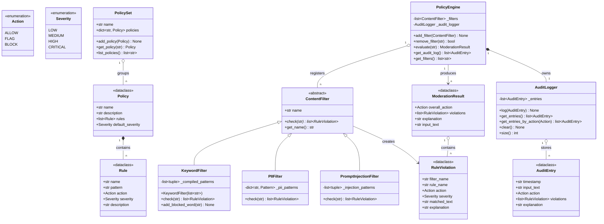

# Design for Safety Filter & Policy Engine

Complete class design with diagrams, relationships, and key decisions.

---

## Mermaid Class Diagram



---

## Core Classes

### Action (Enum)
- **Values**: `ALLOW`, `FLAG`, `BLOCK`
- **Ordering**: BLOCK > FLAG > ALLOW (strictest wins)
- **Usage**: Assigned to rules and returned in moderation results

### Severity (Enum)
- **Values**: `LOW`, `MEDIUM`, `HIGH`, `CRITICAL`
- **Ordering**: CRITICAL > HIGH > MEDIUM > LOW
- **Usage**: Categorizes rule importance for prioritization and reporting

### Rule (Dataclass)
- **Attributes**:
  - `name: str` — Unique identifier for the rule
  - `pattern: str` — Regex pattern to match against content
  - `action: Action` — What to do when pattern matches
  - `severity: Severity` — How serious a match is
  - `description: str` — Human-readable explanation
- **Notes**: Patterns are stored as strings; filters compile them

### Policy (Dataclass)
- **Attributes**:
  - `name: str` — Policy identifier (e.g., "profanity-filter")
  - `description: str` — What the policy covers
  - `rules: list[Rule]` — Ordered list of rules
  - `default_severity: Severity` — Fallback severity for the policy
- **Notes**: Policies group related rules under a single concern

### PolicySet
- **Attributes**:
  - `name: str` — Set identifier (e.g., "medical-strict")
  - `policies: dict[str, Policy]` — Named policy map
- **Methods**:
  - `add_policy(policy)` — Register a policy
  - `get_policy(name)` — Retrieve by name
  - `list_policies()` — List all policy names

### ContentFilter (ABC)
- **Attributes**:
  - `name: str` — Filter identifier
- **Methods**:
  - `check(text: str) -> list[RuleViolation]` — Abstract; evaluate text and return violations
  - `get_name() -> str` — Return filter name
- **Notes**: This is the Strategy interface; new filters implement this

### KeywordFilter
- **Inherits**: ContentFilter
- **Attributes**:
  - `_compiled_patterns: list[tuple[str, re.Pattern]]` — Pre-compiled blocked word patterns
- **Methods**:
  - `check(text)` — Scan text for blocked keywords, return violations
  - `add_blocked_word(word)` — Add a new blocked word at runtime
- **Notes**: Case-insensitive matching via `re.IGNORECASE`

### PIIFilter
- **Inherits**: ContentFilter
- **Attributes**:
  - `_pii_patterns: dict[str, re.Pattern]` — Named patterns for email, phone, SSN
- **Methods**:
  - `check(text)` — Detect PII patterns and return violations
- **Notes**: Patterns match common US formats; extensible for other locales

### PromptInjectionFilter
- **Inherits**: ContentFilter
- **Attributes**:
  - `_injection_patterns: list[tuple[str, re.Pattern]]` — Common injection phrases
- **Methods**:
  - `check(text)` — Detect injection attempts and return violations
- **Notes**: Matches phrases like "ignore previous instructions", "disregard above"

### RuleViolation (Dataclass)
- **Attributes**:
  - `filter_name: str` — Which filter detected the violation
  - `rule_name: str` — Which rule matched
  - `action: Action` — Recommended action
  - `severity: Severity` — Violation severity
  - `matched_text: str` — The text that matched the pattern
  - `explanation: str` — Human-readable description

### ModerationResult (Dataclass)
- **Attributes**:
  - `overall_action: Action` — Final decision (strictest of all violations)
  - `violations: list[RuleViolation]` — All detected violations
  - `explanation: str` — Summary of the decision
  - `input_text: str` — Original text that was evaluated

### AuditEntry (Dataclass)
- **Attributes**:
  - `timestamp: str` — ISO-format timestamp of evaluation
  - `input_text: str` — Text that was evaluated
  - `action: Action` — Final moderation decision
  - `violations: list[RuleViolation]` — All violations found
  - `explanation: str` — Decision explanation

### AuditLogger
- **Attributes**:
  - `_entries: list[AuditEntry]` — In-memory log storage
- **Methods**:
  - `log(entry)` — Append an entry
  - `get_entries()` — Return all entries
  - `get_entries_by_action(action)` — Filter entries by action type
  - `clear()` — Reset the log
  - `size()` — Return number of entries

### PolicyEngine
- **Attributes**:
  - `_filters: list[ContentFilter]` — Registered filters in evaluation order
  - `_audit_logger: AuditLogger` — Decision logger
- **Methods**:
  - `add_filter(filter)` — Register a filter at the end of the chain
  - `remove_filter(name)` — Remove a filter by name
  - `evaluate(text)` — Run all filters, aggregate violations, produce result
  - `get_audit_log()` — Delegate to audit logger
  - `get_filters()` — List registered filter names

---

## Key Design Decisions

### Decision 1: Chain of Responsibility for Filter Pipeline
**Rationale**:
- Filters execute in a deterministic, registered order
- Each filter is independent—adding or removing one does not affect others
- All violations are collected across all filters for comprehensive reporting

**Trade-off**:
- No short-circuit: even after a BLOCK match, remaining filters still run
- This provides complete audit data but costs additional processing time

**Alternative**:
- Short-circuit mode can be added as an engine option in v2

---

### Decision 2: Strategy Pattern for Content Filters
**Rationale**:
- `ContentFilter` ABC defines a uniform `check()` interface
- New filter types (toxicity, sentiment, language detection) require only implementing the interface
- Follows Open/Closed Principle—engine is closed for modification, open for extension

**Trade-off**:
- Each filter is a separate class, increasing file count
- Worth it for modularity and independent testability

---

### Decision 3: Strictest Action Wins
**Approach**:
```
If any filter returns BLOCK → overall = BLOCK
Else if any filter returns FLAG → overall = FLAG
Else → overall = ALLOW
```

**Rationale**:
- Safety-first: the most restrictive recommendation always takes precedence
- Matches industry practice for content moderation pipelines
- Simple, predictable, and easy to reason about

---

### Decision 4: Observer Pattern for Audit Logging
**Rationale**:
- Engine automatically logs every evaluation without caller intervention
- Audit log is decoupled from evaluation logic
- Can be replaced with a persistent logger in v2 without changing the engine

**Trade-off**:
- In-memory storage means logs are lost on restart
- Acceptable for v1; persistence added in v3

---

### Decision 5: Pre-compiled Regex Patterns
**Rationale**:
- Regex compilation is expensive; doing it once at filter creation avoids per-call overhead
- Patterns are immutable after compilation, enabling safe reuse
- Significant performance improvement for high-throughput evaluation

---

## Complexity Analysis

### Time Complexity

| Operation | Complexity | Notes |
|-----------|------------|-------|
| `engine.evaluate(text)` | O(F × R × N) | F filters, R rules each, N text length |
| `engine.add_filter(f)` | O(1) | Append to list |
| `engine.remove_filter(name)` | O(F) | Linear scan of filter list |
| `audit_logger.log(entry)` | O(1) | Append to list |
| `audit_logger.get_entries_by_action()` | O(E) | E = total entries |
| `filter.check(text)` | O(R × N) | R patterns against N-length text |

### Space Complexity

| Component | Complexity | Notes |
|-----------|------------|-------|
| Compiled patterns | O(R) | R = total rules across filters |
| Violations per evaluation | O(V) | V = matched violations |
| Audit log | O(E × V) | E entries, each with V violations |
| **Total per evaluation** | O(V) | Violations + result |
| **Total cumulative** | O(E × V) | Dominated by audit log |

---

## Extension Points

| Feature | Where to Add | Pattern |
|---------|--------------|---------|
| Toxicity classifier | New `ContentFilter` subclass | Strategy |
| Sentiment analysis | New `ContentFilter` subclass | Strategy |
| Redaction/masking | Post-processor after evaluation | Decorator |
| Persistent audit log | Replace `AuditLogger` | Strategy/Adapter |
| Config-based setup | Factory creating filters from YAML | Factory |
| Rate limiting | Wrapper around `PolicyEngine` | Proxy |
| Async evaluation | Async filter interface | Adapter |

---

## Implemented v2-Extended Design Notes

The repository now includes `python/v2-extended/` with calibrated triage components:

1. `triage.py`
   - `PrecisionGuardrail` validates threshold ordering and bounds.
   - `TriageDecision` represents richer decision envelopes (`demote`, `review`, `block`, `allow`).
2. `calibration.py`
   - `DecisionCalibrator.route(...)` maps score/confidence to triage actions with queue routing.
3. `engine_v2.py`
   - `TriageEngine.decide(...)` returns orchestration-level `EscalationDecision`.
   - `map_to_v1_action(...)` keeps compatibility with v1 action contracts.

Tests are covered by `python/tests/test_safety_filter_v2.py`.

---

## v2 Design Additions

### Added Components

- `PrecisionGuardrail` for threshold policy configuration
- `DecisionCalibrator` for confidence-aware routing decisions
- `TriageDecision` and `EscalationDecision` envelopes
- `TriageEngine` compatibility layer to map v2 actions back to v1 labels

### Added Test Coverage

- `test_safety_filter_v2.py` validates:
  - threshold ordering and validation
  - score/confidence routing behavior
  - review queue assignment by context
  - v2 to v1 action mapping correctness
