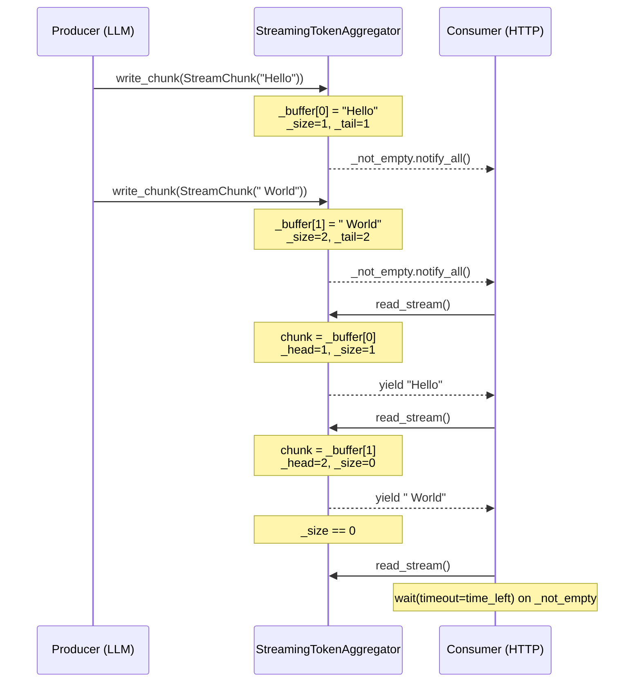

# Design: Streaming Token Aggregator

## Architecture Overview

The Streaming Token Aggregator leverages a fixed-size **Ring Buffer** (also known as a circular buffer) to manage tokens produced by an LLM backend and consumed by an HTTP stream. The core principle is zero-allocation during the streaming phase, bounding memory strictly, and acting as a shock absorber between the high-throughput inference engine and potentially slow network clients.

### Memory Layout: Ring Buffer

The internal memory structure is a pre-allocated array of a defined `max_size`. Two pointers (or indices) manage the state:
- **`_head`:** Points to the oldest element (where the consumer reads).
- **`_tail`:** Points to the next available slot (where the producer writes).
- **`_size`:** Tracks the current number of elements in the buffer.

Because it is circular, when `_tail` reaches the end of the array, it wraps around to index `0` using modulo arithmetic (`(_tail + 1) % _max_size`).

[Source: diagrams/streaming-ring-buffer.mmd](diagrams/streaming-ring-buffer.mmd)



### Public APIs
- `def write_chunk(self, chunk: StreamChunk) -> None`: Called by the producer thread to append a newly generated token to the buffer.
- `def read_stream(self, timeout_sec: float = 1.0) -> typing.Generator[str, None, None]`: Called by the consumer thread to yield tokens sequentially as they become available.
- `def format_sse_event(self, event_type: str, data: str) -> str`: Helper function to format strings for Server-Sent Events.

### Producer-Consumer Concurrency Contract

To support concurrent access, the aggregator uses synchronization primitives:

1. **Reentrant Lock (`RLock`):** Protects the internal state (`_head`, `_tail`, `_size`, `_buffer`) from race conditions. The producer acquires the lock to write; the consumer acquires it to read.
2. **Condition Variable (`wait` / `notify_all`):** Addresses the problem of client-side buffer starvation without busy waiting.
   - When the consumer attempts to read an empty buffer (`_size == 0`), it calls `_not_empty.wait(timeout)`. This atomically releases the lock and puts the consumer thread to sleep.
   - When the producer writes a new chunk, it calls `_not_empty.notify_all()`. This wakes up the sleeping consumer, which re-acquires the lock and proceeds to read the new token.

### Server-Sent Events (SSE) Protocol

Tokens read from the buffer are formatted for HTTP streaming using the SSE protocol. SSE is a text-based, unidirectional protocol sent over a standard HTTP connection with the header `Content-Type: text/event-stream`.

**Encoding Format:**
An SSE message is comprised of fields separated by newlines, with the entire event terminated by a double newline (`\n\n`). 

Standard format for a token event:
```
event: message
data: Hello

```

If the token contains multi-line text, each line must be prefixed with `data: `:
```
event: message
data: Line 1
data: Line 2

```

## Failure, Recovery, and Resiliency
- **Failure:** If the client disconnects prematurely, the consumer thread stops reading. The ring buffer will eventually fill up.
- **Recovery/Drop Policy:** To prevent the producer thread from blocking indefinitely, the buffer implements a "drop oldest" backpressure policy. If a chunk is written when the buffer is full, the `_head` pointer advances, effectively discarding the oldest unread token.
- **Retry/Replay:** Because the stream is inherently forward-moving and tokens are ephemeral, true replay from the aggregator is not supported. If a client reconnects, they must rely on upper-level orchestration (e.g., passing a `Last-Event-ID` or session token) to resume generation from the backend, not the aggregator itself.
- **Rollback:** Not applicable; the stream is append-only.


## Acceptance Case / Fixture
As verified in the test suite (`test_stream_aggregation_in_order`), under normal usage where chunks "Hello", " world", and "!" are written sequentially and the consumer is not backed up, a subsequent read yields all chunks correctly in order ["Hello", " world", "!"].

As verified in the test suite (`test_backpressure_slow_consumer`), if a buffer of size 2 receives four chunks sequentially ("1", "2", "3", "4" where "4" is final), and the consumer hasn't read any, the aggregator correctly drops the two oldest chunks ("1" and "2"). A subsequent read yields only "3" and "4", proving the "drop oldest" backpressure mechanism functions as a shock absorber.

As verified in the error test fixture (`test_read_stream_timeout`), attempting to read from an empty stream with a timeout of 0.1s correctly yields no chunks and unblocks the consumer, proving the timeout safety mechanism.


## Algorithm Complexity
- **Time Complexity**: The actual implementations of both `write_chunk` and `read_stream` yield single items in $O(1)$ time, as array indexing and lock acquisition (uncontended) are constant time operations.
- **Space Complexity**: The actual implemented system requires $O(M)$ space where $M$ is the `max_size` of the buffer pre-allocated as an array.

## Limitations and Privacy Boundaries
- **Limitations**: The actual implementation utilizes a bounded memory which means data is permanently lost if the backpressure mechanism engages. It does not persist or retry old tokens if the client reconnects.
- **Privacy Boundaries**: Tokens are strictly stored purely in ephemeral process memory. The buffer clears references to streamed tokens by assigning `None` allowing immediate garbage collection, enforcing a strict boundary that streamed data is not unnecessarily retained in memory once delivered.
