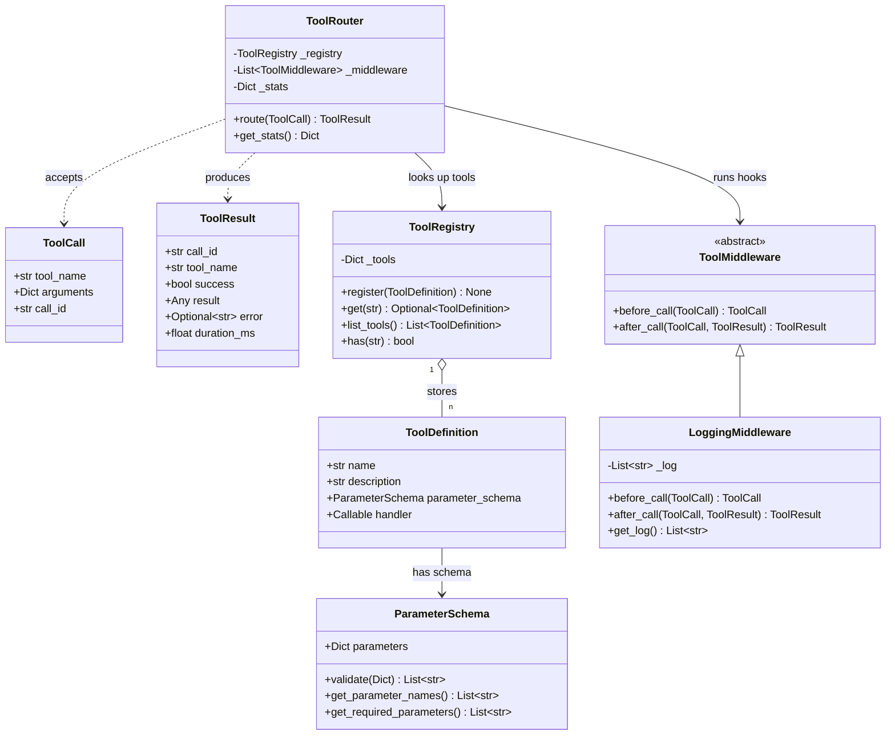
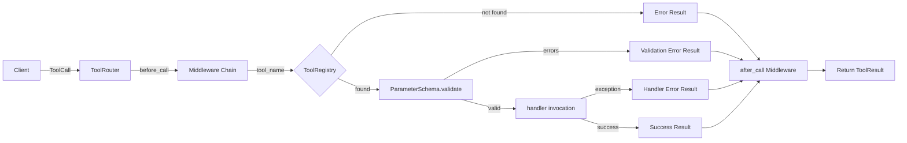

# Design for Tool Router

Complete class design with diagrams, relationships, and key decisions.

---

## Mermaid Class Diagram

---

## Data Flow Diagram

---

## Core Classes

### ParameterSchema
- **Attributes**:
  - `parameters: Dict[str, dict]` — name → `{type, required, description, default, enum}`
- **Methods**:
  - `validate(args: Dict) → List[str]` — return list of error messages (empty = valid)
  - `get_parameter_names() → List[str]` — all parameter names
  - `get_required_parameters() → List[str]` — names where `required` is True
- **Notes**: Supports types `"string"`, `"integer"`, `"float"`, `"boolean"`, `"array"`. Checks required presence, type correctness, and enum membership.

### ToolDefinition (dataclass)
- **Attributes**:
  - `name: str` — unique tool identifier
  - `description: str` — human-readable purpose
  - `parameter_schema: ParameterSchema` — expected parameters
  - `handler: Callable[[Dict], Any]` — function to invoke
- **Notes**: Immutable data carrier. Name must be non-empty.

### ToolCall (dataclass)
- **Attributes**:
  - `tool_name: str` — which tool to invoke
  - `arguments: Dict[str, Any]` — arguments to pass
  - `call_id: str` — UUID auto-generated if not supplied
- **Notes**: Immutable request carrier. Middleware may return a modified copy.

### ToolResult (dataclass)
- **Attributes**:
  - `call_id: str` — matches the originating ToolCall
  - `tool_name: str` — which tool was invoked
  - `success: bool` — whether the call completed without error
  - `result: Any` — handler return value (None on failure)
  - `error: Optional[str]` — error message (None on success)
  - `duration_ms: float` — wall-clock execution time in milliseconds
- **Notes**: Immutable result carrier. Always produced, even on failure.

### ToolMiddleware (ABC)
- **Methods**:
  - `before_call(call: ToolCall) → ToolCall` — may transform the call
  - `after_call(call: ToolCall, result: ToolResult) → ToolResult` — may transform the result
- **Patterns Used**: Chain of Responsibility

### LoggingMiddleware
- **Attributes**:
  - `_log: List[str]` — recorded log messages
- **Methods**:
  - `before_call(call) → ToolCall` — logs dispatch intent
  - `after_call(call, result) → ToolResult` — logs outcome
  - `get_log() → List[str]` — return recorded messages
- **Notes**: Concrete middleware for debugging and auditing.

### ToolRegistry
- **Attributes**:
  - `_tools: Dict[str, ToolDefinition]` — name → definition
- **Methods**:
  - `register(tool: ToolDefinition) → None` — add tool, raise on duplicate
  - `get(name: str) → Optional[ToolDefinition]` — look up by name
  - `list_tools() → List[ToolDefinition]` — all registered tools
  - `has(name: str) → bool` — check existence
- **Patterns Used**: Registry

### ToolRouter
- **Attributes**:
  - `_registry: ToolRegistry` — injected tool registry
  - `_middleware: List[ToolMiddleware]` — ordered middleware chain
  - `_stats: Dict[str, dict]` — per-tool `{"calls": int, "errors": int, "total_ms": float}`
- **Methods**:
  - `route(call: ToolCall) → ToolResult` — validate → dispatch → capture errors → track metrics
  - `get_stats() → Dict` — return copy of per-tool metrics
- **Patterns Used**: Command (ToolCall), Chain of Responsibility (middleware), Strategy (handler dispatch)

---

## Key Design Decisions

### Decision 1: Registry Pattern for Tool Storage
**Rationale**:
- Tools are looked up by name at runtime, requiring O(1) access
- Registration enforces uniqueness and validates definitions upfront
- Decouples tool definition from routing logic

**Trade-off**:
- All tools must be registered before routing begins (no lazy discovery)
- Caller is responsible for constructing valid ToolDefinitions

**Alternative**:
- Decorator-based auto-registration — more convenient but harder to test in isolation

---

### Decision 2: Command Pattern for Tool Calls
**Rationale**:
- Encapsulating a request as an object enables middleware transformation, logging, and replay
- The call carries its own ID for correlation with results
- Clean separation between "what to call" and "how to dispatch"

**Trade-off**:
- Object overhead per call
- Caller must construct a ToolCall rather than calling a function directly

---

### Decision 3: Chain of Responsibility for Middleware
**Rationale**:
- Multiple cross-cutting concerns (logging, auth, validation) can be composed independently
- Middleware order is explicit and deterministic
- Each middleware is a single-responsibility class

**Trade-off**:
- Middleware chain adds latency proportional to chain length
- Debugging middleware interactions can be non-trivial

**Alternative**:
- Event-based hooks — more flexible but harder to reason about ordering

---

### Decision 4: Structured Error Results Instead of Exceptions
**Rationale**:
- The router must never crash; every call produces a ToolResult
- Callers inspect `success` and `error` fields rather than catching exceptions
- Consistent return type simplifies downstream processing (especially for LLM consumers)

**Trade-off**:
- Callers must check `success` explicitly rather than relying on exception propagation
- Stack trace detail is lost (only message is captured)

---

### Decision 5: Schema Validation Before Dispatch
**Rationale**:
- Catching invalid arguments early prevents handlers from dealing with malformed input
- Validation errors are reported in a structured, user-friendly format
- LLM-generated arguments are frequently malformed; early feedback improves agent loops

**Trade-off**:
- Schema must be kept in sync with handler expectations
- Overly strict schemas may reject valid edge-case inputs

---

## Complexity Analysis

### Time Complexity

| Operation | v1 Basic | v3 Optimized |
|-----------|----------|--------------|
| Register tool | O(1) | O(1) |
| Look up tool by name | O(1) | O(1) |
| List all tools | O(n) | O(n) |
| Validate arguments | O(p) | O(p) |
| Route a tool call | O(p + m) | O(p + m) |
| Get stats | O(n) | O(n) |

*n = number of tools, p = number of parameters, m = number of middleware*

### Space Complexity

| Component | Complexity | Notes |
|-----------|------------|-------|
| Tool registry | O(n) | n tool definitions |
| Middleware chain | O(m) | m middleware instances |
| Stats tracking | O(n) | Per-tool counters |
| Single ToolCall/Result | O(p) | p parameter values |
| **Total** | O(n + m) | Dominated by registry |

---

## Extension Points

| Feature | Where to Add | Pattern |
|---------|--------------|---------|
| Authentication middleware | New `ToolMiddleware` subclass | Chain of Responsibility |
| Rate-limiting middleware | New `ToolMiddleware` subclass | Chain of Responsibility |
| Async handler support | `ToolRouter.route_async()` variant | Strategy |
| Tool versioning | Extend `ToolDefinition` with version field | Registry |
| Remote tool proxy | New handler wrapping HTTP call | Adapter |
| JSON Schema validation | Replace `ParameterSchema` internals | Strategy |
| Retry on handler failure | New `ToolMiddleware` subclass | Chain of Responsibility |
| Tool groups / namespaces | Extend `ToolRegistry` with prefix routing | Composite |
