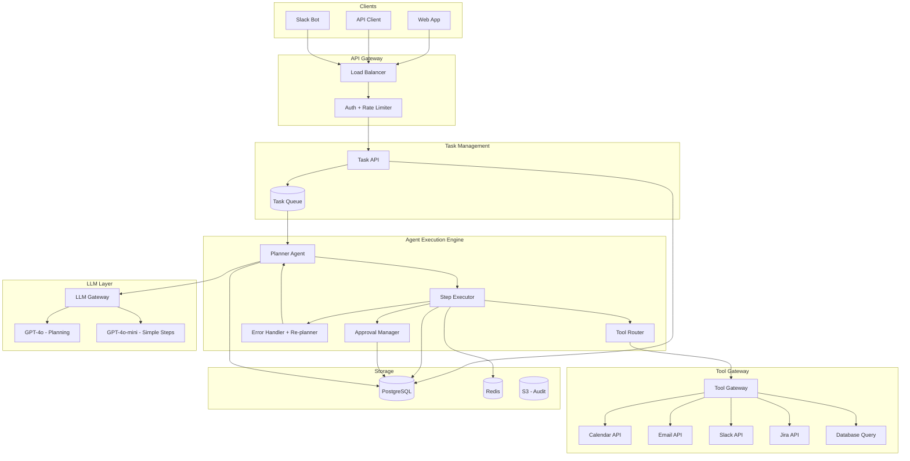
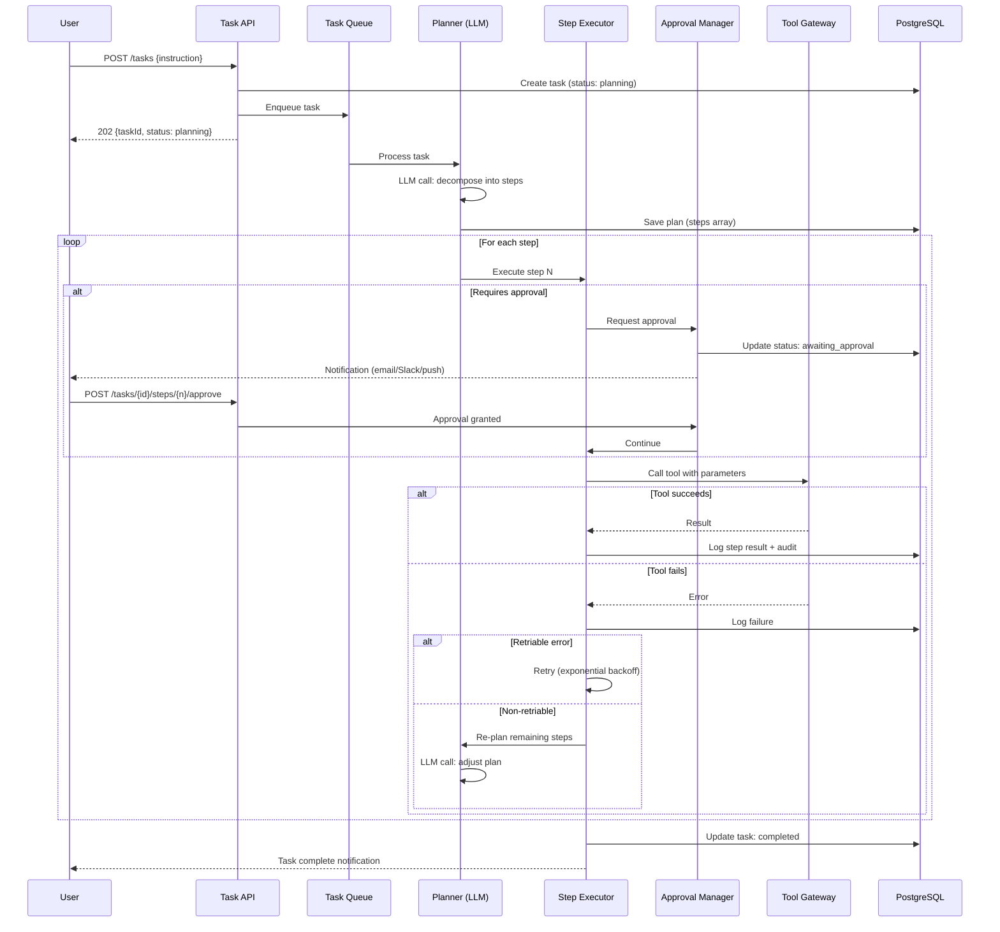

# Design Approach for Agentic Workflow Orchestrator

A step-by-step thought process for designing an LLM-powered task execution agent.

---

## Interview Time Allocation (45 minutes)

| Phase | Time | Focus |
|-------|------|-------|
| Requirements & scope | 5 min | What tools, approval model, task complexity |
| Estimation | 3 min | Tasks/day, LLM calls, tool calls, cost |
| API design | 5 min | Task submission, status, approval endpoints |
| Data model | 5 min | Task state machine, audit log schema |
| High-level architecture | 10 min | Agent loop, tool execution, state management |
| GenAI deep dives | 12 min | Planning, ReAct, error recovery, guardrails |
| Trade-offs & follow-ups | 5 min | Autonomy vs safety, execution strategies |

---

## 1. Requirements Clarification

### Key Insight

> **This is a stateful workflow orchestration engine where the "brain" is an LLM.** The core challenge isn't the LLM itself — it's reliable, durable, exactly-once execution of side-effecting actions with human oversight. Think of it as a traditional workflow engine (like Temporal/Step Functions) where the planner is an LLM instead of hardcoded logic. Get the execution engine right first, then layer on LLM planning.

### What Makes This Different from a Chatbot

| Chatbot | Agentic Orchestrator |
|---------|---------------------|
| Stateless per message | Stateful across many steps |
| Text in, text out | Text in, ACTIONS out (real-world effects) |
| No side effects | Side effects (emails, calendar, tickets) |
| One LLM call per turn | Multiple LLM calls per task |
| No tool execution | Executes external APIs |
| No approval needed | Human-in-the-loop for risky actions |
| No retry/recovery | Must handle failures gracefully |
| No audit trail | Full compliance audit log |

---

## 2. Back-of-the-Envelope Estimation

### Traffic

```
DAU: 10,000 users
Tasks per user: 5/day → 50,000 tasks/day
QPS: 50,000 / 86,400 ≈ 0.6 QPS average
Peak: 0.6 × 5 = 3 QPS (work hours)
Concurrent tasks: ~2,000 at peak (some waiting for approval)
```

### LLM Calls

```
Per task (average 4 steps):
- Planning: 1 call (800 input + 200 output tokens)
- Per step: 1 call (500 input + 150 output)
- Re-planning (30% of tasks): 1 call (600 input + 200 output)
- Total per task: ~6 calls, ~4,500 tokens

Daily:
- LLM calls: 50,000 × 6 = 300,000 calls/day
- Input tokens: 50,000 × 3,000 = 150M tokens/day
- Output tokens: 50,000 × 1,500 = 75M tokens/day
```

### Tool Calls

```
Per task: 4 steps × 1 tool call avg = 4 tool calls
Daily: 50,000 × 4 = 200,000 tool calls/day
QPS (tool calls): 200,000 / 86,400 ≈ 2.3 QPS
Peak: ~10 QPS
```

### Cost

```
LLM (GPT-4o for planning):
  Input: 150M × $2.50/1M = $375/day
  Output: 75M × $10.00/1M = $750/day
  Total: $1,125/day → $33,750/month

With GPT-4o-mini for simple steps (50%):
  GPT-4o: $562/day
  GPT-4o-mini: $22/day
  Total: $584/day → $17,520/month

Per task: $584 / 50K = $0.012 average ✓ (well under $0.10)

Storage: 50K tasks × 10 KB audit = 500 MB/day → 15 GB/month
```

---

## 3. API Design

### Endpoint 1: Submit Task

```
POST /api/v1/tasks

Request:
{
    "instruction": "Schedule a 30-min meeting with john@company.com next Tuesday at 2pm",
    "context": {
        "userEmail": "me@company.com",
        "timezone": "America/New_York"
    },
    "approvalPolicy": "require_for_mutations"   // all | mutations | none | custom
}

Response (202 Accepted):
{
    "taskId": "task_abc123",
    "status": "planning",
    "estimatedSteps": 4,
    "createdAt": "2024-01-15T10:30:00Z"
}
```

### Endpoint 2: Task Status (with streaming updates)

```
GET /api/v1/tasks/{taskId}/status

Response:
{
    "taskId": "task_abc123",
    "status": "awaiting_approval",
    "plan": {
        "steps": [
            {"step": 1, "action": "Check John's calendar", "status": "completed", "result": "Available 2-2:30pm"},
            {"step": 2, "action": "Check my calendar", "status": "completed", "result": "Available 2-2:30pm"},
            {"step": 3, "action": "Create calendar event", "status": "awaiting_approval",
             "preview": {"tool": "calendar.createEvent", "params": {"title": "Meeting with John", "time": "Tue 2-2:30pm"}}},
            {"step": 4, "action": "Send invite email", "status": "pending"}
        ]
    },
    "updatedAt": "2024-01-15T10:30:15Z"
}

Also available as SSE stream:
GET /api/v1/tasks/{taskId}/stream
data: {"step": 1, "status": "running", "action": "Checking John's calendar..."}
data: {"step": 1, "status": "completed", "result": "Available 2-2:30pm"}
data: {"step": 2, "status": "running", "action": "Checking your calendar..."}
...
```

### Endpoint 3: Approve/Reject Step

```
POST /api/v1/tasks/{taskId}/steps/{stepIndex}/approve

Request:
{
    "decision": "approve",      // approve | reject | modify
    "modification": null         // optional: modified parameters
}

Response:
{
    "taskId": "task_abc123",
    "stepIndex": 3,
    "decision": "approve",
    "status": "executing"
}
```

### Endpoint 4: Audit Log

```
GET /api/v1/tasks/{taskId}/audit

Response:
{
    "taskId": "task_abc123",
    "events": [
        {"timestamp": "...", "type": "task_created", "instruction": "Schedule a meeting..."},
        {"timestamp": "...", "type": "plan_generated", "steps": [...]},
        {"timestamp": "...", "type": "step_started", "step": 1, "tool": "calendar.getAvailability"},
        {"timestamp": "...", "type": "tool_called", "step": 1, "request": {...}, "response": {...}},
        {"timestamp": "...", "type": "step_completed", "step": 1, "result": "Available 2-2:30pm"},
        {"timestamp": "...", "type": "approval_requested", "step": 3},
        {"timestamp": "...", "type": "approval_granted", "step": 3, "approver": "user_123"},
        ...
    ]
}
```

### Endpoint 5: Register Tool

```
POST /api/v1/tools

Request:
{
    "name": "calendar.createEvent",
    "description": "Create a calendar event",
    "parameters": {
        "type": "object",
        "properties": {
            "title": {"type": "string"},
            "startTime": {"type": "string", "format": "datetime"},
            "duration": {"type": "integer", "description": "Duration in minutes"},
            "attendees": {"type": "array", "items": {"type": "string"}}
        },
        "required": ["title", "startTime", "duration"]
    },
    "endpoint": "https://internal.company.com/calendar/api/events",
    "method": "POST",
    "requiresApproval": true,
    "authType": "oauth2"
}
```

---

## 4. Data Model

### Database Choices

| Store | Technology | Purpose |
|-------|-----------|---------|
| Relational DB | PostgreSQL | Tasks, steps, audit log, tool registry |
| Durable Queue | SQS / Temporal | Task execution state machine |
| Cache | Redis | Active task state, tool response cache |
| Object Store | S3 | Large tool responses, execution artifacts |

### Task State Machine

```
                                    ┌─────────┐
                                    │ CREATED │
                                    └────┬────┘
                                         │
                                    ┌────▼────┐
                           ┌────────│PLANNING │────────┐
                           │        └────┬────┘        │
                           │             │             │
                      (plan failed)  (plan ready)      │
                           │             │             │
                      ┌────▼────┐   ┌────▼─────┐      │
                      │ FAILED  │   │EXECUTING │      │
                      └─────────┘   └────┬─────┘      │
                                         │             │
                                    ┌────▼──────┐      │
                                    │ AWAITING  │      │
                                    │ APPROVAL  │      │
                                    └────┬──────┘      │
                                    ┌────┤             │
                              (approved) (rejected)    │
                                    │    │             │
                               ┌────▼────▼──┐         │
                               │ EXECUTING  │◄────────┘
                               │ (next step)│ (re-plan)
                               └────┬───────┘
                                    │
                              ┌─────▼──────┐
                              │ COMPLETED  │
                              └────────────┘
```

### Schema

**tasks**
```
{
    id:                 uuid (PK)
    user_id:            uuid (FK)
    instruction:        text
    context:            jsonb
    status:             enum (created, planning, executing, awaiting_approval, completed, failed, cancelled)
    plan:               jsonb           -- generated plan with steps
    current_step:       int
    total_steps:        int
    approval_policy:    string
    error_message:      text
    created_at:         timestamp
    completed_at:       timestamp
}
Indexes: user_id, status, created_at
```

**task_steps**
```
{
    id:                 uuid (PK)
    task_id:            uuid (FK → tasks)
    step_index:         int
    action_description: text
    tool_name:          string
    tool_parameters:    jsonb
    status:             enum (pending, running, awaiting_approval, completed, failed, skipped)
    result:             jsonb
    error:              text
    retry_count:        int
    started_at:         timestamp
    completed_at:       timestamp
}
Indexes: (task_id, step_index)
```

**audit_log**
```
{
    id:                 uuid (PK)
    task_id:            uuid (FK → tasks)
    step_index:         int (nullable)
    event_type:         string
    event_data:         jsonb
    actor:              string          -- "system", "llm", "user:xxx", "tool:xxx"
    timestamp:          timestamp
}
Indexes: task_id, (task_id, timestamp)
Partitioned by: timestamp (monthly)
IMMUTABLE (append-only, no updates or deletes)
```

**tool_registry**
```
{
    id:                 uuid (PK)
    name:               string (unique) -- "calendar.createEvent"
    description:        text
    parameters_schema:  jsonb           -- JSON Schema
    endpoint:           string
    method:             string
    auth_type:          enum (api_key, oauth2, none)
    requires_approval:  boolean
    timeout_ms:         int
    retry_policy:       jsonb           -- {maxRetries: 3, backoffMs: 1000}
    is_active:          boolean
    created_at:         timestamp
}
```

---

## 5. High-Level Architecture

### Architecture Diagram



### Agent Execution Loop (ReAct Pattern)



---

## 6. GenAI Deep Dives

### 6.1 Model Selection

| Use Case | Model | Why |
|----------|-------|-----|
| Initial planning | GPT-4o | Strong reasoning for task decomposition |
| Tool parameter extraction | GPT-4o-mini | Sufficient for structured extraction, lower cost |
| Re-planning on error | GPT-4o | Needs reasoning about failures and alternatives |
| Result summarization | GPT-4o-mini | Simple text generation |

**Function Calling Format:**
```json
{
    "tools": [
        {
            "type": "function",
            "function": {
                "name": "calendar.createEvent",
                "description": "Create a calendar event",
                "parameters": {
                    "type": "object",
                    "properties": {
                        "title": {"type": "string"},
                        "startTime": {"type": "string"},
                        "duration": {"type": "integer"},
                        "attendees": {"type": "array", "items": {"type": "string"}}
                    },
                    "required": ["title", "startTime", "duration"]
                }
            }
        }
    ]
}
```

### 6.2 Agent Architecture: ReAct Pattern

```
ReAct = Reasoning + Acting

Loop:
1. THOUGHT: "I need to check John's calendar first"
2. ACTION: calendar.getAvailability({user: "john@company.com", date: "2024-01-23"})
3. OBSERVATION: {available: [{start: "14:00", end: "17:00"}]}
4. THOUGHT: "John is available 2-5pm. Now check my calendar."
5. ACTION: calendar.getAvailability({user: "me@company.com", date: "2024-01-23"})
6. OBSERVATION: {available: [{start: "13:00", end: "15:00"}]}
7. THOUGHT: "Both available 2-3pm. Create the event."
8. ACTION: calendar.createEvent({...}) → AWAITING APPROVAL
9. OBSERVATION: User approved. Event created.
10. THOUGHT: "Event created. Now send invite email."
11. ACTION: email.send({...}) → AWAITING APPROVAL
...
```

**Plan-then-Execute vs Step-by-Step:**
- v1: Plan all steps upfront, execute sequentially
- v2: ReAct (interleave planning and execution)
- Chosen: **Plan upfront + re-plan on failure** — more predictable, easier to show user the plan

### 6.3 Safety & Guardrails

| Guardrail | Implementation | Purpose |
|-----------|---------------|---------|
| Max steps per task | 15 | Prevent infinite loops |
| Max retries per step | 3 | Prevent infinite retries |
| Task timeout | 10 minutes | Prevent runaway tasks |
| Tool allowlist | Registry-based | Only registered tools can be called |
| Parameter validation | JSON Schema validation before execution | Prevent malformed tool calls |
| Approval gates | Configurable per tool | Human oversight for mutations |
| Rate limiting per tool | Per-user, per-tool limits | Prevent API abuse |
| Idempotency keys | UUID per tool call | Prevent duplicate execution |
| Audit logging | Every action immutably logged | Compliance and debugging |

**Preventing Hallucinated Parameters:**
```
1. LLM generates tool call with parameters
2. Validate against tool's JSON Schema
3. Type check: dates are valid, emails are well-formed
4. Range check: amounts within reasonable bounds
5. Reference check: mentioned entities exist (e.g., user lookup before emailing)
6. If validation fails → ask LLM to regenerate with error context
```

### 6.4 Error Recovery

```
Error Classification:
┌──────────────────┬─────────────────────┬──────────────────────┐
│ Error Type       │ Example             │ Recovery Strategy    │
├──────────────────┼─────────────────────┼──────────────────────┤
│ Transient        │ API timeout, 429    │ Retry (exponential)  │
│ Tool error       │ 400, invalid params │ Re-plan step         │
│ Permission error │ 403, unauthorized   │ Notify user, pause   │
│ Tool unavailable │ 503, service down   │ Skip or use fallback │
│ LLM error        │ Model timeout       │ Retry with backoff   │
│ Logic error      │ Wrong result        │ Re-plan from scratch │
└──────────────────┴─────────────────────┴──────────────────────┘

Recovery Flow:
1. Step fails
2. Classify error type
3. If transient → retry (up to 3x, exponential backoff)
4. If persistent → log error, send to LLM for re-planning
5. LLM generates alternative plan for remaining steps
6. If re-plan fails → mark task as failed, notify user
```

### 6.5 Cost & Latency Analysis

| Component | Latency | Cost per Task |
|-----------|---------|---------------|
| Planning (1 LLM call) | 1-2s | $0.003 |
| Per step - LLM (param extraction) | 500ms | $0.001 |
| Per step - tool execution | 200ms-2s | $0 (internal APIs) |
| Per step - approval wait | 0s-hours | $0 |
| Per step - audit logging | 10ms | negligible |
| **Simple task (3 steps)** | **~5-10s** | **~$0.006** |
| **Complex task (8 steps)** | **~20-45s** | **~$0.015** |

**Note:** Approval wait time dominates but is human-dependent, not system latency.

---

## 7. Classical Deep Dives

### 7.1 Durable Execution

**Problem**: If the executor crashes mid-task, we must resume without re-executing completed steps.

**Solution**: Checkpoint after every step (like Temporal/Step Functions).

```
Execution model:
1. Load task state from PostgreSQL
2. Resume from last completed step
3. Execute next step
4. Checkpoint: save result + advance step counter (atomic)
5. Repeat until done

Crash recovery:
- Worker crashes → task stays in "executing" status
- Health check detects stale task (no progress > 5 min)
- Re-assign to new worker → resumes from checkpoint
```

### 7.2 Exactly-Once Tool Execution

```
Problem: Retry might cause duplicate email sends.

Solution: Idempotency keys
1. Generate UUID for each tool call BEFORE execution
2. Pass idempotency key to tool gateway
3. Tool gateway checks: "Have I executed this key before?"
4. If yes → return cached result (no re-execution)
5. If no → execute, store result keyed by UUID

For external APIs that don't support idempotency:
- Log tool call BEFORE execution
- On retry, check log: if previous call succeeded, skip
- Accept slight risk for truly non-idempotent APIs (e.g., email)
```

### 7.3 Scaling

```
Task API: Stateless, horizontal auto-scale
Executor workers: Scale on queue depth (target: < 10 tasks/worker)
LLM calls: Rate-limited by provider, pool connections
Tool calls: Per-tool rate limits, circuit breakers
PostgreSQL: Read replicas for status queries
Redis: Cluster for active task state
```

---

## 8. Trade-offs

### Decision 1: Plan-First vs Fully Reactive (ReAct)

| Plan-First | Fully Reactive (ReAct) |
|-----------|----------------------|
| Pros: Predictable, user sees full plan | Pros: More adaptive, handles surprises |
| Pros: Easier approval UX | Pros: Fewer wasted steps |
| Cons: Plan may become invalid mid-execution | Cons: Unpredictable step count |
| Cons: May need re-planning anyway | Cons: Harder to show progress |

**Chose: Plan-first with re-planning on failure** — Users want to see and approve the plan before execution starts. Re-plan only when a step fails.

### Decision 2: Synchronous vs Async Execution

| Synchronous (wait for result) | Async (submit and poll) |
|------------------------------|------------------------|
| Pros: Simple client UX | Pros: Handles approval waits |
| Cons: Can't handle approval delays | Pros: Scales better |
| Cons: Connection timeout for long tasks | Cons: Polling/webhook complexity |

**Chose: Async with SSE streaming** — Tasks may wait for human approval, so synchronous would time out. SSE provides real-time updates without polling.

### Decision 3: Dedicated Agent per Task vs Shared Worker Pool

| Dedicated Agent | Shared Worker Pool |
|----------------|-------------------|
| Pros: Isolated execution | Pros: Better resource utilization |
| Cons: Resource waste during approval waits | Pros: Simpler scaling |
| Cons: High memory per idle agent | Cons: Noisy neighbor risk |

**Chose: Shared worker pool** — Tasks spend most time waiting for LLM responses or approvals. Dedicated agents waste resources.

---

## 9. LLM-Specific Risks

| Risk | Impact | Likelihood | Mitigation |
|------|--------|------------|------------|
| Hallucinated tool parameters | Wrong email sent, wrong meeting created | Medium | Schema validation, reference checks |
| Infinite planning loop | Task never completes | Low | Max 15 steps, 10 min timeout |
| Wrong tool selection | Action taken on wrong system | Medium | Confirm tool choice in approval |
| Prompt injection via tool results | Attacker injects instructions in API response | Medium | Sanitize tool outputs before LLM |
| Over-permissive actions | Agent does more than user intended | Medium | Approval gates for all mutations |
| Cost runaway | 100-step plan generates huge LLM bill | Low | Step limit, cost budget per task |
| Non-deterministic plans | Same instruction → different plans each time | Medium | Seed planning, temperature=0, test suite |

---

## 10. Follow-up Questions

### Scaling
- **100x users?** Shared worker pool scales horizontally, partition tasks by user hash
- **Multi-region?** Route tasks to nearest region, tools may be region-specific
- **1000 tools?** Dynamic tool selection (embed tool descriptions, retrieve relevant ones)

### LLM-Specific
- **Improve planning accuracy?** Few-shot examples per tool category, chain-of-thought prompting
- **Handle long-running tasks (hours)?** Persistent workflow engine (Temporal), checkpoint every step
- **Multi-agent collaboration?** Specialized agents per domain (calendar agent, Jira agent), orchestrator coordinates

### Feature Extensions
- **Learning from past tasks?** Log successful plans, use as few-shot examples for similar future tasks
- **Natural language to SQL?** Add database query tool with schema awareness, extra guardrails for data access
- **Task templates?** Pre-built plans for common tasks, skip planning step entirely

---

## Interview Discussion Points

1. **How is this different from a traditional workflow engine?**
   - Traditional: Hardcoded DAGs, deterministic
   - Agent: LLM plans dynamically, handles ambiguity, natural language input
   - Hybrid: Use LLM for planning, traditional engine for execution reliability

2. **How do you prevent the agent from going rogue?**
   - Step limits (15 max), timeout (10 min)
   - Approval gates for all mutations
   - Tool allowlist (only registered tools)
   - Audit trail for every action
   - Per-user rate limits on tool calls

3. **How do you handle approval latency?**
   - Checkpoint state, release worker
   - Task waits in `awaiting_approval` state
   - User gets notification (email/Slack/push)
   - On approval, task re-queued for execution
   - Auto-expire unapproved tasks after 24 hours

4. **What's the hardest part?**
   - Making LLM-generated plans reliable enough for production
   - Key: Schema validation, parameter verification, graceful re-planning
   - It's an AND of LLM quality × tool reliability × execution durability

5. **How do you ensure exactly-once execution?**
   - Idempotency keys per tool call
   - Checkpoint after each step
   - Tool gateway deduplication
   - Accept eventual consistency for truly non-idempotent actions
