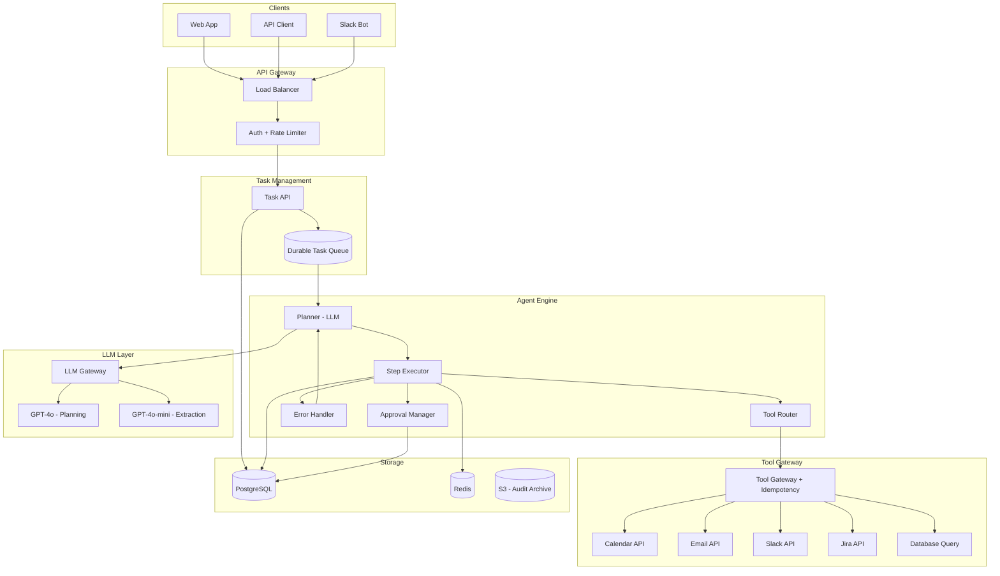
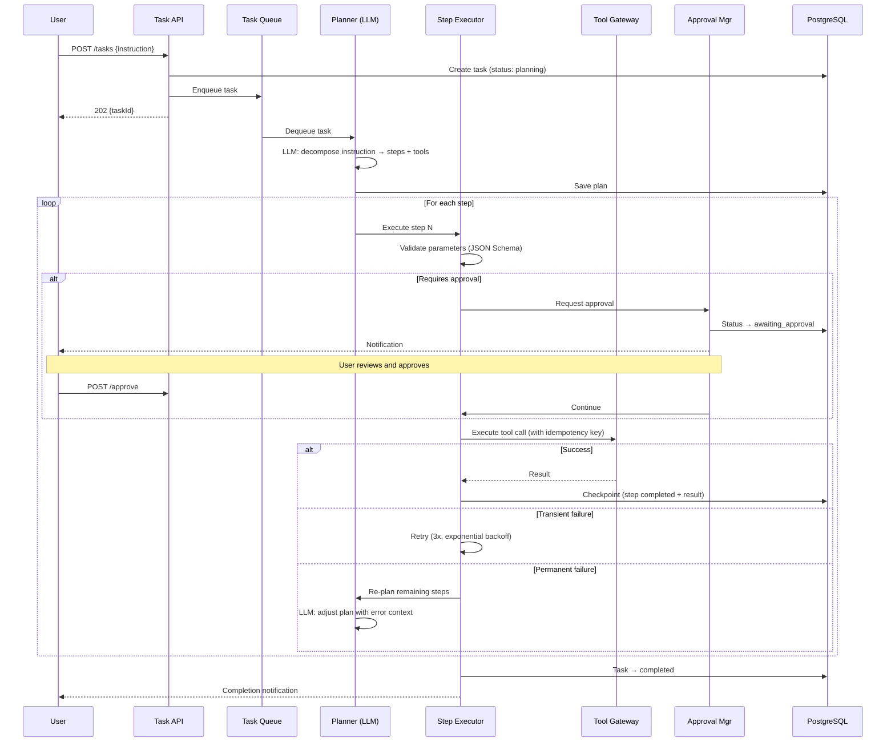

# Agentic Workflow Orchestrator System Design

Complete high-level design for an LLM-powered task execution agent with tool calling, human-in-the-loop, and durable execution.

---

## Overview

This document describes the architecture for an agentic workflow platform that handles 50,000 tasks/day, decomposing natural language instructions into executable plans with external tool calls, human approval gates, error recovery, and full audit trails.

### Architecture Diagram



---

## Detailed Design

### 1. Task Execution Flow



### 2. Tool Gateway

The Tool Gateway provides a unified, safe interface between the agent and external APIs.

```
┌─────────────────────────────────────────────────────┐
│                  Tool Gateway                        │
│                                                     │
│  1. Receive tool call from executor                 │
│  2. Validate parameters against tool schema         │
│  3. Check idempotency key (Redis)                   │
│     → If duplicate: return cached result            │
│  4. Check rate limits (per-user, per-tool)          │
│  5. Transform request to target API format          │
│  6. Execute HTTP call with timeout                  │
│  7. Store result with idempotency key               │
│  8. Log to audit trail                              │
│  9. Return result to executor                       │
│                                                     │
│  Timeout per tool: configurable (default 30s)       │
│  Retry policy: per-tool (default 3x, exp backoff)   │
│  Circuit breaker: per-tool (open after 5 failures)  │
└─────────────────────────────────────────────────────┘
```

### 3. Durable Execution Model

```
Inspired by Temporal/Step Functions:

1. Every step execution is checkpointed to PostgreSQL
2. Worker assignment is through durable queue (SQS/Temporal)
3. If worker crashes, task stays in current state
4. Health monitor detects stale tasks (no progress > 5 min)
5. Re-assign to new worker → resume from last checkpoint
6. Idempotency keys prevent re-execution of completed tool calls

Checkpoint schema (per step):
{
    task_id: "task_abc",
    step_index: 3,
    status: "completed",
    tool_call_id: "uuid",       -- idempotency key
    result: {...},
    checkpointed_at: "2024-01-15T10:30:15Z"
}
```

### 4. Human-in-the-Loop Approval

```
Approval flow:
1. Executor encounters step marked requires_approval
2. Save preview (tool name, parameters, action description)
3. Update task status → awaiting_approval
4. Release worker (return to pool)
5. Notify user via:
   - In-app notification (WebSocket/SSE)
   - Email (for non-real-time users)
   - Slack message (if configured)
6. User reviews action preview
7. User approves/rejects/modifies via API
8. Task re-queued for execution

Timeout: 24 hours (configurable)
Default: auto-reject after timeout
```

### 5. Planning Prompt

```
System: You are a task planner. Given a user's instruction, decompose it
into a series of steps using available tools. For each step, specify:
- action: human-readable description
- tool: tool name from the registry
- parameters: exact parameters for the tool call
- requires_approval: true if the action has side effects

Available tools:
{tool_registry_json}

Rules:
- Use ONLY tools from the available list
- Extract exact values from the user's instruction (dates, emails, etc.)
- Order steps logically (check before create, create before notify)
- Mark mutation tools (create, update, delete, send) as requires_approval

User instruction: {instruction}
User context: {context}

Output format (JSON):
{
    "plan": [
        {"step": 1, "action": "...", "tool": "...", "parameters": {...}, "requires_approval": false},
        {"step": 2, "action": "...", "tool": "...", "parameters": {...}, "requires_approval": true}
    ]
}
```

---

## Trade-offs Summary

| Decision | Chose | Alternative | Why |
|----------|-------|-------------|-----|
| Planning | Plan-first + re-plan on error | Fully reactive (ReAct) | Predictable, better UX for approvals |
| Execution | Async + SSE streaming | Synchronous | Tasks may wait hours for approval |
| Worker model | Shared pool | Dedicated per task | Resource efficiency (tasks idle during waits) |
| Durability | Checkpoint per step (PG) | In-memory state | Must survive crashes |
| Idempotency | UUID per tool call | Rely on tool APIs | Not all APIs support idempotency |
| LLM model | GPT-4o for planning, mini for extraction | Single model | Planning needs strong reasoning |

---

## Failure Scenarios

| Failure | Impact | Mitigation |
|---------|--------|------------|
| Worker crash | Task paused | Checkpoint + re-assignment |
| LLM provider down | No planning | Queue tasks, retry when available |
| Tool API down | Step fails | Circuit breaker, retry, re-plan |
| Tool returns wrong data | Wrong action taken | Schema validation, approval gates |
| Approval timeout | Task stuck | 24h auto-expire, user notification |
| Infinite re-plan loop | Wasted LLM calls | Max 3 re-plans per task |

---

## Component Summary

| Component | Technology | Purpose | Scaling |
|-----------|-----------|---------|---------|
| Task API | Python (FastAPI) | Task CRUD, status, approval | Horizontal (5-10 pods) |
| Task Queue | SQS / Temporal | Durable task delivery | Managed |
| Planner | Python + LLM | Plan generation | Horizontal workers |
| Executor | Python | Step execution, checkpointing | Horizontal workers (20-50) |
| Tool Gateway | Go | API call execution, idempotency | Horizontal (10-20) |
| LLM Gateway | Custom proxy | Model routing, retry | Horizontal |
| PostgreSQL | RDS | Tasks, steps, audit | Read replicas |
| Redis | ElastiCache | Idempotency cache, active state | Cluster |
| S3 | AWS S3 | Audit log archives | Unlimited |

---

*See [APPROACH.md](./APPROACH.md) for step-by-step thinking and [PROBLEM.md](./PROBLEM.md) for requirements. Diagrams available in [diagrams/](./diagrams/).*
