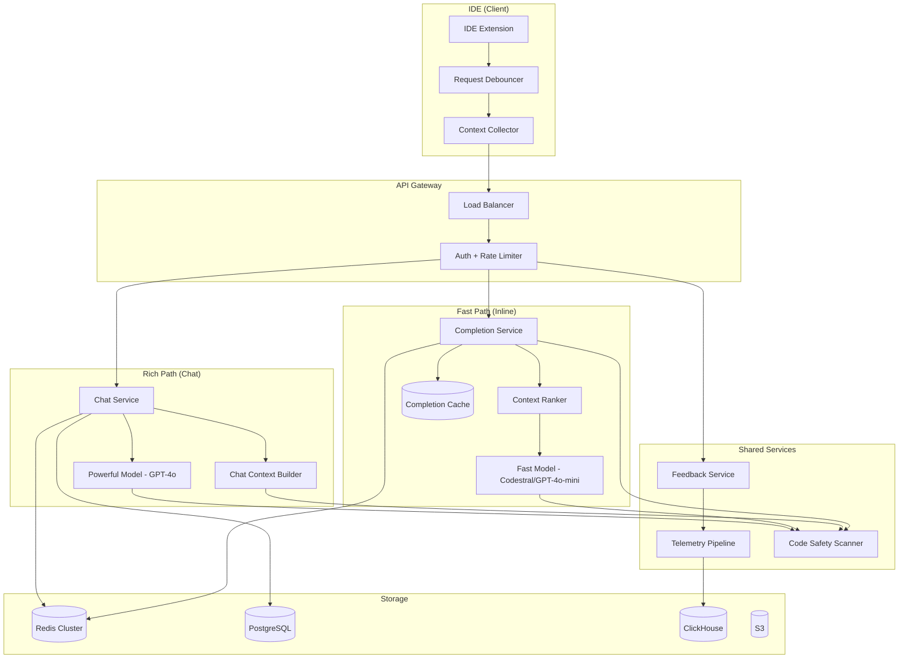

# Design Approach for AI Coding Copilot

A step-by-step thought process for designing an AI-powered code assistant.

---

## Interview Time Allocation (45 minutes)

| Phase | Time | Focus |
|-------|------|-------|
| Requirements & scope | 5 min | Inline vs chat, latency targets, scale |
| Estimation | 5 min | Request rates, token math, cost |
| API design | 5 min | Completion, chat, context sync endpoints |
| Data model | 3 min | Sessions, feedback, telemetry |
| High-level architecture | 10 min | Dual-path architecture, IDE integration |
| GenAI deep dives | 12 min | Context engineering, FIM, model routing |
| Trade-offs & follow-ups | 5 min | Latency vs quality, cost decisions |

---

## Interview Execution Layer

### Structured vs Open-Ended Execution Strategy

| Interview format | What to emphasize |
|------------------|-------------------|
| Structured platform | Fast codebase orientation, phase pacing, and precise incremental prompts |
| Open-ended BYOE | Contract-first scaffolding, disciplined workflow visibility, and explicit verification loops |

### Candidate-Control Loop

For both formats, use a repeatable loop:
1. **State intent** for the next change.
2. **Prompt narrowly** (single step or small patch).
3. **Inspect output** for architecture/constraint alignment.
4. **Verify** with tests or walkthrough.
5. **Narrate outcome + next step**.

### Rubric Signals to Call Out

- Architecture decisions remain candidate-owned, not model-owned.
- Verification checkpoints are explicit and frequent.
- Trade-offs are explained before and after AI-generated diffs.

---

## 1. Requirements Clarification

### Key Insight

> **This system has two fundamentally different request paths with conflicting requirements.** Inline completions need ultra-low latency (< 300ms) with short outputs and can tolerate lower quality. Chat/generation needs high quality with longer outputs and can tolerate higher latency (< 1s first token). The architecture must optimize each path independently — using different models, different caching strategies, and different scaling approaches.

### What Makes This Different from a Regular Chatbot

| Regular Chatbot | Coding Copilot |
|----------------|----------------|
| User initiates every request | System anticipates requests (on keystroke) |
| Conversational flow | Code flow (syntax, indentation, context) |
| Response quality > latency | Inline: latency > quality |
| One interaction mode | Two modes: inline + chat |
| Generic text context | Structured code context (AST, imports, types) |
| ~1 QPS per user | ~100 QPS per user (inline triggered) |
| Cost per query: $0.01-0.05 | Cost per inline: $0.0001-0.001 |

### Functional vs Non-Functional

**Functional (What the system does):**
- Real-time inline code completions (ghost text)
- Chat-based code explanation and generation
- Multi-language support
- Context-aware suggestions using open files
- Accept/reject feedback for quality tracking

**Non-Functional (How the system behaves):**
- Ultra-low latency: < 300ms for inline suggestions
- High throughput: 50M+ inline requests/day
- High availability: 99.9%
- Cost-efficient: < $0.001 per inline suggestion
- Scalable: 1M concurrent developers

---

## 2. Back-of-the-Envelope Estimation

### Traffic

```
DAU: 500,000 developers
Active coding hours: 6 hours/day

Inline completions:
- ~100 triggers/user/hour × 6 hours = 600/user/day
- Total: 500K × 600 = 300M requests/day
- But 80% are debounced/cancelled → 60M actual API calls/day
- QPS: 60M / 86,400 ≈ 700 QPS average
- Peak (9am-5pm, 8 hours): 60M / 28,800 ≈ 2,100 QPS

Chat interactions:
- 10 messages/user/day → 5M messages/day
- QPS: 5M / 86,400 ≈ 58 QPS average
- Peak: ~175 QPS

Total peak: ~2,275 QPS
```

### Token Math

```
Inline completions (per request):
- Input: ~2,000 tokens (prefix + suffix context)
- Output: ~20 tokens (short completion)
- Daily: 60M × 2,000 in = 120B input tokens
- Daily: 60M × 20 out = 1.2B output tokens

Chat (per message):
- Input: ~3,000 tokens (context + code + history)
- Output: ~500 tokens (detailed response)
- Daily: 5M × 3,000 in = 15B input tokens
- Daily: 5M × 500 out = 2.5B output tokens

Total daily: 135B input + 3.7B output tokens
```

### Cost

Pricing note (audited 2026-06-14): the dollar values below are historical interview-arithmetic examples, not current vendor pricing. Refresh them against provider pricing pages before quoting exact costs.

```
Inline (fast model — GPT-4o-mini or Codestral):
  Input: 120B × $0.15/1M = $18,000/day
  Output: 1.2B × $0.60/1M = $720/day
  Subtotal: $18,720/day → $561K/month

  Per suggestion: $18,720 / 60M = $0.0003 ✓ (under $0.001 target)

Chat (powerful model — GPT-4o):
  Input: 15B × $2.50/1M = $37,500/day
  Output: 2.5B × $10.00/1M = $25,000/day
  Subtotal: $62,500/day → $1.875M/month

  Per message: $62,500 / 5M = $0.0125

Total LLM: ~$81K/day → $2.44M/month

Cost optimization with client-side caching:
  Savings: Eliminates backend calls for continued typing
  Optimized total: ~$2.44M/month
```

### Storage

```
Telemetry: 65M events/day × 200 bytes = 13 GB/day → 390 GB/month
Chat history: 5M msgs/day × 3 KB = 15 GB/day → 450 GB/month
Context index: (if enabled) 100 GB per large org
Total: ~850 GB/month growth
```

---

## 3. API Design

### Endpoint 1: Inline Completion

```
POST /api/v1/completions

Headers:
  Authorization: Bearer <token>
  X-IDE: vscode-1.85.0
  X-Request-ID: <uuid>

Request:
{
    "prefix": "def calculate_total_price(items: list[dict]) -> float:\n    ",
    "suffix": "\n\ndef main():\n    ...",
    "language": "python",
    "filePath": "src/pricing.py",
    "cursorOffset": 52,
    "triggerKind": "auto"           // auto | manual
}

Response (fast, non-streaming):
{
    "completions": [
        {
            "text": "total = sum(item['price'] * item['quantity'] for item in items)\n    return total",
            "score": 0.92
        }
    ],
    "requestId": "req_abc123",
    "model": "codestral-latest",
    "usage": {"inputTokens": 1850, "outputTokens": 18}
}

Latency target: < 300ms total (including network)

Errors:
- 429: Rate limited (too many requests)
- 503: Model unavailable (fail silently in IDE)
```

### Endpoint 2: Chat

```
POST /api/v1/chat

Headers:
  Authorization: Bearer <token>
  Accept: text/event-stream

Request:
{
    "message": "Explain this function and suggest performance improvements",
    "codeContext": {
        "selectedCode": "def merge_sort(arr): ...",
        "filePath": "src/sorting.py",
        "language": "python"
    },
    "conversationId": "conv_123"    // null for new
}

Response (SSE):
data: {"type": "chunk", "content": "This function implements **merge sort**, "}
data: {"type": "chunk", "content": "a divide-and-conquer algorithm..."}
data: {"type": "done", "usage": {"inputTokens": 3200, "outputTokens": 450}}

Latency target: < 1s first token
```

### Endpoint 3: Feedback

```
POST /api/v1/feedback

Request:
{
    "requestId": "req_abc123",
    "action": "accepted",           // accepted | rejected | partial
    "editDistance": 3,              // characters changed after accept
    "dwellTimeMs": 1500            // time before accept/reject
}

Response: 204 No Content (fire-and-forget)
```

### Endpoint 4: Context Sync

```
POST /api/v1/context/sync

Request:
{
    "openFiles": [
        {"path": "src/pricing.py", "content": "...", "language": "python"},
        {"path": "src/models.py", "content": "...", "language": "python"}
    ],
    "recentEdits": [
        {"path": "src/pricing.py", "range": {"start": 10, "end": 15}, "newText": "..."}
    ],
    "projectStructure": {
        "rootPath": "/workspace/myproject",
        "fileTree": ["src/", "src/pricing.py", "src/models.py", "tests/"]
    }
}

Response: 204 No Content
Purpose: Keep server-side context warm for better suggestions
```

---

## 4. Data Model

### Database Choices

| Store | Technology | Purpose |
|-------|-----------|---------|
| Relational DB | PostgreSQL | Users, orgs, subscriptions |
| Cache | Redis Cluster | Session context, rate limits |
| Time-Series | ClickHouse | Telemetry, acceptance rates, analytics |
| Object Store | S3 | Context snapshots, model artifacts |

### Key Tables

**users**
```
{
    id:                 uuid (PK)
    org_id:             uuid (FK, nullable)
    email:              string
    plan:               enum (free, pro, enterprise)
    daily_completions:  int (counter)
    settings:           jsonb
    created_at:         timestamp
}
```

**completion_events** (ClickHouse — high-volume telemetry)
```
{
    event_id:           uuid
    user_id:            uuid
    request_id:         string
    event_type:         enum (triggered, served, accepted, rejected)
    language:           string
    model:              string
    input_tokens:       int
    output_tokens:      int
    latency_ms:         int
    completion_length:  int
    timestamp:          datetime
}
Partitioned by: toYYYYMM(timestamp)
```

**chat_messages**
```
{
    id:                 uuid (PK)
    conversation_id:    uuid
    user_id:            uuid
    role:               enum (user, assistant)
    content:            text
    code_context:       jsonb
    tokens_used:        int
    model:              string
    created_at:         timestamp
}
Indexes: (conversation_id, created_at), user_id
```

---

## 5. High-Level Architecture

### Architecture Diagram



### Dual-Path Architecture

The system splits into two distinct paths optimized for different requirements:

**Fast Path (Inline Completions):**
```
Latency budget: 300ms total
- IDE debounce + network: 100ms
- Context ranking: 20ms
- Cache check: 5ms
- Model inference: 150ms
- Safety check: 10ms
- Response: 15ms

Optimization: Smallest/fastest model, minimal post-processing,
              aggressive caching, fail-open (skip on timeout)
```

**Rich Path (Chat):**
```
Latency budget: 1s first token
- Network: 50ms
- Context building: 50ms
- Safety check: 30ms
- Model inference: 800ms (first token, streaming)

Optimization: Larger model, rich context, streaming,
              full safety checks, retry on failure
```

---

## 6. GenAI Deep Dives

### 6.1 Model Selection & Routing

Pricing note (audited 2026-06-14): model names and dollar values here are examples for routing trade-off practice. Refresh provider pricing pages before quoting exact costs.

| Path | Model | Latency (P50) | Latency (P99) | Cost/1M tok (in/out) |
|------|-------|---------------|---------------|---------------------|
| Inline | Codestral / GPT-4o-mini | 100ms | 250ms | $0.15 / $0.60 |
| Chat | GPT-4o / Claude 3.5 Sonnet | 800ms | 2s | $2.50 / $10.00 |
| Fallback | Local small model (on-device) | 50ms | 100ms | $0 |

**Model routing logic:**
```python
def route_request(request):
    if request.type == "inline":
        if cache_hit(request):
            return cached_response
        return fast_model.complete(request, max_tokens=50)
    elif request.type == "chat":
        return powerful_model.stream(request, max_tokens=4096)
```

### 6.2 Context Engineering (Deep Dive)

The most critical aspect of a coding copilot is what context to include in the prompt.

#### Fill-in-the-Middle (FIM)

```
Traditional (left-to-right):
  Prompt: "def add(a, b):\n    "
  Output: "return a + b"

FIM (prefix + suffix):
  Prefix: "def add(a, b):\n    "
  Suffix: "\n\ndef multiply(a, b):\n    return a * b"
  Output: "return a + b"

FIM produces more contextually appropriate completions because
the model sees what comes AFTER the cursor, not just before.
```

#### Context Budget Allocation

```
Total budget: 4,000 tokens (inline) / 16,000 tokens (chat)

Inline allocation:
┌─────────────────────────────────────┐
│ Prefix (current file, before cursor) │ 50% (2,000 tokens)
│ Suffix (current file, after cursor)  │ 20% (800 tokens)
│ Related files (imports, types)       │ 20% (800 tokens)
│ Project context (file tree, types)   │ 10% (400 tokens)
└─────────────────────────────────────┘

Chat allocation:
┌─────────────────────────────────────┐
│ Selected code / file                 │ 30% (4,800 tokens)
│ Related files                        │ 20% (3,200 tokens)
│ Chat history                         │ 25% (4,000 tokens)
│ System prompt + instructions         │ 15% (2,400 tokens)
│ Project context                      │ 10% (1,600 tokens)
└─────────────────────────────────────┘
```

#### Context Ranking Algorithm

```
For each candidate context chunk, score:
  relevance_score = (
      0.4 × import_graph_distance(chunk, cursor_file)
    + 0.3 × recency(chunk.last_edit_time)
    + 0.2 × type_reference_overlap(chunk, cursor_context)
    + 0.1 × file_proximity(chunk.path, cursor_file.path)
  )

Select top-k chunks that fit within token budget.
```

### 6.3 Safety & Guardrails

| Check | When | Implementation |
|-------|------|----------------|
| License compliance | Post-generation | Bloom filter of known copyrighted snippets (> 50 tokens) |
| Vulnerability patterns | Post-generation | Pattern matching (SQL injection, hardcoded secrets, eval()) |
| Secret detection | Pre-send (context) | Regex for API keys, passwords before sending to model |
| Output validation | Post-generation | Syntax check for generated language |

**License Compliance:**
```
1. Generate completion
2. Check against Bloom filter of copyrighted code (< 1ms)
3. If potential match → exact check against database
4. If confirmed verbatim copy (> 50 tokens) → suppress suggestion
5. Log for audit
```

### 6.4 Evaluation & Metrics

| Metric | How Measured | Target | Significance |
|--------|-------------|--------|-------------|
| Acceptance rate | Accepted / shown | > 30% | Primary quality metric |
| Persistence rate | Still in code after 30s | > 25% | Were suggestions actually useful? |
| Characters saved | Completion length × acceptance | High | Productivity impact |
| Latency P50 (inline) | APM | < 200ms | UX quality |
| Latency P99 (inline) | APM | < 300ms | Tail latency |
| Syntactic correctness | Linter on suggestions | > 85% | Code quality |
| Keystrokes saved/hour | Telemetry | > 500 | Headline metric |

**A/B Testing Framework:**
```
- Route 5% of users to experimental model/prompt
- Compare acceptance rate, persistence rate, keystrokes saved
- Minimum 7-day test period for statistical significance
- Automatic rollback if quality drops > 5%
```

### 6.5 Cost & Latency Optimization

| Technique | Saves | Trade-off |
|-----------|-------|-----------|
| Request debouncing (30-50ms) | ~40-50% of requests | Short delay, prevents laggy feel |
| Client-side LRU cache | Reuses completions across typing | Uses local memory |
| Speculative prefetching | Reduces perceived latency | Wasted compute on unused predictions |
| KV-cache reuse | ~40% of token processing | Complex session management |
| Smaller model for inline | 95% cost reduction vs GPT-4o | Lower quality (acceptable for inline) |
| On-device small model | $0 cost for simple completions | Limited capability, device resources |

**Debouncing Strategy (30-50ms trailing-edge):**
```
IDE Extension:
1. User types character
2. Start 30-50ms timer (reset on next keystroke)
3. Timer expires → check if cursor moved
4. If stable cursor → send completion request
5. Cancel in-flight request if user types again

Note: 300ms debouncing introduces unacceptable typing lag for inline
completions. Realistic 30-50ms trailing-edge debouncing feels instantaneous
while still collapsing fast multi-character typing bursts.
```

---

## 7. Classical Deep Dives

### 7.1 Scaling Strategy

```
Inline completion service:
- Stateless → auto-scale on QPS (target: 2,000 QPS/pod)
- Deploy in multiple regions (US, EU, Asia) for latency
- Use edge locations for < 50ms network latency

Chat service:
- Horizontal scaling, fewer pods than inline
- Long-running connections (SSE) → sticky sessions optional

Model inference:
- Managed API (OpenAI/Mistral) → they handle GPU scaling
- Self-hosted option: GPU cluster with load balancing
  - 8× A100 cluster handles ~500 inline QPS
```

### 7.2 Caching

| Layer | What | TTL | Hit Rate |
|-------|------|-----|----------|
| Edge/CDN | Static assets (extension) | 24h | 95% |
| Local (IDE) | LRU prefix tree completion cache | Session | High for typing |
| KV-cache | Model's attention cache for session | Session | N/A |

**Client-Side LRU Prefix Tree Cache:**
```
Instead of a remote Redis cache for exact prefix+suffix matches
(which has a <2% hit rate and adds a 10-15ms network hop penalty),
we use an in-IDE local client-side LRU prefix tree.

When a user types 'def cal' and we receive a completion for 'culate()',
if the user types 'c', we locally traverse the tree to 'def calc' and
immediately suggest 'ulate()' without a network round-trip.
```

### 7.3 IDE Extension Architecture

```
┌─────────────────────────────────────────────┐
│              IDE Extension                   │
│                                             │
│  ┌─────────────┐  ┌──────────────────────┐ │
│  │ Text Change  │  │ Context Collector    │ │
│  │ Listener     │  │ (open files, edits)  │ │
│  └──────┬──────┘  └──────────┬───────────┘ │
│         │                    │              │
│  ┌──────▼──────┐            │              │
│  │ Debouncer   │            │              │
│  │ (30-50ms)   │            │              │
│  └──────┬──────┘            │              │
│         │                    │              │
│  ┌──────▼────────────────────▼──────────┐  │
│  │         Request Builder               │  │
│  │ (prefix + suffix + context ranking)   │  │
│  └──────────────────┬───────────────────┘  │
│                     │                       │
│  ┌──────────────────▼───────────────────┐  │
│  │       HTTP Client (with cancel)       │  │
│  └──────────────────┬───────────────────┘  │
│                     │                       │
│  ┌──────────────────▼───────────────────┐  │
│  │    Response Renderer (ghost text)     │  │
│  └──────────────────────────────────────┘  │
└─────────────────────────────────────────────┘
```

---

## 8. Trade-offs

### Decision 1: Dual Model vs Single Model

| Dual Model (fast + powerful) | Single Powerful Model |
|-----------------------------|---------------------|
| Pros: Optimized latency per path | Pros: Simpler architecture |
| Pros: 95% cost savings on inline | Pros: Consistent quality |
| Cons: Two models to manage | Cons: Too slow for inline |
| Cons: Quality variance | Cons: Too expensive for inline |

**Chose: Dual model** — Inline completion has fundamentally different requirements (< 300ms, $0.001/req) than chat. Using GPT-4o for 60M inline requests/day would cost $62.5K/day.

### Decision 2: Server-Side vs On-Device Inference

| Server-Side | On-Device (local model) |
|------------|----------------------|
| Pros: Powerful models, consistent | Pros: Zero latency, private |
| Pros: Easy to update models | Pros: Works offline |
| Cons: Network latency, cost | Cons: Limited model size |
| Cons: Privacy concerns | Cons: Inconsistent hardware |

**Chose: Server-side primary** with optional on-device fallback. Server-side provides the best quality; on-device handles offline scenarios and simple completions.

### Decision 3: Aggressive vs Conservative Suggestions

| Aggressive (show often) | Conservative (show when confident) |
|------------------------|----------------------------------|
| Pros: More opportunities to help | Pros: Higher acceptance rate |
| Cons: Annoying if irrelevant | Cons: Misses helpful suggestions |
| Cons: Lower acceptance rate | Cons: Users may not realize it's active |

**Chose: Score-based threshold** — Show suggestions only when model confidence > 0.7. This balances helpfulness with avoiding annoyance.

---

## 9. LLM-Specific Risks

| Risk | Impact | Likelihood | Mitigation |
|------|--------|------------|------------|
| Insecure code generation | Vulnerabilities in production | Medium | Post-generation security scanner |
| License violation | Legal liability | Medium | Bloom filter + verbatim check |
| Hallucinated APIs | Code that won't compile | Medium | Type-aware generation, validation |
| Context leakage | User A's code suggested to User B | Low | No cross-user context, stateless model |
| Model latency spike | Inline UX degrades | Medium | Timeout (300ms), show nothing on failure |
| Cost explosion | Budget overrun | Medium | Per-user daily limits, debouncing |

---

## 10. Follow-up Questions

### Scaling
- **10M developers?** Multi-region deployment, edge inference, aggressive caching
- **Enterprise (on-prem)?** Self-hosted model option, data never leaves customer network
- **All programming languages?** Model handles most; optimize prompts per language

### LLM-Specific
- **Model quality regression?** A/B testing, automatic rollback on acceptance rate drop
- **Reduce latency further?** Speculative decoding, KV-cache across requests, edge deployment
- **Support multi-file refactoring?** Requires repository indexing, graph-based context, agentic approach

### Feature Extensions
- **Code review suggestions?** Diff-aware model, PR context, separate product
- **Auto-fix lint errors?** Inline suggestion with diagnostic context, high-confidence only
- **Unit test generation?** Code-to-test pipeline, coverage-guided generation

---

## Interview Discussion Points

1. **Why two different models instead of one?**
   - Inline needs < 300ms, chat can tolerate 1s
   - Cost: GPT-4o for 60M inline requests = $62.5K/day vs $18.7K with small model
   - Different output lengths (20 tokens vs 500 tokens)

2. **How do you handle the context window?**
   - Budget allocation: 50% prefix, 20% suffix, 20% related, 10% project
   - Ranking algorithm for context relevance
   - FIM (Fill-in-the-Middle) for better inline completions

3. **How do you measure quality?**
   - Acceptance rate (> 30% target)
   - Persistence rate (still in code after 30s)
   - Keystrokes saved per hour (headline metric)
   - A/B testing for every model/prompt change

4. **What's the most critical latency optimization?**
   - Client-side debouncing (eliminates 40-50% of requests)
   - Client-side LRU prefix tree caching (eliminates server roundtrips while typing)
   - KV-cache reuse (saves 40% of model compute)
   - Regional deployment (< 50ms network)

5. **How do you prevent generating copyrighted code?**
   - Bloom filter of known copyrighted snippets
   - Exact match check for flagged content
   - Suppress suggestions > 50 tokens matching known code
   - Audit trail for compliance
