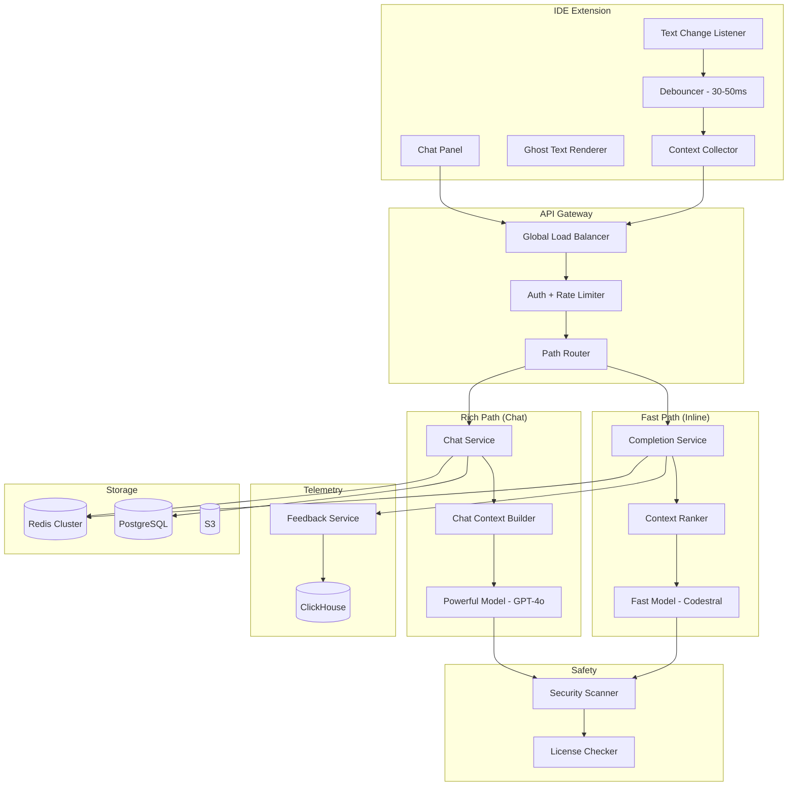
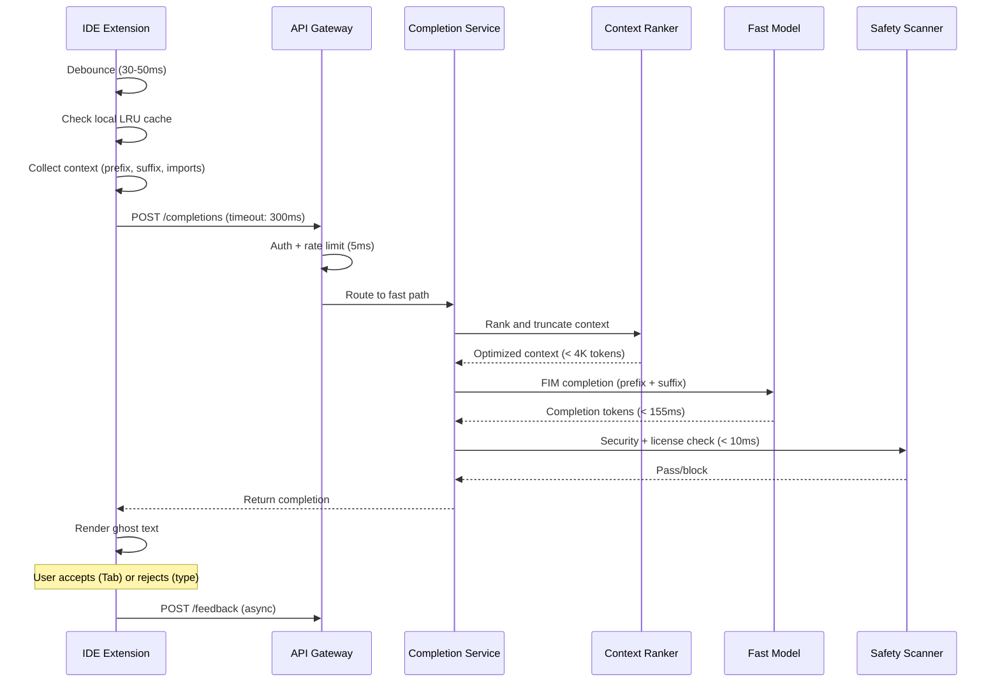
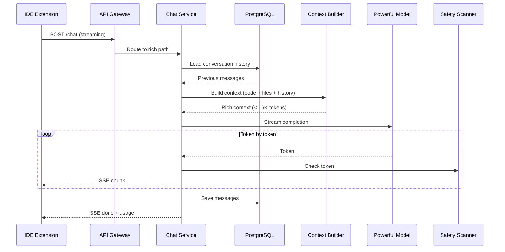

# AI Coding Copilot System Design

Complete high-level design for an AI-powered coding assistant with inline completions and chat.

---

## Overview

This document describes the architecture for an AI coding copilot serving 500K+ daily active developers with dual-path processing: ultra-low-latency inline completions (< 300ms) and rich chat-based code Q&A (< 1s first token).

### Architecture Diagram



---

## Detailed Design

### 1. IDE Extension (Client Side)

The IDE extension is the critical first layer — it manages debouncing, context collection, and rendering.

```
Request lifecycle:
1. User types character
2. Debouncer: Wait 30-50ms (reset on each keystroke)
3. Context collector: Gather prefix, suffix, open files, imports
4. Context ranker (client-side): Select most relevant context within token budget
5. Check client-side LRU prefix tree cache
6. HTTP request to completion API (with 300ms timeout)
7. Cancel in-flight request if user types again
7. Receive completion → render as ghost text
8. User presses Tab (accept) or types (reject)
9. Send feedback event (async, fire-and-forget)
```

**Key client optimizations:**
- Cancel previous request on new keystroke
- Client-side LRU prefix tree completion cache (same prefix → same result)
- Speculative prefetching when user pauses in a function body
- Graceful degradation: if server unavailable, no ghost text shown

### 2. Dual-Path Request Processing

#### Fast Path: Inline Completions



**Latency budget (300ms total):**
```
Network (client → server):     50ms
Auth + routing:                 5ms
Context ranking:               20ms
Model inference:              155ms
Safety check:                  10ms
Network (server → client):     50ms
Buffer:                        10ms
─────────────────────────────────
Total:                        300ms
```

#### Rich Path: Chat



### 3. Context Engineering

#### Fill-in-the-Middle (FIM) Format

```
Standard prompt format for inline completions:

<|fim_prefix|>
import numpy as np

def calculate_statistics(data: list[float]) -> dict:
    """Calculate mean, median, and std deviation."""
    mean = np.mean(data)
    median = np.median(data)
    std = np.std(data)

<|fim_suffix|>

def plot_histogram(data: list[float], bins: int = 10):
    import matplotlib.pyplot as plt
    plt.hist(data, bins=bins)
    plt.show()
<|fim_middle|>
    return {"mean": mean, "median": median, "std": std}
```

#### Context Ranking for Inline

```
Input: cursor position in file X

Step 1: Extract prefix/suffix from current file (50% budget)
Step 2: Identify related files:
  - Files imported by X
  - Files that import X
  - Recently edited files
  - Files with similar names (e.g., test file for source)
Step 3: Score each related file chunk:
  relevance = 0.4 × import_distance
            + 0.3 × edit_recency
            + 0.2 × type_overlap
            + 0.1 × path_similarity
Step 4: Select top chunks within remaining budget (30% for related, 20% for project)
Step 5: Format as FIM prompt
```

### 4. Model Selection Details

Pricing note (audited 2026-06-14): model names and dollar values here are examples for routing trade-off practice. Refresh provider pricing pages before quoting exact costs.

| Feature | Fast Model | Powerful Model |
|---------|-----------|----------------|
| Use case | Inline completions | Chat, code gen |
| Model | Codestral-latest / GPT-4o-mini | GPT-4o / Claude 3.5 Sonnet |
| Max input | 4K tokens | 16K tokens |
| Max output | 50 tokens | 4K tokens |
| Latency P50 | 100ms | 800ms |
| Latency P99 | 250ms | 2s |
| Cost (in) | $0.15/1M | $2.50/1M |
| Cost (out) | $0.60/1M | $10.00/1M |
| Streaming | No (too short) | Yes (SSE) |
| FIM support | Yes | N/A (not needed) |

**Fallback chain:**
```
Fast: Codestral → GPT-4o-mini → timeout (show nothing)
Rich: GPT-4o → Claude 3.5 → GPT-4o-mini (degraded quality warning)
```

### 5. Safety & License Compliance

```
┌────────────────────────────────────────────────┐
│              Safety Pipeline                    │
│                                                │
│  Stage 1: Pre-Send (Context Sanitization)      │
│  ├─ Detect API keys, passwords, tokens         │
│  ├─ Detect PII (email, phone, SSN)             │
│  └─ Redact sensitive content before model call  │
│                                                │
│  Stage 2: Post-Generation                      │
│  ├─ License check (Bloom filter, < 1ms)        │
│  │   └─ Verbatim match > 50 tokens → block     │
│  ├─ Security scanner                           │
│  │   ├─ SQL injection patterns                 │
│  │   ├─ Hardcoded credentials                  │
│  │   ├─ eval() / exec() usage                  │
│  │   └─ Known CVE patterns                     │
│  └─ Syntax validation (language-specific)       │
│                                                │
│  Stage 3: Feedback Loop                        │
│  ├─ Log all blocked suggestions                │
│  └─ Periodic review of false positives          │
└────────────────────────────────────────────────┘
```

### 6. Telemetry & Quality Metrics

#### Key Metrics

| Metric | Definition | Target | Significance |
|--------|-----------|--------|-------------|
| Shown rate | Completions shown / triggers | > 50% | Model producing useful output |
| Acceptance rate | Accepted / shown | > 30% | Quality of suggestions |
| Persistence rate | Still in code after 30s | > 25% | Real usefulness |
| Edit distance | Chars changed post-accept | < 5 avg | Suggestion accuracy |
| Keystrokes saved/hr | Completed chars / coding time | > 500 | Headline productivity metric |
| Latency P50 inline | | < 200ms | UX quality |
| Latency P99 inline | | < 300ms | Tail performance |

#### Telemetry Pipeline

```
IDE Extension → POST /feedback (fire-and-forget)
                     │
                     ▼
             Kafka (buffered)
                     │
                     ▼
          ClickHouse (real-time analytics)
                     │
              ┌──────┴──────┐
              ▼              ▼
        Dashboards     A/B Test Analysis
     (acceptance rate,   (model comparison,
      latency, cost)     prompt experiments)
```

---

## Trade-offs Summary

| Decision | Chose | Alternative | Why |
|----------|-------|-------------|-----|
| Architecture | Dual path (fast + rich) | Single path | Fundamentally different requirements |
| Inline model | Codestral (fast, FIM) | GPT-4o (slow, expensive) | 300ms budget, $0.001/req cost |
| Inline response | Non-streaming (single shot) | Streaming | Too short for streaming to help |
| Caching | Client-side LRU tree | Remote Redis | Eliminates server roundtrips while typing |
| Debouncing | 30-50ms client-side | 300ms client-side | 300ms introduces unacceptable typing lag |
| Context | FIM (prefix + suffix) | Prefix only | Significantly better completions |
| Safety | Post-generation scan | Pre-generation filter | Can't filter code patterns pre-gen |

---

## Failure Scenarios

| Failure | Impact | Mitigation |
|---------|--------|------------|
| Model provider down | No completions | Fail silently (no ghost text), fallback model |
| High latency (> 300ms) | Stale ghost text shown late | Strict timeout, cancel on keystroke |
| Cache (Redis) down | Chat history fails, higher model load | Bypass cache, direct to model |
| Telemetry pipeline down | No metrics | Buffer in IDE, retry later |
| Safety scanner false positive | Good suggestions blocked | Log, review, tune thresholds |

---

## Capacity Planning

| Component | Current (500K DAU) | 10x (5M DAU) |
|-----------|-------------------|---------------|
| Inline QPS (peak) | 2,100 | 21,000 |
| Chat QPS (peak) | 175 | 1,750 |
| Daily inline calls | 60M | 600M |
| LLM cost/month | $2.27M | ~$22.7M |
| Redis (cache) | 2 GB | 20 GB |
| Telemetry storage | 390 GB/month | 3.9 TB/month |

---

## Component Summary

| Component | Technology | Purpose | Scaling |
|-----------|-----------|---------|---------|
| IDE Extension | TypeScript (VS Code), Kotlin (JetBrains) | Client-side UX | Per-user install |
| API Gateway | CloudFlare / AWS ALB | Global routing, auth | Edge locations |
| Completion Service | Go (low latency) | Inline completion orchestration | Horizontal (50-200 pods) |
| Chat Service | Python (FastAPI) | Chat orchestration | Horizontal (10-50 pods) |
| Context Ranker | Go | Fast context ranking | Co-located with completion |
| Fast Model | Codestral / GPT-4o-mini | Inline inference | Managed API |
| Powerful Model | GPT-4o / Claude | Chat inference | Managed API |
| Redis | ElastiCache Cluster | Chat context, sessions, rate limiting | 12 nodes |
| PostgreSQL | RDS | Users, chat history | Read replicas |
| ClickHouse | Self-hosted | Telemetry analytics | Sharded |

---

*See [APPROACH.md](./APPROACH.md) for step-by-step thinking and [PROBLEM.md](./PROBLEM.md) for requirements. Diagrams available in [diagrams/](./diagrams/).*
