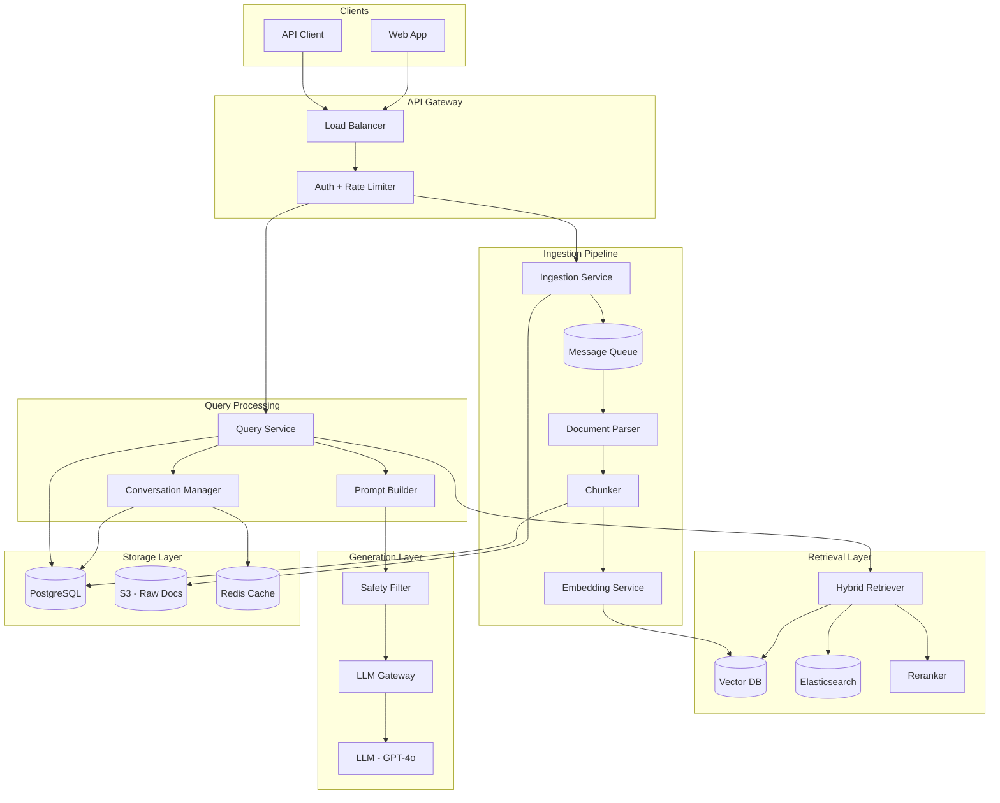

# Design Approach for Document Q&A RAG System

A step-by-step thought process for designing an LLM-powered document Q&A system with retrieval-augmented generation.

---

## Interview Time Allocation (45 minutes)

| Phase | Time | Focus |
|-------|------|-------|
| Requirements & scope | 5 min | Clarify document types, scale, latency needs |
| Estimation | 5 min | Token math, storage, cost |
| API design | 5 min | Query, ingestion, streaming endpoints |
| Data model | 5 min | Vector store, metadata, conversations |
| High-level architecture | 10 min | RAG pipeline end-to-end |
| GenAI deep dives | 10 min | Chunking, retrieval, safety, evaluation |
| Trade-offs & follow-ups | 5 min | Key decisions, scaling |

---

## 1. Requirements Clarification

### Key Insight

> **This is a retrieval problem enhanced by generation, not a generation-from-scratch problem.** The quality of the answer depends 80% on retrieval quality and 20% on generation. If you retrieve the wrong chunks, even the best LLM will produce a bad answer.

### Functional vs Non-Functional

**Functional (What the system does):**
- Ingest documents into a searchable knowledge base
- Answer natural language questions using document content
- Cite specific passages that support each answer
- Support multi-turn conversations
- Enforce access control per user/team

**Non-Functional (How the system behaves):**
- Low latency: first token < 1s, full answer < 8s
- High availability: 99.9%
- Scalable to 500K+ documents
- Cost-efficient: < $0.05 per query average

### What Makes This GenAI-Specific (vs Classical Search)

| Classical Search | RAG-Based Q&A |
|-----------------|---------------|
| Returns document links | Returns synthesized answers |
| Keyword matching (BM25) | Semantic understanding (embeddings) |
| User scans results | System extracts and cites passages |
| No generation | LLM generates natural language answer |
| Stateless queries | Multi-turn conversation context |
| No hallucination risk | Must guard against hallucination |

---

## 2. Back-of-the-Envelope Estimation

### Traffic

```
Users: 10,000 total, 2,000 DAU
Queries per user: 10/day → 20,000 queries/day
QPS: 20,000 / 86,400 ≈ 0.23 QPS average
Peak QPS: 0.23 × 5 ≈ 1.2 QPS (burst during work hours)
```

### Token Math (Critical for Cost)

```
Per query:
- Input tokens: query (~50) + system prompt (~200) + 5 retrieved chunks × 512 tokens = ~2,810 tokens
- Output tokens: ~500 tokens (answer with citations)
- Total: ~3,310 tokens per query

Daily:
- Input: 20,000 × 2,810 = 56.2M input tokens/day
- Output: 20,000 × 500 = 10M output tokens/day
```

### Cost

Pricing note (audited 2026-06-14): the dollar values below are historical interview-arithmetic examples, not current vendor pricing. Refresh them against provider pricing pages before quoting exact costs.

```
GPT-4o pricing (example):
- Input: $2.50/1M tokens → 56.2M × $2.50/1M = $140.50/day
- Output: $10.00/1M tokens → 10M × $10.00/1M = $100.00/day
- Total LLM: ~$240/day → ~$7,200/month

Embedding (one-time + incremental):
- 500K docs × 10 pages × 512 tokens/chunk × 2 chunks/page = 5.12B tokens
- text-embedding-3-small: $0.02/1M → $102 one-time
- Daily incremental: negligible

Vector DB (Pinecone/Weaviate):
- 10M vectors × 1536 dims × 4 bytes = ~60 GB
- ~$200/month

Total: ~$7,500/month
```

### Storage

```
Raw documents: 500K × 50 KB avg = 25 GB
Chunks (text): 10M chunks × 2 KB = 20 GB
Embeddings: 10M × 1536 × 4 bytes = 60 GB
Conversation logs: 20K/day × 5 KB = 100 MB/day → 36 GB/year
Metadata: ~5 GB

Total: ~150 GB + 36 GB/year growth
```

---

## 3. API Design

### Endpoint 1: Ingest Document

```
POST /api/v1/documents

Headers: Authorization: Bearer <token>

Request:
{
    "source": "s3://bucket/report.pdf",
    "format": "pdf",
    "metadata": {
        "team": "engineering",
        "accessLevel": "internal"
    }
}

Response (202 Accepted):
{
    "documentId": "doc_abc123",
    "status": "processing",
    "estimatedCompletionTime": "2024-01-15T10:30:30Z"
}

Errors:
- 400: Unsupported format
- 413: Document too large (> 100 MB)
- 429: Ingestion rate limit exceeded
```

### Endpoint 2: Query (Streaming)

```
POST /api/v1/query

Headers:
  Authorization: Bearer <token>
  Accept: text/event-stream

Request:
{
    "question": "What was our Q3 revenue growth?",
    "conversationId": "conv_xyz789",  // null for new conversation
    "filters": {
        "teams": ["finance", "executive"],
        "dateRange": { "from": "2024-01-01", "to": "2024-12-31" }
    }
}

Response (SSE stream):
data: {"type": "retrieval", "sources": [{"docId": "doc_abc", "page": 3, "score": 0.92, "snippet": "Q3 revenue..."}]}
data: {"type": "chunk", "content": "Based on the Q3 financial report, "}
data: {"type": "chunk", "content": "revenue grew by 15% year-over-year "}
data: {"type": "chunk", "content": "to $4.2 billion."}
data: {"type": "done", "metadata": {"tokensUsed": 3200, "latencyMs": 2100, "model": "gpt-4o"}}

Errors:
- 400: Invalid question
- 401: Unauthorized
- 429: Rate limit / token budget exceeded
- 503: Model temporarily unavailable
```

### Endpoint 3: Document Status

```
GET /api/v1/documents/{documentId}

Response:
{
    "documentId": "doc_abc123",
    "status": "ready",          // processing | ready | failed
    "filename": "q3_report.pdf",
    "pages": 42,
    "chunks": 84,
    "ingestedAt": "2024-01-15T10:30:00Z"
}
```

### Endpoint 4: Conversation History

```
GET /api/v1/conversations/{conversationId}

Response:
{
    "conversationId": "conv_xyz789",
    "messages": [
        {"role": "user", "content": "What was Q3 revenue?", "timestamp": "..."},
        {"role": "assistant", "content": "Revenue was $4.2B...", "sources": [...], "timestamp": "..."},
        {"role": "user", "content": "How does that compare to Q2?", "timestamp": "..."},
        {"role": "assistant", "content": "Q2 revenue was $3.8B...", "sources": [...], "timestamp": "..."}
    ]
}
```

---

## 4. Data Model

### Database Choices

| Store | Technology | Purpose |
|-------|-----------|---------|
| Vector DB | Weaviate / pgvector | Semantic search over chunks |
| Relational DB | PostgreSQL | Documents, users, conversations, metadata |
| Object Store | S3 | Raw document files |
| Cache | Redis | Session context, semantic cache, hot queries |
| Search | Elasticsearch | BM25 keyword search (hybrid retrieval) |

### Schema

**documents**
```
{
    id:             uuid (PK)
    filename:       string
    source_url:     string
    format:         enum (pdf, html, md, txt)
    status:         enum (processing, ready, failed)
    page_count:     int
    chunk_count:    int
    owner_id:       uuid (FK → users)
    access_teams:   text[]           -- ACL
    metadata:       jsonb
    created_at:     timestamp
    updated_at:     timestamp
}
Indexes: owner_id, status, access_teams (GIN)
```

**chunks**
```
{
    id:             uuid (PK)
    document_id:    uuid (FK → documents)
    chunk_index:    int
    content:        text
    page_number:    int
    section_header: text
    token_count:    int
    embedding_id:   string           -- reference to vector store
    created_at:     timestamp
}
Indexes: document_id, (document_id, chunk_index)
```

**conversations**
```
{
    id:             uuid (PK)
    user_id:        uuid (FK → users)
    title:          string           -- auto-generated
    created_at:     timestamp
    updated_at:     timestamp
}
Indexes: user_id, updated_at
```

**messages**
```
{
    id:             uuid (PK)
    conversation_id: uuid (FK → conversations)
    role:           enum (user, assistant)
    content:        text
    sources:        jsonb            -- cited passages
    tokens_used:    int
    model:          string
    latency_ms:     int
    created_at:     timestamp
}
Indexes: conversation_id, created_at
```

**Vector Store Collection: document_chunks**
```
{
    id:             string           -- matches chunks.embedding_id
    vector:         float[1536]      -- embedding
    content:        text             -- chunk text for display
    metadata: {
        document_id:   string
        page_number:   int
        section:       string
        access_teams:  string[]      -- for filtered retrieval
    }
}
```

---

## 5. High-Level Architecture

### Architecture Diagram



### Query Path (Read)

```
1. User submits question via POST /api/v1/query
2. Auth validates token + rate limit check
3. Query Service loads conversation context (if follow-up)
4. Hybrid Retriever searches:
   a. Vector DB: embed query → cosine similarity → top 20 candidates
   b. Elasticsearch: BM25 keyword search → top 20 candidates
   c. Merge + deduplicate → top 30 candidates
5. Reranker (cross-encoder) scores all 30 → selects top 5
6. Access Control: filter out chunks user can't access
7. Prompt Builder constructs prompt:
   [System prompt] + [Retrieved chunks with citations] + [Conversation history] + [User question]
8. Safety Filter checks input for prompt injection
9. LLM Gateway sends to model (streaming)
10. Safety Filter checks output for hallucination/toxicity
11. Stream response tokens to client via SSE
12. Log query, response, sources, latency to PostgreSQL
```

### Ingestion Path (Write)

```
1. User uploads document via POST /api/v1/documents
2. Raw file stored in S3, metadata in PostgreSQL (status: processing)
3. Message queued for async processing
4. Document Parser extracts text (PDF → text, HTML → text)
5. Chunker splits into ~512-token chunks with 64-token overlap
6. Embedding Service generates vectors for each chunk
7. Vectors stored in Vector DB, chunk text in PostgreSQL
8. Document status updated to "ready"
```

---

## 6. GenAI Deep Dives

### 6.1 Model Selection & Routing

Pricing note (audited 2026-06-14): model names and dollar values here are examples for routing trade-off practice. Refresh provider pricing pages before quoting exact costs.

| Use Case | Model | Latency | Cost/1M tokens | Why |
|----------|-------|---------|----------------|-----|
| Answer generation | GPT-4o | ~1.5s first token | $2.50 in / $10 out | Best quality for complex Q&A |
| Simple queries | GPT-4o-mini | ~0.5s first token | $0.15 in / $0.60 out | Fast + cheap for simple lookups |
| Embedding | text-embedding-3-small | ~100ms | $0.02 | Good quality/cost ratio, 1536 dims |
| Reranking | Cross-encoder (Cohere Rerank) | ~200ms | $0.10/query | Dramatically improves retrieval |

**Routing Strategy**: Classify query complexity (simple lookup vs. multi-hop reasoning) using a lightweight classifier. Route simple queries to GPT-4o-mini, complex to GPT-4o.

### 6.2 RAG Pipeline (Deep Dive)

#### Chunking Strategy

```
Method: Recursive character splitting with semantic awareness
- Primary split: by section headers (H1, H2, H3)
- Secondary split: by paragraphs
- Tertiary split: by sentences (if still too long)
- Target: 512 tokens per chunk
- Overlap: 64 tokens (preserves context at boundaries)
- Metadata: preserve page number, section header, document title

Why 512 tokens?
- Large enough for coherent passages
- Small enough for precise retrieval
- Leaves room for 5 chunks + prompt in context window
```

#### Hybrid Retrieval

```
Step 1: Vector Search (semantic)
  - Embed query using text-embedding-3-small
  - Cosine similarity search in vector DB
  - Return top 20 candidates with scores

Step 2: Keyword Search (BM25)
  - Search Elasticsearch index
  - Return top 20 candidates with BM25 scores

Step 3: Reciprocal Rank Fusion (RRF)
  - Combine results: score = Σ 1/(k + rank_i) for each retriever
  - k = 60 (standard constant)
  - Deduplicate, return top 30

Step 4: Reranking
  - Cross-encoder model scores each (query, chunk) pair
  - Reorder by relevance → select top 5
  - This step alone improves answer quality by 15-20%

Step 5: Access Control Filter
  - Remove chunks where user lacks access permission
  - If fewer than 3 chunks remain, indicate limited results
```

#### Prompt Template

```
System: You are a document Q&A assistant. Answer questions using ONLY the
provided context. If the answer is not in the context, say "I don't have
enough information to answer this." Always cite your sources using [Source N].

Context:
[Source 1] (Report Q3 2024, Page 3): "Revenue reached $4.2 billion..."
[Source 2] (Report Q3 2024, Page 5): "Operating margin improved to 22%..."
[Source 3] ...

Conversation History:
User: What was our Q3 revenue?
Assistant: Based on the Q3 financial report, revenue was $4.2B [Source 1]...

Current Question: How does that compare to Q2?
```

### 6.3 Safety & Guardrails

| Layer | Check | Implementation | Action |
|-------|-------|----------------|--------|
| Input | Prompt injection | Regex + classifier | Block + log |
| Input | Off-topic detection | Intent classifier | Redirect to docs |
| Retrieval | Access control | Team-based filter on vector metadata | Exclude chunks |
| Output | Hallucination check | Verify claims against retrieved chunks | Flag ungrounded claims |
| Output | Toxicity filter | Moderation API | Block + fallback |
| Output | PII detection | Regex + NER | Redact before response |

**Hallucination Mitigation Strategy:**
1. **Prompt engineering**: "Answer ONLY from context. Say 'I don't know' if unsure"
2. **Citation requirement**: Force model to cite [Source N] for every claim
3. **Post-generation check**: Verify each citation maps to a retrieved chunk
4. **Confidence thresholding**: If retrieval scores are all low, return "insufficient information"

### 6.4 Evaluation & Observability

| Metric | How Measured | Target | Alert Threshold |
|--------|-------------|--------|-----------------|
| Answer relevance | LLM-as-judge (RAGAS) | > 85% | < 75% |
| Faithfulness | NLI-based groundedness check | > 90% | < 80% |
| Citation accuracy | Automated source verification | > 95% | < 85% |
| Retrieval precision@5 | Labeled test set | > 70% | < 55% |
| First token latency | P50 / P99 | 800ms / 2s | P99 > 3s |
| User satisfaction | Thumbs up/down feedback | > 80% positive | < 70% |
| Cost per query | Token usage tracking | < $0.05 | > $0.08 |

**Feedback Loop:**
```
1. User rates answer (👍/👎)
2. Low-rated answers reviewed by QA team
3. Failing patterns → improve chunking, retrieval, or prompts
4. Weekly evaluation on golden test set (200 labeled Q&A pairs)
5. A/B test prompt changes before full rollout
```

### 6.5 Cost & Latency Breakdown

| Component | Latency | Monthly Cost |
|-----------|---------|-------------|
| Embedding query | 50ms | Included in LLM |
| Vector search | 30ms | $200 (vector DB) |
| BM25 search | 20ms | $100 (Elasticsearch) |
| Reranking | 150ms | $60 (600K queries × $0.10/1K) |
| LLM generation | 1,500ms (first token 800ms) | $7,200 |
| Safety filters | 100ms | $50 |
| **Total** | **~1,850ms** (first token ~900ms) | **~$7,610/month** |

**Cost Optimization Strategies:**
- **Semantic caching**: Cache answers for semantically similar questions (saves ~30% LLM calls)
- **Model routing**: Route simple queries to GPT-4o-mini (saves ~40% on those queries)
- **Chunk budget**: Reduce from 5 to 3 chunks for simple questions
- **Prompt compression**: Remove low-relevance chunks before sending to LLM

---

## 7. Classical Deep Dives

### 7.1 Scaling Strategy

```
Query Service: Stateless → horizontal auto-scale on CPU/QPS
Ingestion: Queue-based → scale workers independently
Vector DB: Sharded by document collection
PostgreSQL: Read replicas for query path
Redis: Cluster mode for session + cache
```

### 7.2 Caching

| Layer | What | TTL | Invalidation |
|-------|------|-----|-------------|
| Semantic cache (Redis) | Query embedding → answer | 1 hour | On document update |
| Conversation context (Redis) | Session → recent messages | 24 hours | On session end |
| Document metadata (Redis) | doc_id → metadata | 10 min | On document change |
| Embedding cache (local) | chunk_id → vector | Indefinite | On re-ingestion |

**Semantic Cache Implementation:**
```
1. Embed incoming query
2. Search cache for similar query (cosine > 0.95)
3. If hit: return cached answer (latency < 100ms)
4. If miss: full RAG pipeline → cache result
```

### 7.3 Database Partitioning

**Vector DB**: Partition by tenant/team for access control efficiency
**PostgreSQL**: Partition conversations by created_at (monthly) for archival
**Elasticsearch**: Index per document collection, lifecycle policy for old indices

---

## 8. Trade-offs

### Decision 1: Hybrid Retrieval vs Pure Vector Search

| Hybrid (Vector + BM25) | Pure Vector Search |
|------------------------|-------------------|
| Pros: Better for exact terms, acronyms | Pros: Simpler architecture |
| Pros: Handles keyword queries well | Pros: Lower operational cost |
| Cons: Two systems to maintain | Cons: Misses exact keyword matches |
| Cons: Fusion logic adds complexity | Cons: Struggles with names, IDs |

**Chose: Hybrid** — Enterprise docs contain specific terms (product names, acronyms) where BM25 excels. The 15-20% quality improvement justifies the complexity.

### Decision 2: Dedicated Vector DB vs pgvector

| Dedicated (Weaviate/Pinecone) | pgvector (PostgreSQL extension) |
|-------------------------------|--------------------------------|
| Pros: Optimized for vector search | Pros: Single database, simpler ops |
| Pros: Better at scale (10M+ vectors) | Pros: SQL joins with metadata |
| Cons: Additional infrastructure | Cons: Slower at large scale |
| Cons: Data sync between stores | Cons: Limited filtering options |

**Chose: Dedicated Vector DB** for production (10M+ vectors). Use pgvector for v1 prototype.

### Decision 3: Streaming vs Batch Response

| Streaming (SSE) | Batch (wait for full response) |
|-----------------|-------------------------------|
| Pros: Perceived latency < 1s | Pros: Simpler implementation |
| Pros: Better UX (progressive) | Pros: Easier to cache full responses |
| Cons: More complex client | Cons: User waits 3-8s for answer |
| Cons: Can't fully validate before showing | Cons: Poor UX for long answers |

**Chose: Streaming** — For a chat-like Q&A experience, streaming dramatically improves perceived latency.

---

## 9. LLM-Specific Risks

| Risk | Impact | Likelihood | Mitigation |
|------|--------|------------|------------|
| Hallucination | Users act on false information | Medium | Grounding + citations + "I don't know" |
| Prompt injection | Data exfiltration, bypassed controls | Medium | Input sanitization + classifier |
| Data leakage across teams | Confidential data exposed | High impact | Metadata-based access control at retrieval |
| Stale answers | Outdated information cited | Medium | Incremental re-indexing, freshness scoring |
| Model provider outage | System completely down | Low | Fallback model (open-source), circuit breaker |
| Cost spike | Budget overrun | Medium | Token budgets, rate limits, alerts |

---

## 10. Follow-up Questions

### Scaling
- **10x documents (5M docs)?** Shard vector DB, add more Elasticsearch nodes, optimize chunk deduplication
- **Multi-region?** Replicate vector DB per region, use nearest LLM endpoint, cache aggressively

### LLM-Specific
- **Model outage?** Circuit breaker → fallback to open-source model (Llama 3, Mistral) with quality degradation alert
- **Reduce hallucinations further?** Add NLI-based verification step, stricter prompt, require 2+ supporting chunks per claim
- **Support images/tables in PDFs?** Add vision model (GPT-4o with vision) for extraction, store image embeddings separately

### Feature Extensions
- **Multi-language?** Multilingual embeddings (Cohere multilingual), language-aware chunking, translate-then-retrieve
- **Real-time document sync?** Webhook-based change detection, incremental chunk updates, versioned embeddings

---

## Interview Discussion Points

1. **Why hybrid retrieval over pure vector search?**
   - Enterprise docs have specific terms where BM25 excels
   - Vector search alone misses exact keyword matches
   - Reciprocal Rank Fusion combines the best of both

2. **How do you prevent hallucinations?**
   - Grounding: "Answer only from context"
   - Citations: Every claim must reference [Source N]
   - Verification: Post-generation check against retrieved chunks
   - Fallback: "I don't have enough information" when uncertain

3. **Why 512-token chunks?**
   - Large enough for coherent passages
   - Small enough for precise retrieval
   - Fits 5 chunks comfortably in context window
   - Industry best practice for enterprise RAG

4. **How do you handle access control in RAG?**
   - Store access metadata in vector DB
   - Filter at retrieval time (not post-generation)
   - Prevents even seeing restricted content in prompts

5. **What's the most expensive part?**
   - LLM inference (~95% of cost)
   - Optimize with: model routing, semantic caching, prompt compression
