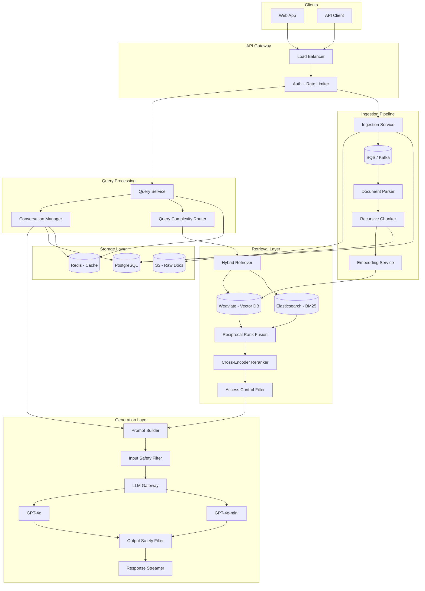
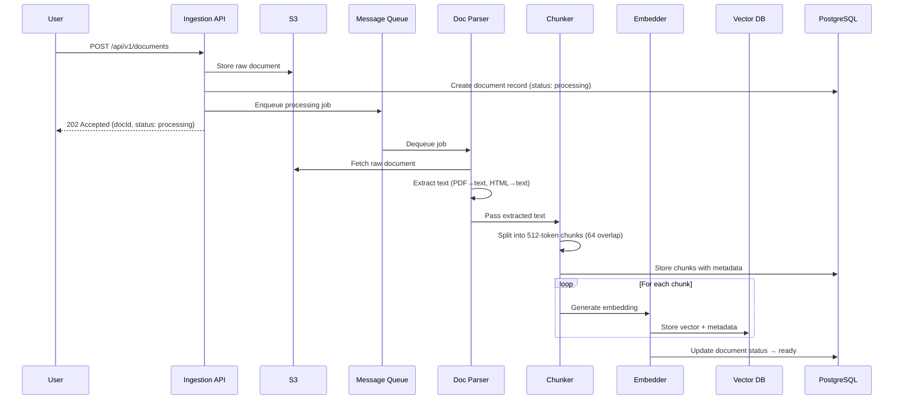
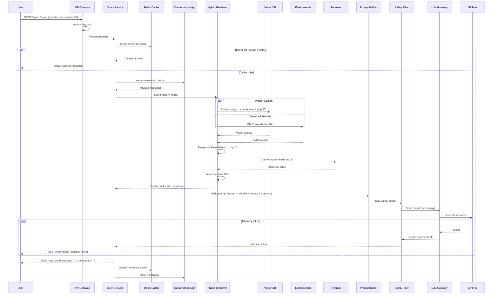

# Document Q&A RAG System Design

Complete high-level design for an LLM-powered document question-answering system with retrieval-augmented generation.

---

## Overview

This document describes the architecture for an enterprise RAG system that allows users to ask natural language questions over a corpus of 500K+ documents and receive accurate, cited answers in real-time via streaming.

### Architecture Diagram



---

## Detailed Design

### 1. Ingestion Pipeline

The ingestion pipeline converts raw documents into searchable, embeddable chunks.

#### Flow



#### Chunking Strategy

| Parameter | Value | Reasoning |
|-----------|-------|-----------|
| Method | Recursive character splitting | Respects document structure |
| Target size | 512 tokens | Balances context vs precision |
| Overlap | 64 tokens | Preserves cross-boundary context |
| Split hierarchy | Headers → paragraphs → sentences | Keeps semantic units intact |
| Metadata preserved | Page number, section header, doc title | Enables citations |

#### Processing Rates

```
Single worker: ~100 documents/hour (parsing + chunking + embedding)
Target: 1,000 documents/hour → 10 workers
Auto-scale workers based on queue depth
```

### 2. Query Processing Pipeline

#### Query Flow



#### Hybrid Retrieval Detail

```
┌─────────────────────────────────────────────────┐
│                 User Query                       │
│        "What was Q3 revenue growth?"            │
└──────────────────┬──────────────────────────────┘
                   │
         ┌─────────┴─────────┐
         ▼                   ▼
┌─────────────────┐  ┌─────────────────┐
│  Vector Search  │  │  BM25 Search    │
│  (Semantic)     │  │  (Keyword)      │
│                 │  │                 │
│ Embed query →   │  │ Term matching → │
│ Cosine sim →    │  │ BM25 scoring →  │
│ Top 20          │  │ Top 20          │
└────────┬────────┘  └────────┬────────┘
         │                    │
         └────────┬───────────┘
                  ▼
    ┌──────────────────────────┐
    │ Reciprocal Rank Fusion   │
    │ score = Σ 1/(60 + rank)  │
    │ Merge + dedupe → Top 30  │
    └────────────┬─────────────┘
                 ▼
    ┌──────────────────────────┐
    │ Cross-Encoder Reranker   │
    │ Score each (query, chunk)│
    │ Select top 5             │
    └────────────┬─────────────┘
                 ▼
    ┌──────────────────────────┐
    │ Access Control Filter    │
    │ Remove unauthorized chunks│
    └────────────┬─────────────┘
                 ▼
         Top 5 Chunks (Cited)
```

### 3. Model Selection & Routing

Pricing note (audited 2026-06-14): model names and dollar values here are examples for routing trade-off practice. Refresh provider pricing pages before quoting exact costs.

| Use Case | Model | Input Cost | Output Cost | P50 Latency | P99 Latency |
|----------|-------|-----------|-------------|-------------|-------------|
| Complex Q&A | GPT-4o | $2.50/1M | $10.00/1M | 1.5s | 4s |
| Simple lookup | GPT-4o-mini | $0.15/1M | $0.60/1M | 0.5s | 1.5s |
| Embedding | text-embedding-3-small | $0.02/1M | — | 80ms | 200ms |
| Reranking | Cohere Rerank v3 | $0.10/query | — | 150ms | 400ms |

**Query Complexity Router:**
```
Simple (→ GPT-4o-mini):
- Single-fact lookups ("What is X?")
- Yes/no questions
- Retrieval scores > 0.9 (high confidence)

Complex (→ GPT-4o):
- Multi-hop reasoning ("Compare X and Y across reports")
- Summarization ("Summarize the key findings")
- Low retrieval scores (needs more reasoning)
- Multi-turn with complex context
```

### 4. Safety & Guardrails

#### Input Safety

```
1. Prompt Injection Detection
   - Pattern matching: "ignore previous instructions", "system prompt"
   - ML classifier trained on injection examples
   - Action: Block request, return safe error message

2. Off-Topic Detection
   - Intent classifier: is this a document question?
   - Action: "I can only answer questions about your documents"

3. Rate Limiting
   - Per-user: 100 queries/hour
   - Per-org: 1000 queries/hour
   - Token budget: 500K tokens/user/day
```

#### Output Safety

```
1. Groundedness Check
   - Verify each claim maps to a retrieved chunk
   - If ungrounded claim detected → replace with "Based on available documents..."

2. Toxicity Filter
   - OpenAI Moderation API on generated text
   - Block and regenerate if flagged

3. PII Detection
   - Regex + NER for emails, phone numbers, SSNs
   - Redact from response before sending

4. Citation Verification
   - Every [Source N] must map to a retrieved chunk
   - Remove orphaned citations
```

### 5. Evaluation & Observability

#### Metrics Dashboard

| Metric | Source | Target | Alert |
|--------|--------|--------|-------|
| Answer relevance (RAGAS) | Weekly eval on golden set | > 85% | < 75% |
| Faithfulness | NLI check per response | > 90% | < 80% |
| Citation precision | Automated verification | > 95% | < 85% |
| Retrieval precision@5 | Labeled test queries | > 70% | < 55% |
| First token latency (P50) | APM | < 1s | > 2s |
| Full response latency (P50) | APM | < 4s | > 8s |
| Cache hit rate | Redis metrics | > 30% | < 15% |
| Cost per query | Token tracking | < $0.05 | > $0.08 |
| Thumbs up rate | User feedback | > 80% | < 65% |

#### Feedback Loop

```
User feedback (👍/👎) → QA review queue → Pattern analysis →
→ Chunking improvements OR retrieval tuning OR prompt changes →
→ A/B test → Deploy if improved on golden set
```

### 6. Caching Strategy

#### Semantic Cache

```
Implementation:
1. Embed incoming query → 1536-dim vector
2. Search Redis (vector similarity) for cached queries
3. If match found (cosine > 0.95):
   - Return cached answer + sources
   - Latency: ~50ms instead of ~2s
   - Cost: $0 instead of ~$0.04
4. If no match:
   - Execute full RAG pipeline
   - Cache: {query_embedding, answer, sources, timestamp}
   - TTL: 1 hour (or until source documents change)

Invalidation:
- On document re-ingestion: clear cache entries citing that document
- Time-based: 1-hour TTL for freshness
- Manual: admin can flush cache
```

#### Session Cache

```
Conversation context in Redis:
- Key: conversation:{conv_id}
- Value: last 10 messages (trimmed to 4K tokens)
- TTL: 24 hours
- Purpose: fast context loading for follow-up questions
```

---

## Trade-offs Summary

| Decision | Chose | Alternative | Why |
|----------|-------|-------------|-----|
| Retrieval | Hybrid (vector + BM25) | Pure vector | Enterprise terms need keyword matching |
| Vector DB | Dedicated (Weaviate) | pgvector | Scale to 10M+ vectors with filtering |
| Response | Streaming (SSE) | Batch | Perceived latency < 1s |
| Chunking | 512 tokens | 256 or 1024 | Balance precision vs context |
| Reranking | Cross-encoder | No reranker | 15-20% quality improvement worth latency |
| Model | GPT-4o + routing | Single model | Cost optimization via smart routing |

---

## Failure Scenarios

| Failure | Impact | Mitigation |
|---------|--------|------------|
| LLM provider down | No generation | Circuit breaker → fallback model (Llama 3) |
| Vector DB down | No retrieval | Read replicas, fallback to BM25 only |
| Redis down | No cache, no sessions | Bypass cache, load context from PostgreSQL |
| Ingestion queue full | New docs delayed | Dead letter queue, auto-scale workers |
| High latency spike | Poor UX | Timeout (10s), return partial answer |

---

## Capacity Planning

| Component | Current Capacity | Headroom |
|-----------|-----------------|----------|
| Query QPS | 1.2 peak | 10x → 12 QPS |
| Documents | 500K | 2x → 1M |
| Vectors | 10M | 3x → 30M |
| Storage | 150 GB | 5x → 750 GB |
| LLM budget | $7,500/month | Scales with traffic |

---

## Component Summary

| Component | Technology | Purpose | Scaling |
|-----------|-----------|---------|---------|
| API Gateway | AWS ALB + Lambda Authorizer | Auth, routing, rate limit | Auto-scaling |
| Query Service | Python (FastAPI) | Orchestrate query pipeline | Horizontal (5-20 pods) |
| Vector DB | Weaviate | Semantic search | Sharded, replicated |
| Search | Elasticsearch | BM25 keyword search | 3-node cluster |
| Reranker | Cohere Rerank API | Improve retrieval quality | Managed service |
| LLM Gateway | Custom proxy | Model routing, retry, fallback | Horizontal |
| PostgreSQL | RDS | Metadata, conversations | Read replicas |
| Redis | ElastiCache | Semantic cache, sessions | Cluster mode |
| S3 | AWS S3 | Raw document storage | Unlimited |
| Queue | SQS / Kafka | Async ingestion | Auto-scaling |

---

*See [APPROACH.md](./APPROACH.md) for step-by-step thinking and [PROBLEM.md](./PROBLEM.md) for requirements. Diagrams available in [diagrams/](./diagrams/).*
