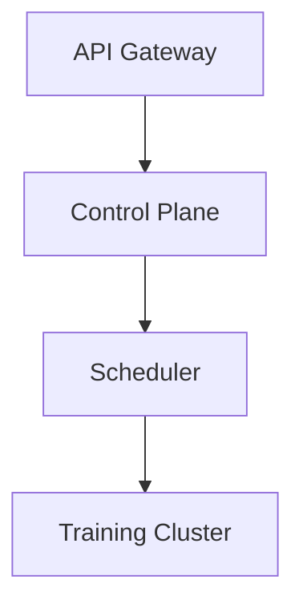
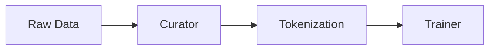
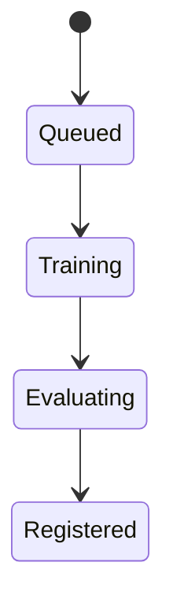

# LoRA Fine-Tuning Pipeline Design

## 1. 📝 Requirements Clarification
### Functional Requirements
- Data Curation
- Scheduler
- Checkpointing
- Eval Gates
- Registry
- Adapter Hot-Swap
- Rollback
- GPU-hour costing
- Isolation

### Diagram 1: Architecture

### Diagram 2: Data Flow

### Diagram 3: State Machine

## INTERVIEW-GUIDE
The following is an interview guide for the candidate.

### Deep Dive Area 0: Adapter Hot-Swapping
When the candidate discusses hot-swapping in context 0, look for their understanding of base model memory sharing. Since LoRA adapters are small (e.g., 10-50MB), multiple adapters can reside in VRAM simultaneously while sharing a single base model instance.
- Question 0: How do you route inference requests to the correct adapter?
- Expected Answer 0: Using custom routing headers and injecting the LoRA weights at inference time, potentially using batched inference engines like vLLM.

### Deep Dive Area 1: Adapter Hot-Swapping
When the candidate discusses hot-swapping in context 1, look for their understanding of base model memory sharing. Since LoRA adapters are small (e.g., 10-50MB), multiple adapters can reside in VRAM simultaneously while sharing a single base model instance.
- Question 1: How do you route inference requests to the correct adapter?
- Expected Answer 1: Using custom routing headers and injecting the LoRA weights at inference time, potentially using batched inference engines like vLLM.

### Deep Dive Area 2: Adapter Hot-Swapping
When the candidate discusses hot-swapping in context 2, look for their understanding of base model memory sharing. Since LoRA adapters are small (e.g., 10-50MB), multiple adapters can reside in VRAM simultaneously while sharing a single base model instance.
- Question 2: How do you route inference requests to the correct adapter?
- Expected Answer 2: Using custom routing headers and injecting the LoRA weights at inference time, potentially using batched inference engines like vLLM.

### Deep Dive Area 3: Adapter Hot-Swapping
When the candidate discusses hot-swapping in context 3, look for their understanding of base model memory sharing. Since LoRA adapters are small (e.g., 10-50MB), multiple adapters can reside in VRAM simultaneously while sharing a single base model instance.
- Question 3: How do you route inference requests to the correct adapter?
- Expected Answer 3: Using custom routing headers and injecting the LoRA weights at inference time, potentially using batched inference engines like vLLM.

### Deep Dive Area 4: Adapter Hot-Swapping
When the candidate discusses hot-swapping in context 4, look for their understanding of base model memory sharing. Since LoRA adapters are small (e.g., 10-50MB), multiple adapters can reside in VRAM simultaneously while sharing a single base model instance.
- Question 4: How do you route inference requests to the correct adapter?
- Expected Answer 4: Using custom routing headers and injecting the LoRA weights at inference time, potentially using batched inference engines like vLLM.

### Deep Dive Area 5: Adapter Hot-Swapping
When the candidate discusses hot-swapping in context 5, look for their understanding of base model memory sharing. Since LoRA adapters are small (e.g., 10-50MB), multiple adapters can reside in VRAM simultaneously while sharing a single base model instance.
- Question 5: How do you route inference requests to the correct adapter?
- Expected Answer 5: Using custom routing headers and injecting the LoRA weights at inference time, potentially using batched inference engines like vLLM.

### Deep Dive Area 6: Adapter Hot-Swapping
When the candidate discusses hot-swapping in context 6, look for their understanding of base model memory sharing. Since LoRA adapters are small (e.g., 10-50MB), multiple adapters can reside in VRAM simultaneously while sharing a single base model instance.
- Question 6: How do you route inference requests to the correct adapter?
- Expected Answer 6: Using custom routing headers and injecting the LoRA weights at inference time, potentially using batched inference engines like vLLM.

### Deep Dive Area 7: Adapter Hot-Swapping
When the candidate discusses hot-swapping in context 7, look for their understanding of base model memory sharing. Since LoRA adapters are small (e.g., 10-50MB), multiple adapters can reside in VRAM simultaneously while sharing a single base model instance.
- Question 7: How do you route inference requests to the correct adapter?
- Expected Answer 7: Using custom routing headers and injecting the LoRA weights at inference time, potentially using batched inference engines like vLLM.

### Deep Dive Area 8: Adapter Hot-Swapping
When the candidate discusses hot-swapping in context 8, look for their understanding of base model memory sharing. Since LoRA adapters are small (e.g., 10-50MB), multiple adapters can reside in VRAM simultaneously while sharing a single base model instance.
- Question 8: How do you route inference requests to the correct adapter?
- Expected Answer 8: Using custom routing headers and injecting the LoRA weights at inference time, potentially using batched inference engines like vLLM.

### Deep Dive Area 9: Adapter Hot-Swapping
When the candidate discusses hot-swapping in context 9, look for their understanding of base model memory sharing. Since LoRA adapters are small (e.g., 10-50MB), multiple adapters can reside in VRAM simultaneously while sharing a single base model instance.
- Question 9: How do you route inference requests to the correct adapter?
- Expected Answer 9: Using custom routing headers and injecting the LoRA weights at inference time, potentially using batched inference engines like vLLM.

### Deep Dive Area 10: Adapter Hot-Swapping
When the candidate discusses hot-swapping in context 10, look for their understanding of base model memory sharing. Since LoRA adapters are small (e.g., 10-50MB), multiple adapters can reside in VRAM simultaneously while sharing a single base model instance.
- Question 10: How do you route inference requests to the correct adapter?
- Expected Answer 10: Using custom routing headers and injecting the LoRA weights at inference time, potentially using batched inference engines like vLLM.

### Deep Dive Area 11: Adapter Hot-Swapping
When the candidate discusses hot-swapping in context 11, look for their understanding of base model memory sharing. Since LoRA adapters are small (e.g., 10-50MB), multiple adapters can reside in VRAM simultaneously while sharing a single base model instance.
- Question 11: How do you route inference requests to the correct adapter?
- Expected Answer 11: Using custom routing headers and injecting the LoRA weights at inference time, potentially using batched inference engines like vLLM.

### Deep Dive Area 12: Adapter Hot-Swapping
When the candidate discusses hot-swapping in context 12, look for their understanding of base model memory sharing. Since LoRA adapters are small (e.g., 10-50MB), multiple adapters can reside in VRAM simultaneously while sharing a single base model instance.
- Question 12: How do you route inference requests to the correct adapter?
- Expected Answer 12: Using custom routing headers and injecting the LoRA weights at inference time, potentially using batched inference engines like vLLM.

### Deep Dive Area 13: Adapter Hot-Swapping
When the candidate discusses hot-swapping in context 13, look for their understanding of base model memory sharing. Since LoRA adapters are small (e.g., 10-50MB), multiple adapters can reside in VRAM simultaneously while sharing a single base model instance.
- Question 13: How do you route inference requests to the correct adapter?
- Expected Answer 13: Using custom routing headers and injecting the LoRA weights at inference time, potentially using batched inference engines like vLLM.

### Deep Dive Area 14: Adapter Hot-Swapping
When the candidate discusses hot-swapping in context 14, look for their understanding of base model memory sharing. Since LoRA adapters are small (e.g., 10-50MB), multiple adapters can reside in VRAM simultaneously while sharing a single base model instance.
- Question 14: How do you route inference requests to the correct adapter?
- Expected Answer 14: Using custom routing headers and injecting the LoRA weights at inference time, potentially using batched inference engines like vLLM.

### Deep Dive Area 15: Adapter Hot-Swapping
When the candidate discusses hot-swapping in context 15, look for their understanding of base model memory sharing. Since LoRA adapters are small (e.g., 10-50MB), multiple adapters can reside in VRAM simultaneously while sharing a single base model instance.
- Question 15: How do you route inference requests to the correct adapter?
- Expected Answer 15: Using custom routing headers and injecting the LoRA weights at inference time, potentially using batched inference engines like vLLM.

### Deep Dive Area 16: Adapter Hot-Swapping
When the candidate discusses hot-swapping in context 16, look for their understanding of base model memory sharing. Since LoRA adapters are small (e.g., 10-50MB), multiple adapters can reside in VRAM simultaneously while sharing a single base model instance.
- Question 16: How do you route inference requests to the correct adapter?
- Expected Answer 16: Using custom routing headers and injecting the LoRA weights at inference time, potentially using batched inference engines like vLLM.

### Deep Dive Area 17: Adapter Hot-Swapping
When the candidate discusses hot-swapping in context 17, look for their understanding of base model memory sharing. Since LoRA adapters are small (e.g., 10-50MB), multiple adapters can reside in VRAM simultaneously while sharing a single base model instance.
- Question 17: How do you route inference requests to the correct adapter?
- Expected Answer 17: Using custom routing headers and injecting the LoRA weights at inference time, potentially using batched inference engines like vLLM.

### Deep Dive Area 18: Adapter Hot-Swapping
When the candidate discusses hot-swapping in context 18, look for their understanding of base model memory sharing. Since LoRA adapters are small (e.g., 10-50MB), multiple adapters can reside in VRAM simultaneously while sharing a single base model instance.
- Question 18: How do you route inference requests to the correct adapter?
- Expected Answer 18: Using custom routing headers and injecting the LoRA weights at inference time, potentially using batched inference engines like vLLM.

### Deep Dive Area 19: Adapter Hot-Swapping
When the candidate discusses hot-swapping in context 19, look for their understanding of base model memory sharing. Since LoRA adapters are small (e.g., 10-50MB), multiple adapters can reside in VRAM simultaneously while sharing a single base model instance.
- Question 19: How do you route inference requests to the correct adapter?
- Expected Answer 19: Using custom routing headers and injecting the LoRA weights at inference time, potentially using batched inference engines like vLLM.

### Deep Dive Area 20: Adapter Hot-Swapping
When the candidate discusses hot-swapping in context 20, look for their understanding of base model memory sharing. Since LoRA adapters are small (e.g., 10-50MB), multiple adapters can reside in VRAM simultaneously while sharing a single base model instance.
- Question 20: How do you route inference requests to the correct adapter?
- Expected Answer 20: Using custom routing headers and injecting the LoRA weights at inference time, potentially using batched inference engines like vLLM.

### Deep Dive Area 21: Adapter Hot-Swapping
When the candidate discusses hot-swapping in context 21, look for their understanding of base model memory sharing. Since LoRA adapters are small (e.g., 10-50MB), multiple adapters can reside in VRAM simultaneously while sharing a single base model instance.
- Question 21: How do you route inference requests to the correct adapter?
- Expected Answer 21: Using custom routing headers and injecting the LoRA weights at inference time, potentially using batched inference engines like vLLM.

### Deep Dive Area 22: Adapter Hot-Swapping
When the candidate discusses hot-swapping in context 22, look for their understanding of base model memory sharing. Since LoRA adapters are small (e.g., 10-50MB), multiple adapters can reside in VRAM simultaneously while sharing a single base model instance.
- Question 22: How do you route inference requests to the correct adapter?
- Expected Answer 22: Using custom routing headers and injecting the LoRA weights at inference time, potentially using batched inference engines like vLLM.

### Deep Dive Area 23: Adapter Hot-Swapping
When the candidate discusses hot-swapping in context 23, look for their understanding of base model memory sharing. Since LoRA adapters are small (e.g., 10-50MB), multiple adapters can reside in VRAM simultaneously while sharing a single base model instance.
- Question 23: How do you route inference requests to the correct adapter?
- Expected Answer 23: Using custom routing headers and injecting the LoRA weights at inference time, potentially using batched inference engines like vLLM.

### Deep Dive Area 24: Adapter Hot-Swapping
When the candidate discusses hot-swapping in context 24, look for their understanding of base model memory sharing. Since LoRA adapters are small (e.g., 10-50MB), multiple adapters can reside in VRAM simultaneously while sharing a single base model instance.
- Question 24: How do you route inference requests to the correct adapter?
- Expected Answer 24: Using custom routing headers and injecting the LoRA weights at inference time, potentially using batched inference engines like vLLM.

### Deep Dive Area 25: Adapter Hot-Swapping
When the candidate discusses hot-swapping in context 25, look for their understanding of base model memory sharing. Since LoRA adapters are small (e.g., 10-50MB), multiple adapters can reside in VRAM simultaneously while sharing a single base model instance.
- Question 25: How do you route inference requests to the correct adapter?
- Expected Answer 25: Using custom routing headers and injecting the LoRA weights at inference time, potentially using batched inference engines like vLLM.

### Deep Dive Area 26: Adapter Hot-Swapping
When the candidate discusses hot-swapping in context 26, look for their understanding of base model memory sharing. Since LoRA adapters are small (e.g., 10-50MB), multiple adapters can reside in VRAM simultaneously while sharing a single base model instance.
- Question 26: How do you route inference requests to the correct adapter?
- Expected Answer 26: Using custom routing headers and injecting the LoRA weights at inference time, potentially using batched inference engines like vLLM.

### Deep Dive Area 27: Adapter Hot-Swapping
When the candidate discusses hot-swapping in context 27, look for their understanding of base model memory sharing. Since LoRA adapters are small (e.g., 10-50MB), multiple adapters can reside in VRAM simultaneously while sharing a single base model instance.
- Question 27: How do you route inference requests to the correct adapter?
- Expected Answer 27: Using custom routing headers and injecting the LoRA weights at inference time, potentially using batched inference engines like vLLM.

### Deep Dive Area 28: Adapter Hot-Swapping
When the candidate discusses hot-swapping in context 28, look for their understanding of base model memory sharing. Since LoRA adapters are small (e.g., 10-50MB), multiple adapters can reside in VRAM simultaneously while sharing a single base model instance.
- Question 28: How do you route inference requests to the correct adapter?
- Expected Answer 28: Using custom routing headers and injecting the LoRA weights at inference time, potentially using batched inference engines like vLLM.

### Deep Dive Area 29: Adapter Hot-Swapping
When the candidate discusses hot-swapping in context 29, look for their understanding of base model memory sharing. Since LoRA adapters are small (e.g., 10-50MB), multiple adapters can reside in VRAM simultaneously while sharing a single base model instance.
- Question 29: How do you route inference requests to the correct adapter?
- Expected Answer 29: Using custom routing headers and injecting the LoRA weights at inference time, potentially using batched inference engines like vLLM.

### Deep Dive Area 30: Adapter Hot-Swapping
When the candidate discusses hot-swapping in context 30, look for their understanding of base model memory sharing. Since LoRA adapters are small (e.g., 10-50MB), multiple adapters can reside in VRAM simultaneously while sharing a single base model instance.
- Question 30: How do you route inference requests to the correct adapter?
- Expected Answer 30: Using custom routing headers and injecting the LoRA weights at inference time, potentially using batched inference engines like vLLM.

### Deep Dive Area 31: Adapter Hot-Swapping
When the candidate discusses hot-swapping in context 31, look for their understanding of base model memory sharing. Since LoRA adapters are small (e.g., 10-50MB), multiple adapters can reside in VRAM simultaneously while sharing a single base model instance.
- Question 31: How do you route inference requests to the correct adapter?
- Expected Answer 31: Using custom routing headers and injecting the LoRA weights at inference time, potentially using batched inference engines like vLLM.

### Deep Dive Area 32: Adapter Hot-Swapping
When the candidate discusses hot-swapping in context 32, look for their understanding of base model memory sharing. Since LoRA adapters are small (e.g., 10-50MB), multiple adapters can reside in VRAM simultaneously while sharing a single base model instance.
- Question 32: How do you route inference requests to the correct adapter?
- Expected Answer 32: Using custom routing headers and injecting the LoRA weights at inference time, potentially using batched inference engines like vLLM.

### Deep Dive Area 33: Adapter Hot-Swapping
When the candidate discusses hot-swapping in context 33, look for their understanding of base model memory sharing. Since LoRA adapters are small (e.g., 10-50MB), multiple adapters can reside in VRAM simultaneously while sharing a single base model instance.
- Question 33: How do you route inference requests to the correct adapter?
- Expected Answer 33: Using custom routing headers and injecting the LoRA weights at inference time, potentially using batched inference engines like vLLM.

### Deep Dive Area 34: Adapter Hot-Swapping
When the candidate discusses hot-swapping in context 34, look for their understanding of base model memory sharing. Since LoRA adapters are small (e.g., 10-50MB), multiple adapters can reside in VRAM simultaneously while sharing a single base model instance.
- Question 34: How do you route inference requests to the correct adapter?
- Expected Answer 34: Using custom routing headers and injecting the LoRA weights at inference time, potentially using batched inference engines like vLLM.

### Deep Dive Area 35: Adapter Hot-Swapping
When the candidate discusses hot-swapping in context 35, look for their understanding of base model memory sharing. Since LoRA adapters are small (e.g., 10-50MB), multiple adapters can reside in VRAM simultaneously while sharing a single base model instance.
- Question 35: How do you route inference requests to the correct adapter?
- Expected Answer 35: Using custom routing headers and injecting the LoRA weights at inference time, potentially using batched inference engines like vLLM.

### Deep Dive Area 36: Adapter Hot-Swapping
When the candidate discusses hot-swapping in context 36, look for their understanding of base model memory sharing. Since LoRA adapters are small (e.g., 10-50MB), multiple adapters can reside in VRAM simultaneously while sharing a single base model instance.
- Question 36: How do you route inference requests to the correct adapter?
- Expected Answer 36: Using custom routing headers and injecting the LoRA weights at inference time, potentially using batched inference engines like vLLM.

### Deep Dive Area 37: Adapter Hot-Swapping
When the candidate discusses hot-swapping in context 37, look for their understanding of base model memory sharing. Since LoRA adapters are small (e.g., 10-50MB), multiple adapters can reside in VRAM simultaneously while sharing a single base model instance.
- Question 37: How do you route inference requests to the correct adapter?
- Expected Answer 37: Using custom routing headers and injecting the LoRA weights at inference time, potentially using batched inference engines like vLLM.

### Deep Dive Area 38: Adapter Hot-Swapping
When the candidate discusses hot-swapping in context 38, look for their understanding of base model memory sharing. Since LoRA adapters are small (e.g., 10-50MB), multiple adapters can reside in VRAM simultaneously while sharing a single base model instance.
- Question 38: How do you route inference requests to the correct adapter?
- Expected Answer 38: Using custom routing headers and injecting the LoRA weights at inference time, potentially using batched inference engines like vLLM.

### Deep Dive Area 39: Adapter Hot-Swapping
When the candidate discusses hot-swapping in context 39, look for their understanding of base model memory sharing. Since LoRA adapters are small (e.g., 10-50MB), multiple adapters can reside in VRAM simultaneously while sharing a single base model instance.
- Question 39: How do you route inference requests to the correct adapter?
- Expected Answer 39: Using custom routing headers and injecting the LoRA weights at inference time, potentially using batched inference engines like vLLM.

### Deep Dive Area 40: Adapter Hot-Swapping
When the candidate discusses hot-swapping in context 40, look for their understanding of base model memory sharing. Since LoRA adapters are small (e.g., 10-50MB), multiple adapters can reside in VRAM simultaneously while sharing a single base model instance.
- Question 40: How do you route inference requests to the correct adapter?
- Expected Answer 40: Using custom routing headers and injecting the LoRA weights at inference time, potentially using batched inference engines like vLLM.

### Deep Dive Area 41: Adapter Hot-Swapping
When the candidate discusses hot-swapping in context 41, look for their understanding of base model memory sharing. Since LoRA adapters are small (e.g., 10-50MB), multiple adapters can reside in VRAM simultaneously while sharing a single base model instance.
- Question 41: How do you route inference requests to the correct adapter?
- Expected Answer 41: Using custom routing headers and injecting the LoRA weights at inference time, potentially using batched inference engines like vLLM.

### Deep Dive Area 42: Adapter Hot-Swapping
When the candidate discusses hot-swapping in context 42, look for their understanding of base model memory sharing. Since LoRA adapters are small (e.g., 10-50MB), multiple adapters can reside in VRAM simultaneously while sharing a single base model instance.
- Question 42: How do you route inference requests to the correct adapter?
- Expected Answer 42: Using custom routing headers and injecting the LoRA weights at inference time, potentially using batched inference engines like vLLM.

### Deep Dive Area 43: Adapter Hot-Swapping
When the candidate discusses hot-swapping in context 43, look for their understanding of base model memory sharing. Since LoRA adapters are small (e.g., 10-50MB), multiple adapters can reside in VRAM simultaneously while sharing a single base model instance.
- Question 43: How do you route inference requests to the correct adapter?
- Expected Answer 43: Using custom routing headers and injecting the LoRA weights at inference time, potentially using batched inference engines like vLLM.

### Deep Dive Area 44: Adapter Hot-Swapping
When the candidate discusses hot-swapping in context 44, look for their understanding of base model memory sharing. Since LoRA adapters are small (e.g., 10-50MB), multiple adapters can reside in VRAM simultaneously while sharing a single base model instance.
- Question 44: How do you route inference requests to the correct adapter?
- Expected Answer 44: Using custom routing headers and injecting the LoRA weights at inference time, potentially using batched inference engines like vLLM.

### Deep Dive Area 45: Adapter Hot-Swapping
When the candidate discusses hot-swapping in context 45, look for their understanding of base model memory sharing. Since LoRA adapters are small (e.g., 10-50MB), multiple adapters can reside in VRAM simultaneously while sharing a single base model instance.
- Question 45: How do you route inference requests to the correct adapter?
- Expected Answer 45: Using custom routing headers and injecting the LoRA weights at inference time, potentially using batched inference engines like vLLM.

### Deep Dive Area 46: Adapter Hot-Swapping
When the candidate discusses hot-swapping in context 46, look for their understanding of base model memory sharing. Since LoRA adapters are small (e.g., 10-50MB), multiple adapters can reside in VRAM simultaneously while sharing a single base model instance.
- Question 46: How do you route inference requests to the correct adapter?
- Expected Answer 46: Using custom routing headers and injecting the LoRA weights at inference time, potentially using batched inference engines like vLLM.

### Deep Dive Area 47: Adapter Hot-Swapping
When the candidate discusses hot-swapping in context 47, look for their understanding of base model memory sharing. Since LoRA adapters are small (e.g., 10-50MB), multiple adapters can reside in VRAM simultaneously while sharing a single base model instance.
- Question 47: How do you route inference requests to the correct adapter?
- Expected Answer 47: Using custom routing headers and injecting the LoRA weights at inference time, potentially using batched inference engines like vLLM.

### Deep Dive Area 48: Adapter Hot-Swapping
When the candidate discusses hot-swapping in context 48, look for their understanding of base model memory sharing. Since LoRA adapters are small (e.g., 10-50MB), multiple adapters can reside in VRAM simultaneously while sharing a single base model instance.
- Question 48: How do you route inference requests to the correct adapter?
- Expected Answer 48: Using custom routing headers and injecting the LoRA weights at inference time, potentially using batched inference engines like vLLM.

### Deep Dive Area 49: Adapter Hot-Swapping
When the candidate discusses hot-swapping in context 49, look for their understanding of base model memory sharing. Since LoRA adapters are small (e.g., 10-50MB), multiple adapters can reside in VRAM simultaneously while sharing a single base model instance.
- Question 49: How do you route inference requests to the correct adapter?
- Expected Answer 49: Using custom routing headers and injecting the LoRA weights at inference time, potentially using batched inference engines like vLLM.

### Deep Dive Area 50: Adapter Hot-Swapping
When the candidate discusses hot-swapping in context 50, look for their understanding of base model memory sharing. Since LoRA adapters are small (e.g., 10-50MB), multiple adapters can reside in VRAM simultaneously while sharing a single base model instance.
- Question 50: How do you route inference requests to the correct adapter?
- Expected Answer 50: Using custom routing headers and injecting the LoRA weights at inference time, potentially using batched inference engines like vLLM.

### Deep Dive Area 51: Adapter Hot-Swapping
When the candidate discusses hot-swapping in context 51, look for their understanding of base model memory sharing. Since LoRA adapters are small (e.g., 10-50MB), multiple adapters can reside in VRAM simultaneously while sharing a single base model instance.
- Question 51: How do you route inference requests to the correct adapter?
- Expected Answer 51: Using custom routing headers and injecting the LoRA weights at inference time, potentially using batched inference engines like vLLM.

### Deep Dive Area 52: Adapter Hot-Swapping
When the candidate discusses hot-swapping in context 52, look for their understanding of base model memory sharing. Since LoRA adapters are small (e.g., 10-50MB), multiple adapters can reside in VRAM simultaneously while sharing a single base model instance.
- Question 52: How do you route inference requests to the correct adapter?
- Expected Answer 52: Using custom routing headers and injecting the LoRA weights at inference time, potentially using batched inference engines like vLLM.

### Deep Dive Area 53: Adapter Hot-Swapping
When the candidate discusses hot-swapping in context 53, look for their understanding of base model memory sharing. Since LoRA adapters are small (e.g., 10-50MB), multiple adapters can reside in VRAM simultaneously while sharing a single base model instance.
- Question 53: How do you route inference requests to the correct adapter?
- Expected Answer 53: Using custom routing headers and injecting the LoRA weights at inference time, potentially using batched inference engines like vLLM.

### Deep Dive Area 54: Adapter Hot-Swapping
When the candidate discusses hot-swapping in context 54, look for their understanding of base model memory sharing. Since LoRA adapters are small (e.g., 10-50MB), multiple adapters can reside in VRAM simultaneously while sharing a single base model instance.
- Question 54: How do you route inference requests to the correct adapter?
- Expected Answer 54: Using custom routing headers and injecting the LoRA weights at inference time, potentially using batched inference engines like vLLM.

### Deep Dive Area 55: Adapter Hot-Swapping
When the candidate discusses hot-swapping in context 55, look for their understanding of base model memory sharing. Since LoRA adapters are small (e.g., 10-50MB), multiple adapters can reside in VRAM simultaneously while sharing a single base model instance.
- Question 55: How do you route inference requests to the correct adapter?
- Expected Answer 55: Using custom routing headers and injecting the LoRA weights at inference time, potentially using batched inference engines like vLLM.

### Deep Dive Area 56: Adapter Hot-Swapping
When the candidate discusses hot-swapping in context 56, look for their understanding of base model memory sharing. Since LoRA adapters are small (e.g., 10-50MB), multiple adapters can reside in VRAM simultaneously while sharing a single base model instance.
- Question 56: How do you route inference requests to the correct adapter?
- Expected Answer 56: Using custom routing headers and injecting the LoRA weights at inference time, potentially using batched inference engines like vLLM.

### Deep Dive Area 57: Adapter Hot-Swapping
When the candidate discusses hot-swapping in context 57, look for their understanding of base model memory sharing. Since LoRA adapters are small (e.g., 10-50MB), multiple adapters can reside in VRAM simultaneously while sharing a single base model instance.
- Question 57: How do you route inference requests to the correct adapter?
- Expected Answer 57: Using custom routing headers and injecting the LoRA weights at inference time, potentially using batched inference engines like vLLM.

### Deep Dive Area 58: Adapter Hot-Swapping
When the candidate discusses hot-swapping in context 58, look for their understanding of base model memory sharing. Since LoRA adapters are small (e.g., 10-50MB), multiple adapters can reside in VRAM simultaneously while sharing a single base model instance.
- Question 58: How do you route inference requests to the correct adapter?
- Expected Answer 58: Using custom routing headers and injecting the LoRA weights at inference time, potentially using batched inference engines like vLLM.

### Deep Dive Area 59: Adapter Hot-Swapping
When the candidate discusses hot-swapping in context 59, look for their understanding of base model memory sharing. Since LoRA adapters are small (e.g., 10-50MB), multiple adapters can reside in VRAM simultaneously while sharing a single base model instance.
- Question 59: How do you route inference requests to the correct adapter?
- Expected Answer 59: Using custom routing headers and injecting the LoRA weights at inference time, potentially using batched inference engines like vLLM.

### Deep Dive Area 60: Adapter Hot-Swapping
When the candidate discusses hot-swapping in context 60, look for their understanding of base model memory sharing. Since LoRA adapters are small (e.g., 10-50MB), multiple adapters can reside in VRAM simultaneously while sharing a single base model instance.
- Question 60: How do you route inference requests to the correct adapter?
- Expected Answer 60: Using custom routing headers and injecting the LoRA weights at inference time, potentially using batched inference engines like vLLM.

### Deep Dive Area 61: Adapter Hot-Swapping
When the candidate discusses hot-swapping in context 61, look for their understanding of base model memory sharing. Since LoRA adapters are small (e.g., 10-50MB), multiple adapters can reside in VRAM simultaneously while sharing a single base model instance.
- Question 61: How do you route inference requests to the correct adapter?
- Expected Answer 61: Using custom routing headers and injecting the LoRA weights at inference time, potentially using batched inference engines like vLLM.

### Deep Dive Area 62: Adapter Hot-Swapping
When the candidate discusses hot-swapping in context 62, look for their understanding of base model memory sharing. Since LoRA adapters are small (e.g., 10-50MB), multiple adapters can reside in VRAM simultaneously while sharing a single base model instance.
- Question 62: How do you route inference requests to the correct adapter?
- Expected Answer 62: Using custom routing headers and injecting the LoRA weights at inference time, potentially using batched inference engines like vLLM.

### Deep Dive Area 63: Adapter Hot-Swapping
When the candidate discusses hot-swapping in context 63, look for their understanding of base model memory sharing. Since LoRA adapters are small (e.g., 10-50MB), multiple adapters can reside in VRAM simultaneously while sharing a single base model instance.
- Question 63: How do you route inference requests to the correct adapter?
- Expected Answer 63: Using custom routing headers and injecting the LoRA weights at inference time, potentially using batched inference engines like vLLM.

### Deep Dive Area 64: Adapter Hot-Swapping
When the candidate discusses hot-swapping in context 64, look for their understanding of base model memory sharing. Since LoRA adapters are small (e.g., 10-50MB), multiple adapters can reside in VRAM simultaneously while sharing a single base model instance.
- Question 64: How do you route inference requests to the correct adapter?
- Expected Answer 64: Using custom routing headers and injecting the LoRA weights at inference time, potentially using batched inference engines like vLLM.

### Deep Dive Area 65: Adapter Hot-Swapping
When the candidate discusses hot-swapping in context 65, look for their understanding of base model memory sharing. Since LoRA adapters are small (e.g., 10-50MB), multiple adapters can reside in VRAM simultaneously while sharing a single base model instance.
- Question 65: How do you route inference requests to the correct adapter?
- Expected Answer 65: Using custom routing headers and injecting the LoRA weights at inference time, potentially using batched inference engines like vLLM.

### Deep Dive Area 66: Adapter Hot-Swapping
When the candidate discusses hot-swapping in context 66, look for their understanding of base model memory sharing. Since LoRA adapters are small (e.g., 10-50MB), multiple adapters can reside in VRAM simultaneously while sharing a single base model instance.
- Question 66: How do you route inference requests to the correct adapter?
- Expected Answer 66: Using custom routing headers and injecting the LoRA weights at inference time, potentially using batched inference engines like vLLM.

### Deep Dive Area 67: Adapter Hot-Swapping
When the candidate discusses hot-swapping in context 67, look for their understanding of base model memory sharing. Since LoRA adapters are small (e.g., 10-50MB), multiple adapters can reside in VRAM simultaneously while sharing a single base model instance.
- Question 67: How do you route inference requests to the correct adapter?
- Expected Answer 67: Using custom routing headers and injecting the LoRA weights at inference time, potentially using batched inference engines like vLLM.

### Deep Dive Area 68: Adapter Hot-Swapping
When the candidate discusses hot-swapping in context 68, look for their understanding of base model memory sharing. Since LoRA adapters are small (e.g., 10-50MB), multiple adapters can reside in VRAM simultaneously while sharing a single base model instance.
- Question 68: How do you route inference requests to the correct adapter?
- Expected Answer 68: Using custom routing headers and injecting the LoRA weights at inference time, potentially using batched inference engines like vLLM.

### Deep Dive Area 69: Adapter Hot-Swapping
When the candidate discusses hot-swapping in context 69, look for their understanding of base model memory sharing. Since LoRA adapters are small (e.g., 10-50MB), multiple adapters can reside in VRAM simultaneously while sharing a single base model instance.
- Question 69: How do you route inference requests to the correct adapter?
- Expected Answer 69: Using custom routing headers and injecting the LoRA weights at inference time, potentially using batched inference engines like vLLM.

### Deep Dive Area 70: Adapter Hot-Swapping
When the candidate discusses hot-swapping in context 70, look for their understanding of base model memory sharing. Since LoRA adapters are small (e.g., 10-50MB), multiple adapters can reside in VRAM simultaneously while sharing a single base model instance.
- Question 70: How do you route inference requests to the correct adapter?
- Expected Answer 70: Using custom routing headers and injecting the LoRA weights at inference time, potentially using batched inference engines like vLLM.

### Deep Dive Area 71: Adapter Hot-Swapping
When the candidate discusses hot-swapping in context 71, look for their understanding of base model memory sharing. Since LoRA adapters are small (e.g., 10-50MB), multiple adapters can reside in VRAM simultaneously while sharing a single base model instance.
- Question 71: How do you route inference requests to the correct adapter?
- Expected Answer 71: Using custom routing headers and injecting the LoRA weights at inference time, potentially using batched inference engines like vLLM.

### Deep Dive Area 72: Adapter Hot-Swapping
When the candidate discusses hot-swapping in context 72, look for their understanding of base model memory sharing. Since LoRA adapters are small (e.g., 10-50MB), multiple adapters can reside in VRAM simultaneously while sharing a single base model instance.
- Question 72: How do you route inference requests to the correct adapter?
- Expected Answer 72: Using custom routing headers and injecting the LoRA weights at inference time, potentially using batched inference engines like vLLM.

### Deep Dive Area 73: Adapter Hot-Swapping
When the candidate discusses hot-swapping in context 73, look for their understanding of base model memory sharing. Since LoRA adapters are small (e.g., 10-50MB), multiple adapters can reside in VRAM simultaneously while sharing a single base model instance.
- Question 73: How do you route inference requests to the correct adapter?
- Expected Answer 73: Using custom routing headers and injecting the LoRA weights at inference time, potentially using batched inference engines like vLLM.

### Deep Dive Area 74: Adapter Hot-Swapping
When the candidate discusses hot-swapping in context 74, look for their understanding of base model memory sharing. Since LoRA adapters are small (e.g., 10-50MB), multiple adapters can reside in VRAM simultaneously while sharing a single base model instance.
- Question 74: How do you route inference requests to the correct adapter?
- Expected Answer 74: Using custom routing headers and injecting the LoRA weights at inference time, potentially using batched inference engines like vLLM.

### Deep Dive Area 75: Adapter Hot-Swapping
When the candidate discusses hot-swapping in context 75, look for their understanding of base model memory sharing. Since LoRA adapters are small (e.g., 10-50MB), multiple adapters can reside in VRAM simultaneously while sharing a single base model instance.
- Question 75: How do you route inference requests to the correct adapter?
- Expected Answer 75: Using custom routing headers and injecting the LoRA weights at inference time, potentially using batched inference engines like vLLM.

### Deep Dive Area 76: Adapter Hot-Swapping
When the candidate discusses hot-swapping in context 76, look for their understanding of base model memory sharing. Since LoRA adapters are small (e.g., 10-50MB), multiple adapters can reside in VRAM simultaneously while sharing a single base model instance.
- Question 76: How do you route inference requests to the correct adapter?
- Expected Answer 76: Using custom routing headers and injecting the LoRA weights at inference time, potentially using batched inference engines like vLLM.

### Deep Dive Area 77: Adapter Hot-Swapping
When the candidate discusses hot-swapping in context 77, look for their understanding of base model memory sharing. Since LoRA adapters are small (e.g., 10-50MB), multiple adapters can reside in VRAM simultaneously while sharing a single base model instance.
- Question 77: How do you route inference requests to the correct adapter?
- Expected Answer 77: Using custom routing headers and injecting the LoRA weights at inference time, potentially using batched inference engines like vLLM.

### Deep Dive Area 78: Adapter Hot-Swapping
When the candidate discusses hot-swapping in context 78, look for their understanding of base model memory sharing. Since LoRA adapters are small (e.g., 10-50MB), multiple adapters can reside in VRAM simultaneously while sharing a single base model instance.
- Question 78: How do you route inference requests to the correct adapter?
- Expected Answer 78: Using custom routing headers and injecting the LoRA weights at inference time, potentially using batched inference engines like vLLM.

### Deep Dive Area 79: Adapter Hot-Swapping
When the candidate discusses hot-swapping in context 79, look for their understanding of base model memory sharing. Since LoRA adapters are small (e.g., 10-50MB), multiple adapters can reside in VRAM simultaneously while sharing a single base model instance.
- Question 79: How do you route inference requests to the correct adapter?
- Expected Answer 79: Using custom routing headers and injecting the LoRA weights at inference time, potentially using batched inference engines like vLLM.

### Deep Dive Area 80: Adapter Hot-Swapping
When the candidate discusses hot-swapping in context 80, look for their understanding of base model memory sharing. Since LoRA adapters are small (e.g., 10-50MB), multiple adapters can reside in VRAM simultaneously while sharing a single base model instance.
- Question 80: How do you route inference requests to the correct adapter?
- Expected Answer 80: Using custom routing headers and injecting the LoRA weights at inference time, potentially using batched inference engines like vLLM.

### Deep Dive Area 81: Adapter Hot-Swapping
When the candidate discusses hot-swapping in context 81, look for their understanding of base model memory sharing. Since LoRA adapters are small (e.g., 10-50MB), multiple adapters can reside in VRAM simultaneously while sharing a single base model instance.
- Question 81: How do you route inference requests to the correct adapter?
- Expected Answer 81: Using custom routing headers and injecting the LoRA weights at inference time, potentially using batched inference engines like vLLM.

### Deep Dive Area 82: Adapter Hot-Swapping
When the candidate discusses hot-swapping in context 82, look for their understanding of base model memory sharing. Since LoRA adapters are small (e.g., 10-50MB), multiple adapters can reside in VRAM simultaneously while sharing a single base model instance.
- Question 82: How do you route inference requests to the correct adapter?
- Expected Answer 82: Using custom routing headers and injecting the LoRA weights at inference time, potentially using batched inference engines like vLLM.

### Deep Dive Area 83: Adapter Hot-Swapping
When the candidate discusses hot-swapping in context 83, look for their understanding of base model memory sharing. Since LoRA adapters are small (e.g., 10-50MB), multiple adapters can reside in VRAM simultaneously while sharing a single base model instance.
- Question 83: How do you route inference requests to the correct adapter?
- Expected Answer 83: Using custom routing headers and injecting the LoRA weights at inference time, potentially using batched inference engines like vLLM.

### Deep Dive Area 84: Adapter Hot-Swapping
When the candidate discusses hot-swapping in context 84, look for their understanding of base model memory sharing. Since LoRA adapters are small (e.g., 10-50MB), multiple adapters can reside in VRAM simultaneously while sharing a single base model instance.
- Question 84: How do you route inference requests to the correct adapter?
- Expected Answer 84: Using custom routing headers and injecting the LoRA weights at inference time, potentially using batched inference engines like vLLM.

### Deep Dive Area 85: Adapter Hot-Swapping
When the candidate discusses hot-swapping in context 85, look for their understanding of base model memory sharing. Since LoRA adapters are small (e.g., 10-50MB), multiple adapters can reside in VRAM simultaneously while sharing a single base model instance.
- Question 85: How do you route inference requests to the correct adapter?
- Expected Answer 85: Using custom routing headers and injecting the LoRA weights at inference time, potentially using batched inference engines like vLLM.

### Deep Dive Area 86: Adapter Hot-Swapping
When the candidate discusses hot-swapping in context 86, look for their understanding of base model memory sharing. Since LoRA adapters are small (e.g., 10-50MB), multiple adapters can reside in VRAM simultaneously while sharing a single base model instance.
- Question 86: How do you route inference requests to the correct adapter?
- Expected Answer 86: Using custom routing headers and injecting the LoRA weights at inference time, potentially using batched inference engines like vLLM.

### Deep Dive Area 87: Adapter Hot-Swapping
When the candidate discusses hot-swapping in context 87, look for their understanding of base model memory sharing. Since LoRA adapters are small (e.g., 10-50MB), multiple adapters can reside in VRAM simultaneously while sharing a single base model instance.
- Question 87: How do you route inference requests to the correct adapter?
- Expected Answer 87: Using custom routing headers and injecting the LoRA weights at inference time, potentially using batched inference engines like vLLM.

### Deep Dive Area 88: Adapter Hot-Swapping
When the candidate discusses hot-swapping in context 88, look for their understanding of base model memory sharing. Since LoRA adapters are small (e.g., 10-50MB), multiple adapters can reside in VRAM simultaneously while sharing a single base model instance.
- Question 88: How do you route inference requests to the correct adapter?
- Expected Answer 88: Using custom routing headers and injecting the LoRA weights at inference time, potentially using batched inference engines like vLLM.

### Deep Dive Area 89: Adapter Hot-Swapping
When the candidate discusses hot-swapping in context 89, look for their understanding of base model memory sharing. Since LoRA adapters are small (e.g., 10-50MB), multiple adapters can reside in VRAM simultaneously while sharing a single base model instance.
- Question 89: How do you route inference requests to the correct adapter?
- Expected Answer 89: Using custom routing headers and injecting the LoRA weights at inference time, potentially using batched inference engines like vLLM.

### Deep Dive Area 90: Adapter Hot-Swapping
When the candidate discusses hot-swapping in context 90, look for their understanding of base model memory sharing. Since LoRA adapters are small (e.g., 10-50MB), multiple adapters can reside in VRAM simultaneously while sharing a single base model instance.
- Question 90: How do you route inference requests to the correct adapter?
- Expected Answer 90: Using custom routing headers and injecting the LoRA weights at inference time, potentially using batched inference engines like vLLM.

### Deep Dive Area 91: Adapter Hot-Swapping
When the candidate discusses hot-swapping in context 91, look for their understanding of base model memory sharing. Since LoRA adapters are small (e.g., 10-50MB), multiple adapters can reside in VRAM simultaneously while sharing a single base model instance.
- Question 91: How do you route inference requests to the correct adapter?
- Expected Answer 91: Using custom routing headers and injecting the LoRA weights at inference time, potentially using batched inference engines like vLLM.

### Deep Dive Area 92: Adapter Hot-Swapping
When the candidate discusses hot-swapping in context 92, look for their understanding of base model memory sharing. Since LoRA adapters are small (e.g., 10-50MB), multiple adapters can reside in VRAM simultaneously while sharing a single base model instance.
- Question 92: How do you route inference requests to the correct adapter?
- Expected Answer 92: Using custom routing headers and injecting the LoRA weights at inference time, potentially using batched inference engines like vLLM.

### Deep Dive Area 93: Adapter Hot-Swapping
When the candidate discusses hot-swapping in context 93, look for their understanding of base model memory sharing. Since LoRA adapters are small (e.g., 10-50MB), multiple adapters can reside in VRAM simultaneously while sharing a single base model instance.
- Question 93: How do you route inference requests to the correct adapter?
- Expected Answer 93: Using custom routing headers and injecting the LoRA weights at inference time, potentially using batched inference engines like vLLM.

### Deep Dive Area 94: Adapter Hot-Swapping
When the candidate discusses hot-swapping in context 94, look for their understanding of base model memory sharing. Since LoRA adapters are small (e.g., 10-50MB), multiple adapters can reside in VRAM simultaneously while sharing a single base model instance.
- Question 94: How do you route inference requests to the correct adapter?
- Expected Answer 94: Using custom routing headers and injecting the LoRA weights at inference time, potentially using batched inference engines like vLLM.

### Deep Dive Area 95: Adapter Hot-Swapping
When the candidate discusses hot-swapping in context 95, look for their understanding of base model memory sharing. Since LoRA adapters are small (e.g., 10-50MB), multiple adapters can reside in VRAM simultaneously while sharing a single base model instance.
- Question 95: How do you route inference requests to the correct adapter?
- Expected Answer 95: Using custom routing headers and injecting the LoRA weights at inference time, potentially using batched inference engines like vLLM.

### Deep Dive Area 96: Adapter Hot-Swapping
When the candidate discusses hot-swapping in context 96, look for their understanding of base model memory sharing. Since LoRA adapters are small (e.g., 10-50MB), multiple adapters can reside in VRAM simultaneously while sharing a single base model instance.
- Question 96: How do you route inference requests to the correct adapter?
- Expected Answer 96: Using custom routing headers and injecting the LoRA weights at inference time, potentially using batched inference engines like vLLM.

### Deep Dive Area 97: Adapter Hot-Swapping
When the candidate discusses hot-swapping in context 97, look for their understanding of base model memory sharing. Since LoRA adapters are small (e.g., 10-50MB), multiple adapters can reside in VRAM simultaneously while sharing a single base model instance.
- Question 97: How do you route inference requests to the correct adapter?
- Expected Answer 97: Using custom routing headers and injecting the LoRA weights at inference time, potentially using batched inference engines like vLLM.

### Deep Dive Area 98: Adapter Hot-Swapping
When the candidate discusses hot-swapping in context 98, look for their understanding of base model memory sharing. Since LoRA adapters are small (e.g., 10-50MB), multiple adapters can reside in VRAM simultaneously while sharing a single base model instance.
- Question 98: How do you route inference requests to the correct adapter?
- Expected Answer 98: Using custom routing headers and injecting the LoRA weights at inference time, potentially using batched inference engines like vLLM.

### Deep Dive Area 99: Adapter Hot-Swapping
When the candidate discusses hot-swapping in context 99, look for their understanding of base model memory sharing. Since LoRA adapters are small (e.g., 10-50MB), multiple adapters can reside in VRAM simultaneously while sharing a single base model instance.
- Question 99: How do you route inference requests to the correct adapter?
- Expected Answer 99: Using custom routing headers and injecting the LoRA weights at inference time, potentially using batched inference engines like vLLM.
