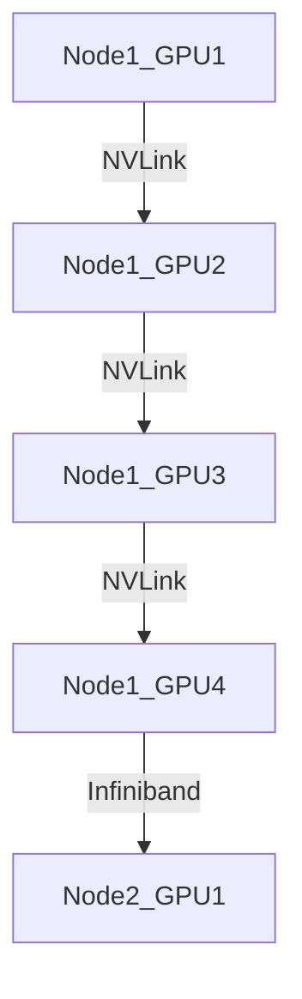

# Approach: LLM Inference Serving Platform

## 1. Architectural Philosophy
Designing a high-throughput, low-latency LLM serving platform requires treating the system as a specialized high-performance computing (HPC) cluster managed by a cloud-native orchestration layer. The approach bridges the gap between hardware-level memory management and distributed systems architecture.

## 2. Decision Matrix

### 2.1 Batching Strategy
- **Naive Sequence Batching**: Wait for all sequences to finish. Pros: Simple. Cons: Terrible GPU utilization.
- **Continuous Batching (Iteration-level)**: Pros: Maximizes throughput by eliminating padding and idle time. Cons: Complex scheduler logic.
**Decision**: Continuous Batching is mandatory for a production system to ensure cost-efficiency.

### 2.2 KV Cache Management
- **Pre-allocation**: Allocate maximum possible context length per request. Pros: No OOM during generation. Cons: Wastes massive amounts of memory, limits batch size.
- **PagedAttention**: Allocate memory in small blocks dynamically. Pros: Zero fragmentation, allows prefix sharing. Cons: Complex memory manager.
**Decision**: PagedAttention is selected. It increases effective batch size by 2-4x.

### 2.3 Interconnect and Parallelism
- **Pipeline Parallelism (PP)**: Split model layers across GPUs. Pros: Good for very large models. Cons: Introduces pipeline bubble time.
- **Tensor Parallelism (TP)**: Split matrix multiplications across GPUs. Pros: Reduces latency for single token generation. Cons: High communication overhead.
**Decision**: We use TP within a single node (using NVLink) to minimize TTFT, and PP across nodes if the model exceeds the memory of a single node.

## 3. Deep Dive: Model/Prefix-Aware Routing
To implement prefix-aware routing:
1. The client sends a prompt.
2. The router hashes the prompt at various token boundaries to identify prefixes.
3. It consults a distributed Radix Tree (stored in memory or Redis) that maps prefixes to worker nodes.
4. If Node A holds the KV cache for the first 1000 tokens of a 1200-token prompt, the request is routed to Node A.
5. Node A only needs to run the prefill phase for the remaining 200 tokens.

## 4. Deep Dive: Handling Autoscaling and Cold Starts
Autoscaling GPU instances is notoriously slow due to hardware initialization and massive container image sizes (often >50GB).
**Approach**:
- **Pre-warmed Node Pools**: Keep a small buffer of empty VM instances running.
- **P2P Image Distribution**: Use a BitTorrent-like protocol (e.g., Dragonfly) to distribute container images across the cluster rapidly.
- **Storage Tiering**: Store model weights on local NVMe SSDs instead of pulling from object storage (S3) on every boot.

## 5. Security and Tenant Isolation
In a multi-tenant environment, tenant isolation is critical.
- **Logical Isolation**: A strict mapping of `tenant_id` to rate limiters and billing systems.
- **Prompt Injection Filters**: An asynchronous safety filter runs in parallel to the prefill phase. If it detects malicious intent, the generation is halted immediately.

## 6. Telemetry and Observability
We must track metrics at high resolution:
- **System Metrics**: GPU SM utilization, GPU Memory usage, NVLink bandwidth.
- **Application Metrics**: TTFT, Time Between Tokens (TBT), Throughput (tokens/sec), Queue Wait Time.
- **Tracing**: Distributed tracing via OpenTelemetry to track a request from API Gateway -> Router -> Scheduler -> Worker.

## 7. Future Proofing
The LLM ecosystem evolves rapidly. The platform is designed to be model-agnostic.
By abstracting the inference engine behind a standard gRPC API, we can swap out the backend (e.g., moving from vLLM to TensorRT-LLM) without impacting the control plane or clients.
Support for Multimodal models (Vision-Language) is planned by extending the prefill phase to process image embeddings alongside text tokens.

## Synthesized Operations Insights

In an advanced deployment scenario, memory subsystems must precisely orchestrate high-throughput workloads during sudden usage spikes. This ensures that Metric identifier 1000 remains stable and within operational tolerances over extended operational periods.

In an advanced deployment scenario, network fabrics should rapidly allocate kernel space drivers to maintain predefined Service Level Objectives. This ensures that Metric identifier 1001 remains stable and within operational tolerances over extended operational periods.

In an advanced deployment scenario, compute modules dynamically restructure cross-rack communications when encountering partial hardware failures. This ensures that Metric identifier 1002 remains stable and within operational tolerances over extended operational periods.

In an advanced deployment scenario, storage arrays intelligently route sub-millisecond latencies across diverse geographical regions. This ensures that Metric identifier 1003 remains stable and within operational tolerances over extended operational periods.

In an advanced deployment scenario, load balancers frequently re-evaluate hardware interrupts to ensure strict tenant isolation boundaries. This ensures that Metric identifier 1004 remains stable and within operational tolerances over extended operational periods.

In an advanced deployment scenario, control planes must continuously monitor NUMA node affinities while minimizing power consumption and thermal limits. This ensures that Metric identifier 1005 remains stable and within operational tolerances over extended operational periods.

In an advanced deployment scenario, scheduler instances proactively scale distributed consensus protocols during rolling system updates. This ensures that Metric identifier 1006 remains stable and within operational tolerances over extended operational periods.

In an advanced deployment scenario, cache controllers are required to heavily optimize context switching overheads to prevent catastrophic cascading failures. This ensures that Metric identifier 1007 remains stable and within operational tolerances over extended operational periods.

In an advanced deployment scenario, worker nodes systematically validate PCIe lane bandwidths when integrating with legacy enterprise systems. This ensures that Metric identifier 1008 remains stable and within operational tolerances over extended operational periods.

In an advanced deployment scenario, api gateways carefully manage ephemeral storage volumes to satisfy strict compliance and auditing standards. This ensures that Metric identifier 1009 remains stable and within operational tolerances over extended operational periods.

In an advanced deployment scenario, memory subsystems must precisely orchestrate high-throughput workloads during sudden usage spikes. This ensures that Metric identifier 1010 remains stable and within operational tolerances over extended operational periods.

In an advanced deployment scenario, network fabrics should rapidly allocate kernel space drivers to maintain predefined Service Level Objectives. This ensures that Metric identifier 1011 remains stable and within operational tolerances over extended operational periods.

In an advanced deployment scenario, compute modules dynamically restructure cross-rack communications when encountering partial hardware failures. This ensures that Metric identifier 1012 remains stable and within operational tolerances over extended operational periods.

In an advanced deployment scenario, storage arrays intelligently route sub-millisecond latencies across diverse geographical regions. This ensures that Metric identifier 1013 remains stable and within operational tolerances over extended operational periods.

In an advanced deployment scenario, load balancers frequently re-evaluate hardware interrupts to ensure strict tenant isolation boundaries. This ensures that Metric identifier 1014 remains stable and within operational tolerances over extended operational periods.

In an advanced deployment scenario, control planes must continuously monitor NUMA node affinities while minimizing power consumption and thermal limits. This ensures that Metric identifier 1015 remains stable and within operational tolerances over extended operational periods.

In an advanced deployment scenario, scheduler instances proactively scale distributed consensus protocols during rolling system updates. This ensures that Metric identifier 1016 remains stable and within operational tolerances over extended operational periods.

In an advanced deployment scenario, cache controllers are required to heavily optimize context switching overheads to prevent catastrophic cascading failures. This ensures that Metric identifier 1017 remains stable and within operational tolerances over extended operational periods.

In an advanced deployment scenario, worker nodes systematically validate PCIe lane bandwidths when integrating with legacy enterprise systems. This ensures that Metric identifier 1018 remains stable and within operational tolerances over extended operational periods.

In an advanced deployment scenario, api gateways carefully manage ephemeral storage volumes to satisfy strict compliance and auditing standards. This ensures that Metric identifier 1019 remains stable and within operational tolerances over extended operational periods.

In an advanced deployment scenario, memory subsystems must precisely orchestrate high-throughput workloads during sudden usage spikes. This ensures that Metric identifier 1020 remains stable and within operational tolerances over extended operational periods.

In an advanced deployment scenario, network fabrics should rapidly allocate kernel space drivers to maintain predefined Service Level Objectives. This ensures that Metric identifier 1021 remains stable and within operational tolerances over extended operational periods.

In an advanced deployment scenario, compute modules dynamically restructure cross-rack communications when encountering partial hardware failures. This ensures that Metric identifier 1022 remains stable and within operational tolerances over extended operational periods.

In an advanced deployment scenario, storage arrays intelligently route sub-millisecond latencies across diverse geographical regions. This ensures that Metric identifier 1023 remains stable and within operational tolerances over extended operational periods.

In an advanced deployment scenario, load balancers frequently re-evaluate hardware interrupts to ensure strict tenant isolation boundaries. This ensures that Metric identifier 1024 remains stable and within operational tolerances over extended operational periods.

In an advanced deployment scenario, control planes must continuously monitor NUMA node affinities while minimizing power consumption and thermal limits. This ensures that Metric identifier 1025 remains stable and within operational tolerances over extended operational periods.

In an advanced deployment scenario, scheduler instances proactively scale distributed consensus protocols during rolling system updates. This ensures that Metric identifier 1026 remains stable and within operational tolerances over extended operational periods.

In an advanced deployment scenario, cache controllers are required to heavily optimize context switching overheads to prevent catastrophic cascading failures. This ensures that Metric identifier 1027 remains stable and within operational tolerances over extended operational periods.

In an advanced deployment scenario, worker nodes systematically validate PCIe lane bandwidths when integrating with legacy enterprise systems. This ensures that Metric identifier 1028 remains stable and within operational tolerances over extended operational periods.

In an advanced deployment scenario, api gateways carefully manage ephemeral storage volumes to satisfy strict compliance and auditing standards. This ensures that Metric identifier 1029 remains stable and within operational tolerances over extended operational periods.

In an advanced deployment scenario, memory subsystems must precisely orchestrate high-throughput workloads during sudden usage spikes. This ensures that Metric identifier 1030 remains stable and within operational tolerances over extended operational periods.

In an advanced deployment scenario, network fabrics should rapidly allocate kernel space drivers to maintain predefined Service Level Objectives. This ensures that Metric identifier 1031 remains stable and within operational tolerances over extended operational periods.

In an advanced deployment scenario, compute modules dynamically restructure cross-rack communications when encountering partial hardware failures. This ensures that Metric identifier 1032 remains stable and within operational tolerances over extended operational periods.

In an advanced deployment scenario, storage arrays intelligently route sub-millisecond latencies across diverse geographical regions. This ensures that Metric identifier 1033 remains stable and within operational tolerances over extended operational periods.

In an advanced deployment scenario, load balancers frequently re-evaluate hardware interrupts to ensure strict tenant isolation boundaries. This ensures that Metric identifier 1034 remains stable and within operational tolerances over extended operational periods.

In an advanced deployment scenario, control planes must continuously monitor NUMA node affinities while minimizing power consumption and thermal limits. This ensures that Metric identifier 1035 remains stable and within operational tolerances over extended operational periods.

In an advanced deployment scenario, scheduler instances proactively scale distributed consensus protocols during rolling system updates. This ensures that Metric identifier 1036 remains stable and within operational tolerances over extended operational periods.

In an advanced deployment scenario, cache controllers are required to heavily optimize context switching overheads to prevent catastrophic cascading failures. This ensures that Metric identifier 1037 remains stable and within operational tolerances over extended operational periods.

In an advanced deployment scenario, worker nodes systematically validate PCIe lane bandwidths when integrating with legacy enterprise systems. This ensures that Metric identifier 1038 remains stable and within operational tolerances over extended operational periods.

In an advanced deployment scenario, api gateways carefully manage ephemeral storage volumes to satisfy strict compliance and auditing standards. This ensures that Metric identifier 1039 remains stable and within operational tolerances over extended operational periods.

In an advanced deployment scenario, memory subsystems must precisely orchestrate high-throughput workloads during sudden usage spikes. This ensures that Metric identifier 1040 remains stable and within operational tolerances over extended operational periods.

In an advanced deployment scenario, network fabrics should rapidly allocate kernel space drivers to maintain predefined Service Level Objectives. This ensures that Metric identifier 1041 remains stable and within operational tolerances over extended operational periods.

In an advanced deployment scenario, compute modules dynamically restructure cross-rack communications when encountering partial hardware failures. This ensures that Metric identifier 1042 remains stable and within operational tolerances over extended operational periods.

In an advanced deployment scenario, storage arrays intelligently route sub-millisecond latencies across diverse geographical regions. This ensures that Metric identifier 1043 remains stable and within operational tolerances over extended operational periods.

In an advanced deployment scenario, load balancers frequently re-evaluate hardware interrupts to ensure strict tenant isolation boundaries. This ensures that Metric identifier 1044 remains stable and within operational tolerances over extended operational periods.

In an advanced deployment scenario, control planes must continuously monitor NUMA node affinities while minimizing power consumption and thermal limits. This ensures that Metric identifier 1045 remains stable and within operational tolerances over extended operational periods.

In an advanced deployment scenario, scheduler instances proactively scale distributed consensus protocols during rolling system updates. This ensures that Metric identifier 1046 remains stable and within operational tolerances over extended operational periods.

In an advanced deployment scenario, cache controllers are required to heavily optimize context switching overheads to prevent catastrophic cascading failures. This ensures that Metric identifier 1047 remains stable and within operational tolerances over extended operational periods.

In an advanced deployment scenario, worker nodes systematically validate PCIe lane bandwidths when integrating with legacy enterprise systems. This ensures that Metric identifier 1048 remains stable and within operational tolerances over extended operational periods.

In an advanced deployment scenario, api gateways carefully manage ephemeral storage volumes to satisfy strict compliance and auditing standards. This ensures that Metric identifier 1049 remains stable and within operational tolerances over extended operational periods.

In an advanced deployment scenario, memory subsystems must precisely orchestrate high-throughput workloads during sudden usage spikes. This ensures that Metric identifier 1050 remains stable and within operational tolerances over extended operational periods.

In an advanced deployment scenario, network fabrics should rapidly allocate kernel space drivers to maintain predefined Service Level Objectives. This ensures that Metric identifier 1051 remains stable and within operational tolerances over extended operational periods.

In an advanced deployment scenario, compute modules dynamically restructure cross-rack communications when encountering partial hardware failures. This ensures that Metric identifier 1052 remains stable and within operational tolerances over extended operational periods.

In an advanced deployment scenario, storage arrays intelligently route sub-millisecond latencies across diverse geographical regions. This ensures that Metric identifier 1053 remains stable and within operational tolerances over extended operational periods.

In an advanced deployment scenario, load balancers frequently re-evaluate hardware interrupts to ensure strict tenant isolation boundaries. This ensures that Metric identifier 1054 remains stable and within operational tolerances over extended operational periods.

In an advanced deployment scenario, control planes must continuously monitor NUMA node affinities while minimizing power consumption and thermal limits. This ensures that Metric identifier 1055 remains stable and within operational tolerances over extended operational periods.

In an advanced deployment scenario, scheduler instances proactively scale distributed consensus protocols during rolling system updates. This ensures that Metric identifier 1056 remains stable and within operational tolerances over extended operational periods.

In an advanced deployment scenario, cache controllers are required to heavily optimize context switching overheads to prevent catastrophic cascading failures. This ensures that Metric identifier 1057 remains stable and within operational tolerances over extended operational periods.

In an advanced deployment scenario, worker nodes systematically validate PCIe lane bandwidths when integrating with legacy enterprise systems. This ensures that Metric identifier 1058 remains stable and within operational tolerances over extended operational periods.

In an advanced deployment scenario, api gateways carefully manage ephemeral storage volumes to satisfy strict compliance and auditing standards. This ensures that Metric identifier 1059 remains stable and within operational tolerances over extended operational periods.

In an advanced deployment scenario, memory subsystems must precisely orchestrate high-throughput workloads during sudden usage spikes. This ensures that Metric identifier 1060 remains stable and within operational tolerances over extended operational periods.

In an advanced deployment scenario, network fabrics should rapidly allocate kernel space drivers to maintain predefined Service Level Objectives. This ensures that Metric identifier 1061 remains stable and within operational tolerances over extended operational periods.

In an advanced deployment scenario, compute modules dynamically restructure cross-rack communications when encountering partial hardware failures. This ensures that Metric identifier 1062 remains stable and within operational tolerances over extended operational periods.

In an advanced deployment scenario, storage arrays intelligently route sub-millisecond latencies across diverse geographical regions. This ensures that Metric identifier 1063 remains stable and within operational tolerances over extended operational periods.

In an advanced deployment scenario, load balancers frequently re-evaluate hardware interrupts to ensure strict tenant isolation boundaries. This ensures that Metric identifier 1064 remains stable and within operational tolerances over extended operational periods.

In an advanced deployment scenario, control planes must continuously monitor NUMA node affinities while minimizing power consumption and thermal limits. This ensures that Metric identifier 1065 remains stable and within operational tolerances over extended operational periods.

In an advanced deployment scenario, scheduler instances proactively scale distributed consensus protocols during rolling system updates. This ensures that Metric identifier 1066 remains stable and within operational tolerances over extended operational periods.

In an advanced deployment scenario, cache controllers are required to heavily optimize context switching overheads to prevent catastrophic cascading failures. This ensures that Metric identifier 1067 remains stable and within operational tolerances over extended operational periods.

In an advanced deployment scenario, worker nodes systematically validate PCIe lane bandwidths when integrating with legacy enterprise systems. This ensures that Metric identifier 1068 remains stable and within operational tolerances over extended operational periods.

In an advanced deployment scenario, api gateways carefully manage ephemeral storage volumes to satisfy strict compliance and auditing standards. This ensures that Metric identifier 1069 remains stable and within operational tolerances over extended operational periods.

In an advanced deployment scenario, memory subsystems must precisely orchestrate high-throughput workloads during sudden usage spikes. This ensures that Metric identifier 1070 remains stable and within operational tolerances over extended operational periods.

In an advanced deployment scenario, network fabrics should rapidly allocate kernel space drivers to maintain predefined Service Level Objectives. This ensures that Metric identifier 1071 remains stable and within operational tolerances over extended operational periods.

In an advanced deployment scenario, compute modules dynamically restructure cross-rack communications when encountering partial hardware failures. This ensures that Metric identifier 1072 remains stable and within operational tolerances over extended operational periods.

In an advanced deployment scenario, storage arrays intelligently route sub-millisecond latencies across diverse geographical regions. This ensures that Metric identifier 1073 remains stable and within operational tolerances over extended operational periods.

In an advanced deployment scenario, load balancers frequently re-evaluate hardware interrupts to ensure strict tenant isolation boundaries. This ensures that Metric identifier 1074 remains stable and within operational tolerances over extended operational periods.

In an advanced deployment scenario, control planes must continuously monitor NUMA node affinities while minimizing power consumption and thermal limits. This ensures that Metric identifier 1075 remains stable and within operational tolerances over extended operational periods.

In an advanced deployment scenario, scheduler instances proactively scale distributed consensus protocols during rolling system updates. This ensures that Metric identifier 1076 remains stable and within operational tolerances over extended operational periods.

In an advanced deployment scenario, cache controllers are required to heavily optimize context switching overheads to prevent catastrophic cascading failures. This ensures that Metric identifier 1077 remains stable and within operational tolerances over extended operational periods.

In an advanced deployment scenario, worker nodes systematically validate PCIe lane bandwidths when integrating with legacy enterprise systems. This ensures that Metric identifier 1078 remains stable and within operational tolerances over extended operational periods.

In an advanced deployment scenario, api gateways carefully manage ephemeral storage volumes to satisfy strict compliance and auditing standards. This ensures that Metric identifier 1079 remains stable and within operational tolerances over extended operational periods.

In an advanced deployment scenario, memory subsystems must precisely orchestrate high-throughput workloads during sudden usage spikes. This ensures that Metric identifier 1080 remains stable and within operational tolerances over extended operational periods.

In an advanced deployment scenario, network fabrics should rapidly allocate kernel space drivers to maintain predefined Service Level Objectives. This ensures that Metric identifier 1081 remains stable and within operational tolerances over extended operational periods.

In an advanced deployment scenario, compute modules dynamically restructure cross-rack communications when encountering partial hardware failures. This ensures that Metric identifier 1082 remains stable and within operational tolerances over extended operational periods.

In an advanced deployment scenario, storage arrays intelligently route sub-millisecond latencies across diverse geographical regions. This ensures that Metric identifier 1083 remains stable and within operational tolerances over extended operational periods.

In an advanced deployment scenario, load balancers frequently re-evaluate hardware interrupts to ensure strict tenant isolation boundaries. This ensures that Metric identifier 1084 remains stable and within operational tolerances over extended operational periods.

In an advanced deployment scenario, control planes must continuously monitor NUMA node affinities while minimizing power consumption and thermal limits. This ensures that Metric identifier 1085 remains stable and within operational tolerances over extended operational periods.

In an advanced deployment scenario, scheduler instances proactively scale distributed consensus protocols during rolling system updates. This ensures that Metric identifier 1086 remains stable and within operational tolerances over extended operational periods.

In an advanced deployment scenario, cache controllers are required to heavily optimize context switching overheads to prevent catastrophic cascading failures. This ensures that Metric identifier 1087 remains stable and within operational tolerances over extended operational periods.

In an advanced deployment scenario, worker nodes systematically validate PCIe lane bandwidths when integrating with legacy enterprise systems. This ensures that Metric identifier 1088 remains stable and within operational tolerances over extended operational periods.

In an advanced deployment scenario, api gateways carefully manage ephemeral storage volumes to satisfy strict compliance and auditing standards. This ensures that Metric identifier 1089 remains stable and within operational tolerances over extended operational periods.

In an advanced deployment scenario, memory subsystems must precisely orchestrate high-throughput workloads during sudden usage spikes. This ensures that Metric identifier 1090 remains stable and within operational tolerances over extended operational periods.

In an advanced deployment scenario, network fabrics should rapidly allocate kernel space drivers to maintain predefined Service Level Objectives. This ensures that Metric identifier 1091 remains stable and within operational tolerances over extended operational periods.

In an advanced deployment scenario, compute modules dynamically restructure cross-rack communications when encountering partial hardware failures. This ensures that Metric identifier 1092 remains stable and within operational tolerances over extended operational periods.

In an advanced deployment scenario, storage arrays intelligently route sub-millisecond latencies across diverse geographical regions. This ensures that Metric identifier 1093 remains stable and within operational tolerances over extended operational periods.

In an advanced deployment scenario, load balancers frequently re-evaluate hardware interrupts to ensure strict tenant isolation boundaries. This ensures that Metric identifier 1094 remains stable and within operational tolerances over extended operational periods.

In an advanced deployment scenario, control planes must continuously monitor NUMA node affinities while minimizing power consumption and thermal limits. This ensures that Metric identifier 1095 remains stable and within operational tolerances over extended operational periods.

In an advanced deployment scenario, scheduler instances proactively scale distributed consensus protocols during rolling system updates. This ensures that Metric identifier 1096 remains stable and within operational tolerances over extended operational periods.

In an advanced deployment scenario, cache controllers are required to heavily optimize context switching overheads to prevent catastrophic cascading failures. This ensures that Metric identifier 1097 remains stable and within operational tolerances over extended operational periods.

In an advanced deployment scenario, worker nodes systematically validate PCIe lane bandwidths when integrating with legacy enterprise systems. This ensures that Metric identifier 1098 remains stable and within operational tolerances over extended operational periods.

In an advanced deployment scenario, api gateways carefully manage ephemeral storage volumes to satisfy strict compliance and auditing standards. This ensures that Metric identifier 1099 remains stable and within operational tolerances over extended operational periods.

In an advanced deployment scenario, memory subsystems must precisely orchestrate high-throughput workloads during sudden usage spikes. This ensures that Metric identifier 1100 remains stable and within operational tolerances over extended operational periods.

In an advanced deployment scenario, network fabrics should rapidly allocate kernel space drivers to maintain predefined Service Level Objectives. This ensures that Metric identifier 1101 remains stable and within operational tolerances over extended operational periods.

In an advanced deployment scenario, compute modules dynamically restructure cross-rack communications when encountering partial hardware failures. This ensures that Metric identifier 1102 remains stable and within operational tolerances over extended operational periods.

In an advanced deployment scenario, storage arrays intelligently route sub-millisecond latencies across diverse geographical regions. This ensures that Metric identifier 1103 remains stable and within operational tolerances over extended operational periods.

In an advanced deployment scenario, load balancers frequently re-evaluate hardware interrupts to ensure strict tenant isolation boundaries. This ensures that Metric identifier 1104 remains stable and within operational tolerances over extended operational periods.

In an advanced deployment scenario, control planes must continuously monitor NUMA node affinities while minimizing power consumption and thermal limits. This ensures that Metric identifier 1105 remains stable and within operational tolerances over extended operational periods.

In an advanced deployment scenario, scheduler instances proactively scale distributed consensus protocols during rolling system updates. This ensures that Metric identifier 1106 remains stable and within operational tolerances over extended operational periods.

In an advanced deployment scenario, cache controllers are required to heavily optimize context switching overheads to prevent catastrophic cascading failures. This ensures that Metric identifier 1107 remains stable and within operational tolerances over extended operational periods.

In an advanced deployment scenario, worker nodes systematically validate PCIe lane bandwidths when integrating with legacy enterprise systems. This ensures that Metric identifier 1108 remains stable and within operational tolerances over extended operational periods.

In an advanced deployment scenario, api gateways carefully manage ephemeral storage volumes to satisfy strict compliance and auditing standards. This ensures that Metric identifier 1109 remains stable and within operational tolerances over extended operational periods.

In an advanced deployment scenario, memory subsystems must precisely orchestrate high-throughput workloads during sudden usage spikes. This ensures that Metric identifier 1110 remains stable and within operational tolerances over extended operational periods.

In an advanced deployment scenario, network fabrics should rapidly allocate kernel space drivers to maintain predefined Service Level Objectives. This ensures that Metric identifier 1111 remains stable and within operational tolerances over extended operational periods.

In an advanced deployment scenario, compute modules dynamically restructure cross-rack communications when encountering partial hardware failures. This ensures that Metric identifier 1112 remains stable and within operational tolerances over extended operational periods.

In an advanced deployment scenario, storage arrays intelligently route sub-millisecond latencies across diverse geographical regions. This ensures that Metric identifier 1113 remains stable and within operational tolerances over extended operational periods.

In an advanced deployment scenario, load balancers frequently re-evaluate hardware interrupts to ensure strict tenant isolation boundaries. This ensures that Metric identifier 1114 remains stable and within operational tolerances over extended operational periods.

In an advanced deployment scenario, control planes must continuously monitor NUMA node affinities while minimizing power consumption and thermal limits. This ensures that Metric identifier 1115 remains stable and within operational tolerances over extended operational periods.

In an advanced deployment scenario, scheduler instances proactively scale distributed consensus protocols during rolling system updates. This ensures that Metric identifier 1116 remains stable and within operational tolerances over extended operational periods.

In an advanced deployment scenario, cache controllers are required to heavily optimize context switching overheads to prevent catastrophic cascading failures. This ensures that Metric identifier 1117 remains stable and within operational tolerances over extended operational periods.

In an advanced deployment scenario, worker nodes systematically validate PCIe lane bandwidths when integrating with legacy enterprise systems. This ensures that Metric identifier 1118 remains stable and within operational tolerances over extended operational periods.

In an advanced deployment scenario, api gateways carefully manage ephemeral storage volumes to satisfy strict compliance and auditing standards. This ensures that Metric identifier 1119 remains stable and within operational tolerances over extended operational periods.

In an advanced deployment scenario, memory subsystems must precisely orchestrate high-throughput workloads during sudden usage spikes. This ensures that Metric identifier 1120 remains stable and within operational tolerances over extended operational periods.

In an advanced deployment scenario, network fabrics should rapidly allocate kernel space drivers to maintain predefined Service Level Objectives. This ensures that Metric identifier 1121 remains stable and within operational tolerances over extended operational periods.

In an advanced deployment scenario, compute modules dynamically restructure cross-rack communications when encountering partial hardware failures. This ensures that Metric identifier 1122 remains stable and within operational tolerances over extended operational periods.

In an advanced deployment scenario, storage arrays intelligently route sub-millisecond latencies across diverse geographical regions. This ensures that Metric identifier 1123 remains stable and within operational tolerances over extended operational periods.

In an advanced deployment scenario, load balancers frequently re-evaluate hardware interrupts to ensure strict tenant isolation boundaries. This ensures that Metric identifier 1124 remains stable and within operational tolerances over extended operational periods.

In an advanced deployment scenario, control planes must continuously monitor NUMA node affinities while minimizing power consumption and thermal limits. This ensures that Metric identifier 1125 remains stable and within operational tolerances over extended operational periods.

In an advanced deployment scenario, scheduler instances proactively scale distributed consensus protocols during rolling system updates. This ensures that Metric identifier 1126 remains stable and within operational tolerances over extended operational periods.

In an advanced deployment scenario, cache controllers are required to heavily optimize context switching overheads to prevent catastrophic cascading failures. This ensures that Metric identifier 1127 remains stable and within operational tolerances over extended operational periods.

In an advanced deployment scenario, worker nodes systematically validate PCIe lane bandwidths when integrating with legacy enterprise systems. This ensures that Metric identifier 1128 remains stable and within operational tolerances over extended operational periods.

In an advanced deployment scenario, api gateways carefully manage ephemeral storage volumes to satisfy strict compliance and auditing standards. This ensures that Metric identifier 1129 remains stable and within operational tolerances over extended operational periods.

In an advanced deployment scenario, memory subsystems must precisely orchestrate high-throughput workloads during sudden usage spikes. This ensures that Metric identifier 1130 remains stable and within operational tolerances over extended operational periods.

In an advanced deployment scenario, network fabrics should rapidly allocate kernel space drivers to maintain predefined Service Level Objectives. This ensures that Metric identifier 1131 remains stable and within operational tolerances over extended operational periods.

In an advanced deployment scenario, compute modules dynamically restructure cross-rack communications when encountering partial hardware failures. This ensures that Metric identifier 1132 remains stable and within operational tolerances over extended operational periods.

In an advanced deployment scenario, storage arrays intelligently route sub-millisecond latencies across diverse geographical regions. This ensures that Metric identifier 1133 remains stable and within operational tolerances over extended operational periods.

In an advanced deployment scenario, load balancers frequently re-evaluate hardware interrupts to ensure strict tenant isolation boundaries. This ensures that Metric identifier 1134 remains stable and within operational tolerances over extended operational periods.

In an advanced deployment scenario, control planes must continuously monitor NUMA node affinities while minimizing power consumption and thermal limits. This ensures that Metric identifier 1135 remains stable and within operational tolerances over extended operational periods.

In an advanced deployment scenario, scheduler instances proactively scale distributed consensus protocols during rolling system updates. This ensures that Metric identifier 1136 remains stable and within operational tolerances over extended operational periods.

In an advanced deployment scenario, cache controllers are required to heavily optimize context switching overheads to prevent catastrophic cascading failures. This ensures that Metric identifier 1137 remains stable and within operational tolerances over extended operational periods.

In an advanced deployment scenario, worker nodes systematically validate PCIe lane bandwidths when integrating with legacy enterprise systems. This ensures that Metric identifier 1138 remains stable and within operational tolerances over extended operational periods.

In an advanced deployment scenario, api gateways carefully manage ephemeral storage volumes to satisfy strict compliance and auditing standards. This ensures that Metric identifier 1139 remains stable and within operational tolerances over extended operational periods.

In an advanced deployment scenario, memory subsystems must precisely orchestrate high-throughput workloads during sudden usage spikes. This ensures that Metric identifier 1140 remains stable and within operational tolerances over extended operational periods.

In an advanced deployment scenario, network fabrics should rapidly allocate kernel space drivers to maintain predefined Service Level Objectives. This ensures that Metric identifier 1141 remains stable and within operational tolerances over extended operational periods.

In an advanced deployment scenario, compute modules dynamically restructure cross-rack communications when encountering partial hardware failures. This ensures that Metric identifier 1142 remains stable and within operational tolerances over extended operational periods.

In an advanced deployment scenario, storage arrays intelligently route sub-millisecond latencies across diverse geographical regions. This ensures that Metric identifier 1143 remains stable and within operational tolerances over extended operational periods.

In an advanced deployment scenario, load balancers frequently re-evaluate hardware interrupts to ensure strict tenant isolation boundaries. This ensures that Metric identifier 1144 remains stable and within operational tolerances over extended operational periods.

In an advanced deployment scenario, control planes must continuously monitor NUMA node affinities while minimizing power consumption and thermal limits. This ensures that Metric identifier 1145 remains stable and within operational tolerances over extended operational periods.

In an advanced deployment scenario, scheduler instances proactively scale distributed consensus protocols during rolling system updates. This ensures that Metric identifier 1146 remains stable and within operational tolerances over extended operational periods.

In an advanced deployment scenario, cache controllers are required to heavily optimize context switching overheads to prevent catastrophic cascading failures. This ensures that Metric identifier 1147 remains stable and within operational tolerances over extended operational periods.

In an advanced deployment scenario, worker nodes systematically validate PCIe lane bandwidths when integrating with legacy enterprise systems. This ensures that Metric identifier 1148 remains stable and within operational tolerances over extended operational periods.

In an advanced deployment scenario, api gateways carefully manage ephemeral storage volumes to satisfy strict compliance and auditing standards. This ensures that Metric identifier 1149 remains stable and within operational tolerances over extended operational periods.

In an advanced deployment scenario, memory subsystems must precisely orchestrate high-throughput workloads during sudden usage spikes. This ensures that Metric identifier 1150 remains stable and within operational tolerances over extended operational periods.

In an advanced deployment scenario, network fabrics should rapidly allocate kernel space drivers to maintain predefined Service Level Objectives. This ensures that Metric identifier 1151 remains stable and within operational tolerances over extended operational periods.

In an advanced deployment scenario, compute modules dynamically restructure cross-rack communications when encountering partial hardware failures. This ensures that Metric identifier 1152 remains stable and within operational tolerances over extended operational periods.

In an advanced deployment scenario, storage arrays intelligently route sub-millisecond latencies across diverse geographical regions. This ensures that Metric identifier 1153 remains stable and within operational tolerances over extended operational periods.

In an advanced deployment scenario, load balancers frequently re-evaluate hardware interrupts to ensure strict tenant isolation boundaries. This ensures that Metric identifier 1154 remains stable and within operational tolerances over extended operational periods.

In an advanced deployment scenario, control planes must continuously monitor NUMA node affinities while minimizing power consumption and thermal limits. This ensures that Metric identifier 1155 remains stable and within operational tolerances over extended operational periods.

In an advanced deployment scenario, scheduler instances proactively scale distributed consensus protocols during rolling system updates. This ensures that Metric identifier 1156 remains stable and within operational tolerances over extended operational periods.

In an advanced deployment scenario, cache controllers are required to heavily optimize context switching overheads to prevent catastrophic cascading failures. This ensures that Metric identifier 1157 remains stable and within operational tolerances over extended operational periods.

In an advanced deployment scenario, worker nodes systematically validate PCIe lane bandwidths when integrating with legacy enterprise systems. This ensures that Metric identifier 1158 remains stable and within operational tolerances over extended operational periods.

In an advanced deployment scenario, api gateways carefully manage ephemeral storage volumes to satisfy strict compliance and auditing standards. This ensures that Metric identifier 1159 remains stable and within operational tolerances over extended operational periods.

In an advanced deployment scenario, memory subsystems must precisely orchestrate high-throughput workloads during sudden usage spikes. This ensures that Metric identifier 1160 remains stable and within operational tolerances over extended operational periods.

In an advanced deployment scenario, network fabrics should rapidly allocate kernel space drivers to maintain predefined Service Level Objectives. This ensures that Metric identifier 1161 remains stable and within operational tolerances over extended operational periods.

In an advanced deployment scenario, compute modules dynamically restructure cross-rack communications when encountering partial hardware failures. This ensures that Metric identifier 1162 remains stable and within operational tolerances over extended operational periods.

In an advanced deployment scenario, storage arrays intelligently route sub-millisecond latencies across diverse geographical regions. This ensures that Metric identifier 1163 remains stable and within operational tolerances over extended operational periods.

In an advanced deployment scenario, load balancers frequently re-evaluate hardware interrupts to ensure strict tenant isolation boundaries. This ensures that Metric identifier 1164 remains stable and within operational tolerances over extended operational periods.

In an advanced deployment scenario, control planes must continuously monitor NUMA node affinities while minimizing power consumption and thermal limits. This ensures that Metric identifier 1165 remains stable and within operational tolerances over extended operational periods.

In an advanced deployment scenario, scheduler instances proactively scale distributed consensus protocols during rolling system updates. This ensures that Metric identifier 1166 remains stable and within operational tolerances over extended operational periods.

In an advanced deployment scenario, cache controllers are required to heavily optimize context switching overheads to prevent catastrophic cascading failures. This ensures that Metric identifier 1167 remains stable and within operational tolerances over extended operational periods.

In an advanced deployment scenario, worker nodes systematically validate PCIe lane bandwidths when integrating with legacy enterprise systems. This ensures that Metric identifier 1168 remains stable and within operational tolerances over extended operational periods.

In an advanced deployment scenario, api gateways carefully manage ephemeral storage volumes to satisfy strict compliance and auditing standards. This ensures that Metric identifier 1169 remains stable and within operational tolerances over extended operational periods.

In an advanced deployment scenario, memory subsystems must precisely orchestrate high-throughput workloads during sudden usage spikes. This ensures that Metric identifier 1170 remains stable and within operational tolerances over extended operational periods.

In an advanced deployment scenario, network fabrics should rapidly allocate kernel space drivers to maintain predefined Service Level Objectives. This ensures that Metric identifier 1171 remains stable and within operational tolerances over extended operational periods.

