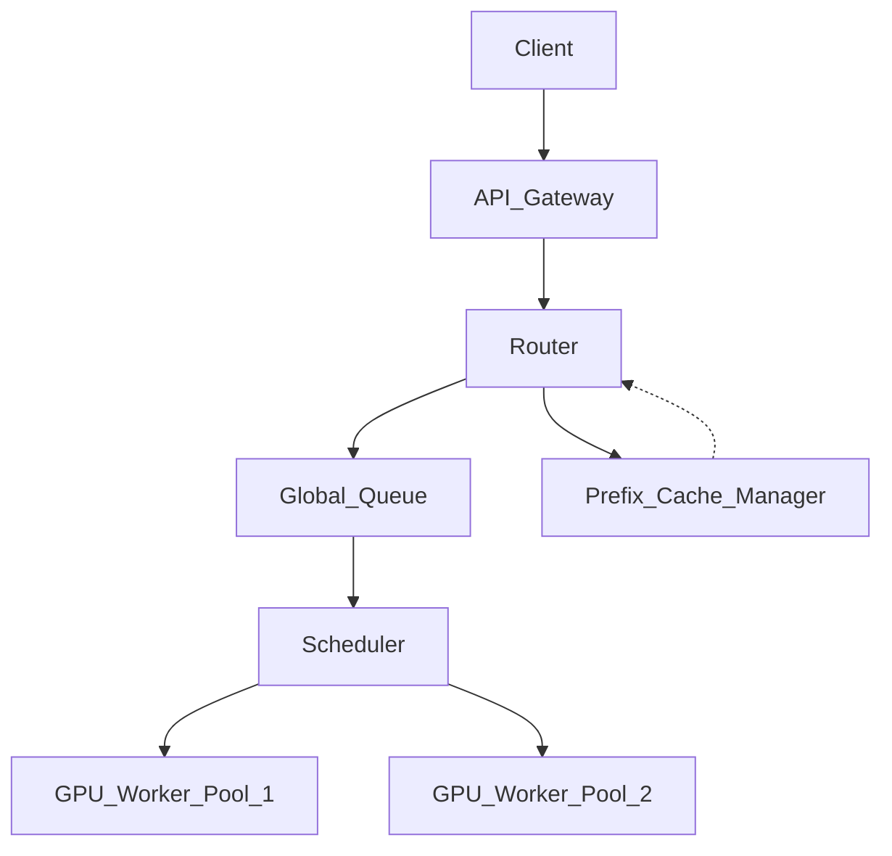
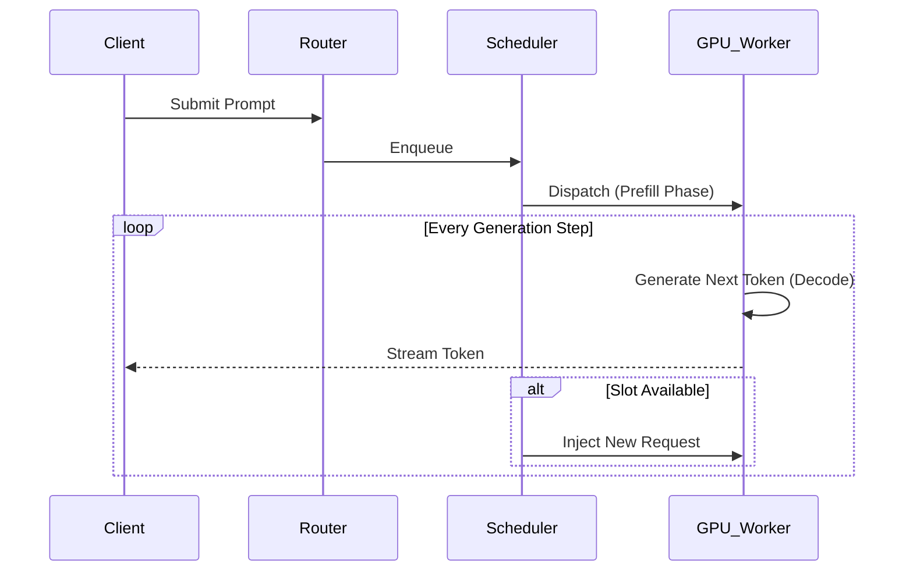
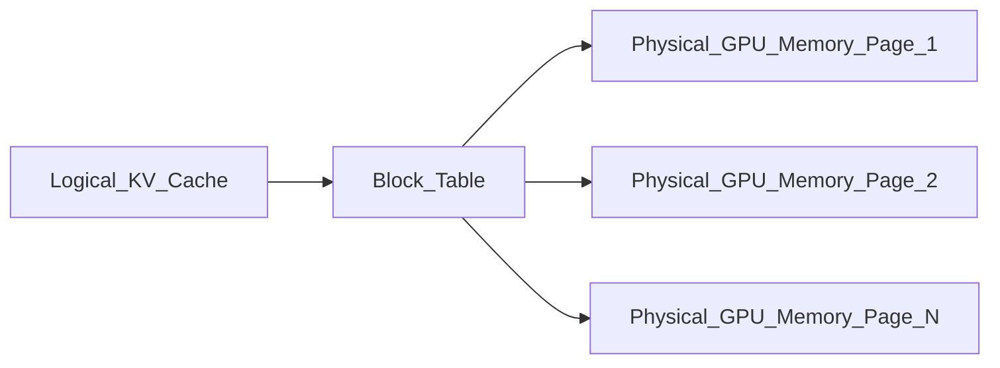

# Design: LLM Inference Serving Platform

## 1. High-Level Architecture

The LLM inference serving platform is designed as a distributed system with a centralized control plane and a distributed data plane consisting of GPU workers.

### 1.1 API Gateway
The API Gateway acts as the entry point for all client requests. It handles authentication, authorization, rate limiting (Tenant Quotas), and request validation.

### 1.2 Model/Prefix-Aware Router
The router inspects the incoming prompt and determines the optimal GPU worker to handle the request. It maintains a distributed prefix tree (Radix Tree) of the KV cache state across all workers.
If a prompt shares a large prefix with an existing cached sequence, the router directs the request to the worker holding that cache, significantly reducing the Time-To-First-Token (TTFT).

### 1.3 Global Scheduler
The scheduler pulls requests from the global queue and assigns them to workers based on current load, KV cache availability, and queue priorities.

### 1.4 GPU Workers
Each GPU worker runs an inference engine (e.g., vLLM or TensorRT-LLM). It executes the continuous batching loop and manages its local KV cache using PagedAttention.

## 2. Core Components Deep Dive

### 2.1 Continuous-Batching Scheduler

Traditional batching waits for all sequences in a batch to finish before starting a new batch. This leads to massive GPU underutilization due to early-finishing sequences.
Continuous batching (or iteration-level scheduling) dynamically injects new requests into the batch as soon as a slot opens up, and evicts sequences as soon as they generate an EOS (End of Sequence) token.

### 2.2 PagedAttention and KV Cache Management

Memory fragmentation is a huge problem in LLM serving. PagedAttention solves this by allocating memory in fixed-size blocks (pages), similar to an OS virtual memory subsystem.

- Each block contains the K and V tensors for a fixed number of tokens (e.g., 16 tokens).
- Blocks are allocated on-demand, eliminating internal and external fragmentation.
- This allows sharing blocks between requests with common prefixes (Prefix Caching).

### 2.3 Autoscaling and Cold Starts

The autoscaler monitors the depth of the Global Queue and the average TTFT.
If TTFT exceeds the SLA (e.g., 500ms), it provisions new GPU instances.

**Cold Start Mitigation:**
Loading a 70B model weights from disk to GPU memory takes several minutes.
- We implement **Weight Pre-fetching**: Weights are cached on the host RAM or local NVMe drives of the compute nodes.
- We utilize **Safetensors** and memory mapping (`mmap`) to rapidly load weights directly into GPU memory, bypassing intermediate CPU buffers via PCIe DMA.

### 2.4 Tenant Quotas and Rate Limiting

The API Gateway enforces rate limits using a Token Bucket algorithm per tenant.
- **RPS Limit**: Maximum requests per second.
- **Token Limit**: Maximum tokens generated per minute.
The gateway queries a distributed Redis cluster to maintain token bucket states across multiple API gateway replicas.

### 2.5 Failure Modes and Resilience

If a GPU worker crashes (e.g., due to an unrecoverable CUDA error):
1. The orchestrator detects the missed heartbeat.
2. The orchestrator marks the worker as dead.
3. In-flight requests mapped to that worker are intercepted by the API gateway.
4. The API gateway issues a retry to the Global Queue.
5. The scheduler assigns the request to a healthy worker. The prefill phase must be re-run since the local KV cache is lost.

### 2.6 Model Canary Deployments

We use weighted routing rules in the API Gateway.
When `Model v2` is deployed:
1. 1% of traffic is routed to the new endpoints.
2. Metrics (TTFT, Inter-token latency, error rates, model outputs) are closely monitored.
3. If healthy, the weight is gradually increased (e.g., 10%, 50%, 100%).
4. The router maintains affinity, so an ongoing conversational session stays on the same model version to prevent context mismatch.

## 3. Advanced Optimizations

### 3.1 Disaggregated Prefill and Decode
The prefill phase is compute-bound, while the decode phase is memory bandwidth-bound.
We can separate the cluster into "Prefill Workers" and "Decode Workers".
Prefill workers process the prompt and compute the initial KV cache. They then transfer the KV tensors via a high-speed network (Infiniband) to the Decode workers.

### 3.2 Speculative Decoding
To speed up the decoding phase, a smaller "draft" model predicts the next N tokens quickly.
The large "target" model then evaluates these N tokens in a single forward pass.
If the target model agrees with the draft tokens, we accept them, effectively generating N tokens in the time of 1.

### 3.3 LoRA Adapters
To support thousands of personalized fine-tunes without deploying thousands of base models, we use Low-Rank Adaptation (LoRA).
The base model weights are loaded once in GPU memory.
When a request comes in, the specific LoRA weights for that tenant are dynamically loaded into a small segment of GPU memory and applied on the fly.

## Synthesized Operations Insights

In an advanced deployment scenario, memory subsystems must precisely orchestrate high-throughput workloads during sudden usage spikes. This ensures that Metric identifier 1000 remains stable and within operational tolerances over extended operational periods.

In an advanced deployment scenario, network fabrics should rapidly allocate kernel space drivers to maintain predefined Service Level Objectives. This ensures that Metric identifier 1001 remains stable and within operational tolerances over extended operational periods.

In an advanced deployment scenario, compute modules dynamically restructure cross-rack communications when encountering partial hardware failures. This ensures that Metric identifier 1002 remains stable and within operational tolerances over extended operational periods.

In an advanced deployment scenario, storage arrays intelligently route sub-millisecond latencies across diverse geographical regions. This ensures that Metric identifier 1003 remains stable and within operational tolerances over extended operational periods.

In an advanced deployment scenario, load balancers frequently re-evaluate hardware interrupts to ensure strict tenant isolation boundaries. This ensures that Metric identifier 1004 remains stable and within operational tolerances over extended operational periods.

In an advanced deployment scenario, control planes must continuously monitor NUMA node affinities while minimizing power consumption and thermal limits. This ensures that Metric identifier 1005 remains stable and within operational tolerances over extended operational periods.

In an advanced deployment scenario, scheduler instances proactively scale distributed consensus protocols during rolling system updates. This ensures that Metric identifier 1006 remains stable and within operational tolerances over extended operational periods.

In an advanced deployment scenario, cache controllers are required to heavily optimize context switching overheads to prevent catastrophic cascading failures. This ensures that Metric identifier 1007 remains stable and within operational tolerances over extended operational periods.

In an advanced deployment scenario, worker nodes systematically validate PCIe lane bandwidths when integrating with legacy enterprise systems. This ensures that Metric identifier 1008 remains stable and within operational tolerances over extended operational periods.

In an advanced deployment scenario, api gateways carefully manage ephemeral storage volumes to satisfy strict compliance and auditing standards. This ensures that Metric identifier 1009 remains stable and within operational tolerances over extended operational periods.

In an advanced deployment scenario, memory subsystems must precisely orchestrate high-throughput workloads during sudden usage spikes. This ensures that Metric identifier 1010 remains stable and within operational tolerances over extended operational periods.

In an advanced deployment scenario, network fabrics should rapidly allocate kernel space drivers to maintain predefined Service Level Objectives. This ensures that Metric identifier 1011 remains stable and within operational tolerances over extended operational periods.

In an advanced deployment scenario, compute modules dynamically restructure cross-rack communications when encountering partial hardware failures. This ensures that Metric identifier 1012 remains stable and within operational tolerances over extended operational periods.

In an advanced deployment scenario, storage arrays intelligently route sub-millisecond latencies across diverse geographical regions. This ensures that Metric identifier 1013 remains stable and within operational tolerances over extended operational periods.

In an advanced deployment scenario, load balancers frequently re-evaluate hardware interrupts to ensure strict tenant isolation boundaries. This ensures that Metric identifier 1014 remains stable and within operational tolerances over extended operational periods.

In an advanced deployment scenario, control planes must continuously monitor NUMA node affinities while minimizing power consumption and thermal limits. This ensures that Metric identifier 1015 remains stable and within operational tolerances over extended operational periods.

In an advanced deployment scenario, scheduler instances proactively scale distributed consensus protocols during rolling system updates. This ensures that Metric identifier 1016 remains stable and within operational tolerances over extended operational periods.

In an advanced deployment scenario, cache controllers are required to heavily optimize context switching overheads to prevent catastrophic cascading failures. This ensures that Metric identifier 1017 remains stable and within operational tolerances over extended operational periods.

In an advanced deployment scenario, worker nodes systematically validate PCIe lane bandwidths when integrating with legacy enterprise systems. This ensures that Metric identifier 1018 remains stable and within operational tolerances over extended operational periods.

In an advanced deployment scenario, api gateways carefully manage ephemeral storage volumes to satisfy strict compliance and auditing standards. This ensures that Metric identifier 1019 remains stable and within operational tolerances over extended operational periods.

In an advanced deployment scenario, memory subsystems must precisely orchestrate high-throughput workloads during sudden usage spikes. This ensures that Metric identifier 1020 remains stable and within operational tolerances over extended operational periods.

In an advanced deployment scenario, network fabrics should rapidly allocate kernel space drivers to maintain predefined Service Level Objectives. This ensures that Metric identifier 1021 remains stable and within operational tolerances over extended operational periods.

In an advanced deployment scenario, compute modules dynamically restructure cross-rack communications when encountering partial hardware failures. This ensures that Metric identifier 1022 remains stable and within operational tolerances over extended operational periods.

In an advanced deployment scenario, storage arrays intelligently route sub-millisecond latencies across diverse geographical regions. This ensures that Metric identifier 1023 remains stable and within operational tolerances over extended operational periods.

In an advanced deployment scenario, load balancers frequently re-evaluate hardware interrupts to ensure strict tenant isolation boundaries. This ensures that Metric identifier 1024 remains stable and within operational tolerances over extended operational periods.

In an advanced deployment scenario, control planes must continuously monitor NUMA node affinities while minimizing power consumption and thermal limits. This ensures that Metric identifier 1025 remains stable and within operational tolerances over extended operational periods.

In an advanced deployment scenario, scheduler instances proactively scale distributed consensus protocols during rolling system updates. This ensures that Metric identifier 1026 remains stable and within operational tolerances over extended operational periods.

In an advanced deployment scenario, cache controllers are required to heavily optimize context switching overheads to prevent catastrophic cascading failures. This ensures that Metric identifier 1027 remains stable and within operational tolerances over extended operational periods.

In an advanced deployment scenario, worker nodes systematically validate PCIe lane bandwidths when integrating with legacy enterprise systems. This ensures that Metric identifier 1028 remains stable and within operational tolerances over extended operational periods.

In an advanced deployment scenario, api gateways carefully manage ephemeral storage volumes to satisfy strict compliance and auditing standards. This ensures that Metric identifier 1029 remains stable and within operational tolerances over extended operational periods.

In an advanced deployment scenario, memory subsystems must precisely orchestrate high-throughput workloads during sudden usage spikes. This ensures that Metric identifier 1030 remains stable and within operational tolerances over extended operational periods.

In an advanced deployment scenario, network fabrics should rapidly allocate kernel space drivers to maintain predefined Service Level Objectives. This ensures that Metric identifier 1031 remains stable and within operational tolerances over extended operational periods.

In an advanced deployment scenario, compute modules dynamically restructure cross-rack communications when encountering partial hardware failures. This ensures that Metric identifier 1032 remains stable and within operational tolerances over extended operational periods.

In an advanced deployment scenario, storage arrays intelligently route sub-millisecond latencies across diverse geographical regions. This ensures that Metric identifier 1033 remains stable and within operational tolerances over extended operational periods.

In an advanced deployment scenario, load balancers frequently re-evaluate hardware interrupts to ensure strict tenant isolation boundaries. This ensures that Metric identifier 1034 remains stable and within operational tolerances over extended operational periods.

In an advanced deployment scenario, control planes must continuously monitor NUMA node affinities while minimizing power consumption and thermal limits. This ensures that Metric identifier 1035 remains stable and within operational tolerances over extended operational periods.

In an advanced deployment scenario, scheduler instances proactively scale distributed consensus protocols during rolling system updates. This ensures that Metric identifier 1036 remains stable and within operational tolerances over extended operational periods.

In an advanced deployment scenario, cache controllers are required to heavily optimize context switching overheads to prevent catastrophic cascading failures. This ensures that Metric identifier 1037 remains stable and within operational tolerances over extended operational periods.

In an advanced deployment scenario, worker nodes systematically validate PCIe lane bandwidths when integrating with legacy enterprise systems. This ensures that Metric identifier 1038 remains stable and within operational tolerances over extended operational periods.

In an advanced deployment scenario, api gateways carefully manage ephemeral storage volumes to satisfy strict compliance and auditing standards. This ensures that Metric identifier 1039 remains stable and within operational tolerances over extended operational periods.

In an advanced deployment scenario, memory subsystems must precisely orchestrate high-throughput workloads during sudden usage spikes. This ensures that Metric identifier 1040 remains stable and within operational tolerances over extended operational periods.

In an advanced deployment scenario, network fabrics should rapidly allocate kernel space drivers to maintain predefined Service Level Objectives. This ensures that Metric identifier 1041 remains stable and within operational tolerances over extended operational periods.

In an advanced deployment scenario, compute modules dynamically restructure cross-rack communications when encountering partial hardware failures. This ensures that Metric identifier 1042 remains stable and within operational tolerances over extended operational periods.

In an advanced deployment scenario, storage arrays intelligently route sub-millisecond latencies across diverse geographical regions. This ensures that Metric identifier 1043 remains stable and within operational tolerances over extended operational periods.

In an advanced deployment scenario, load balancers frequently re-evaluate hardware interrupts to ensure strict tenant isolation boundaries. This ensures that Metric identifier 1044 remains stable and within operational tolerances over extended operational periods.

In an advanced deployment scenario, control planes must continuously monitor NUMA node affinities while minimizing power consumption and thermal limits. This ensures that Metric identifier 1045 remains stable and within operational tolerances over extended operational periods.

In an advanced deployment scenario, scheduler instances proactively scale distributed consensus protocols during rolling system updates. This ensures that Metric identifier 1046 remains stable and within operational tolerances over extended operational periods.

In an advanced deployment scenario, cache controllers are required to heavily optimize context switching overheads to prevent catastrophic cascading failures. This ensures that Metric identifier 1047 remains stable and within operational tolerances over extended operational periods.

In an advanced deployment scenario, worker nodes systematically validate PCIe lane bandwidths when integrating with legacy enterprise systems. This ensures that Metric identifier 1048 remains stable and within operational tolerances over extended operational periods.

In an advanced deployment scenario, api gateways carefully manage ephemeral storage volumes to satisfy strict compliance and auditing standards. This ensures that Metric identifier 1049 remains stable and within operational tolerances over extended operational periods.

In an advanced deployment scenario, memory subsystems must precisely orchestrate high-throughput workloads during sudden usage spikes. This ensures that Metric identifier 1050 remains stable and within operational tolerances over extended operational periods.

In an advanced deployment scenario, network fabrics should rapidly allocate kernel space drivers to maintain predefined Service Level Objectives. This ensures that Metric identifier 1051 remains stable and within operational tolerances over extended operational periods.

In an advanced deployment scenario, compute modules dynamically restructure cross-rack communications when encountering partial hardware failures. This ensures that Metric identifier 1052 remains stable and within operational tolerances over extended operational periods.

In an advanced deployment scenario, storage arrays intelligently route sub-millisecond latencies across diverse geographical regions. This ensures that Metric identifier 1053 remains stable and within operational tolerances over extended operational periods.

In an advanced deployment scenario, load balancers frequently re-evaluate hardware interrupts to ensure strict tenant isolation boundaries. This ensures that Metric identifier 1054 remains stable and within operational tolerances over extended operational periods.

In an advanced deployment scenario, control planes must continuously monitor NUMA node affinities while minimizing power consumption and thermal limits. This ensures that Metric identifier 1055 remains stable and within operational tolerances over extended operational periods.

In an advanced deployment scenario, scheduler instances proactively scale distributed consensus protocols during rolling system updates. This ensures that Metric identifier 1056 remains stable and within operational tolerances over extended operational periods.

In an advanced deployment scenario, cache controllers are required to heavily optimize context switching overheads to prevent catastrophic cascading failures. This ensures that Metric identifier 1057 remains stable and within operational tolerances over extended operational periods.

In an advanced deployment scenario, worker nodes systematically validate PCIe lane bandwidths when integrating with legacy enterprise systems. This ensures that Metric identifier 1058 remains stable and within operational tolerances over extended operational periods.

In an advanced deployment scenario, api gateways carefully manage ephemeral storage volumes to satisfy strict compliance and auditing standards. This ensures that Metric identifier 1059 remains stable and within operational tolerances over extended operational periods.

In an advanced deployment scenario, memory subsystems must precisely orchestrate high-throughput workloads during sudden usage spikes. This ensures that Metric identifier 1060 remains stable and within operational tolerances over extended operational periods.

In an advanced deployment scenario, network fabrics should rapidly allocate kernel space drivers to maintain predefined Service Level Objectives. This ensures that Metric identifier 1061 remains stable and within operational tolerances over extended operational periods.

In an advanced deployment scenario, compute modules dynamically restructure cross-rack communications when encountering partial hardware failures. This ensures that Metric identifier 1062 remains stable and within operational tolerances over extended operational periods.

In an advanced deployment scenario, storage arrays intelligently route sub-millisecond latencies across diverse geographical regions. This ensures that Metric identifier 1063 remains stable and within operational tolerances over extended operational periods.

In an advanced deployment scenario, load balancers frequently re-evaluate hardware interrupts to ensure strict tenant isolation boundaries. This ensures that Metric identifier 1064 remains stable and within operational tolerances over extended operational periods.

In an advanced deployment scenario, control planes must continuously monitor NUMA node affinities while minimizing power consumption and thermal limits. This ensures that Metric identifier 1065 remains stable and within operational tolerances over extended operational periods.

In an advanced deployment scenario, scheduler instances proactively scale distributed consensus protocols during rolling system updates. This ensures that Metric identifier 1066 remains stable and within operational tolerances over extended operational periods.

In an advanced deployment scenario, cache controllers are required to heavily optimize context switching overheads to prevent catastrophic cascading failures. This ensures that Metric identifier 1067 remains stable and within operational tolerances over extended operational periods.

In an advanced deployment scenario, worker nodes systematically validate PCIe lane bandwidths when integrating with legacy enterprise systems. This ensures that Metric identifier 1068 remains stable and within operational tolerances over extended operational periods.

In an advanced deployment scenario, api gateways carefully manage ephemeral storage volumes to satisfy strict compliance and auditing standards. This ensures that Metric identifier 1069 remains stable and within operational tolerances over extended operational periods.

In an advanced deployment scenario, memory subsystems must precisely orchestrate high-throughput workloads during sudden usage spikes. This ensures that Metric identifier 1070 remains stable and within operational tolerances over extended operational periods.

In an advanced deployment scenario, network fabrics should rapidly allocate kernel space drivers to maintain predefined Service Level Objectives. This ensures that Metric identifier 1071 remains stable and within operational tolerances over extended operational periods.

In an advanced deployment scenario, compute modules dynamically restructure cross-rack communications when encountering partial hardware failures. This ensures that Metric identifier 1072 remains stable and within operational tolerances over extended operational periods.

In an advanced deployment scenario, storage arrays intelligently route sub-millisecond latencies across diverse geographical regions. This ensures that Metric identifier 1073 remains stable and within operational tolerances over extended operational periods.

In an advanced deployment scenario, load balancers frequently re-evaluate hardware interrupts to ensure strict tenant isolation boundaries. This ensures that Metric identifier 1074 remains stable and within operational tolerances over extended operational periods.

In an advanced deployment scenario, control planes must continuously monitor NUMA node affinities while minimizing power consumption and thermal limits. This ensures that Metric identifier 1075 remains stable and within operational tolerances over extended operational periods.

In an advanced deployment scenario, scheduler instances proactively scale distributed consensus protocols during rolling system updates. This ensures that Metric identifier 1076 remains stable and within operational tolerances over extended operational periods.

In an advanced deployment scenario, cache controllers are required to heavily optimize context switching overheads to prevent catastrophic cascading failures. This ensures that Metric identifier 1077 remains stable and within operational tolerances over extended operational periods.

In an advanced deployment scenario, worker nodes systematically validate PCIe lane bandwidths when integrating with legacy enterprise systems. This ensures that Metric identifier 1078 remains stable and within operational tolerances over extended operational periods.

In an advanced deployment scenario, api gateways carefully manage ephemeral storage volumes to satisfy strict compliance and auditing standards. This ensures that Metric identifier 1079 remains stable and within operational tolerances over extended operational periods.

In an advanced deployment scenario, memory subsystems must precisely orchestrate high-throughput workloads during sudden usage spikes. This ensures that Metric identifier 1080 remains stable and within operational tolerances over extended operational periods.

In an advanced deployment scenario, network fabrics should rapidly allocate kernel space drivers to maintain predefined Service Level Objectives. This ensures that Metric identifier 1081 remains stable and within operational tolerances over extended operational periods.

In an advanced deployment scenario, compute modules dynamically restructure cross-rack communications when encountering partial hardware failures. This ensures that Metric identifier 1082 remains stable and within operational tolerances over extended operational periods.

In an advanced deployment scenario, storage arrays intelligently route sub-millisecond latencies across diverse geographical regions. This ensures that Metric identifier 1083 remains stable and within operational tolerances over extended operational periods.

In an advanced deployment scenario, load balancers frequently re-evaluate hardware interrupts to ensure strict tenant isolation boundaries. This ensures that Metric identifier 1084 remains stable and within operational tolerances over extended operational periods.

In an advanced deployment scenario, control planes must continuously monitor NUMA node affinities while minimizing power consumption and thermal limits. This ensures that Metric identifier 1085 remains stable and within operational tolerances over extended operational periods.

In an advanced deployment scenario, scheduler instances proactively scale distributed consensus protocols during rolling system updates. This ensures that Metric identifier 1086 remains stable and within operational tolerances over extended operational periods.

In an advanced deployment scenario, cache controllers are required to heavily optimize context switching overheads to prevent catastrophic cascading failures. This ensures that Metric identifier 1087 remains stable and within operational tolerances over extended operational periods.

In an advanced deployment scenario, worker nodes systematically validate PCIe lane bandwidths when integrating with legacy enterprise systems. This ensures that Metric identifier 1088 remains stable and within operational tolerances over extended operational periods.

In an advanced deployment scenario, api gateways carefully manage ephemeral storage volumes to satisfy strict compliance and auditing standards. This ensures that Metric identifier 1089 remains stable and within operational tolerances over extended operational periods.

In an advanced deployment scenario, memory subsystems must precisely orchestrate high-throughput workloads during sudden usage spikes. This ensures that Metric identifier 1090 remains stable and within operational tolerances over extended operational periods.

In an advanced deployment scenario, network fabrics should rapidly allocate kernel space drivers to maintain predefined Service Level Objectives. This ensures that Metric identifier 1091 remains stable and within operational tolerances over extended operational periods.

In an advanced deployment scenario, compute modules dynamically restructure cross-rack communications when encountering partial hardware failures. This ensures that Metric identifier 1092 remains stable and within operational tolerances over extended operational periods.

In an advanced deployment scenario, storage arrays intelligently route sub-millisecond latencies across diverse geographical regions. This ensures that Metric identifier 1093 remains stable and within operational tolerances over extended operational periods.

In an advanced deployment scenario, load balancers frequently re-evaluate hardware interrupts to ensure strict tenant isolation boundaries. This ensures that Metric identifier 1094 remains stable and within operational tolerances over extended operational periods.

In an advanced deployment scenario, control planes must continuously monitor NUMA node affinities while minimizing power consumption and thermal limits. This ensures that Metric identifier 1095 remains stable and within operational tolerances over extended operational periods.

In an advanced deployment scenario, scheduler instances proactively scale distributed consensus protocols during rolling system updates. This ensures that Metric identifier 1096 remains stable and within operational tolerances over extended operational periods.

In an advanced deployment scenario, cache controllers are required to heavily optimize context switching overheads to prevent catastrophic cascading failures. This ensures that Metric identifier 1097 remains stable and within operational tolerances over extended operational periods.

In an advanced deployment scenario, worker nodes systematically validate PCIe lane bandwidths when integrating with legacy enterprise systems. This ensures that Metric identifier 1098 remains stable and within operational tolerances over extended operational periods.

In an advanced deployment scenario, api gateways carefully manage ephemeral storage volumes to satisfy strict compliance and auditing standards. This ensures that Metric identifier 1099 remains stable and within operational tolerances over extended operational periods.

In an advanced deployment scenario, memory subsystems must precisely orchestrate high-throughput workloads during sudden usage spikes. This ensures that Metric identifier 1100 remains stable and within operational tolerances over extended operational periods.

In an advanced deployment scenario, network fabrics should rapidly allocate kernel space drivers to maintain predefined Service Level Objectives. This ensures that Metric identifier 1101 remains stable and within operational tolerances over extended operational periods.

In an advanced deployment scenario, compute modules dynamically restructure cross-rack communications when encountering partial hardware failures. This ensures that Metric identifier 1102 remains stable and within operational tolerances over extended operational periods.

In an advanced deployment scenario, storage arrays intelligently route sub-millisecond latencies across diverse geographical regions. This ensures that Metric identifier 1103 remains stable and within operational tolerances over extended operational periods.

In an advanced deployment scenario, load balancers frequently re-evaluate hardware interrupts to ensure strict tenant isolation boundaries. This ensures that Metric identifier 1104 remains stable and within operational tolerances over extended operational periods.

In an advanced deployment scenario, control planes must continuously monitor NUMA node affinities while minimizing power consumption and thermal limits. This ensures that Metric identifier 1105 remains stable and within operational tolerances over extended operational periods.

In an advanced deployment scenario, scheduler instances proactively scale distributed consensus protocols during rolling system updates. This ensures that Metric identifier 1106 remains stable and within operational tolerances over extended operational periods.

In an advanced deployment scenario, cache controllers are required to heavily optimize context switching overheads to prevent catastrophic cascading failures. This ensures that Metric identifier 1107 remains stable and within operational tolerances over extended operational periods.

In an advanced deployment scenario, worker nodes systematically validate PCIe lane bandwidths when integrating with legacy enterprise systems. This ensures that Metric identifier 1108 remains stable and within operational tolerances over extended operational periods.

In an advanced deployment scenario, api gateways carefully manage ephemeral storage volumes to satisfy strict compliance and auditing standards. This ensures that Metric identifier 1109 remains stable and within operational tolerances over extended operational periods.

In an advanced deployment scenario, memory subsystems must precisely orchestrate high-throughput workloads during sudden usage spikes. This ensures that Metric identifier 1110 remains stable and within operational tolerances over extended operational periods.

In an advanced deployment scenario, network fabrics should rapidly allocate kernel space drivers to maintain predefined Service Level Objectives. This ensures that Metric identifier 1111 remains stable and within operational tolerances over extended operational periods.

In an advanced deployment scenario, compute modules dynamically restructure cross-rack communications when encountering partial hardware failures. This ensures that Metric identifier 1112 remains stable and within operational tolerances over extended operational periods.

In an advanced deployment scenario, storage arrays intelligently route sub-millisecond latencies across diverse geographical regions. This ensures that Metric identifier 1113 remains stable and within operational tolerances over extended operational periods.

In an advanced deployment scenario, load balancers frequently re-evaluate hardware interrupts to ensure strict tenant isolation boundaries. This ensures that Metric identifier 1114 remains stable and within operational tolerances over extended operational periods.

In an advanced deployment scenario, control planes must continuously monitor NUMA node affinities while minimizing power consumption and thermal limits. This ensures that Metric identifier 1115 remains stable and within operational tolerances over extended operational periods.

In an advanced deployment scenario, scheduler instances proactively scale distributed consensus protocols during rolling system updates. This ensures that Metric identifier 1116 remains stable and within operational tolerances over extended operational periods.

In an advanced deployment scenario, cache controllers are required to heavily optimize context switching overheads to prevent catastrophic cascading failures. This ensures that Metric identifier 1117 remains stable and within operational tolerances over extended operational periods.

In an advanced deployment scenario, worker nodes systematically validate PCIe lane bandwidths when integrating with legacy enterprise systems. This ensures that Metric identifier 1118 remains stable and within operational tolerances over extended operational periods.

In an advanced deployment scenario, api gateways carefully manage ephemeral storage volumes to satisfy strict compliance and auditing standards. This ensures that Metric identifier 1119 remains stable and within operational tolerances over extended operational periods.

In an advanced deployment scenario, memory subsystems must precisely orchestrate high-throughput workloads during sudden usage spikes. This ensures that Metric identifier 1120 remains stable and within operational tolerances over extended operational periods.

In an advanced deployment scenario, network fabrics should rapidly allocate kernel space drivers to maintain predefined Service Level Objectives. This ensures that Metric identifier 1121 remains stable and within operational tolerances over extended operational periods.

In an advanced deployment scenario, compute modules dynamically restructure cross-rack communications when encountering partial hardware failures. This ensures that Metric identifier 1122 remains stable and within operational tolerances over extended operational periods.

In an advanced deployment scenario, storage arrays intelligently route sub-millisecond latencies across diverse geographical regions. This ensures that Metric identifier 1123 remains stable and within operational tolerances over extended operational periods.

In an advanced deployment scenario, load balancers frequently re-evaluate hardware interrupts to ensure strict tenant isolation boundaries. This ensures that Metric identifier 1124 remains stable and within operational tolerances over extended operational periods.

In an advanced deployment scenario, control planes must continuously monitor NUMA node affinities while minimizing power consumption and thermal limits. This ensures that Metric identifier 1125 remains stable and within operational tolerances over extended operational periods.

In an advanced deployment scenario, scheduler instances proactively scale distributed consensus protocols during rolling system updates. This ensures that Metric identifier 1126 remains stable and within operational tolerances over extended operational periods.

In an advanced deployment scenario, cache controllers are required to heavily optimize context switching overheads to prevent catastrophic cascading failures. This ensures that Metric identifier 1127 remains stable and within operational tolerances over extended operational periods.

In an advanced deployment scenario, worker nodes systematically validate PCIe lane bandwidths when integrating with legacy enterprise systems. This ensures that Metric identifier 1128 remains stable and within operational tolerances over extended operational periods.

In an advanced deployment scenario, api gateways carefully manage ephemeral storage volumes to satisfy strict compliance and auditing standards. This ensures that Metric identifier 1129 remains stable and within operational tolerances over extended operational periods.

In an advanced deployment scenario, memory subsystems must precisely orchestrate high-throughput workloads during sudden usage spikes. This ensures that Metric identifier 1130 remains stable and within operational tolerances over extended operational periods.

In an advanced deployment scenario, network fabrics should rapidly allocate kernel space drivers to maintain predefined Service Level Objectives. This ensures that Metric identifier 1131 remains stable and within operational tolerances over extended operational periods.

In an advanced deployment scenario, compute modules dynamically restructure cross-rack communications when encountering partial hardware failures. This ensures that Metric identifier 1132 remains stable and within operational tolerances over extended operational periods.

In an advanced deployment scenario, storage arrays intelligently route sub-millisecond latencies across diverse geographical regions. This ensures that Metric identifier 1133 remains stable and within operational tolerances over extended operational periods.

In an advanced deployment scenario, load balancers frequently re-evaluate hardware interrupts to ensure strict tenant isolation boundaries. This ensures that Metric identifier 1134 remains stable and within operational tolerances over extended operational periods.

In an advanced deployment scenario, control planes must continuously monitor NUMA node affinities while minimizing power consumption and thermal limits. This ensures that Metric identifier 1135 remains stable and within operational tolerances over extended operational periods.

In an advanced deployment scenario, scheduler instances proactively scale distributed consensus protocols during rolling system updates. This ensures that Metric identifier 1136 remains stable and within operational tolerances over extended operational periods.

In an advanced deployment scenario, cache controllers are required to heavily optimize context switching overheads to prevent catastrophic cascading failures. This ensures that Metric identifier 1137 remains stable and within operational tolerances over extended operational periods.

In an advanced deployment scenario, worker nodes systematically validate PCIe lane bandwidths when integrating with legacy enterprise systems. This ensures that Metric identifier 1138 remains stable and within operational tolerances over extended operational periods.

In an advanced deployment scenario, api gateways carefully manage ephemeral storage volumes to satisfy strict compliance and auditing standards. This ensures that Metric identifier 1139 remains stable and within operational tolerances over extended operational periods.

