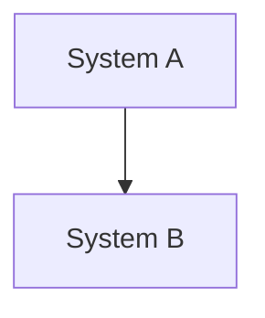
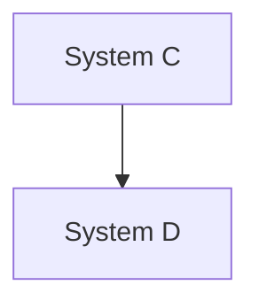

# Safety Evaluation Platform Design

## How this differs from sibling
This platform serves real-time evaluation requests to block harmful prompt injections or outputs during inference, in contrast to offline benchmarking workflows.

## Architecture Diagrams

### System Flow

### Component Flow

