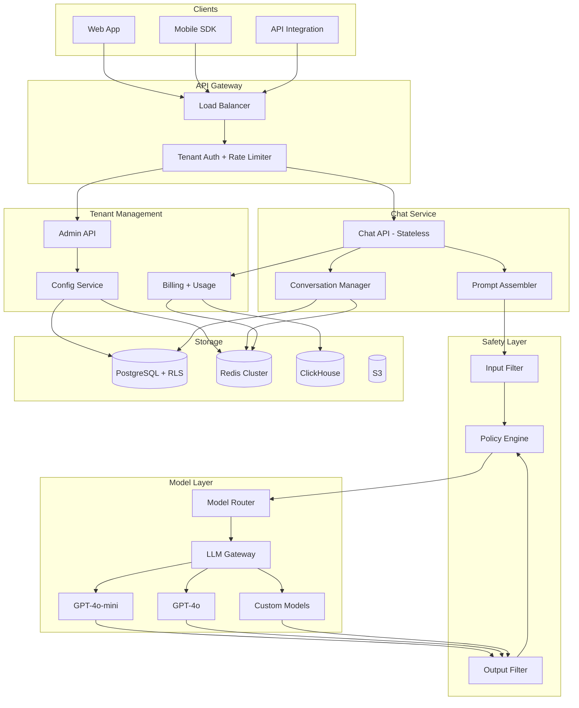
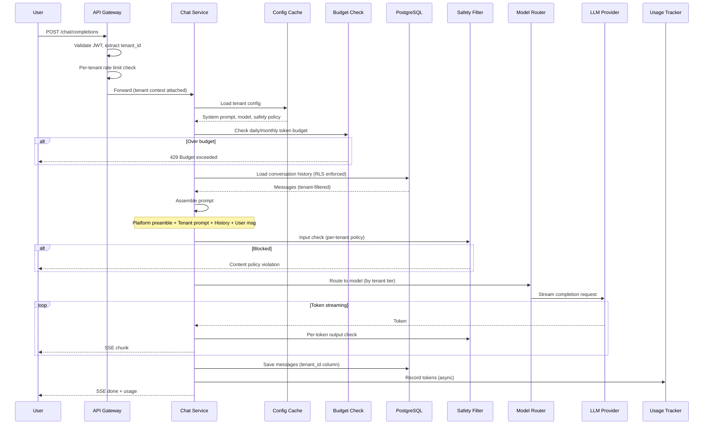

# Multi-Tenant Chat Assistant System Design

Complete high-level design for a multi-tenant LLM chat platform serving enterprise customers.

---

## Overview

This document describes the architecture for a multi-tenant AI chat platform supporting 500+ enterprise tenants, each with isolated data, configurable prompts, per-tenant safety policies, and usage-based billing.

### Architecture Diagram



---

## Detailed Design

### 1. Tenant Isolation Architecture

The platform enforces isolation at every layer:

```
┌─────────────────────────────────────────────────────┐
│                 Isolation Layers                     │
│                                                     │
│  Layer 1: API Gateway                               │
│  └─ X-Tenant-ID header validation                   │
│  └─ JWT contains tenant claim                       │
│                                                     │
│  Layer 2: Application                               │
│  └─ SET app.tenant_id = '<id>' per request          │
│  └─ Tenant context threaded through all services    │
│                                                     │
│  Layer 3: PostgreSQL (RLS)                           │
│  └─ Every table: WHERE tenant_id = current_tenant() │
│  └─ Impossible to query across tenants              │
│                                                     │
│  Layer 4: Redis                                     │
│  └─ Key prefix: tenant:{id}:*                       │
│  └─ Namespace isolation                             │
│                                                     │
│  Layer 5: Object Storage                            │
│  └─ S3 prefix: tenants/{id}/                        │
│  └─ IAM policies per prefix                         │
└─────────────────────────────────────────────────────┘
```

### 2. Chat Message Flow



### 3. Per-Tenant Configuration System

#### Configuration Hierarchy

```
Platform Defaults (immutable baseline)
    └── Plan Tier Defaults (Basic / Pro / Enterprise)
        └── Tenant Overrides (admin-configured)
            └── Runtime Overrides (A/B tests, feature flags)
```

#### Config Caching

```
Write path:
  Admin API → PostgreSQL → Publish invalidation event → Redis

Read path (every chat request):
  Chat Service → Redis cache (TTL: 5 min) → PostgreSQL (fallback)

Invalidation:
  Admin updates config → Pub/Sub event → All Chat Service pods clear cache
  Latency: < 1 second for config changes to take effect
```

#### Prompt Versioning

```
tenant_prompt_versions:
{
    id:           uuid (PK)
    tenant_id:    uuid (FK)
    version:      int
    system_prompt: text
    is_active:    boolean
    created_by:   uuid
    created_at:   timestamp
}

- Every prompt change creates new version
- Rollback = set previous version as active
- A/B test = route % traffic to specific version
```

### 4. Safety & Policy Engine

#### Two-Layer Safety Model

**Platform Layer (mandatory, all tenants):**
- No hate speech, violence, or illegal content
- No PII generation (SSN, credit cards)
- No prompt injection execution
- Toxicity threshold: 0.3 (hard floor)

**Tenant Layer (configurable):**
- Custom blocked topics (e.g., "competitors")
- Stricter toxicity threshold (e.g., 0.1)
- Custom blocked phrases
- PII redaction toggle
- Response length limits

#### Policy Evaluation Flow

```
Input Message
    │
    ▼
┌─────────────────┐
│ Platform Checks  │ ← Cannot be disabled
│ • Toxicity       │
│ • Illegal content│
│ • Prompt inject  │
└────────┬────────┘
         │ PASS
         ▼
┌─────────────────┐
│ Tenant Checks    │ ← Configurable per tenant
│ • Topic filter   │
│ • Custom phrases │
│ • PII detection  │
└────────┬────────┘
         │ PASS
         ▼
    Model Inference
         │
         ▼
┌─────────────────┐
│ Output Checks    │
│ • Groundedness   │
│ • Platform rules │
│ • Tenant rules   │
└────────┬────────┘
         │ PASS
         ▼
    Stream to User
```

### 5. Usage Tracking & Billing

#### Real-Time Token Counting

```
Per-message flow:
1. Before inference: estimate input tokens (for budget check)
2. During inference: count output tokens
3. After inference: record exact usage

Redis counters (real-time):
  INCRBY tenant:{id}:usage:daily:{date} {tokens}
  INCRBY tenant:{id}:usage:monthly:{month} {tokens}

Budget enforcement:
  IF GET tenant:{id}:usage:daily:{date} > daily_limit THEN reject
  IF GET tenant:{id}:usage:monthly:{month} > monthly_limit THEN reject
```

#### Billing Aggregation

```
ClickHouse (batch analytics):
  - Hourly rollup from usage_records
  - Per-tenant, per-model, per-day aggregation
  - Cost calculation: tokens × model_rate
  - Dashboard queries: < 100ms on 100M rows
```

### 6. Model Routing

```
┌────────────────────────────────────────┐
│           Model Router                  │
│                                        │
│  Input: tenant_id, message             │
│                                        │
│  1. Load tenant config → plan tier     │
│  2. Map tier to model:                 │
│     Basic     → GPT-4o-mini           │
│     Pro       → GPT-4o               │
│     Enterprise → tenant.model_config   │
│                                        │
│  3. Check model health:               │
│     Healthy → route to primary model   │
│     Unhealthy → fallback (tier - 1)   │
│                                        │
│  4. Apply tenant-specific params:      │
│     max_tokens, temperature, etc.      │
│                                        │
│  5. Send to LLM Gateway               │
└────────────────────────────────────────┘
```

---

## Trade-offs Summary

| Decision | Chose | Alternative | Why |
|----------|-------|-------------|-----|
| Isolation | Shared DB + RLS | Dedicated DB per tenant | Cost-efficient at 500 tenants |
| Model hosting | Managed APIs (OpenAI) | Self-hosted models | Simpler ops, better availability |
| Safety | Synchronous inline | Async post-check | Enterprise compliance requires blocking |
| Config cache | Redis + pub/sub | Direct DB reads | < 1s config propagation |
| Billing | Real-time counters + batch | Pure batch | Budget enforcement needs real-time |
| Conversation store | PostgreSQL + RLS | Per-tenant DynamoDB | Proven RLS, simpler migrations |

---

## Failure Scenarios

| Failure | Impact | Mitigation |
|---------|--------|------------|
| LLM provider down | All chats fail | Multi-provider fallback (OpenAI → Anthropic) |
| Redis down | No config cache, no rate limits | Read from PG, permissive mode for rate limits |
| PostgreSQL primary down | No writes | Automatic failover to replica, promote |
| Tenant config corruption | Tenant chat breaks | Config versioning, instant rollback |
| Token budget counter lost | Over-billing risk | Daily reconciliation with PG records |
| Safety filter false positive | Good messages blocked | Feedback loop, admin override, tuning |

---

## Capacity Planning

| Component | Current | 10x Growth |
|-----------|---------|-----------|
| Tenants | 500 | 5,000 |
| Concurrent convos | 10,000 | 100,000 |
| Messages/day | 300,000 | 3,000,000 |
| QPS (peak) | 14 | 140 |
| DB storage | 25 GB/month | 250 GB/month |
| LLM cost | $14,640/month | ~$150K/month |

**Scaling triggers:**
- Chat service pod CPU > 60% → auto-scale
- PostgreSQL connections > 80% → add read replicas
- Redis memory > 70% → scale cluster
- Per-tenant QPS > plan limit → 429 rate limiting

---

## Component Summary

| Component | Technology | Purpose | Scaling |
|-----------|-----------|---------|---------|
| API Gateway | Kong / AWS ALB | Auth, routing, rate limiting | Auto-scaling |
| Chat Service | Python (FastAPI) | Chat orchestration | Horizontal (10-50 pods) |
| Config Service | Python (FastAPI) | Tenant config CRUD | 3 replicas |
| Safety Filter | Python + ML classifiers | Content policy enforcement | Horizontal |
| Model Router | Custom proxy | Plan-based model routing | Horizontal |
| PostgreSQL | RDS (Multi-AZ) | Tenants, conversations, messages | Read replicas |
| Redis | ElastiCache Cluster | Config cache, rate limits, budgets | 6 nodes |
| ClickHouse | Self-hosted / Cloud | Usage analytics, billing | Sharded |
| S3 | AWS S3 | Conversation exports, archives | Unlimited |

---

*See [APPROACH.md](./APPROACH.md) for step-by-step thinking and [PROBLEM.md](./PROBLEM.md) for requirements. Diagrams available in [diagrams/](./diagrams/).*
