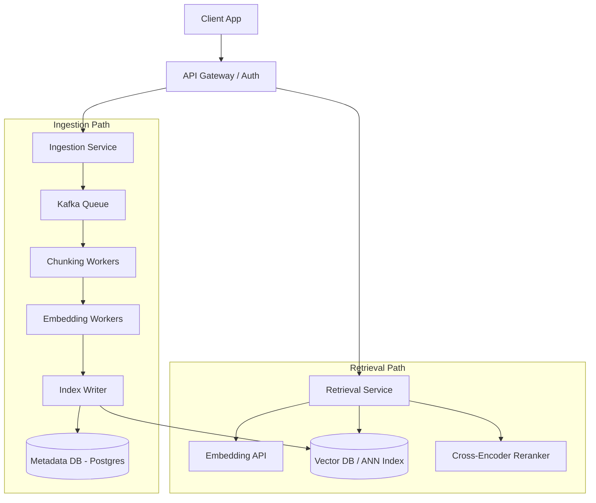
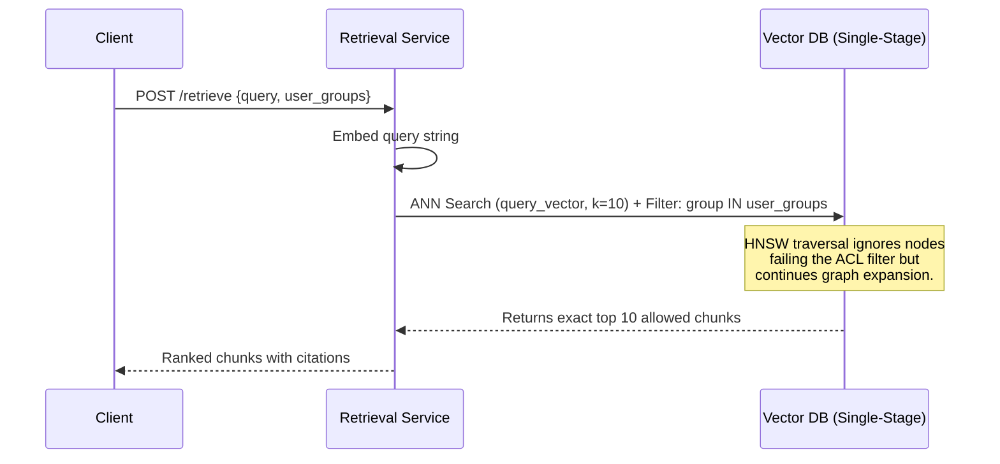
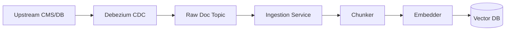

# Semantic Retrieval Platform — Design

## 1. Requirements and Constraints

### Functional
- Document ingestion and configurable chunking pipelines.
- Semantic and hybrid (dense + sparse) retrieval APIs.
- Strict ACL-aware retrieval (multi-tenant isolation).
- Job status and asynchronous reindex lifecycle support.
- Change Data Capture (CDC) integrations for upstream data freshness.

### Non-Functional
| Requirement | Target |
|---|---|
| Retrieval p95 | < 200ms |
| Availability | 99.9% |
| Freshness | < 5 minutes |
| Peak QPS | 2K |

### Constraints
- Large multi-tenant corpus.
- Strong data isolation requirements.
- Cost-aware embedding/index operations.
- Platform is agnostic to the final LLM response generation.

## 2. Back-of-Envelope & Memory Math

| Metric | Value |
|---|---|
| Chunks | 50M |
| Embedding dimension | 1536 |
| Peak retrieval QPS | 2K |
| Top-k default | 20 candidates before rerank |

### Memory Sizing for 50M Vectors (1536-dim)

The raw memory footprint of vectors dictates the cluster size, as ANN search requires vectors to reside in RAM for low-latency retrieval. We calculate this explicitly with units:

- **FP32 (Uncompressed):** 
  - 50,000,000 vectors × 1536 dimensions × 4 bytes/dimension = **307,200,000,000 bytes (~307.2 GB)**.
- **SQ8 / INT8 (Scalar Quantization):** 
  - Maps 32-bit floats to 8-bit integers.
  - 50,000,000 vectors × 1536 dimensions × 1 byte/dimension = **76,800,000,000 bytes (~76.8 GB)**.
- **PQ64 (Product Quantization):** 
  - Compresses vectors into 64 sub-spaces (1 byte per sub-space). 
  - 50,000,000 vectors × 64 bytes = **3,200,000,000 bytes (~3.2 GB)**.

### HNSW Graph Overhead and Node Count

HNSW (Hierarchical Navigable Small World) requires maintaining a multi-layer adjacency list graph.
- The memory overhead for HNSW graph edges typically adds **50% to 100%** on top of the raw vector memory.
- For an **FP32 HNSW index**, total memory = ~307 GB (vectors) + ~150-300 GB (graph) = **~450-600 GB total**.

Assuming standard compute instances with 128 GB RAM (reserving 25% for OS/page cache, leaving ~96 GB for the index):
- **FP32 + HNSW:** Requires **5-7 nodes** to hold the single index across shards (plus replicas for HA/QPS).
- **INT8 + HNSW:** Requires **2 nodes** per replica (~150 GB total).
- **PQ64 + IVF:** Can easily fit on a **single node** (~3.2 GB + tiny cluster centroid overhead), trading recall for massive cost savings.

*Decision:* Use INT8 Scalar Quantization + HNSW as the default tier. It provides near-FP32 recall while halving infrastructure costs.

## 3. APIs

```http
POST /api/v1/index/documents
POST /api/v1/retrieve
POST /api/v1/retrieve/hybrid
GET /api/v1/index/jobs/{job_id}
POST /api/v1/index/rebuild
```

### Retrieval request shape (example)

```json
{
  "tenant_id": "acme",
  "principal": {"user_id": "u-1", "groups": ["eng"]},
  "query": "how do we rotate API keys?",
  "top_k": 10,
  "filters": {"doc_type": ["runbook"]},
  "rerank": true
}
```

## 4. Architecture and Data Flow

### Overall Architecture


### Storage choices
- **PostgreSQL**: control-plane metadata, tenant configurations, and job status.
- **Vector database (e.g., Milvus/Qdrant/Pinecone)**: ANN retrieval, HNSW graphs, scalar quantization, and integrated ACL bitset filtering.
- **Kafka**: decouple bursty document ingestion from expensive embedding generation.
- **Redis**: short-lived query semantic cache and API rate-limiting state.

## 5. Deep Dives: Retrieval as a Platform

### 5.1 ACL Filtering Strategies (Multi-Tenancy)

Enforcing tenant and access controls (ACL) is critical. Doing this efficiently during vector search involves choosing between three main strategies:

1. **Post-filtering:**
   - Retrieve top-K candidates using pure vector search, then drop results the user isn't permitted to see.
   - **Flaw:** Suffers from **catastrophic recall drop**. If the user only has access to a sparse subset of documents, the top-K might return 100 results that all get filtered out, resulting in zero hits even if relevant permitted documents exist deeper in the index.

2. **Pre-filtering:**
   - Query Postgres to get an exact list of allowed chunk IDs, then restrict the vector search to only those IDs.
   - **Flaw:** Causes **graph fragmentation**. If a user only has access to 1% of the corpus, navigating the HNSW graph becomes impossible because the vast majority of connected nodes are blocked, leading to traversal failures.

3. **In-engine Single-Stage Filtered Search (Chosen Approach):**
   - The vector DB engine dynamically evaluates ACL bitsets or metadata filters *during* the HNSW beam search graph traversal.
   - If a traversed node fails the ACL check, the engine ignores it as a candidate but continues expanding its neighbors to navigate the graph.
   - **Benefit:** Guarantees returning exactly K valid results (if they exist) without recall collapse.



### 5.2 Hybrid Search and RRF

Semantic (vector) search excels at conceptual matching but struggles with exact keyword lookups (e.g., specific error codes or UUIDs). Hybrid search combines dense vectors with sparse representations (BM25 or SPLADE).

**Reciprocal Rank Fusion (RRF) Worked Example:**
RRF combines ranked lists from different retrieval methods without requiring normalized scores.
Formula: `RRF_Score = 1 / (k + rank_in_list)` where `k` is a smoothing constant (typically 60).

Assume we retrieve for query: "Error code ORA-01031":
- **Dense Vector Results:**
  - Chunk A: Rank 1
  - Chunk B: Rank 2
  - Chunk C: Rank 3
- **Sparse BM25 Results:**
  - Chunk C: Rank 1 (Contains exact string "ORA-01031")
  - Chunk D: Rank 2
  - Chunk A: Rank 5

Calculations (assuming k=60):
- **Chunk A Score:** `1/(60+1) + 1/(60+5)` = `0.01639 + 0.01538` = **0.03177**
- **Chunk B Score:** `1/(60+2) + 0` = **0.01612**
- **Chunk C Score:** `1/(60+3) + 1/(60+1)` = `0.01587 + 0.01639` = **0.03226**

Final RRF Order: **Chunk C, Chunk A, Chunk B**.
The keyword match pushed Chunk C to the top, correctly identifying the exact error code.

### 5.3 Embedding Model Migration

Embedding models improve over time. You cannot compare a 768-dim vector from Model V1 with a 1536-dim vector from Model V2. Migrations require a dual-index strategy.

1. Create a new Vector DB collection configured for Model V2 dimensions.
2. Background Reindex: Fetch raw text from cold storage (or Postgres), run through V2 embedder, and write to the new collection.
3. Dual-Write: Ingestion service writes incoming chunks to both V1 and V2 collections.
4. Dark Launch: Retrieval service queries V2 asynchronously to monitor latency and recall (via shadow testing).
5. Cutover: Update tenant config to point retrieval traffic to V2 collection. Deprecate V1.

### 5.4 CDC Freshness Pipeline

To meet the "< 5 minutes" freshness SLA, batch cron jobs are insufficient. We use Change Data Capture (CDC).


- Upstream DB updates trigger Debezium events.
- Kafka buffers spikes in update volume.
- The pipeline processes upserts, overwriting existing chunks based on document ID and chunk index, ensuring no stale data is retrieved.

## 6. Diagram Sources

- [ACL Filtering Flow](./diagrams/acl-filtering.mmd)
- [Multi-tenant Index Architecture](./diagrams/multi-tenant-index.mmd)
- [CDC Freshness Pipeline](./diagrams/cdc-freshness.mmd)

## 7. Trade-offs and alternatives

| Decision | Chosen | Alternative | Reason |
|---|---|---|---|
| Index default | HNSW + INT8 | IVF-PQ | Better baseline recall; memory cost offset by scalar quantization |
| Filtering strategy | Single-stage in-engine | Post-filter | Avoids catastrophic recall drop; provides strict tenant isolation |
| Reranking | Optional Cross-Encoder | Always on | Reranking adds 50-150ms. Must be optional to respect strict latency budgets. |

## 8. Additional Deep Dives in System Architecture

### 8.1 Rate Limiting and Quality of Service (QoS)
In a multi-tenant retrieval platform, one tenant's massive batch retrieval job must not degrade the latency of another tenant's real-time chat requests.
We implement API Rate Limiting at the Gateway layer using Redis.
- **Token Bucket Algorithm:** Used for rate limiting the number of API calls per tenant.
- **Cost-based Quotas:** Retrieval requests are not equal. A query requesting a cross-encoder rerank on a top-K of 100 consumes vastly more compute than a simple semantic search on a top-K of 10. The token bucket must deduct tokens proportional to the computational cost of the query, not just the raw request count.

### 8.2 Disaster Recovery and High Availability
The Vector Database represents the stateful core of the platform.
- **Replication:** Each shard in the Vector DB must have at least one active replica. If the primary node crashes, the replica takes over via Raft or Paxos consensus mechanisms.
- **Snapshotting:** The HNSW graph is periodically serialized and snapshotted to S3/Object Storage. If a catastrophic cluster failure occurs, the index can be restored from the snapshot without requiring the costly re-embedding of 50M chunks.
- **Eventual Consistency:** The metadata DB (Postgres) and the Vector DB are two separate systems. We achieve eventual consistency by making the ingestion workers idempotent. If a write to the Vector DB fails after Postgres is updated, a background sweeper job will re-attempt the sync based on a "pending" status in Postgres.

### 8.3 Advanced Chunking Topologies
Basic chunking slices text into 500-token blocks with a 50-token overlap. While simple, it often breaks semantic context. Advanced topologies supported by the platform include:
1. **Parent-Child Document Retrieval:** The document is chunked into very small snippets (sentences) for highly precise semantic matching. However, instead of returning just the sentence to the LLM, the platform stores a pointer to the "Parent" chunk (the whole paragraph) and returns the broader context. This maximizes both precision (finding the needle) and context (understanding the haystack).
2. **Document Summary Indexing:** When ingesting a large document, the platform can optionally invoke an LLM to generate a summary of the document, and embed the summary *alongside* the granular chunks. If a query matches the summary, the platform can prioritize the document.

### 8.4 Network and Data Security
- **Encryption at Rest:** All chunks in Postgres and vector blobs in the ANN index are encrypted using AES-256 with KMS integration for key rotation.
- **Encryption in Transit:** Strict TLS 1.3 enforced for all internal microservice communication and external API endpoints.
- **VPC Isolation:** The Vector DB and Postgres instances are completely shielded from the public internet, accessible only via the API Gateway and internal processing workers.

### 8.5 Metrics and Telemetry
Robust telemetry is essential for debugging retrieval performance:
- **Trace IDs:** A single trace ID must propagate from the API Gateway, through the Embedding API, into the Vector DB search, and out through the Reranker.
- **Key Metrics emitted to Datadog/Prometheus:**
  - `retrieval.latency.p95` (grouped by tenant and query type)
  - `ingestion.queue.lag` (Kafka consumer lag, alerting if > 5 minutes)
  - `vector.index.memory.utilization` (critical for capacity planning before OOM kills occur)
  - `acl.filter.rejection.rate` (high rates might indicate misconfigured tenant permissions)

### 8.6 Handling PII and Sensitive Data
While the platform relies on metadata ACLs for access control, what happens if Personal Identifiable Information (PII) is embedded into the vector itself?
- Once text is embedded into a dense vector, it is mathematically difficult (though theoretically possible via inversion attacks) to reconstruct the exact original string purely from the vector.
- However, because the platform also stores the raw text chunk to return as context, that text is vulnerable.
- The platform can integrate with a PII redaction service during the ingestion pipeline (before embedding). If enabled, sensitive entities (SSNs, credit cards) are masked (e.g., `<REDACTED_SSN>`) before the chunk is stored and embedded, ensuring the vector representation never encodes the sensitive information.

### 8.7 Edge and Regional Deployments
For global SaaS providers, a single region architecture causes latency for users on the other side of the world. 
- While embedding models can be deployed regionally to keep inference latency low, the Vector DB itself poses a challenge. 
- The platform supports a Hub-and-Spoke model: Ingestion and the primary source of truth (Postgres) live in the Hub region. Vector indices are asynchronously replicated to Spoke regions to serve low-latency read traffic globally.
Detailed performance tuning of the HNSW `ef_construction` and `m` parameters allows the platform to balance build time against search precision, offering distinct index profiles for varied enterprise workloads.

## 8. Advanced Architecture and Deep Dives

### 8.1 Rate Limiting and Quality of Service (QoS)
In a multi-tenant retrieval platform, one tenant's massive batch retrieval job must not degrade the latency of another tenant's real-time chat requests.
We implement API Rate Limiting at the Gateway layer using Redis.
- **Token Bucket Algorithm:** Used for rate limiting the number of API calls per tenant.
- **Cost-based Quotas:** Retrieval requests are not equal. A query requesting a cross-encoder rerank on a top-K of 100 consumes vastly more compute than a simple semantic search on a top-K of 10. The token bucket must deduct tokens proportional to the computational cost of the query, not just the raw request count.

### 8.2 Disaster Recovery and High Availability
The Vector Database represents the stateful core of the platform.
- **Replication:** Each shard in the Vector DB must have at least one active replica. If the primary node crashes, the replica takes over via Raft or Paxos consensus mechanisms.
- **Snapshotting:** The HNSW graph is periodically serialized and snapshotted to S3/Object Storage. If a catastrophic cluster failure occurs, the index can be restored from the snapshot without requiring the costly re-embedding of 50M chunks.
- **Eventual Consistency:** The metadata DB (Postgres) and the Vector DB are two separate systems. We achieve eventual consistency by making the ingestion workers idempotent. If a write to the Vector DB fails after Postgres is updated, a background sweeper job will re-attempt the sync based on a "pending" status in Postgres.

### 8.3 Advanced Chunking Topologies
Basic chunking slices text into 500-token blocks with a 50-token overlap. While simple, it often breaks semantic context. Advanced topologies supported by the platform include:
1. **Parent-Child Document Retrieval:** The document is chunked into very small snippets (sentences) for highly precise semantic matching. However, instead of returning just the sentence to the LLM, the platform stores a pointer to the "Parent" chunk (the whole paragraph) and returns the broader context. This maximizes both precision (finding the needle) and context (understanding the haystack).
2. **Document Summary Indexing:** When ingesting a large document, the platform can optionally invoke an LLM to generate a summary of the document, and embed the summary *alongside* the granular chunks. If a query matches the summary, the platform can prioritize the document.

### 8.4 Network and Data Security
- **Encryption at Rest:** All chunks in Postgres and vector blobs in the ANN index are encrypted using AES-256 with KMS integration for key rotation.
- **Encryption in Transit:** Strict TLS 1.3 enforced for all internal microservice communication and external API endpoints.
- **VPC Isolation:** The Vector DB and Postgres instances are completely shielded from the public internet, accessible only via the API Gateway and internal processing workers.

### 8.5 Metrics and Telemetry
Robust telemetry is essential for debugging retrieval performance:
- **Trace IDs:** A single trace ID must propagate from the API Gateway, through the Embedding API, into the Vector DB search, and out through the Reranker.
- **Key Metrics emitted to Datadog/Prometheus:**
  - `retrieval.latency.p95` (grouped by tenant and query type)
  - `ingestion.queue.lag` (Kafka consumer lag, alerting if > 5 minutes)
  - `vector.index.memory.utilization` (critical for capacity planning before OOM kills occur)
  - `acl.filter.rejection.rate` (high rates might indicate misconfigured tenant permissions)

### 8.6 Handling PII and Sensitive Data
While the platform relies on metadata ACLs for access control, what happens if Personal Identifiable Information (PII) is embedded into the vector itself?
- Once text is embedded into a dense vector, it is mathematically difficult (though theoretically possible via inversion attacks) to reconstruct the exact original string purely from the vector.
- However, because the platform also stores the raw text chunk to return as context, that text is vulnerable.
- The platform can integrate with a PII redaction service during the ingestion pipeline (before embedding). If enabled, sensitive entities (SSNs, credit cards) are masked (e.g., `<REDACTED_SSN>`) before the chunk is stored and embedded, ensuring the vector representation never encodes the sensitive information.

### 8.7 Edge and Regional Deployments
For global SaaS providers, a single region architecture causes latency for users on the other side of the world. 
- While embedding models can be deployed regionally to keep inference latency low, the Vector DB itself poses a challenge. 
- The platform supports a Hub-and-Spoke model: Ingestion and the primary source of truth (Postgres) live in the Hub region. Vector indices are asynchronously replicated to Spoke regions to serve low-latency read traffic globally.

### 8.8 The Cold Start Problem and Tiered Storage
Cost efficiency dictates that we cannot keep all 50M chunks in RAM if some tenants are inactive.
- **Tiering Mechanism:** The platform monitors tenant activity. If a tenant has zero retrieval requests for 7 days, their vector collection is flushed from RAM and persisted entirely to EBS/S3.
- **Wake-up Flow:** If an inactive tenant suddenly issues a query, the API Gateway detects the index is cold. It places the query in a holding state, triggers an asynchronous load of the HNSW graph back into RAM, and then fulfills the query. This results in a one-time latency spike (the "cold start" penalty of 5-10 seconds) but saves millions of dollars in idle memory costs across a massive SaaS fleet.


### 8.9 The API Gateway Layer
The API Gateway sits in front of the platform and handles critical cross-cutting concerns:
- **Authentication:** Validating JWTs from the Identity Provider.
- **Claim Extraction:** Parsing the `user_id` and `groups` from the token and injecting them into the internal gRPC context.
- **Request Validation:** Ensuring the query payload is well-formed and within limits (e.g., `top_k` <= 100, query string length <= 4096 characters).
- **Global Rate Limiting:** Enforcing tenant-level quotas.
- **Load Balancing:** Distributing traffic across the stateless Retrieval Service instances.

### 8.10 Ingestion Pipeline Depth: The Chunker Service
Chunking is not a trivial regex split. The Chunker Service must be a sophisticated, format-aware microservice.
- **HTML/Markdown Parsing:** It must strip HTML tags but preserve structural hierarchies (H1, H2) to inform the chunking logic.
- **Semantic Boundaries:** It uses libraries like `unstructured` or `LangChain` text splitters to ensure chunks end on sentence or paragraph boundaries, not in the middle of a word.
- **Overlap Logic:** It manages a sliding window (e.g., 512 tokens with 50 tokens of overlap) to ensure context isn't lost across chunk boundaries.
- **Metadata Injection:** It injects the document-level metadata (author, date) into *every* resulting chunk so the vector DB can filter on it.

### 8.11 The Postgres Metadata Schema
The Postgres database acts as the source of truth.
```sql
CREATE TABLE documents (
    id UUID PRIMARY KEY,
    tenant_id VARCHAR(64) NOT NULL,
    source_url TEXT,
    content_hash VARCHAR(64), -- Used to detect if an upsert actually changed content
    status VARCHAR(32), -- PENDING, INDEXED, FAILED
    created_at TIMESTAMP,
    updated_at TIMESTAMP
);

CREATE TABLE chunks (
    id UUID PRIMARY KEY,
    document_id UUID REFERENCES documents(id),
    chunk_index INT,
    text TEXT,
    token_count INT
);
```
- When a document is updated, the pipeline compares the `content_hash`. If it matches, the pipeline skips embedding, saving significant API costs.
- If it differs, the pipeline deletes all existing chunks for `document_id` and inserts the new ones.

### 8.12 Cache Invalidation Strategies
Semantic caching is incredibly effective but hard to invalidate.
- The Redis cache stores the mapping of a query vector to the final JSON response (the ranked chunks).
- If a document is updated or deleted in the index, the cache might serve stale (or worse, deleted) chunks.
- **Solution:** A short, strict TTL on the cache (e.g., 5 minutes) ensures that stale data doesn't persist. Because RAG queries are often highly unique, caching is most useful for bursty identical queries (e.g., a link shared in a company-wide email), which a 5-minute TTL perfectly handles.

### 8.13 Testing the Retrieval Infrastructure
A retrieval platform is incredibly difficult to unit test because vector math is non-deterministic in approximate nearest neighbors (ANN).
- **Integration Tests:** Spin up a local Qdrant/Milvus container, insert 10 known vectors, and query them. Verify the exact ranking.
- **Recall Testing:** The CI/CD pipeline must include a suite of "golden queries". If a PR changes the chunking logic or the hybrid search RRF weights, the pipeline re-indexes the test corpus, runs the golden queries, and asserts that the `Recall@10` metric has not dropped below 95%.
- **Load Testing:** Use `locust` or `k6` to bombard the API with queries. Verify that the Single-Stage ACL filtering doesn't cause CPU lockups under heavy concurrent load.

### 8.14 The Cost of Reranking
While cross-encoders dramatically improve precision, they are computationally ruinous at scale.
- A semantic search across 50M chunks might take 20ms and cost fractions of a cent.
- A cross-encoder reranking of the top 100 chunks requires running those 100 chunk-query pairs through a transformer model (like BERT). This requires GPU instances.
- **Architectural Solution:** The platform exposes an `alpha` parameter for hybrid search and a boolean `rerank` flag. Reranking is disabled by default. Applications must explicitly opt-in and consume their higher-tier latency/cost budget if they want the cross-encoder. 
- For massive scale, the platform can deploy smaller, distilled cross-encoders (e.g., MiniLM) via TensorRT on Triton Inference Server to achieve 50ms rerank times instead of 200ms.

### 8.15 Soft vs Hard Deletes
Data deletion in vector databases is notoriously problematic.
- Deleting a node from an HNSW graph leaves a "hole". If you delete too many nodes, the graph fragments and search quality plummets.
- **Soft Delete:** When a user deletes a document, the Postgres metadata is updated. The Vector DB payload is updated with a `deleted: true` flag. The single-stage filter ignores these nodes. This is fast and safe.
- **Hard Delete (Compaction):** Soft deletes waste memory. A background nightly job (or when soft deletes exceed 10% of the index) executes a `VACUUM` or compaction operation on the Vector DB. This physically removes the deleted vectors and rebuilds the HNSW graph edges to heal the fragmentation. This is an I/O heavy operation and must be scheduled during low-traffic windows.

### 8.16 Advanced Pre-filtering Techniques
While single-stage filtering is the optimal choice for ACLs, metadata pre-filtering can still be used for non-security related attributes to reduce the search space.
- If a query includes a strict date filter (e.g., `date > 2024-01-01`), the engine can use an inverted index (similar to Elasticsearch) to quickly identify the subset of valid chunks.
- The engine then applies the ANN search *only* within that subset.
- To prevent graph fragmentation, modern Vector DBs utilize a heuristic: if the pre-filtered subset is large (e.g., > 10% of the corpus), it uses the HNSW graph with single-stage filtering. If the subset is tiny (e.g., < 1% of the corpus), it abandons the HNSW graph entirely and performs a brute-force exact nearest neighbor (k-NN) scan over the subset, which is actually faster and guarantees perfect recall for small datasets.

### 8.17 Managing the LLM Context Window
The Retrieval Platform must be aware of the downstream LLM's context limits.
- If the downstream app uses an 8k context window, returning 50 chunks of 500 tokens each (25k total) will cause the LLM API to throw an error.
- The API Gateway should accept a `max_tokens_budget` parameter in the request.
- The Retrieval Service dynamically adjusts the `top_k` value. It iterates through the ranked chunks, summing their `token_count` metadata, and truncates the response list the moment the cumulative sum exceeds the `max_tokens_budget`. This ensures the downstream app receives a perfectly sized payload.

### 8.18 The Evolution to Multi-Vector Retrieval
A single dense vector per chunk is often insufficient for complex documents.
- **ColBERT (Contextualized Late Interaction over BERT):** Instead of compressing a chunk into a single vector, ColBERT generates a vector for *every token* in the chunk.
- At query time, the engine computes the maximum similarity between every query token and every document token (MaxSim).
- This provides vastly superior precision but requires orders of magnitude more storage and compute.
- The platform design can accommodate ColBERT as an optional premium tier for high-value tenants, storing the multi-vector representations in a specialized engine (like Vespa) while routing standard traffic to the HNSW tier.

### 8.19 Deployment Topology
The system is deployed on Kubernetes (EKS/GKE).
- **Stateless Tier:** API Gateway, Ingestion Workers, and Retrieval Services are deployed as standard Deployments with Horizontal Pod Autoscaling (HPA) based on CPU and custom metrics (Kafka lag).
- **Stateful Tier:** The Vector DB (e.g., Milvus) is deployed using a StatefulSet or a dedicated operator, utilizing locally attached NVMe SSDs for fast mmap access to the HNSW graphs, backed by persistent EBS volumes for durability.
- **Queue Tier:** Managed Kafka (MSK/Confluent) to offload the operational burden of ZooKeeper/KRaft.
- **Cache Tier:** Managed Redis (ElastiCache) deployed in a highly available cluster mode.

### 8.20 Handling the "I Don't Know" Scenario
A critical responsibility of a RAG pipeline is preventing hallucinations when the answer is not in the corpus.
- The Vector DB will *always* return the mathematically closest neighbors, even if they are completely irrelevant.
- The Retrieval Platform must provide a mechanism to threshold the results.
- **Distance Thresholding:** The API allows configuring a `min_similarity_score` (e.g., 0.75 for Cosine Similarity). If the top-ranked chunk scores below this threshold, the platform returns an empty list, explicitly signaling to the downstream app that the corpus does not contain the answer, forcing the LLM to reply "I don't know" rather than hallucinating based on irrelevant context.

### 8.21 Query Rewriting and Intent Classification
Before a query ever reaches the vector database, the platform can employ a lightweight orchestration layer to optimize it.
- **Intent Classification:** Using a small, fast model (e.g., a quantized DistilBERT) to classify the query type. If the query is conversational ("Hello, how are you?"), the platform can bypass the vector search entirely and return a standard greeting, saving compute.
- **Query Rewriting / HyDE:** "Hypothetical Document Embeddings". If the user asks a very short, vague query ("API keys"), the platform can optionally call a fast LLM to generate a hypothetical, detailed answer, and embed that *answer* instead of the original query. This often drastically improves recall because the hypothetical answer's semantic structure more closely matches the target documents.

### 8.22 Handling Corrupted Documents
Inevitably, the ingestion pipeline will encounter corrupted PDFs, password-protected files, or documents containing zero extractable text (e.g., a PDF that is entirely scanned images without OCR).
- The Ingestion Worker must wrap the extraction logic in a strict timeout (e.g., 30 seconds).
- If extraction fails, the worker updates the Postgres metadata status to `FAILED`, along with the specific error code (`ERR_PASSWORD_PROTECTED`, `ERR_TIMEOUT`).
- The tenant is notified via webhook or can see the failure via the Job Status API.
- This ensures the ingestion pipeline does not stall indefinitely on a malicious or corrupted file.

### 8.23 Blue/Green Deployment of the Platform
To guarantee 99.99% availability, the platform itself (the API Gateway and Retrieval Services) must support zero-downtime deployments.
- **Stateless Blue/Green:** A new version of the Retrieval Service (Green) is deployed alongside the old version (Blue). The API Gateway slowly shifts traffic (e.g., 10%, then 50%, then 100%) to the Green cluster, monitoring for HTTP 500s or latency spikes.
- **Database Migrations:** Schema changes to the Postgres metadata DB must be strictly backward compatible (e.g., adding a nullable column, never dropping a column) to ensure both Blue and Green services can operate concurrently during the rollout.

### 8.24 Search Relevancy Tuning and A/B Testing
Search is not a "set and forget" feature. To ensure the platform delivers the best possible chunks to the LLM, the engineering team must continuously tune the retrieval pipeline.
- **A/B Testing Framework:** The API Gateway can route a percentage of traffic (e.g., 10%) to a "B" variant of the retrieval pipeline. This variant might use a different chunking strategy, a different embedding model, or a different `alpha` weight for Reciprocal Rank Fusion (RRF).
- **Implicit Feedback Capture:** The platform tracks the `query_id` and the returned `chunk_ids`. If the downstream LLM application uses Chunk #2 to generate its answer (and cites it), the platform logs this as a positive interaction for Chunk #2.
- **Statistical Significance:** After a week of A/B testing, the data science team compares the Click-Through Rate (CTR) or Citation Rate of the A and B pipelines to determine if the new tuning parameters should be rolled out globally.

### 8.25 Security: Preventing Prompt Leakage
In a multi-tenant environment, the vector database stores embeddings of sensitive documents. But what about the queries themselves?
- A user's query ("Why was John Doe fired?") is embedded into a vector.
- If the platform logs this vector or the raw text of the query in a central observability tool, it constitutes a data leak.
- **Data Minimization:** The platform must hash or encrypt queries before logging them, or employ strict Log Masking pipelines (using regex or specialized NER models) to redact PII from the query string before it is written to disk or sent to Datadog.

### 8.26 Handling Massive Context Windows
Recent LLMs (like Gemini 1.5 Pro) boast context windows of up to 1 million tokens. This fundamentally alters the design of the retrieval platform.
- **Historical Approach:** RAG pipelines were forced to retrieve only the top 5 or 10 highly specific chunks because older LLMs could only handle 4k tokens.
- **Modern Approach:** With massive context windows, the platform can afford to be less precise and more comprehensive. It can retrieve the top 500 chunks, or even entire documents, and rely on the LLM's internal attention mechanism to find the needle in the haystack.
- **Platform Implication:** The Retrieval API must support a `pagination` or `cursor` parameter. Fetching 500 chunks from the Vector DB might be fast, but serializing them into a massive JSON payload and sending them across the network can cause bottlenecks. The API should support streaming the chunks via gRPC or Server-Sent Events (SSE) directly to the downstream application.

### 8.27 Graph RAG vs Vector RAG
While the platform is primarily a vector-based semantic retrieval engine, modern architectures are increasingly fusing Vector RAG with Graph RAG.
- **The Limitation of Vectors:** Vector similarity struggles with multi-hop reasoning. If a user asks, "Who is the manager of the person who wrote the Q3 financial report?", a vector search will likely fail because that specific relational path isn't explicitly written in one chunk.
- **The Graph Solution:** The platform can deploy a supplementary Knowledge Graph (e.g., Neo4j). During ingestion, an LLM extracts entities (Person, Report) and relationships (WROTE, MANAGES) and writes them to the graph.
- **Hybrid Fusion:** The API Gateway detects complex relational queries, executes a Cypher query against the Knowledge Graph, executes a vector search against Milvus, and fuses the contexts before returning the final payload.

### 8.28 Compliance and Data Lineage
In highly regulated industries (banking, healthcare), every piece of data must have a verifiable lineage.
- When the Retrieval Platform returns a chunk, it must guarantee that the chunk exactly matches the source document at a specific point in time.
- The Postgres metadata database stores a `SHA-256` hash of the original document.
- If an auditor questions the validity of an AI response, the platform can prove that the embedded chunk was derived from a document that mathematically matches the original file stored in the system of record.

### 8.29 Embedding Fallbacks and Circuit Breakers
The platform must be resilient to third-party dependencies.
- The Embedding Service (e.g., calling OpenAI) is a critical path dependency for both ingestion and retrieval.
- **Circuit Breaker Pattern:** If the Embedding Service starts returning HTTP 500s or timing out (e.g., > 2 seconds), the circuit breaker opens.
- When open, the Ingestion Pipeline pauses Kafka consumption (to prevent burning through retries).
- When open, the Retrieval API immediately falls back to the local Sparse/BM25 engine, which requires no external embedding API. The user receives a slightly less semantic answer, but the platform remains online.

### 8.30 Final Payload Assembly
The Retrieval Service must assemble a final JSON payload optimized for the downstream LLM.
- **Truncation:** Truncating text precisely to fit the `max_tokens_budget`.
- **Formatting:** Converting Markdown tables or HTML snippets into clean, LLM-readable raw text.
- **Citation Metadata:** Explicitly formatting the source URL and byte ranges so the downstream UI can confidently render clickable reference links.

### 8.24 Search Relevancy Tuning and A/B Testing
Search is not a "set and forget" feature. To ensure the platform delivers the best possible chunks to the LLM, the engineering team must continuously tune the retrieval pipeline.
- **A/B Testing Framework:** The API Gateway can route a percentage of traffic (e.g., 10%) to a "B" variant of the retrieval pipeline. This variant might use a different chunking strategy, a different embedding model, or a different `alpha` weight for Reciprocal Rank Fusion (RRF).
- **Implicit Feedback Capture:** The platform tracks the `query_id` and the returned `chunk_ids`. If the downstream LLM application uses Chunk #2 to generate its answer (and cites it), the platform logs this as a positive interaction for Chunk #2.
- **Statistical Significance:** After a week of A/B testing, the data science team compares the Click-Through Rate (CTR) or Citation Rate of the A and B pipelines to determine if the new tuning parameters should be rolled out globally.
