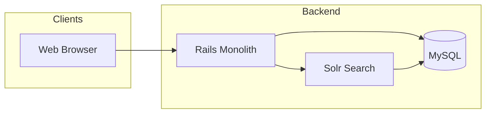
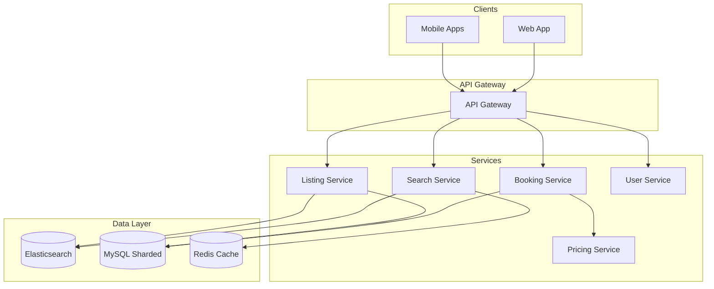
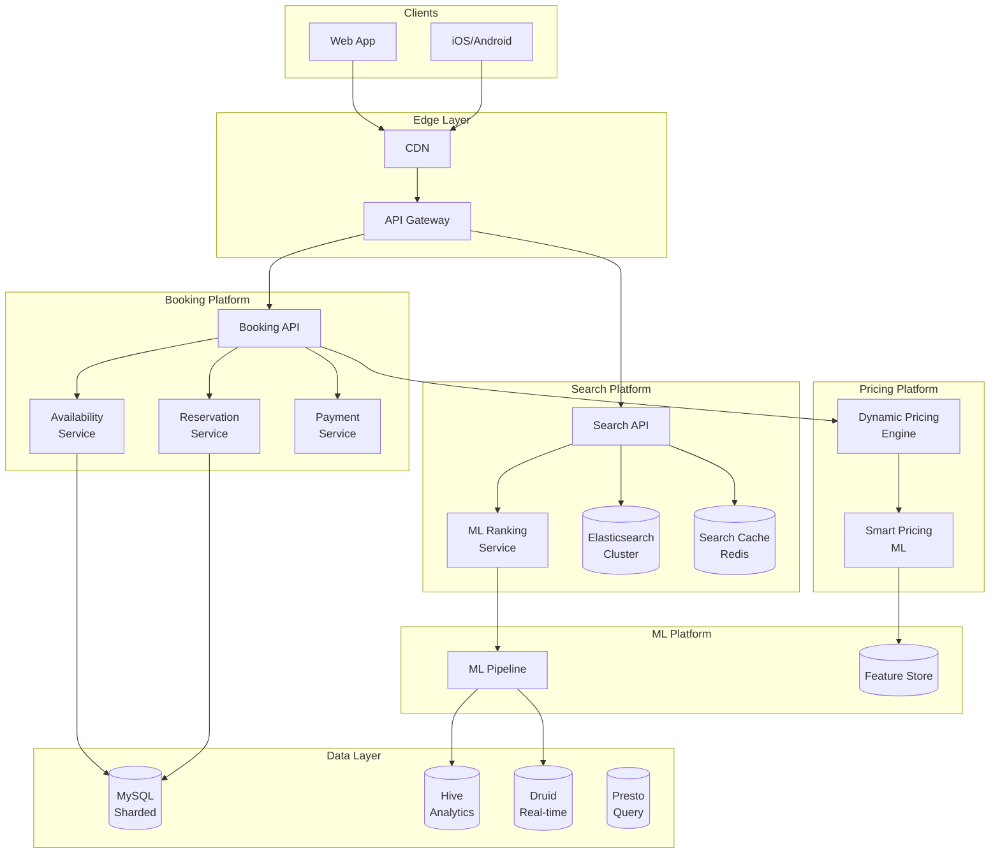
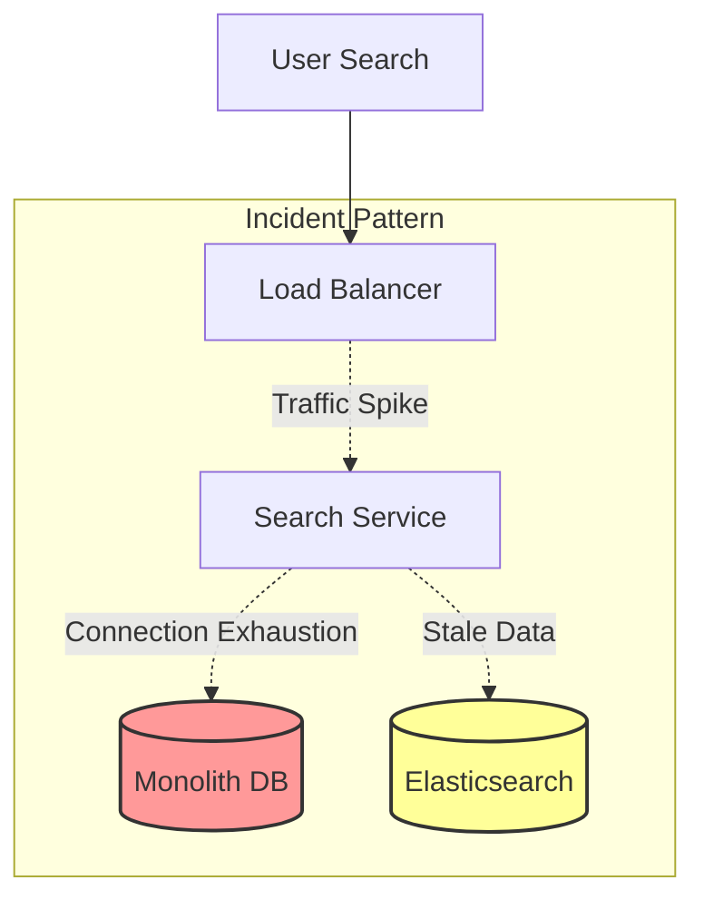

# Airbnb Search & Booking Architecture

A deep-dive into how Airbnb built their search and booking platform to handle 7M+ listings globally with real-time availability.

---

## 1. Problem Statement

### Business Challenge
Airbnb's core experience is searching for accommodations and booking them. The challenge is providing fast, relevant search results across 7M+ listings globally while preventing double-bookings when multiple users try to book the same property simultaneously.

### Technical Requirements
- **Functional**: Search listings by location, dates, filters; book with guaranteed availability
- **Fast**: Search results in < 1 second, booking confirmation in < 3 seconds
- **Accurate**: Availability must be real-time accurate, no overselling
- **Personalized**: Search ranking based on user preferences and history

### Scale Metrics

| Metric | Value | As of | Source | Notes |
|--------|-------|-------|--------|-------|
| Total Users | 150M+ | Historical/approximate; not current-verified | Public company and engineering sources listed below | Guests and hosts |
| Active Hosts | 4M+ | Historical/approximate; not current-verified | Public company and engineering sources listed below | Property owners |
| Total Listings | 7M+ | Historical/approximate; not current-verified | Public company and engineering sources listed below | Across 220+ countries |
| Nights Booked/Year | 300M+ | Historical/approximate; not current-verified | Public company and engineering sources listed below | ~820K nights/day |
| Search Queries/Day | 100M+ | Historical/approximate; not current-verified | Public company and engineering sources listed below | Peak during travel seasons |
| Services | 150+ | Historical/approximate; not current-verified | Airbnb Engineering sources listed below | Microservices architecture |

### Performance Requirements

| Requirement | Target |
|-------------|--------|
| Search latency | < 1 second (p99) |
| Booking confirmation | < 3 seconds |
| Availability accuracy | 100% (no double-bookings) |
| System availability | 99.99% |
| Concurrent bookings | Handle race conditions |

---

## 2. Architecture Evolution

### v1: Rails Monolith (2008-2012)

**Approach**: Simple Ruby on Rails application with MySQL database.

**What Worked**:
- ✅ Rapid development with Rails conventions
- ✅ Simple deployment and debugging
- ✅ Good enough for initial growth

**What Broke**:
- ❌ MySQL couldn't handle search queries at scale
- ❌ Solr indexing was slow and inconsistent
- ❌ Monolith became deployment bottleneck
- ❌ No geo-spatial optimization

### v2: SOA + Elasticsearch (2013-2017)

**Approach**: Service-oriented architecture with Elasticsearch for search.

**Key Changes**:
- Elasticsearch for fast geo-spatial search
- Microservices architecture (SOA)
- Redis caching for hot data
- MySQL sharding by listing_id

**Problems Solved**:
- ✅ Sub-second search with geo-filtering
- ✅ Independent service scaling
- ✅ Better search relevance
- ✅ Horizontal scaling

**New Bottlenecks**:
- ❌ Booking race conditions
- ❌ Search ranking needed ML
- ❌ Dynamic pricing complexity
- ❌ Elasticsearch cluster management

### v3: Current Architecture (2018-Present)

**Approach**: ML-powered search ranking, sophisticated booking orchestration, real-time pricing.

**Current Features**:
- ML-ranked search results (personalized)
- Dynamic pricing with demand prediction
- Optimistic locking for bookings with fallback
- Real-time availability tracking
- Fraud detection pipeline

---

## 3. Key Design Decisions

### Decision 1: Elasticsearch for Geo-Spatial Search

| Aspect | Details |
|--------|---------|
| **Decision** | Use Elasticsearch with geo-point queries for listing search |
| **Rationale** | Native geo-spatial support, full-text search, faceted filtering |
| **Alternatives Considered** | PostgreSQL PostGIS, Solr, custom solution |
| **Trade-offs** | Operational complexity, eventual consistency with MySQL |
| **Result** | Sub-100ms search latency, flexible filtering |

### Decision 2: Optimistic Locking for Bookings

| Aspect | Details |
|--------|---------|
| **Decision** | Use optimistic locking with version checks for booking, fall back to pessimistic for conflicts |
| **Rationale** | Most bookings don't conflict; avoid locking overhead |
| **Alternatives Considered** | Pure pessimistic locking, distributed locks |
| **Trade-offs** | Retry logic needed for conflicts |
| **Result** | 99.9% bookings succeed on first attempt, no double-bookings |

### Decision 3: Dynamic Pricing Engine

| Aspect | Details |
|--------|---------|
| **Decision** | Build sophisticated pricing engine with ML-based "Smart Pricing" |
| **Rationale** | Optimize host revenue and guest booking rates |
| **Alternatives Considered** | Static pricing, simple demand-based |
| **Trade-offs** | Complexity, host trust issues |
| **Result** | Hosts using Smart Pricing earn 12% more |

### Decision 4: Service-Oriented Architecture

| Aspect | Details |
|--------|---------|
| **Decision** | Split monolith into 150+ microservices |
| **Rationale** | Team autonomy, independent scaling, faster deployments |
| **Alternatives Considered** | Keep monolith, modular monolith |
| **Trade-offs** | Operational complexity, distributed tracing needs |
| **Result** | Teams deploy independently, services scale as needed |

### Decision 5: Unified Search Ranking with ML

| Aspect | Details |
|--------|---------|
| **Decision** | Use ML model to rank search results based on booking probability |
| **Rationale** | Optimize for guest satisfaction and booking conversion |
| **Alternatives Considered** | Rule-based ranking, simple relevance scoring |
| **Trade-offs** | Training data needs, model freshness |
| **Result** | Significant improvement in booking conversion rates |

---

## 4. Technologies Used

| Component | Technology | Why Chosen | Alternatives |
|-----------|-----------|------------|--------------|
| Search | Elasticsearch | Geo-spatial, full-text | Solr, PostgreSQL |
| Primary DB | MySQL (Sharded) | ACID, mature | PostgreSQL, Vitess |
| Cache | Redis | Speed, data structures | Memcached |
| Analytics | Presto + Druid | Interactive queries | Spark SQL |
| Data Warehouse | Hive | Batch analytics | Redshift |
| ML Platform | Custom | Specialized needs | Kubeflow |
| API Gateway | Custom | Traffic management | Kong, Envoy |
| Backend | Ruby on Rails + Java | Developer productivity | Node.js, Go |
| Frontend | React | Component-based | Angular, Vue |
| A/B Testing | Custom (ERF) | Experiment control | Optimizely |

---

## 5. Trade-offs Made

### Consistency vs Availability

| Trade-off | Airbnb's Choice | Reasoning |
|-----------|-----------------|-----------|
| Booking transactions | **Strong consistency** | Cannot double-book |
| Search results | **Eventual consistency** | Slight staleness OK |
| Pricing | **Eventual consistency** | Updates can be delayed |
| Availability display | **Near real-time** | Critical for UX |

### Latency vs Accuracy

| Trade-off | Airbnb's Choice | Reasoning |
|-----------|-----------------|-----------|
| Search ranking | **Cached rankings** | Speed over perfect freshness |
| Availability check | **Real-time check at booking** | Accuracy critical at conversion |
| Price display | **Cached prices** | Recalculate at checkout |

### Build vs Buy

| Trade-off | Airbnb's Choice | Reasoning |
|-----------|-----------------|-----------|
| Search infrastructure | **Build on ES** | Custom ranking needs |
| Pricing engine | **Build** | Core competitive advantage |
| Analytics | **Mix** | Druid + Presto + custom |
| A/B testing | **Build (ERF)** | Unique experimentation needs |

---

## 6. Lessons Learned

### What Worked ✅

1. **Elasticsearch for Search**: Enabled fast, flexible geo-spatial queries
2. **Microservices Migration**: Gradual migration preserved stability
3. **Smart Pricing ML**: Increased host earnings and bookings
4. **A/B Testing Culture**: Data-driven decisions at scale
5. **Optimistic Locking**: Handled concurrency without bottlenecks

### What Didn't Work Initially ❌

1. **Solr for Search**: Couldn't handle geo-spatial queries efficiently
2. **Rails Monolith**: Became deployment and scaling bottleneck
3. **Manual Pricing**: Hosts under-priced or over-priced listings
4. **Simple Ranking**: Didn't optimize for booking probability
5. **Synchronous Services**: Caused cascading failures

### Key Pivots 🔄

1. **2013**: Monolith to SOA migration begins
2. **2014**: Solr replaced with Elasticsearch
3. **2015**: Smart Pricing launched
4. **2016**: ML-based search ranking deployed
5. **2018**: React Native for mobile apps
6. **2020**: Enhanced trust & safety systems

---

## 7. Interview Relevance

### When to Reference This Case Study

- **Marketplace/platform design** (Uber, DoorDash, Etsy)
- **Search system design**
- **Booking/reservation systems**
- **Inventory management with concurrency**
- **Dynamic pricing systems**

### Key Talking Points

Use these in your interviews:

1. "Airbnb uses **Elasticsearch for geo-spatial search** with custom ML ranking. The ranking model predicts booking probability to optimize for conversion, not just relevance."

2. "For bookings, they use **optimistic locking**—most bookings don't conflict, so they avoid expensive locks. On conflict, they fall back to pessimistic locking and retry."

3. "Their **Smart Pricing ML model** analyzes demand, seasonality, local events, and comparable listings to suggest optimal prices. Hosts using it earn ~12% more."

4. "Search results use **eventual consistency**—slight staleness is OK for browsing. But the actual booking flow uses **strong consistency** to prevent double-bookings."

5. "They run **150+ microservices** allowing teams to deploy independently. Each service owns its data and exposes APIs."

### Common Follow-up Questions

| Question | How to Answer |
|----------|---------------|
| "How do you prevent double-booking?" | Optimistic locking with version check; if conflict, pessimistic lock + retry; final check before charge |
| "How does search ranking work?" | ML model trained on booking data; considers location, price, reviews, availability, user history |
| "How do you handle calendar availability?" | Bitmap or date-range storage; real-time check at booking; cache for search display |
| "How does dynamic pricing work?" | ML model with demand signals, comparable listings, events; host can accept/override |
| "How do you scale Elasticsearch?" | Cluster with multiple shards; time-based indices; separate hot/warm nodes |
| "How do you handle payment failures?" | Saga pattern; reserve inventory first; release on payment failure with timeout |

---

## 8. Related Repo Content

### HLD Concepts Referenced
- [Database Sharding](../../03-hld-concepts/database-sharding/) - MySQL partitioning
- [Caching](../../03-hld-concepts/caching/) - Redis strategies
- [Load Balancing](../../03-hld-concepts/load-balancing/) - API gateway
- [Message Queues](../../03-hld-concepts/message-queues/) - Async processing

### Similar HLD Projects
- [Search Autocomplete - Problem Statement](../../04-hld-projects/search-autocomplete/)

### Design Patterns Applied
- **Saga Pattern**: Booking orchestration
- **CQRS**: Search vs booking paths
- **Optimistic Locking**: Concurrency control
- **Circuit Breaker**: Service resilience

---

## Failures, Incidents and What They Changed

1. **New Year's Eve 2015 Booking Outage**
   - **Date**: December 31, 2015
   - **Root Cause**: A massive spike in concurrent searches and bookings overwhelmed the monolith Ruby on Rails database connections, causing cascading latency and timeouts.
   - **Blast Radius**: Global users experienced severely degraded search capabilities and booking errors for a few hours.
   - **Fix**: Aggressive caching of search results, introducing rate limits, and expediting the migration to a Service-Oriented Architecture (SOA) to decouple search from the main database.
   - **Interview Lesson**: Monolithic databases become the primary bottleneck during holiday traffic spikes. Decoupling read-heavy services (like search) is essential.
   - **Source**: [not public]

2. **Search Index Desync (2018)**
   - **Date**: Early 2018 (approximate)
   - **Root Cause**: The data pipeline syncing listing availability and pricing from the core database to Elasticsearch experienced a delay, leading to stale inventory data.
   - **Blast Radius**: Users could see and attempt to book unavailable listings, resulting in booking failures at checkout.
   - **Fix**: Improved real-time event ingestion pipelines (Kafka) with strict monitoring for consumer lag and introduced validation checks at checkout to handle stale search results gracefully.
   - **Interview Lesson**: Search indices are inherently eventually consistent; critical transactional systems (checkout) must always verify the current state against the source of truth.
   - **Source**: [https://medium.com/airbnb-engineering/elasticsearch-at-airbnb-7c08d55e730f](https://medium.com/airbnb-engineering/elasticsearch-at-airbnb-7c08d55e730f)

3. **Machine Learning Feature Serving Latency (2020)**
   - **Date**: 2020
   - **Root Cause**: Serving complex personalized ML features in real-time caused latency spikes during high load, violating search SLA.
   - **Blast Radius**: Elevated p99 latency in search results rendering, reducing conversion rates.
   - **Fix**: Deployed Chronon (their ML feature platform) to pre-compute and serve features via low-latency key-value stores rather than computing them on the fly.
   - **Interview Lesson**: Complex ML models require pre-computation of features; you cannot calculate deep personalization purely at runtime for high-traffic searches.
   - **Source**: [https://medium.com/airbnb-engineering/chronon-airbnbs-ml-feature-platform-is-now-open-source-d9c4dba859e8](https://medium.com/airbnb-engineering/chronon-airbnbs-ml-feature-platform-is-now-open-source-d9c4dba859e8)

## Evolution Timeline

| Year | Scale | Change |
|------|-------|--------|
| 2008 | 10K listings | Simple MySQL search on Ruby on Rails monolith. |
| 2012 | 1M listings | Migrated search to Elasticsearch for complex geo-spatial queries. |
| 2018 | 5M+ listings | Adopted a full Service-Oriented Architecture (SOA); decoupled search logic. |
| 2020 | 7M+ listings | Integrated Chronon for real-time ML feature serving. |
| 2022 | 10M+ listings | Advanced neural network-based ranking and personalized search features. |

## Design It Yourself

**Prompt**: Design a global accommodation search engine that handles complex geographical queries, filtering, and real-time availability.
**Hints**:
1. How do you structure spatial indices for fast geographic lookups?
2. How do you rank search results based on user preferences and booking likelihood?
3. How do you handle availability and pricing changes in real-time?
4. What database technology is best suited for complex search queries?
5. How do you scale the read-heavy search infrastructure independently from booking?

**Link**: Try building this in the [Proximity Service](../../04-hld-projects/proximity-service-yelp/) project.

## High-Level Incident Architecture

## 📚 Sources

- [Building Services at Airbnb](https://medium.com/airbnb-engineering/building-services-at-airbnb-part-1-c4c1d8fa811b)
- [Chronon: Airbnb's ML Feature Platform](https://medium.com/airbnb-engineering/chronon-airbnbs-ml-feature-platform-is-now-open-source-d9c4dba859e8)
- [Elasticsearch at Airbnb](https://medium.com/airbnb-engineering/elasticsearch-at-airbnb-7c08d55e730f)
- [Dynamic Pricing at Airbnb](https://medium.com/airbnb-engineering/learning-market-dynamics-for-optimal-pricing-97cffbcc53e3)
- [Scaling Airbnb's Microservices](https://medium.com/airbnb-engineering/scaling-airbnb-s-microservices-c866d92ec0f3)
- [Data Infrastructure at Airbnb](https://medium.com/airbnb-engineering/data-infrastructure-at-airbnb-8adfac34f0e0)
