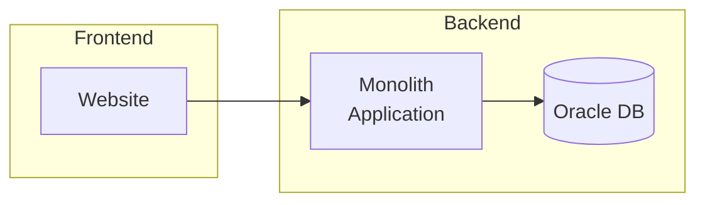
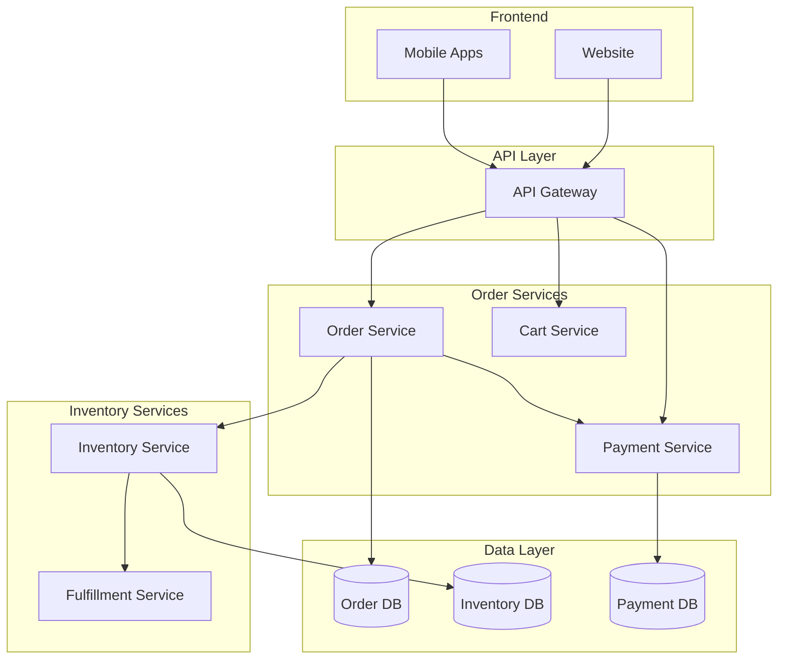
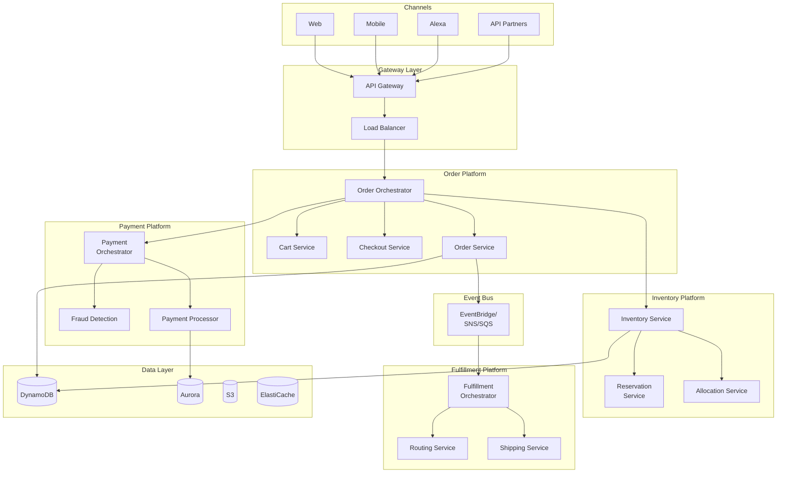
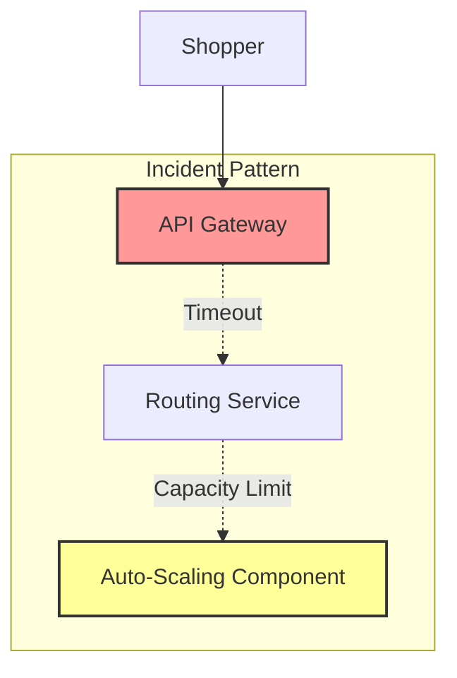

# Amazon Order Processing Architecture

A deep-dive into how Amazon built the world's largest e-commerce order processing system, handling 12M+ orders per day.

---

## 1. Problem Statement

### Business Challenge
Amazon processes millions of orders daily across hundreds of millions of products. The challenge is managing inventory across 175+ fulfillment centers globally, preventing overselling, and ensuring reliable order processing even during peak events like Prime Day.

### Technical Requirements
- **Functional**: Accept orders, validate payment, reserve inventory, fulfill and ship
- **Reliable**: No overselling, no lost orders, eventual delivery guarantee
- **Scalable**: Handle 10x traffic spikes during Prime Day
- **Fast**: Order confirmation in seconds, accurate delivery estimates

### Scale Metrics

| Metric | Value | As of | Source | Notes |
|--------|-------|-------|--------|-------|
| Daily Orders | 12M+ | Historical/approximate; not current-verified | Amazon public and Builders' Library sources listed below | Peak during holidays |
| Products | 300M+ | Historical/approximate; not current-verified | Amazon public sources listed below | Across all marketplaces |
| Sellers | 2M+ | Historical/approximate; not current-verified | Amazon public sources listed below | Third-party marketplace |
| Fulfillment Centers | 175+ | Historical/approximate; not current-verified | Amazon public sources listed below | Global network |
| Peak Orders/Second | 100K+ | Historical/approximate; not current-verified | Amazon retail and public sources listed below | Prime Day |
| Countries | 20+ | Historical/approximate; not current-verified | Amazon public sources listed below | Major markets |

### Performance Requirements

| Requirement | Target |
|-------------|--------|
| Order confirmation | < 5 seconds |
| Inventory accuracy | 99.9%+ |
| Order completion rate | 99.99% |
| System availability | 99.999% |
| Prime Day scaling | 10x normal traffic |

---

## 2. Architecture Evolution

### v1: Monolithic Order System (1995-2000)

**Approach**: Single Oracle database with monolithic application.

**What Worked**:
- ✅ Simple to develop and debug
- ✅ ACID transactions for orders
- ✅ Worked for initial growth

**What Broke**:
- ❌ Oracle licensing costs exploding
- ❌ Single database bottleneck
- ❌ Deployments affected entire system
- ❌ Couldn't scale for holiday traffic

### v2: Service-Oriented Architecture (2001-2010)

**Approach**: Decompose into services with "2-pizza teams"; each team owns their service end-to-end.

**Key Changes**:
- SOA with clear service boundaries
- Each service owns its database
- Internal APIs between services
- 2-pizza team ownership model

**Problems Solved**:
- ✅ Independent scaling per service
- ✅ Teams deploy independently
- ✅ Reduced Oracle dependency
- ✅ Better fault isolation

**New Bottlenecks**:
- ❌ Distributed transactions complexity
- ❌ Service coordination overhead
- ❌ Consistency across services
- ❌ Need for better orchestration

### v3: Current Architecture (2010-Present)

**Approach**: Eventual consistency, DynamoDB, Saga pattern, event-driven processing.

**Current Features**:
- DynamoDB for order and inventory data
- Saga pattern for distributed transactions
- Event-driven fulfillment
- Real-time inventory visibility
- ML-based fraud detection

---

## 3. Key Design Decisions

### Decision 1: Service-Oriented Architecture (SOA)

| Aspect | Details |
|--------|---------|
| **Decision** | Decompose monolith into services; each service owns its data |
| **Rationale** | Team autonomy, independent scaling, faster iteration |
| **Alternatives Considered** | Keep monolith, shared database |
| **Trade-offs** | Distributed complexity, eventual consistency |
| **Result** | Foundation for AWS, enabled thousands of deployments/day |

### Decision 2: DynamoDB for Order Data

| Aspect | Details |
|--------|---------|
| **Decision** | Build and use DynamoDB for high-throughput order/inventory data |
| **Rationale** | Predictable latency at any scale, no provisioning headaches |
| **Alternatives Considered** | Oracle, MySQL sharding, Cassandra |
| **Trade-offs** | Limited query patterns, eventual consistency |
| **Result** | Handles Prime Day traffic without degradation |

### Decision 3: Saga Pattern for Distributed Transactions

| Aspect | Details |
|--------|---------|
| **Decision** | Use Saga pattern instead of distributed transactions |
| **Rationale** | Better availability, works across service boundaries |
| **Alternatives Considered** | 2PC, XA transactions, TCC pattern |
| **Trade-offs** | Compensating transactions needed, eventual consistency |
| **Result** | Reliable order processing without distributed locks |

### Decision 4: Inventory Reservation with Timeouts

| Aspect | Details |
|--------|---------|
| **Decision** | Soft-reserve inventory with timeout; hard-reserve on payment success |
| **Rationale** | Balance customer experience with inventory accuracy |
| **Alternatives Considered** | Hard lock immediately, pure optimistic |
| **Trade-offs** | Can still oversell in edge cases |
| **Result** | 99.9%+ inventory accuracy, good customer experience |

### Decision 5: Event-Driven Fulfillment

| Aspect | Details |
|--------|---------|
| **Decision** | Use events to trigger fulfillment, not synchronous calls |
| **Rationale** | Decouple order placement from fulfillment, handle backpressure |
| **Alternatives Considered** | Synchronous fulfillment, batch processing |
| **Trade-offs** | Eventual processing, ordering complexity |
| **Result** | Resilient to warehouse system failures |

---

## 4. Technologies Used

| Component | Technology | Why Chosen | Alternatives |
|-----------|-----------|------------|--------------|
| Order Storage | DynamoDB | Scale, latency | Cassandra |
| OLTP | Aurora | ACID where needed | RDS MySQL |
| Cache | ElastiCache | Session, hot data | Redis OSS |
| Events | SNS + SQS | Reliable delivery | Kafka |
| Orchestration | Step Functions | Saga coordination | Custom |
| API Gateway | Amazon API Gateway | Managed, integrated | Kong |
| Compute | Lambda + EC2 | Mix of patterns | Pure containers |
| Analytics | Redshift | Warehouse | Snowflake |
| ML | SageMaker | Fraud, forecasting | Custom |
| CDN | CloudFront | Static content | Akamai |

---

## 5. Trade-offs Made

### Consistency vs Availability

| Trade-off | Amazon's Choice | Reasoning |
|-----------|-----------------|-----------|
| Order placement | **Available** | Customer can always order |
| Inventory count | **Eventually consistent** | Aggregate is approximate |
| Payment | **Strongly consistent** | Financial accuracy |
| Fulfillment status | **Eventually consistent** | Async updates OK |

### Latency vs Accuracy

| Trade-off | Amazon's Choice | Reasoning |
|-----------|-----------------|-----------|
| Inventory display | **Cached count** | Speed for browsing |
| Checkout | **Real-time check** | Accuracy at conversion |
| Delivery estimate | **Approximate** | Can update later |

### Cost vs Reliability

| Trade-off | Amazon's Choice | Reasoning |
|-----------|-----------------|-----------|
| Redundancy | **Multi-AZ** | Availability critical |
| Inventory buffers | **Safety stock** | Prevent overselling |
| Compute | **Over-provision** | Handle spikes |

### Complexity vs Flexibility

| Trade-off | Amazon's Choice | Reasoning |
|-----------|-----------------|-----------|
| Transactions | **Saga pattern** | Flexibility over simplicity |
| Data model | **Service-owned** | Autonomy over sharing |
| Deployment | **Independent** | Speed over coordination |

---

## 6. Lessons Learned

### What Worked ✅

1. **2-Pizza Teams**: Small teams own services end-to-end, enabling velocity
2. **SOA Early**: Decomposition before it was called microservices
3. **Building DynamoDB**: Custom database for specific needs (became AWS product)
4. **Saga Pattern**: Reliable distributed transactions without locks
5. **Event-Driven**: Resilient fulfillment pipeline

### What Didn't Work Initially ❌

1. **Oracle Monolith**: Couldn't scale, licensing costs exploded
2. **Distributed Transactions**: 2PC was too slow and fragile
3. **Shared Databases**: Created coupling between teams
4. **Synchronous Fulfillment**: Single warehouse failure blocked orders
5. **Manual Scaling**: Couldn't handle Prime Day traffic

### Key Pivots 🔄

1. **2001**: Monolith to SOA (famous memo from Bezos)
2. **2006**: AWS launched (built from internal platform)
3. **2012**: DynamoDB launched (from Dynamo paper)
4. **2015**: Prime Day introduced (10x traffic challenge)
5. **2018**: Machine learning for forecasting
6. **2020**: Same-day delivery infrastructure

---

## 7. Interview Relevance

### When to Reference This Case Study

- **E-commerce system design**
- **Order processing systems**
- **Inventory management**
- **Distributed transactions**
- **Event-driven architectures**

### Key Talking Points

Use these in your interviews:

1. "Amazon pioneered **Service-Oriented Architecture** in 2001 with the famous Bezos mandate: every team must expose their data through APIs, no direct database access. This led to AWS."

2. "They use the **Saga pattern** for order processing—instead of distributed transactions, each step has a compensating action. If payment fails, inventory reservation is released."

3. "Inventory uses a **soft reservation with timeout**: cart holds inventory for 15 minutes, payment success converts to hard reservation, timeout releases the hold."

4. "**DynamoDB** was built by Amazon specifically for order processing—they needed predictable single-digit millisecond latency at any scale, which traditional databases couldn't provide."

5. "Fulfillment is **event-driven**: order completion publishes an event that triggers the fulfillment pipeline, decoupling order placement from warehouse operations."

### Common Follow-up Questions

| Question | How to Answer |
|----------|---------------|
| "How do you prevent overselling?" | Soft reserve in cart → timeout; hard reserve on payment; safety stock buffers |
| "How do you handle payment failures after inventory reserved?" | Saga compensation: release inventory reservation; notify customer |
| "How does Prime Day scale?" | Pre-provisioned capacity; DynamoDB auto-scaling; circuit breakers; graceful degradation |
| "How do you handle returns?" | Reverse saga: refund payment → update inventory → return logistics |
| "How do you allocate inventory across warehouses?" | Optimization algorithm: minimize shipping cost + time; consider inventory levels |
| "How do you ensure idempotency?" | Order ID as idempotency key; check before processing; exactly-once with dedup |

---

## 8. Related Repo Content

### HLD Concepts Referenced
- [Database Sharding](../../03-hld-concepts/database-sharding/) - DynamoDB partitioning
- [Message Queues](../../03-hld-concepts/message-queues/) - SNS/SQS patterns
- [Microservices Communication](../../03-hld-concepts/microservices-communication/) - Service mesh
- [Rate Limiting](../../03-hld-concepts/rate-limiting/) - Traffic control

### Similar HLD Projects
- [E-commerce Backend - Problem Statement](../../04-hld-projects/ecommerce-backend/)
- [File Storage Service](../../04-hld-projects/file-storage/)
- [Distributed Object Storage - Problem Statement](../../04-hld-projects/distributed-object-storage/)
- [Distributed Workflow Orchestrator - Problem Statement](../../04-hld-projects/distributed-workflow-orchestrator/)
- [Online Auction System](../../04-hld-projects/online-auction/)
- [Ad Click Aggregator](../../04-hld-projects/ad-click-aggregator/)

### Design Patterns Applied
- **Saga Pattern**: Distributed transactions
- **Event Sourcing**: Order history
- **CQRS**: Order read vs write
- **Circuit Breaker**: Service resilience
- **Outbox Pattern**: Reliable event publishing

---

## Failures, Incidents and What They Changed

1. **Prime Day 2018 Glitch**
   - **Date**: July 16, 2018
   - **Root Cause**: An internal capacity issue in Amazon's auto-scaling infrastructure, heavily impacting Sable (a core internal service for retail routing), caused request timeouts and failures across the site.
   - **Blast Radius**: Shoppers experienced error pages ("dogs of Amazon") and could not complete purchases during the first few hours of Prime Day.
   - **Fix**: Re-architected auto-scaling policies to handle more extreme traffic spikes proactively and added better isolation between front-end dependencies.
   - **Interview Lesson**: Peak events require proactive scaling (not reactive auto-scaling); critical routing dependencies must have massive fallback capacity.
   - **Source**: [https://aws.amazon.com/solutions/case-studies/amazon-retail/](https://aws.amazon.com/solutions/case-studies/amazon-retail/)

2. **Dynamo Paper Outage Catalyst (2004)**
   - **Date**: December 2004 (Holiday Season)
   - **Root Cause**: The relational databases handling session states and shopping carts could not scale to meet holiday traffic, causing cascading failures.
   - **Blast Radius**: Significant downtime and lost revenue during peak holiday shopping.
   - **Fix**: This failure drove the creation of Dynamo (eventually DynamoDB), a highly available key-value store, favoring eventual consistency over immediate consistency for carts.
   - **Interview Lesson**: Always prioritize availability for critical flows like shopping carts; eventual consistency is a necessary trade-off at extreme scale.
   - **Source**: [https://www.allthingsdistributed.com/files/amazon-dynamo-sosp2007.pdf](https://www.allthingsdistributed.com/files/amazon-dynamo-sosp2007.pdf)

3. **AWS S3 Outage (2017)**
   - **Date**: February 28, 2017
   - **Root Cause**: An authorized team member inadvertently executed a command to remove a small set of servers for a billing system issue, but a typo caused a much larger set of servers to be removed.
   - **Blast Radius**: A large portion of the internet reliant on US-EAST-1 S3, including parts of Amazon's retail site reliant on S3 for image hosting, went offline for several hours.
   - **Fix**: Implemented strict safety checks and rate limits for removing capacity, and decoupled retail image serving to rely on regional CDN caches.
   - **Interview Lesson**: Tooling must enforce blast radius limits; large-scale infrastructure operations should be gradual and heavily guarded against human error.
   - **Source**: [https://aws.amazon.com/message/41926/](https://aws.amazon.com/message/41926/)

## Evolution Timeline

| Year | Scale | Change |
|------|-------|--------|
| 1995 | N/A | Monolithic C/C++ application running on a single database. |
| 2001 | N/A | Transitioned to a Service-Oriented Architecture (SOA). |
| 2007 | N/A | Published the Dynamo paper, cementing their move to eventual consistency. |
| 2015 | N/A | Fully embraced AWS managed services for internal retail operations. |
| 2020 | N/A | Implemented advanced machine learning for routing and fulfillment optimization. |

## Design It Yourself

**Prompt**: Design a highly available e-commerce order processing system that guarantees a shopping cart is never lost.
**Hints**:
1. How do you handle database failures during checkout?
2. Why is eventual consistency acceptable for shopping carts but not payment processing?
3. How do you ensure idempotency for order creation?
4. What happens when a user adds items on two different devices simultaneously?
5. How do you design the system to survive the failure of an entire availability zone?

**Link**: Try building this in the [E-commerce Backend](../../04-hld-projects/ecommerce-backend/) project.

## High-Level Incident Architecture

## 📚 Sources

- [Dynamo: Amazon's Highly Available Key-value Store](https://www.allthingsdistributed.com/files/amazon-dynamo-sosp2007.pdf)
- [How Amazon Handles Peak Traffic](https://aws.amazon.com/solutions/case-studies/amazon-retail/)
- [Timeouts, retries, and backoff with jitter](https://aws.amazon.com/builders-library/timeouts-retries-and-backoff-with-jitter/)
- [Making retries safe with idempotent APIs](https://aws.amazon.com/builders-library/making-retries-safe-with-idempotent-APIs/)
- [Avoiding fallback in distributed systems](https://aws.amazon.com/builders-library/avoiding-fallback-in-distributed-systems/)
- [Amazon S3 Outage Summary](https://aws.amazon.com/message/41926/)
