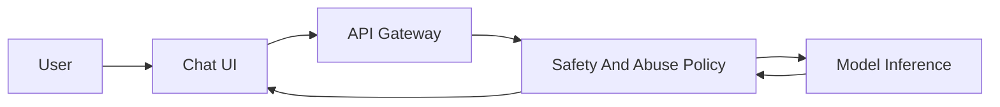
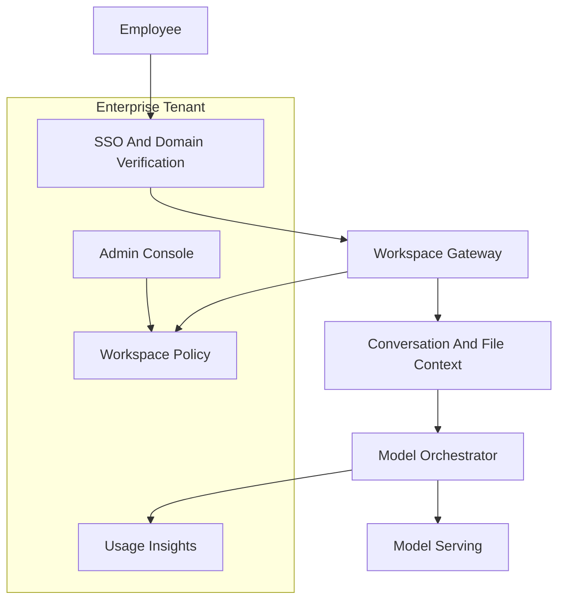
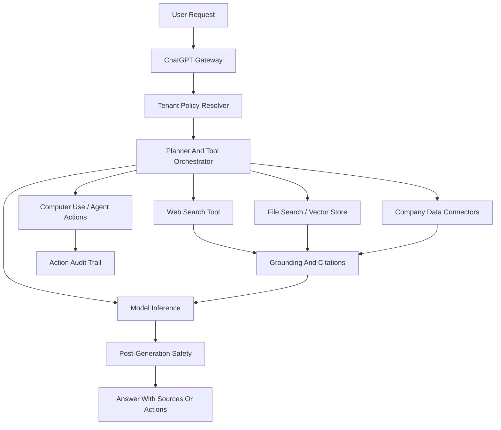
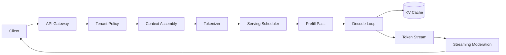

# ChatGPT Inference And Enterprise Agent Architecture

A public-source case study of ChatGPT as a multi-tenant AI assistant platform with model inference, tools, enterprise controls, and connected company data.

---

## 1. Source Framing

This case study separates public facts from system-design inference:

- **Source-backed facts:** product capabilities, enterprise controls, security statements, connector surfaces, and public platform tools from OpenAI pages.
- **Interview architecture inference:** gateway, context assembly, tool orchestration, policy checks, model serving, and observability are presented as a defensible design model, not as OpenAI's private internal topology.
- **Avoided claims:** GPU fleet size, exact model router logic, cache hit rates, latency SLOs, cost per query, internal safety classifier details, and unreleased roadmap.

## 2. Problem Statement

### Business Challenge

ChatGPT must serve a broad assistant surface: consumer chat, enterprise workspaces, file/data analysis, web-connected answers, coding delegation, and agentic tasks. The hard design problem is keeping this experience fast and useful while isolating tenants, honoring data controls, grounding answers in approved context, and routing expensive model/tool work through bounded policies.

### Functional Requirements

- Accept conversational requests, uploaded files, and tool-using workflows.
- Retrieve approved context from connectors and user-provided files.
- Route requests to appropriate model and tool paths.
- Apply safety, privacy, and tenant-policy checks before and after generation.
- Provide citations or source links when using web/search-backed answers.
- Surface usage, admin, and access controls for enterprise deployments.

### Scale And Provenance Metrics

| Metric | Value | As of | Source | Notes |
|--------|-------|-------|--------|-------|
| Business adoption | Over 5 million business users | Page accessed 2026-06-14 | [ChatGPT Enterprise](https://chatgpt.com/business/enterprise/) | Live marketing page; volatile. |
| Enterprise data connectors | Microsoft SharePoint, GitHub, Google Drive, Box, and more | Page accessed 2026-06-14 | [ChatGPT Enterprise](https://chatgpt.com/business/enterprise/) | Product surface, not connector internals. |
| Enterprise privacy posture | Business data is not used for training by default | Page accessed 2026-06-14 | [OpenAI data-use help](https://help.openai.com/en/articles/5722486-how-your-data-is-used-to-improve-model-performance) | Organization opt-in policy can change the default. |
| Launch enterprise controls | Admin console, SSO, domain verification, usage insights, encryption, SOC 2 | 2023-08-28 | [Introducing ChatGPT Enterprise](https://openai.com/index/introducing-chatgpt-enterprise/) | Historical launch baseline. |
| Fortune 500 registered-account signal | Over 80% of Fortune 500 companies had registered ChatGPT accounts | 2023-08-28 | [Introducing ChatGPT Enterprise](https://openai.com/index/introducing-chatgpt-enterprise/) | Footnoted launch metric; registered accounts, not paid enterprise seats. |
| Agent platform tools | Web search, file search, computer use, and Agents SDK | 2025-03-11 | [New tools for building agents](https://openai.com/index/new-tools-for-building-agents/) | API platform capabilities that mirror common assistant architecture patterns. |

## 3. Architecture Evolution

### v1: Single Chat Surface

**Approach:** A user prompt flows through authentication, moderation, model inference, and response rendering.



**What worked**

- Simple user mental model: ask, receive, refine.
- Minimal state management beyond conversation history.
- Clear control point for pre-generation and post-generation safety checks.

**What breaks at scale**

- Long conversations need compression or memory selection.
- Current events require retrieval or web search.
- Enterprises need tenant isolation, auditability, and admin controls.

### v2: Enterprise Workspace Control Plane

**Approach:** Add organization membership, identity, policy, usage analytics, and enterprise data-handling controls around the assistant.



**Design lessons**

- Tenant policy must be resolved before prompt assembly.
- Data-retention and training defaults are product contracts, not implementation details.
- Usage analytics must be useful without exposing sensitive prompt contents broadly.

### v3: Connected Agent And Tool Platform

**Approach:** A request can become a plan with search, file retrieval, code, computer-use actions, or connector calls. The model is part of an orchestrated workflow rather than the only service.



**Design lessons**

- Tool calls need permission checks, rate limits, and audit trails.
- Retrieval quality becomes part of answer quality.
- Citations are a product feature and a trust mechanism.
- Agent actions need stronger rollback, review, and containment than pure text responses.

## 4. Request Lifecycle: From API Call To Token Stream

A single chat request in the design model passes through seven stages:

1. **Admission.** The gateway authenticates the caller, resolves tenant policy, and applies rate limits before any model work is scheduled. Requests that fail policy or budget checks are rejected here, at the cheapest point in the pipeline.
2. **Context assembly.** The orchestrator builds the prompt: conversation history (possibly summarized), retrieved documents with per-source access checks, tool outputs, and system instructions. This stage drives request variance: a short greeting and a 50-page document question differ by orders of magnitude in prompt tokens.
3. **Tokenization and enqueue.** The assembled prompt is tokenized and handed to the serving scheduler with a priority class and a streaming flag.
4. **Prefill.** The model processes the full prompt in one parallel forward pass, producing the first token and the initial KV cache. Prefill cost scales with prompt length and is compute-bound.
5. **Decode loop.** Tokens are generated one at a time; each step appends to the KV cache and streams the token to the client. Decode is memory-bandwidth-bound and runs until a stop condition: end token, length budget, or client disconnect.
6. **Post-generation checks.** Streaming moderation and policy filters run on token windows; violations truncate or replace the stream.
7. **Accounting and observability.** Token counts, latency breakdowns, tool calls, and cost attribution are logged per request and per tenant.



**Streaming and disconnects.** Tokens ship over a streaming connection (server-sent events or similar) and the client renders incrementally, so perceived latency is governed by time to first token and decode rate, not total generation time. A client disconnect cancels the sequence: the scheduler frees its KV blocks immediately, which is why abandoned long generations are pure waste and why long agentic runs are worth checkpointing.

The two latency numbers an interviewer will ask about come from different stages: time to first token is queue wait plus prefill, while per-token latency is decode under the current batch. The phases have opposite bottleneck profiles (compute-bound versus bandwidth-bound), which is why modern serving stacks schedule them differently and, increasingly, place them on different hardware pools.

## 5. Batching And Scheduling

Batching is the single biggest throughput lever in model serving, and its design is well covered in public literature.

- **Static batching wastes capacity.** Waiting to fill a fixed batch and running it until the longest sequence finishes means padding short prompts and idling slots behind stragglers. Utilization collapses exactly when demand is highest.
- **Continuous (iteration-level) batching.** The scheduler re-evaluates batch membership every iteration: sequences that finish leave immediately and waiting requests join at the next step. This is the standard model today, published in "Orca: A Distributed Serving System for Transformer-Based Generative Models" (USENIX OSDI 2022).
- **Prefill and decode schedule differently.** A long prefill monopolizes compute and stalls every decode in the same step. Chunked prefill splits long prompts into pieces interleaved with decode steps so interactive streams keep their per-token latency.
- **Priority lanes and fairness.** Interactive chat, background document jobs, and API batch traffic need distinct priority classes with per-tenant quotas, or the cheapest bulk workload starves the most expensive interactive one.
- **Preemption under pressure.** When KV-cache space runs out, the scheduler can pause lower-priority sequences and either recompute their state later or swap it to host memory. Both options are discussed in the PagedAttention paper (ACM SOSP 2023); recompute trades compute for memory, swap trades bandwidth for memory.
- **Speculative decoding as a latency lever.** A small draft model proposes several tokens that the large model verifies in one pass, raising effective decode speed without changing output quality; widely published as a serving optimization and worth naming when asked about per-token latency.
- **Prefill/decode disaggregation.** Because the two phases have opposite bottleneck profiles, a further step is placing them on separate hardware pools: compute-optimized accelerators for prefill, bandwidth-optimized for decode, with the KV cache transferred between them. This is an active area of published work and a good "what comes next" point in an interview, framed as a field direction rather than a claim about this specific deployment.

## 6. KV-Cache Memory Pressure

Autoregressive decoding attends to every previous token, so each token's key and value tensors are cached instead of recomputed. That cache is usually the binding memory constraint in serving, not the model weights.

**Illustrative arithmetic (assumptions stated).** Per token, the KV cache holds 2 tensors (key and value) across every layer:

```text
KV bytes per token = 2 x layers x hidden size x bytes per element
                   = 2 x 40 x 5120 x 2 (FP16)
                   = ~0.8 MB per token
```

So one 4,000-token conversation needs roughly 3.2 GB of KV cache, and 10,000 such concurrent conversations need ~32 TB. Weights for the same model class are a one-time ~26 GB per replica. The ratio is the lesson: memory pressure scales with concurrent context, not with model size alone.

**Why naive allocation wastes most of it.** Reserving contiguous max-length buffers per sequence strands memory that most sequences never use, and variable lengths fragment what remains. The vLLM project's PagedAttention paper (ACM SOSP 2023) allocates the KV cache in fixed-size blocks addressed through a block table, like virtual memory pages: near-zero fragmentation, and blocks can be shared across sequences with a common prefix (shared system prompts, parallel samples from one prompt).

**Pressure responses, cheapest first:**

1. Prefix sharing and block reuse for identical prompt prefixes.
2. Context management: summarize or drop old turns before the window fills.
3. Preemption of lower-priority sequences (recompute or swap).
4. Offload of cold KV blocks to host memory, paying bandwidth on resume.
5. Hard context-window limits enforced at the product layer.

**The product angle.** Context limits are not only an engineering constraint; they shape the product. A larger window costs KV capacity on every concurrent stream, so window size, summarization behavior, and file-upload limits are capacity decisions made jointly by product and serving teams. This is a strong interview observation because it connects a user-visible limit to an infrastructure budget.

## 7. Load Balancing And Queueing

- **Routing policy matters beyond load.** Least-loaded routing spreads work, but prefix-aware routing that sends repeat or similar prompts to the replica already holding their KV blocks raises cache reuse and cuts prefill work. Production routers blend both signals.
- **Queues appear before saturation.** Time to first token is queue wait plus prefill, so TTFT degrades non-linearly as utilization climbs; running a serving fleet near 100% utilization converts small traffic spikes into large latency spikes. Headroom is a latency feature, not waste.
- **Admission control beats overload.** When the queue crosses a threshold, shed or defer low-priority lanes, return explicit retry signals, and protect interactive traffic. A system that refuses 5% of requests cleanly beats one that serves 100% badly.
- **Failover and deploys.** Replicas fail and models roll forward constantly. Health-checked draining, per-version canaries, and fast rollback keep these routine events invisible to users.
- **Fairness is a product property.** Without explicit per-tenant quotas, a single workspace running bulk document analysis can consume enough queue and KV-cache capacity to degrade every other tenant. Fair-share scheduling per tenant, with burst allowances, turns fairness from a hope into a contract.

## 8. Capacity Reasoning: A Worked Estimate

*Labelled illustrative; every number below is an assumption, not a published figure. The method is the point.*

**Assumptions:**

- Peak demand: 50,000 concurrent connected chat sessions.
- Activity: at any instant, ~20% of connected sessions are mid-response and actively decoding -> 10,000 active streams.
- Target perceived speed: 30 output tokens per second per stream.
- One serving replica sustains 2,000 output tokens per second in aggregate under continuous batching (varies widely with model size, hardware, and batch shape).

**Throughput estimate:**

```text
demand  = 10,000 streams x 30 tokens/s = 300,000 tokens/s
replicas = 300,000 / 2,000 = 150
with ~30% headroom for bursts, failover, and imperfect batching -> ~200 replicas
```

**KV-cache cross-check:** 10,000 active streams averaging 4,000 tokens of context at ~0.8 MB per token need ~32 TB of KV space. At ~56 GB of usable KV space per accelerator (80 GB HBM minus weights and overhead), that is ~570 accelerator-equivalents of memory, far above the throughput estimate.

**Short-context sensitivity.** Re-run the same arithmetic at a 1,000-token average context: KV demand falls four-fold to ~8 TB (~143 accelerator-equivalents), below the throughput estimate of ~200 replicas, so compute now binds and memory is comfortable. The crossover context length, not either estimate alone, is what a strong answer surfaces.

**Reading the result.** The two estimates disagree, and that disagreement is the finding: at long average context, memory is the binding constraint and prefix caching, context management, and quantization of the KV cache pay back immediately; at short context, compute binds and batching efficiency dominates. A strong interview answer computes both bounds, states which one binds, and shows the sensitivity to the activity factor and context length rather than defending a single number.

## 9. Key Design Decisions

| Decision | Why It Matters | Trade-off |
|----------|----------------|-----------|
| Separate tenant policy from prompt assembly | Prevents accidental inclusion of disallowed context. | Adds latency and policy-cache complexity. |
| Treat retrieval as a first-class subsystem | Enables answers over company data and fresh web sources. | Requires indexing, access checks, ranking, and stale-source handling. |
| Keep tool orchestration explicit | Makes multi-step tasks inspectable and governable. | More state machines and failure modes than direct model calls. |
| Add source links for search-backed answers | Improves user trust and reviewability. | Requires source selection, dedupe, and citation rendering. |
| Preserve human review for high-impact actions | Reduces blast radius of agent mistakes. | Slows fully autonomous workflows. |

## 10. Failure Modes

| Failure Mode | Symptom | Mitigation |
|--------------|---------|------------|
| Prompt or tool injection | Retrieved content steers the model away from user/admin intent. | Instruction hierarchy, source isolation, allowlisted tools, post-action review. |
| Cross-tenant data leak | User receives data from another workspace or unauthorized connector path. | Tenant-scoped authz before retrieval; per-connector ACL checks. |
| Stale retrieval | Answer uses outdated web or enterprise documents. | Source freshness labels, recency-aware ranking, source links. |
| Tool runaway | Agent repeats costly searches or actions. | Step budgets, rate limits, timeouts, approval gates. |
| Silent safety bypass | Unsafe output appears valid because checks are not observable. | Structured moderation logs, eval suites, and sampled human review. |

### Degradation Modes

Failures stop requests; degradations slow or weaken them, and users notice these first.

| Degradation | Symptom | Handling |
|-------------|---------|----------|
| Replica or accelerator loss | Capacity drops, TTFT climbs across the fleet. | Health-checked failover, drain and replace, shed low-priority lanes until capacity recovers. |
| KV-cache exhaustion | Preemption and recompute spikes; jittery per-token latency. | Memory watermarks, admission control, prefix-cache pressure relief, context limits. |
| Queue saturation | TTFT grows while per-token latency stays normal. | Defer batch lanes, explicit backpressure to clients, autoscale on queue depth rather than only on utilization. |
| Tool or connector outage | Answers fall back to model-only behavior mid-conversation. | Explicit degraded-mode responses, cached context where valid, per-tool circuit breakers. |
| Model version rollout regression | Quality or latency shifts after a deploy. | Per-version canaries with latency and eval guardrails, fast rollback, version-pinned enterprise tenants. |
| Cold start after scale-up | New replicas serve slowly while weights load and caches warm. | Warm pools, readiness gates that wait for cache priming, gradual traffic ramp. |
| Retrieval index staleness | Answers cite documents that have changed or lost permission. | Freshness labels, re-index lag alerts, access re-checks at read time. |

## 11. Cost Levers

Serving cost is dominated by accelerator-hours, so every lever is ultimately about doing the same work with fewer of them:

- **Model routing.** Send easy requests to smaller, cheaper models and reserve the largest model for requests that need it. A cheap classifier or heuristic gate costs almost nothing compared to the savings.
- **Batching efficiency.** Decode is memory-bandwidth-bound, so larger effective batches raise tokens per second per accelerator at nearly flat compute cost, until KV-cache limits bind. Scheduling quality is a cost feature.
- **Quantization.** FP8 or lower-precision weights and KV caches cut both memory footprint and bandwidth demand at a small, measurable quality cost; adopt behind eval guardrails.
- **Caching.** Response caching for identical queries and prefix caching for shared system prompts and repeated document context remove entire classes of compute.
- **Token budgets.** Context summarization, retrieval top-k limits, and max-output caps bound the per-request cost distribution directly.
- **Autoscaling to the demand curve.** Diurnal traffic means static fleets pay for peak all day; scale on queue depth and utilization, and prefer deferring batch work to off-peak.
- **Capacity mix.** Blend reserved, committed, and spot accelerator capacity so the base load rides the cheapest tier; treat spot eviction as another failover drill, which the serving layer already handles.

Measure each lever with cost per million tokens and accelerator-hours per conversation, gated by quality evals. Adopt in order of risk: caching and batching first (no quality risk), then routing and quantization (bounded, measurable risk).

## 12. Observability And Telemetry

Inference platforms live or die by per-phase telemetry, because a single end-to-end latency number hides every actionable cause:

- **Latency, split by phase:** time to first token, per-token latency, end-to-end latency; each by model version, priority lane, and tenant, at p50 and p99.
- **Throughput:** output tokens per second per replica, batch-size distribution, and the prefill/decode share of step time.
- **Memory:** KV-cache utilization, preemption and recompute rates, prefix-cache hit rate.
- **Queue:** depth and wait time per priority lane, admission-shed rate.
- **Quality and safety:** rolling eval scores per model version, moderation rates, sampled human review outcomes.
- **Cost:** cost per million tokens and per conversation, attributed per tenant so enterprise billing and internal budgeting agree.

Every metric needs a tenant dimension: one noisy tenant must be visible as one noisy tenant, not as a fleet-wide regression.

Alerting follows the same split: page on user-facing symptoms (TTFT p99, shed rate, error rate), ticket on capacity trends (KV headroom, queue growth rate), and dashboard the rest. An inference fleet generates too much signal to page on causes.

## 13. Evaluation And Quality Guardrails

Model and prompt changes ship continuously, so evaluation is a production system, not a research artifact:

- **Pre-release gates.** Each candidate version passes offline quality suites, safety suites, and latency benchmarks before any live traffic.
- **Canary with guardrails.** New versions take a small traffic slice with automatic rollback on latency, eval-score, or moderation-rate regression.
- **Adversarial suites.** Prompt-injection, jailbreak, and data-exfiltration test sets run as release gates, because the retrieval and tool surfaces expand the attack surface with every connector.
- **Sampled human review.** A small, privacy-reviewed sample of production traffic is graded by people to catch regressions automated suites miss.
- **Regression tracking over time.** Scores are trended, not just checked at launch; slow drift from retrieval-index changes or upstream model updates is the common failure.

## 14. Interview Relevance

Use this case study when asked to design:

- A multi-tenant enterprise AI assistant.
- A RAG-backed chat product.
- A tool-using agent platform.
- A conversational analytics or document-Q&A assistant.
- A policy-aware model gateway.

Good interview framing:

1. Start with tenant isolation and data-use contracts.
2. Split the system into gateway, context assembly, orchestrator, tools, model serving, safety, and observability.
3. Make retrieval permissions explicit.
4. Add budgets and review gates for agentic actions.
5. Treat evaluation and audit as production requirements, not offline extras.

### Interview Questions And Strong Answers

**Q1. "Design the inference serving layer for a chat assistant streaming tokens to millions of users."**

Walk the request lifecycle: gateway with tenant policy, admission queue, continuous-batched serving fleet, streaming decode, post-generation checks. Split latency into time to first token (queue plus prefill) and per-token latency (decode under the current batch) within the first two minutes; that split tells the interviewer you know where time actually goes. Close with per-tenant quotas and observability.

**Q2. "Time to first token is fine, but per-token latency doubled. What do you check?"**

Decode is memory-bandwidth-bound, so look at batch composition first: did average context length or batch size jump, raising KV-cache pressure and preemption? Then memory-bandwidth saturation, then any quantization or kernel change in a recent deploy. The weak answer blames "the model" without separating queueing, prefill, and decode; the strong one names the phase before naming causes.

**Q3. "Cut inference cost by 40% without users noticing. Which levers, in what order?"**

Caching and batching first because they carry no quality risk: prefix caching for shared prompts, response caching where legal, better continuous batching. Then model routing to tier requests, then quantization behind eval guardrails, then token budgets. Each lever gets a quality gate, and you say so; "no quality risk" and "bounded, measured risk" are different promises.

**Q4. "Bulk document-analysis jobs are starving interactive chat traffic. Fix it."**

Separate the lanes: distinct priority classes and per-tenant quota pools, admission control on the bulk lane, chunked prefill so long document prompts interleave with decodes instead of blocking them, and autoscale bulk capacity into off-peak windows. The general principle worth stating: never let a bulk latency class share a queue with an interactive one.

## 15. Related Repository Content

| Topic | Repository Link | How It Maps |
|-------|-----------------|-------------|
| Multi-tenant chat assistant | [GenAI HLD](../../06-genai-systems/02-llm-hld-projects/multi-tenant-chat-assistant/) | Interview-scale version of the workspace assistant architecture. |
| Conversation memory store | [GenAI LLD](../../06-genai-systems/01-llm-lld-projects/conversation-memory-store/) | State selection and summarization for long chats. |
| Safety policy engine | [GenAI LLD](../../06-genai-systems/01-llm-lld-projects/safety-filter-policy-engine/) | Pre/post generation policy enforcement. |
| Document Q&A RAG | [GenAI HLD](../../06-genai-systems/02-llm-hld-projects/document-qa-rag/) | Retrieval and grounded answers over documents. |
| API gateway | [HLD Concept](../../03-hld-concepts/api-gateway/) | Front-door auth, routing, throttling, and policy resolution. |
| Rate limiting | [HLD Concept](../../03-hld-concepts/rate-limiting/) | Tool and model budget enforcement. |
| Monitoring | [HLD Concept](../../03-hld-concepts/monitoring-observability/) | Usage, reliability, cost, and safety observability. |

## 16. Glossary

- **Time to first token (TTFT):** queue wait plus prefill time; the latency users feel before any output appears.
- **Per-token latency (TPOT):** time between streamed tokens during decode; governs how fast the answer "types".
- **Prefill:** the parallel forward pass over the full prompt that produces the first token and the initial KV cache.
- **Decode:** the sequential loop that generates one token per step, appending to the KV cache.
- **KV cache:** stored key/value tensors for prior tokens so decoding does not recompute them; the dominant serving-memory consumer.
- **Continuous batching:** re-admitting sequences to the running batch every iteration instead of running fixed batches to completion.
- **Preemption:** pausing a sequence under memory pressure and recomputing or swapping its KV state later.
- **Quantization:** storing weights or KV tensors at lower precision to cut memory and bandwidth needs.
- **Chunked prefill:** splitting a long prompt's prefill into pieces interleaved with decode steps so interactive streams keep their latency.
- **Prefix caching:** reusing KV blocks for prompt prefixes shared across requests, such as system prompts.
- **Admission control:** rejecting or deferring requests before they consume model compute, to protect the latency of admitted traffic.
- **Prefill/decode disaggregation:** running the two phases on separate hardware pools matched to their different bottlenecks.
- **Speculative decoding:** drafting tokens with a small model and verifying them with the large one to raise decode speed.

## 17. Sources

- [ChatGPT Enterprise](https://chatgpt.com/business/enterprise/) - accessed 2026-06-14.
- [Introducing ChatGPT Enterprise](https://openai.com/index/introducing-chatgpt-enterprise/) - 2023-08-28.
- [New tools for building agents](https://openai.com/index/new-tools-for-building-agents/) - 2025-03-11.
- [How your data is used to improve model performance](https://help.openai.com/en/articles/5722486-how-your-data-is-used-to-improve-model-performance) - accessed 2026-06-14.
- Efficient Memory Management for Large Language Model Serving with PagedAttention - Kwon et al., ACM SOSP, 2023. Public literature for continuous batching scheduling details, KV-cache paging, and preemption options in Sections 5-6.
- Orca: A Distributed Serving System for Transformer-Based Generative Models - Yu et al., USENIX OSDI, 2022. Public literature for iteration-level (continuous) batching in Section 5.

The two papers above are general serving-literature references: they ground the batching, scheduling, and KV-cache mechanics in Sections 4-8, and are not claims about OpenAI's private infrastructure, consistent with Section 1's framing.

---

[Back to Case Studies](../README.md)
