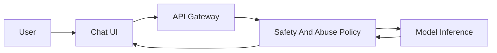
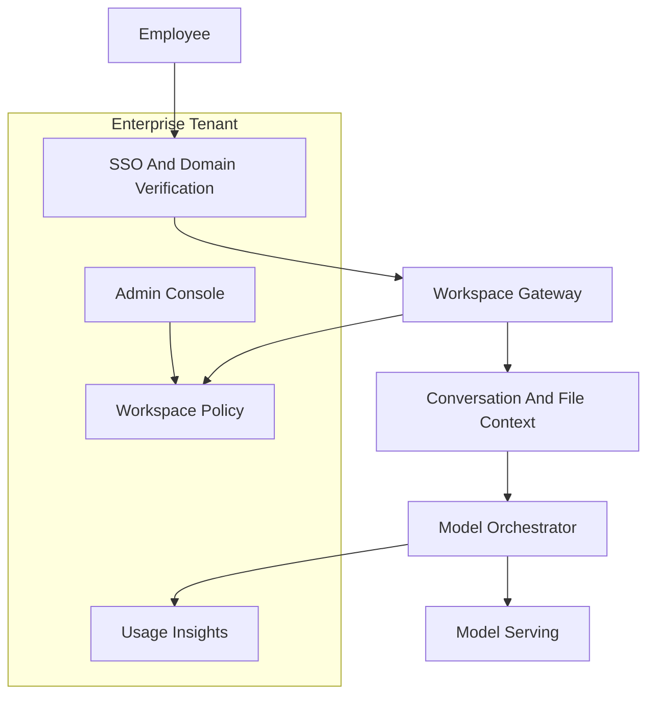
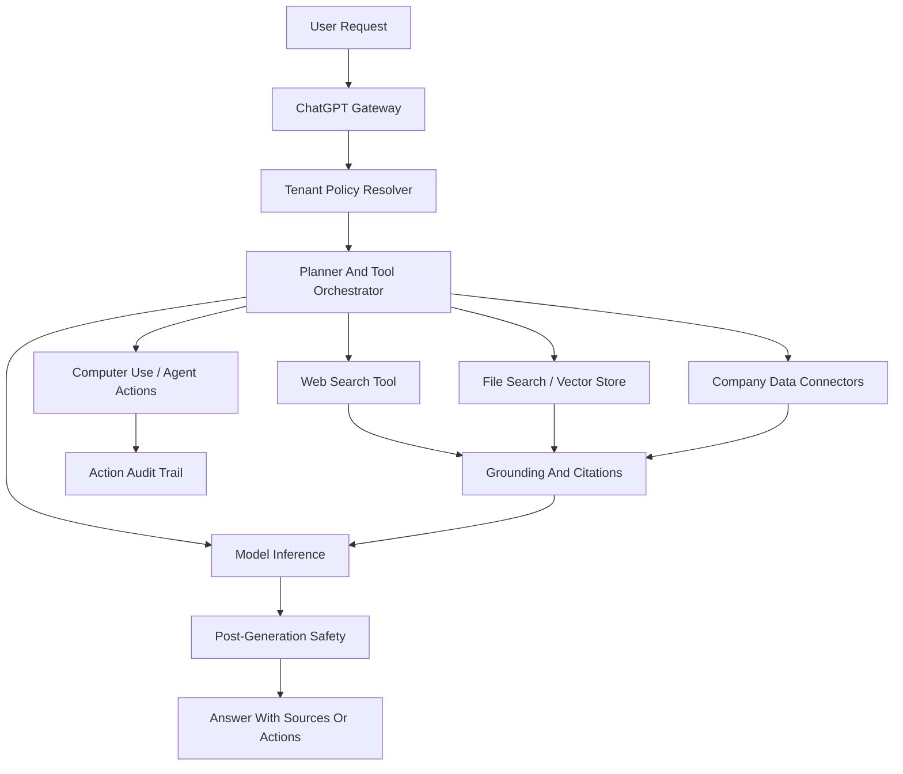

# ChatGPT Inference And Enterprise Agent Architecture

A public-source case study of ChatGPT as a multi-tenant AI assistant platform with model inference, tools, enterprise controls, and connected company data.

---

## 1. Source Framing

This case study separates public facts from system-design inference:

- **Source-backed facts:** product capabilities, enterprise controls, security statements, connector surfaces, and public platform tools from OpenAI pages.
- **Interview architecture inference:** gateway, context assembly, tool orchestration, policy checks, model serving, and observability are presented as a defensible design model, not as OpenAI's private internal topology.
- **Avoided claims:** GPU fleet size, exact model router logic, cache hit rates, latency SLOs, cost per query, internal safety classifier details, and unreleased roadmap.

## 2. Problem Statement

### Business Challenge

ChatGPT must serve a broad assistant surface: consumer chat, enterprise workspaces, file/data analysis, web-connected answers, coding delegation, and agentic tasks. The hard design problem is keeping this experience fast and useful while isolating tenants, honoring data controls, grounding answers in approved context, and routing expensive model/tool work through bounded policies.

### Functional Requirements

- Accept conversational requests, uploaded files, and tool-using workflows.
- Retrieve approved context from connectors and user-provided files.
- Route requests to appropriate model and tool paths.
- Apply safety, privacy, and tenant-policy checks before and after generation.
- Provide citations or source links when using web/search-backed answers.
- Surface usage, admin, and access controls for enterprise deployments.

### Scale And Provenance Metrics

| Metric | Value | As of | Source | Notes |
|--------|-------|-------|--------|-------|
| Business adoption | Over 5 million business users | Page accessed 2026-06-14 | [ChatGPT Enterprise](https://chatgpt.com/business/enterprise/) | Live marketing page; volatile. |
| Enterprise data connectors | Microsoft SharePoint, GitHub, Google Drive, Box, and more | Page accessed 2026-06-14 | [ChatGPT Enterprise](https://chatgpt.com/business/enterprise/) | Product surface, not connector internals. |
| Enterprise privacy posture | Business data is not used for training by default | Page accessed 2026-06-14 | [OpenAI data-use help](https://help.openai.com/en/articles/5722486-how-your-data-is-used-to-improve-model-performance) | Organization opt-in policy can change the default. |
| Launch enterprise controls | Admin console, SSO, domain verification, usage insights, encryption, SOC 2 | 2023-08-28 | [Introducing ChatGPT Enterprise](https://openai.com/index/introducing-chatgpt-enterprise/) | Historical launch baseline. |
| Fortune 500 registered-account signal | Over 80% of Fortune 500 companies had registered ChatGPT accounts | 2023-08-28 | [Introducing ChatGPT Enterprise](https://openai.com/index/introducing-chatgpt-enterprise/) | Footnoted launch metric; registered accounts, not paid enterprise seats. |
| Agent platform tools | Web search, file search, computer use, and Agents SDK | 2025-03-11 | [New tools for building agents](https://openai.com/index/new-tools-for-building-agents/) | API platform capabilities that mirror common assistant architecture patterns. |

## 3. Architecture Evolution

### v1: Single Chat Surface

**Approach:** A user prompt flows through authentication, moderation, model inference, and response rendering.

**What worked**

- Simple user mental model: ask, receive, refine.
- Minimal state management beyond conversation history.
- Clear control point for pre-generation and post-generation safety checks.

**What breaks at scale**

- Long conversations need compression or memory selection.
- Current events require retrieval or web search.
- Enterprises need tenant isolation, auditability, and admin controls.

### v2: Enterprise Workspace Control Plane

**Approach:** Add organization membership, identity, policy, usage analytics, and enterprise data-handling controls around the assistant.

**Design lessons**

- Tenant policy must be resolved before prompt assembly.
- Data-retention and training defaults are product contracts, not implementation details.
- Usage analytics must be useful without exposing sensitive prompt contents broadly.

### v3: Connected Agent And Tool Platform

**Approach:** A request can become a plan with search, file retrieval, code, computer-use actions, or connector calls. The model is part of an orchestrated workflow rather than the only service.

**Design lessons**

- Tool calls need permission checks, rate limits, and audit trails.
- Retrieval quality becomes part of answer quality.
- Citations are a product feature and a trust mechanism.
- Agent actions need stronger rollback, review, and containment than pure text responses.

## 4. Key Design Decisions

| Decision | Why It Matters | Trade-off |
|----------|----------------|-----------|
| Separate tenant policy from prompt assembly | Prevents accidental inclusion of disallowed context. | Adds latency and policy-cache complexity. |
| Treat retrieval as a first-class subsystem | Enables answers over company data and fresh web sources. | Requires indexing, access checks, ranking, and stale-source handling. |
| Keep tool orchestration explicit | Makes multi-step tasks inspectable and governable. | More state machines and failure modes than direct model calls. |
| Add source links for search-backed answers | Improves user trust and reviewability. | Requires source selection, dedupe, and citation rendering. |
| Preserve human review for high-impact actions | Reduces blast radius of agent mistakes. | Slows fully autonomous workflows. |

## 5. Failure Modes

| Failure Mode | Symptom | Mitigation |
|--------------|---------|------------|
| Prompt or tool injection | Retrieved content steers the model away from user/admin intent. | Instruction hierarchy, source isolation, allowlisted tools, post-action review. |
| Cross-tenant data leak | User receives data from another workspace or unauthorized connector path. | Tenant-scoped authz before retrieval; per-connector ACL checks. |
| Stale retrieval | Answer uses outdated web or enterprise documents. | Source freshness labels, recency-aware ranking, source links. |
| Tool runaway | Agent repeats costly searches or actions. | Step budgets, rate limits, timeouts, approval gates. |
| Silent safety bypass | Unsafe output appears valid because checks are not observable. | Structured moderation logs, eval suites, and sampled human review. |

## 6. Interview Relevance

Use this case study when asked to design:

- A multi-tenant enterprise AI assistant.
- A RAG-backed chat product.
- A tool-using agent platform.
- A conversational analytics or document-Q&A assistant.
- A policy-aware model gateway.

Good interview framing:

1. Start with tenant isolation and data-use contracts.
2. Split the system into gateway, context assembly, orchestrator, tools, model serving, safety, and observability.
3. Make retrieval permissions explicit.
4. Add budgets and review gates for agentic actions.
5. Treat evaluation and audit as production requirements, not offline extras.

## 7. Related Repository Content

| Topic | Repository Link | How It Maps |
|-------|-----------------|-------------|
| Multi-tenant chat assistant | [GenAI HLD](../../06-genai-systems/02-llm-hld-projects/multi-tenant-chat-assistant/) | Interview-scale version of the workspace assistant architecture. |
| Conversation memory store | [GenAI LLD](../../06-genai-systems/01-llm-lld-projects/conversation-memory-store/) | State selection and summarization for long chats. |
| Safety policy engine | [GenAI LLD](../../06-genai-systems/01-llm-lld-projects/safety-filter-policy-engine/) | Pre/post generation policy enforcement. |
| Document Q&A RAG | [GenAI HLD](../../06-genai-systems/02-llm-hld-projects/document-qa-rag/) | Retrieval and grounded answers over documents. |
| API gateway | [HLD Concept](../../03-hld-concepts/api-gateway/) | Front-door auth, routing, throttling, and policy resolution. |
| Rate limiting | [HLD Concept](../../03-hld-concepts/rate-limiting/) | Tool and model budget enforcement. |
| Monitoring | [HLD Concept](../../03-hld-concepts/monitoring-observability/) | Usage, reliability, cost, and safety observability. |

## 8. Sources

- [ChatGPT Enterprise](https://chatgpt.com/business/enterprise/) - accessed 2026-06-14.
- [Introducing ChatGPT Enterprise](https://openai.com/index/introducing-chatgpt-enterprise/) - 2023-08-28.
- [New tools for building agents](https://openai.com/index/new-tools-for-building-agents/) - 2025-03-11.
- [How your data is used to improve model performance](https://help.openai.com/en/articles/5722486-how-your-data-is-used-to-improve-model-performance) - accessed 2026-06-14.

---

[Back to Case Studies](../README.md)
