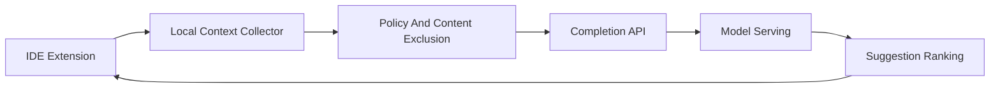
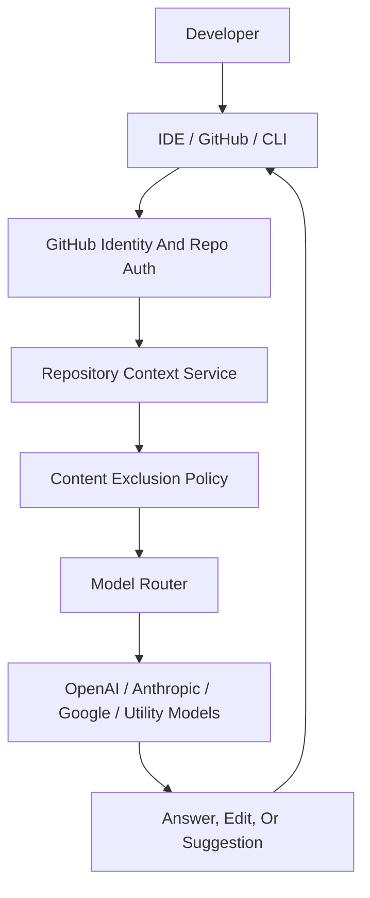
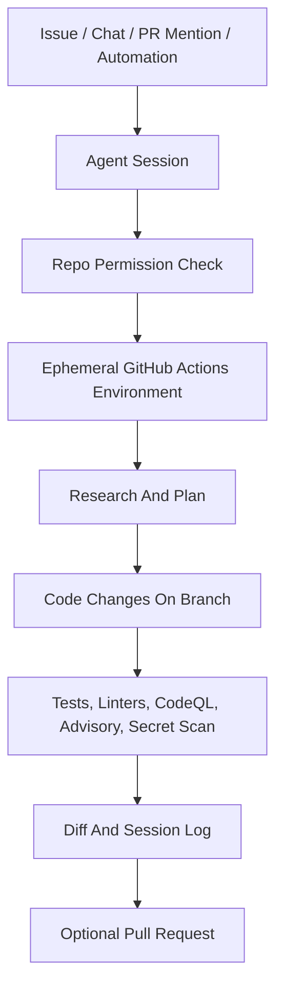
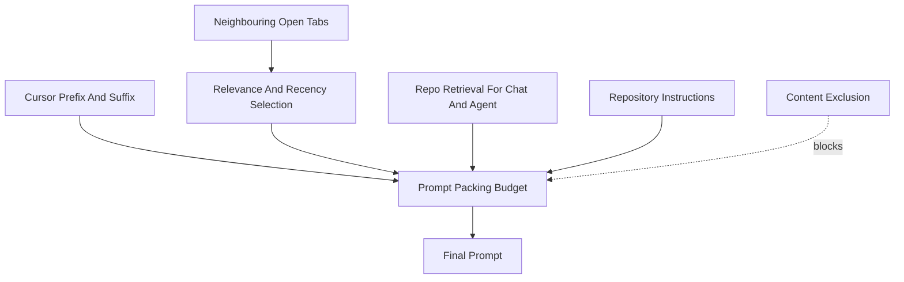

# GitHub Copilot Code-Assist And Coding-Agent Architecture

A public-source case study of GitHub Copilot as a developer-assistance platform spanning inline suggestions, chat, code review, cloud agents, repository context, model choice, and enterprise governance.

---

## 1. Source Framing

This case study uses official GitHub documentation and GitHub Blog posts. It does not claim GitHub's private serving topology, prompt-construction algorithms, ranking models, telemetry schemas, or model-routing internals.

Use the architecture diagrams as interview-grade design models for a Copilot-like product:

- **Source-backed:** supported surfaces, cloud-agent workflow, GitHub Actions-powered ephemeral environment, branch/PR behavior, content exclusion, MCP extension points, pricing model, and security mitigations.
- **Inferred:** gateway decomposition, context assembly, prompt packing, model router, suggestion ranking, and observability layout.

## 2. Problem Statement

### Business Challenge

Copilot must support low-latency code completions in IDEs, contextual chat, PR/code-review workflows, and longer-running coding agents. The product has to balance developer speed with repository permissions, context quality, enterprise governance, cost controls, and human review.

### Functional Requirements

- Generate inline suggestions from editor and repository context.
- Answer codebase questions and propose multi-file edits.
- Run cloud-agent sessions that research, plan, change code, test, and create PRs.
- Respect repository access, content exclusion, and enterprise policy.
- Support model choice and usage-based cost accounting.
- Expose agent session logs and reviewable diffs.

### Scale And Provenance Metrics

| Metric | Value | As of | Source | Notes |
|--------|-------|-------|--------|-------|
| Cloud-agent availability | All paid Copilot plans | Page accessed 2026-06-14 | [About cloud agent](https://docs.github.com/en/copilot/concepts/agents/cloud-agent/about-cloud-agent) | Subject to repository and enterprise disablement. |
| Cloud-agent repository scope | Repositories stored on GitHub, except managed-user-owned or explicitly disabled repositories | Page accessed 2026-06-14 | [About cloud agent](https://docs.github.com/en/copilot/concepts/agents/cloud-agent/about-cloud-agent) | Product availability, not adoption. |
| Cloud-agent execution environment | Ephemeral GitHub Actions-powered development environment | Page accessed 2026-06-14 | [About cloud agent](https://docs.github.com/en/copilot/concepts/agents/cloud-agent/about-cloud-agent) | Used for code exploration, edits, tests, and linters. |
| Cloud-agent hard timeout | 59 minutes per session | Page accessed 2026-06-14 | [About cloud agent](https://docs.github.com/en/copilot/concepts/agents/cloud-agent/about-cloud-agent) | Long tasks must be split. |
| Billing unit | 1 AI credit = USD $0.01 | Page accessed 2026-06-14 | [Models and pricing](https://docs.github.com/en/copilot/reference/copilot-billing/models-and-pricing) | Pricing pages are volatile. |
| Content exclusion | Business/Enterprise admins can configure ignored files for supported Copilot surfaces | Page accessed 2026-06-14 | [Content exclusion](https://docs.github.com/en/copilot/concepts/context/content-exclusion), [cloud-agent limitations](https://docs.github.com/en/copilot/concepts/agents/cloud-agent/about-cloud-agent) | Support is not universal. GitHub docs state Copilot cloud agent does not account for content exclusions and can see or update excluded files; other limitations include indirect IDE context, symlinks, remote filesystems, and unsupported Edit/Agent modes in editors. |
| Agent security checks | CodeQL, dependency advisory checks, and secret scanning are used by default | Page accessed 2026-06-14 | [Risks and mitigations](https://docs.github.com/en/copilot/concepts/agents/cloud-agent/risks-and-mitigations) | Human review is still required. |

## 3. Architecture Evolution

### v1: Inline Completion Assistant

**Approach:** IDE context, cursor position, nearby files, and user code are transformed into a prompt for fast completions.



**What worked**

- Keystroke-level assistance fits developer flow.
- Small context windows keep latency low.
- Suggestions are easy to accept, reject, or edit.

**What breaks at scale**

- Repository-wide reasoning needs more context than nearby code.
- Sensitive files need policy controls.
- Hallucinated APIs require developer review and tests.

### v2: Chat, Model Choice, And Repository Context

**Approach:** Copilot becomes a multi-surface assistant across IDEs, GitHub, CLI, and chat with richer repository context and model selection.



**Design lessons**

- Context access is as important as model quality.
- Model choice creates cost, latency, and governance complexity.
- Utility models can power background features without exposing every routing decision to users.

### v3: Cloud Coding Agent

**Approach:** A task becomes a branch-backed agent session with repository research, planning, edits, validation, session logs, and optional PR creation.



**Design lessons**

- Branch containment limits write blast radius.
- Logs and diffs make autonomous work reviewable.
- Long-running work needs timeout controls and task decomposition.
- Security scanning reduces risk but does not replace human review.
- Cloud-agent governance must not rely on content exclusion, because the cloud agent can see and update excluded files according to GitHub's cloud-agent limitations.

## 4. Editor To Service: The Inline Request Path

An inline completion round trip, in the design model:

1. **Edit event.** The IDE extension observes keystrokes, cursor moves, and file switches. It does not call the service per keystroke: a debounce window (tens of milliseconds) waits for typing to settle so bursts collapse into one request.
2. **Local context collection.** The extension assembles the prompt locally: the current file's prefix and suffix around the cursor, plus selected neighbouring content (see Section 5). No network cost yet, and sensitive filtering starts here.
3. **Policy and eligibility check.** Content exclusion and client-side eligibility rules decide whether a suggestion may be requested at all for this file.
4. **Request dispatch.** The prompt goes to the completion API with authentication, surface metadata, and a cancellation handle.
5. **Inference and ranking.** A latency-optimized model generates candidate completions; a ranker orders or trims them.
6. **Streaming render.** Tokens stream back and render as ghost text incrementally; the developer can accept word-by-word or in full.
7. **Outcome recording.** Shown, accepted, edited, or dismissed, with latency metadata, feeds telemetry (Section 8).

**Why not request-per-keystroke?** Each request carries context assembly, network, and inference cost, and almost every per-keystroke request would be cancelled by the next keystroke anyway. Debounce plus cancellation turns an unusable request storm into a small number of well-timed calls; the ratio of requests made to suggestions shown is itself a health metric.

**Cancellation is the path's defining feature.** Every new keystroke can invalidate the in-flight request, so the client cancels aggressively and the server aborts wasted inference. A completion that arrives after the cursor moved is worthless, which makes inline completion a latency race, not a batch workload.

## 5. Context Assembly: Open Files And Neighbours

Completion quality is bounded by context quality, and the published GitHub engineering posts describe the broad shape: the current file, its cursor position, and *neighbouring* content from recently open tabs.

- **Prefix and suffix.** Inline completion needs the text after the cursor too, not just before it. Training and serving models to condition on both sides is the published "fill-in-the-middle" technique ("Efficient Training of Language Models to Fill in the Middle", OpenAI/arXiv, 2022).
- **Neighbouring tabs.** GitHub's posts describe using recently open editor tabs as additional context, since developers work in small working sets. The design problem is selection: a handful of snippets, chosen by recency and relatedness, must stand in for the whole workspace.
- **Packing budget.** Context windows are finite, so assembly is a budget allocation: current file prefix and suffix first, then neighbours by relevance, then repo-level hints for chat surfaces. Every token spent on a neighbour is a token not spent on the current file.
- **Chat and agent context.** For chat and cloud-agent surfaces, repository-wide retrieval (code search, symbol and embedding indexes) replaces neighbouring tabs; the packing problem is the same at a larger scale.



**Why this is a ranking problem.** Every candidate snippet competes for the same window, so context assembly is really relevance ranking under a hard token budget. Treating it as "collect everything, truncate at the limit" is the design smell to call out in an interview: truncation discards by position, not by usefulness.

## 6. Latency Budget For Inline Completions

Inline completion only helps if it arrives while the developer is still deciding. *Labelled illustrative budget* (design target, not a published figure):

```text
total target:        ~300-500 ms, keystroke to ghost text
  debounce/settle:     50-100 ms
  local context:       20-50 ms   (no network)
  network round trip:  50-150 ms
  inference:          100-200 ms  (small, fast model path)
  rank and render:     10-30 ms
```

**Levers that keep the budget:**

- **Debounce and cancellation** prevent wasted requests and free server capacity.
- **Streaming** hides inference time behind incremental rendering.
- **Small-model routing** for inline paths (Section 7) trades a little quality for a lot of latency.
- **Client caching** of recent suggestions handles repeated pauses at the same cursor for free.
- **Graceful expiry:** a suggestion older than its usefulness window is dropped, not shown.

The interview point: inline completion is the rare LLM product where latency outranks quality. A slightly worse suggestion in 200 ms beats a better one in 2 seconds that arrives after the developer typed the line.

**Perceived versus actual latency.** Streaming ghost text changes the equation: the first visible token matters more than the completed suggestion. Optimizing time-to-first-token and rendering partial completions early buys perceived speed that raw inference improvements cannot.

## 7. Caching And Model Routing

- **Suggestion caching.** Identical or near-identical contexts recur constantly (re-opened files, cursor returned to the same spot). Caching completions keyed by context hash turns those into zero-inference responses.
- **Prompt-prefix caching.** System prompts, repository instructions, and shared file prefixes are reused across requests; prefix reuse cuts both latency and cost on the serving side.
- **Model routing by surface.** Inline completion routes to small, latency-optimized models; chat, edits, and agent steps route to larger models. GitHub documents utility models powering background features, and model choice for user-facing surfaces; the routing layer maps request class to model class while honoring plan and governance constraints.
- **Fallback chains.** Provider or model outages degrade the route, not the product: secondary model, then reduced context, then transparent unavailability with a status signal.
- **Routing is policy-enforced, not just cost-driven.** Enterprise plan rules and model-availability settings constrain which models a request may use; the router honors governance first, then optimizes latency and cost inside the allowed set.

## 8. Telemetry And The Acceptance-Rate Feedback Loop

Acceptance rate, the share of shown suggestions the developer keeps, is the product's defining quality metric, and it is computable only from client telemetry.

- **Core funnel:** shown, accepted, edited-then-accepted, dismissed; sliced by language, file type, repo size, surface, and model version.
- **Latency metrics:** end-to-end and per-stage percentiles, cancellation rates, and cache hit rates.
- **Offline evaluation:** benchmark suites in the style of HumanEval (published with "Evaluating Large Language Models Trained on Code", OpenAI/arXiv, 2021) gate model changes before live traffic; online A/B then measures real acceptance.
- **Privacy constraints shape the telemetry itself:** code content is sensitive, so funnel and latency metrics are designed to be aggregate and metadata-level. This constraint is a design input, not an afterthought: it decides what debugging data exists when acceptance drops.
- **Closing the loop:** acceptance outcomes feed prompt-construction choices, ranking, and routing policy, making context assembly a measured system rather than a fixed heuristic.
- **Guardrail metrics:** latency percentiles, cancellation rate, filter-suppression rate, and security-scan findings move with acceptance rate in any healthy release review; a quality gain bought with doubled latency is a regression in this product.
- **Experiment discipline:** model, prompt, and ranking changes ship behind A/B with acceptance and latency gates, because offline benchmark gains do not reliably transfer to real editing sessions.

## 9. Security And Privacy Controls

- **Content exclusion where supported.** Admins can exclude files from supported Copilot surfaces (documented); enforcement belongs at context assembly, before anything is sent.
- **The documented cloud-agent gap.** GitHub's docs state the cloud agent does not account for content exclusions and can see or update excluded files. The risk boundary for agents is therefore repository access, task scope, scans, and human review, not exclusion lists. Any interview answer that treats exclusions as an agent control is wrong per current docs.
- **Public-code matching filter.** GitHub documented a setting that suppresses suggestions closely matching public code, addressing license and recitation concerns; it trades away some useful suggestions, and enterprises must decide the default.
- **Secret handling.** Secret scanning runs by default in the cloud-agent pipeline (documented), and client-side hygiene aims to keep secrets out of prompts; a found secret is a rotation event, not just a blocked suggestion.
- **Data-use commitments.** Business offerings carry documented terms on prompt retention and training use; the architecture honors them at the logging and telemetry layers, which is why telemetry is metadata-first.

**The threat model is two-directional.** Controls protect the user's code from leaving approved boundaries (exclusions, retention terms, metadata-first telemetry) and protect the user from the model's output (public-code matching, secret scanning, dependency advisories, mandatory PR review for agents). Designs that only address one direction miss half the interview.

## 10. Key Design Decisions

| Decision | Why It Matters | Trade-off |
|----------|----------------|-----------|
| Keep inline completion latency separate from agent depth | Fast suggestions and slower autonomous work have different SLOs. | Requires multiple orchestration paths. |
| Apply repository permission checks before context assembly | Prevents unauthorized data use in prompts and actions. | Adds authz and policy-cache complexity. |
| Treat content exclusion as surface-specific, not a cloud-agent boundary | Keeps admin expectations accurate: cloud agents can see and update excluded files, so repository access, task scope, scans, and review controls must carry the agent-risk boundary. | More policy surfaces to explain and test. |
| Run cloud agents in ephemeral environments | Isolates task execution and gives a repeatable place to test. | Requires setup scripts, network controls, and timeout handling. |
| Make output branch/PR based | Gives developers normal review and rollback workflows. | Not ideal for tiny interactive edits. |

## 11. Failure Modes

| Failure Mode | Symptom | Mitigation |
|--------------|---------|------------|
| Bad context retrieval | Copilot edits the wrong abstraction or misses repo conventions. | Repository instructions, MCP/tool scoping, code search, human review. |
| Secret or sensitive-file exposure | Excluded, private, or indirectly exposed content influences suggestions or cloud-agent changes; the cloud agent can see and update excluded files. | Content exclusion where supported for eligible surfaces, repo access checks, agent-scope limits, secret scanning, and policy review. |
| Agent overreach | Agent edits broad files or opens a large PR for a narrow issue. | Branch containment, task scope, session timeout, diff review. |
| Unsafe dependency change | Generated patch introduces malicious or vulnerable dependency. | Advisory database checks, lockfile review, dependency policy. |
| Cost runaway | Model/tool loops consume credits quickly. | Budget controls, model selection policy, task splitting, timeout settings. |

### Degradation Modes

| Degradation | Symptom | Handling |
|-------------|---------|----------|
| Provider or model outage | Completions time out or return errors across surfaces. | Fallback route to a secondary model, reduced-context mode, transparent status to the user. |
| Latency budget breach | Ghost text arrives after the developer moved on; acceptance falls without any quality change. | Stricter debounce and cancellation, downgrade to the small-model path, alert on percentile drift. |
| Stale local context | Suggestion references a symbol renamed seconds ago. | Re-collect context on edit events, recency-weighted selection, drop expired suggestions. |
| Filter false positive | A valid suggestion is suppressed by the public-code matching filter. | Documented setting to allow matches, code-reference transparency where available. |
| Telemetry blind spot | Acceptance drops but metadata-only telemetry cannot show why. | Pre-built quality dashboards per slice, offline repro suites, sampled opt-in diagnostics. |

## 12. Trade-Offs Table

| Choice | Gain | Cost |
|--------|------|------|
| Small fast model for inline, large model for chat and agent | Inline latency stays inside budget; quality where it matters. | Two model paths to evaluate, route, and govern; routing mistakes surface as quality or latency regressions. |
| Aggressive cancellation of stale requests | No wasted inference; fresher suggestions. | Lost work on borderline-late completions; server must handle high abort rates. |
| Metadata-only telemetry | Privacy-safe by construction; simpler compliance story. | Harder root-cause analysis when acceptance drops. |
| Public-code matching filter on by default | Lower license and recitation risk. | Suppresses some genuinely useful idioms; developer friction. |
| Branch-and-PR containment for agents | Review, rollback, and audit use familiar workflows. | Overhead disproportionate for tiny fixes; slower than direct edits. |
| Ephemeral cloud-agent environments | Isolation, repeatability, clean security posture. | Setup latency per session; environment drift between repo setups. |
| Neighbouring-tab context over full-repo context for inline | Local, fast, privacy-friendlier; no index to maintain. | Misses repository-wide conventions; completions can contradict distant code. |
| Metadata-first telemetry | Privacy-safe debugging and compliance posture. | Slower root-cause work; pre-built slices decide what can be diagnosed. |

## 13. Cloud-Agent Session Lifecycle

The cloud coding agent (documented by GitHub) runs a task as a branch-backed session. In lifecycle form:

1. **Trigger.** An issue assignment, chat mention, or automation starts a session with a task description and repository scope.
2. **Permission resolution.** Repository access is checked before anything else; the session can only touch what the triggering identity and configuration allow.
3. **Environment setup.** An ephemeral GitHub Actions-powered environment is provisioned (documented), giving a clean, repeatable place to explore, edit, and run tests and linters.
4. **Research and plan.** The agent explores the codebase and forms a plan; this is where repository instructions and scoped tools matter most, because a wrong plan wastes the whole session.
5. **Edit and validate.** Changes land on a branch; tests, linters, CodeQL, dependency-advisory checks, and secret scanning run by default (documented).
6. **Review and handoff.** A session log and diff make the work reviewable; the outcome is a pull request a human must approve.
7. **Timeout discipline.** Sessions have a hard timeout (documented as 59 minutes), so large tasks must be split into reviewable slices up front. Timeout is a product feature: it bounds cost, blast radius, and how stale the base branch can grow.

The interview-worthy property is that every stage is observable and reversible. Autonomy is bought with containment and review, not with a smarter model alone.

**Session observability.** Because sessions run unattended, the log is the product: a reviewer reconstructs what the agent read, decided, changed, and verified from it. Treating logs as debug output instead of a designed review surface is the common design miss.

## 14. Cost And Capacity Considerations

GitHub publishes a credit-based billing model (1 AI credit = USD $0.01 at page-access time), which makes cost a first-class design surface rather than an internal detail:

- **Routing is the biggest lever.** Small models for inline completion, larger models for chat and agent steps; every misrouted request multiplies cost without improving the outcome.
- **Caching turns repeats free.** Suggestion caching and prompt-prefix caching (Section 7) convert recurring contexts into zero-inference responses.
- **Timeouts and step budgets cap agent cost.** The 59-minute session cap and task splitting bound the worst case per task; without them, an agent in a tool loop is an unbounded expense.
- **Debounce and cancellation are cost controls too.** Every aborted keystroke-stale request is inference not spent.
- **Measurement:** cost per accepted suggestion, per resolved issue, and per active developer, sliced by model and surface. Acceptance rate is the denominator that makes cost meaningful: cheap completions nobody accepts are the most expensive kind.

*Labelled illustrative framing; no per-request cost figures are published, so magnitudes belong in the routing and caching levers, not invented prices.*

## 15. Multi-Surface Consistency

Copilot spans IDE extensions, GitHub's web UI, CLI, and mobile, and the hard problem is keeping policy consistent across surfaces with very different capabilities:

- **Identity and entitlement** resolve once per surface against the same GitHub account, plan, and enterprise policy; a surface must never become a policy backdoor.
- **Content exclusion and model policy** apply at the context-assembly layer of each surface, with documented gaps (the cloud agent) called out rather than assumed away.
- **Telemetry funnels** share metric definitions so acceptance and latency are comparable across surfaces; a "good" number on one surface must mean the same thing on another.
- **Feature parity is deliberately absent.** CLI completions and web chat have different latency budgets and context sources; consistency of *policy*, not of *features*, is the design goal.

## 16. Interview Relevance

Use this case study when asked to design:

- An AI coding assistant.
- A repository-aware chatbot.
- A cloud coding agent that opens pull requests.
- A policy-controlled enterprise AI product.
- A model-router and context-management layer.

Strong interview answer outline:

1. Separate completion, chat, code review, and agent workflows.
2. Resolve identity and repository authorization before collecting context.
3. Apply content exclusion where supported; for cloud-agent workflows, assume exclusions do not protect files and constrain repository access, tools, scans, and diff review.
4. Use different model/tool paths for latency-sensitive completions and branch-backed agents.
5. Make autonomous changes reviewable through branches, logs, scans, and PRs.

### Interview Questions And Strong Answers

**Q1. "Design the serving path for inline code completion under a strict latency budget."**

Lead with the budget and work backwards: debounce keystrokes, collect context locally, cancel in-flight requests on new input, route to a small latency-optimized model, stream tokens, render incrementally, and cache by context. Give the illustrative stage-by-stage budget and name cancellation as the defining constraint: this is a latency race, not a batch job. A weak answer designs for quality first and treats latency as tuning.

**Q2. "Acceptance rate dropped 15% after a release. Walk through the investigation."**

First split the funnel: shown versus accepted versus edited, by language, surface, repo size, and model version, because a drop concentrated in one slice points at routing or prompt changes while a uniform drop points at the model. Check latency percentiles next: slower suggestions are accepted less even at identical quality. Then bisect the release: prompt-construction change, model change, ranking change. Name the telemetry constraint honestly: metadata-only telemetry means you rely on pre-built slices, not ad-hoc content inspection.

**Q3. "How do you prevent Copilot from leaking secrets or excluded files into suggestions or agent PRs?"**

Layer it, and be precise about the documented gap: content exclusion is enforced at context assembly for supported surfaces, but GitHub's docs state the cloud agent does not honor exclusions and can see and update excluded files, so the agent boundary is repository access, task scope, scanning (CodeQL, advisory, secret scanning by default), and mandatory human review. Add the public-code matching filter for recitation risk. The precision about what exclusions do and do not cover is what separates a strong answer.

**Q4. "Chat answers need repository-wide context that does not fit the context window. Design it."**

Retrieval over code search plus symbol and embedding indexes, then prompt packing under a hard token budget: instructions and the current file first, retrieved snippets ranked by relevance, with citations so answers are checkable. Handle freshness (re-index lag) and permissions (per-file access checks at retrieval time). The fallback matters too: say "not found in this repo" rather than hallucinate an API.

### Follow-Ups Interviewers Commonly Ask

- How would you evaluate a new model before rollout? (Offline HumanEval-style suites, then A/B on acceptance and latency.)
- Where does ranking happen, client or server? (Server, for consistent models and updatable rankers; client only re-sorts cached candidates.)
- How do you keep the agent from running forever? (Hard session timeout, step budgets, task splitting; documented 59-minute cap.)
- What breaks first at 10x usage? (Capacity on the small-model path and telemetry volume; quality systems scale worse than serving systems.)

**One-line summary for the close:** Copilot is three products sharing one policy plane: a latency-race completion engine, a context-heavy chat assistant, and a containment-first coding agent. Naming that split in the first minute frames every later design choice.

## 17. Related Repository Content

| Topic | Repository Link | How It Maps |
|-------|-----------------|-------------|
| API gateway | [HLD Concept](../../03-hld-concepts/api-gateway/) | Auth, routing, request shaping, and throttling for Copilot surfaces. |
| Rate limiting | [HLD Concept](../../03-hld-concepts/rate-limiting/) | Premium request, model, and agent budget controls. |
| Search systems | [HLD Concept](../../03-hld-concepts/search-systems/) | Repository and code-context retrieval. |
| Monitoring | [HLD Concept](../../03-hld-concepts/monitoring-observability/) | Agent session, cost, reliability, and safety metrics. |
| Social post search | [HLD Project](../../04-hld-projects/social-post-search/) | Search and ranking ideas that transfer to code-context retrieval. |
| Safety policy engine | [GenAI LLD](../../06-genai-systems/01-llm-lld-projects/safety-filter-policy-engine/) | Policy checks around prompt, output, and action execution. |
| LLM safety evaluation platform | [GenAI HLD](../../06-genai-systems/02-llm-hld-projects/llm-safety-eval-platform/) | Continuous evaluation and review for generated code and agent behavior. |

## 18. Glossary

- **Ghost text:** the dimmed inline preview of a suggested completion, accepted with a key or dismissed by typing on.
- **Debounce:** waiting briefly for typing to settle before requesting a completion, collapsing a keystroke burst into one request.
- **Fill-in-the-middle (FIM):** training and serving a model to complete text given both the prefix before and the suffix after the cursor.
- **Neighbouring tabs:** recently open editor files used as extra completion context, as described in GitHub's engineering posts.
- **Prompt packing:** selecting and ordering context snippets under a hard token budget.
- **Acceptance rate:** the share of shown suggestions a developer keeps; the product's primary quality metric.
- **Utility model:** a small, cheap model powering background or supporting features, as documented by GitHub.
- **Public-code matching filter:** a documented setting suppressing suggestions that closely match public code.
- **Content exclusion:** a documented admin control keeping listed files out of supported Copilot surfaces; does not cover the cloud agent.
- **Ephemeral runner:** the single-use GitHub Actions environment in which a cloud-agent session executes.
- **Session log:** the recorded trace of a cloud-agent session's research, decisions, edits, and validations, used for human review.
- **Step budget:** a cap on agent actions (tool calls, edits, commands) inside one session, bounding cost and blast radius.
- **Cancellation:** aborting an in-flight completion request when new input invalidates it.
- **Recitation:** a model reproducing memorized training code verbatim; the risk the public-code matching filter addresses.

## 19. Sources

- [About GitHub Copilot cloud agent](https://docs.github.com/en/copilot/concepts/agents/cloud-agent/about-cloud-agent) - accessed 2026-06-14.
- [Risks and mitigations for GitHub Copilot cloud agent](https://docs.github.com/en/copilot/concepts/agents/cloud-agent/risks-and-mitigations) - accessed 2026-06-14.
- [Content exclusion for GitHub Copilot](https://docs.github.com/en/copilot/concepts/context/content-exclusion) - accessed 2026-06-14.
- [About Model Context Protocol](https://docs.github.com/en/copilot/concepts/context/mcp) - accessed 2026-06-14.
- [Utility models](https://docs.github.com/en/copilot/concepts/models/utility-models) - accessed 2026-06-14.
- [Models and pricing for GitHub Copilot](https://docs.github.com/en/copilot/reference/copilot-billing/models-and-pricing) - accessed 2026-06-14.
- [GitHub Copilot: The agent awakens](https://github.blog/news-insights/product-news/github-copilot-the-agent-awakens/) - 2025-02-06.
- How GitHub Copilot is getting better at understanding your code - GitHub Blog, 2023. Public description of prompt construction and neighbouring-tab context behind Section 5.
- Inside GitHub: Working with the LLMs behind GitHub Copilot - GitHub Blog, 2023. Public engineering discussion of model improvements and latency work behind Sections 6-7.
- Evaluating Large Language Models Trained on Code - Chen et al., OpenAI/arXiv, 2021. The Codex paper; origin of the HumanEval-style offline evaluation referenced in Section 8.
- Efficient Training of Language Models to Fill in the Middle - Bavarian et al., OpenAI/arXiv, 2022. The fill-in-the-middle technique behind prefix/suffix completion in Section 5.

The four entries above are field-literature and engineering-blog references for techniques and evaluation practice; they are not claims about GitHub's private serving topology, consistent with Section 1's framing.

---

[Back to Case Studies](../README.md)
