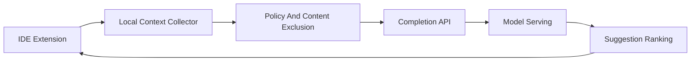
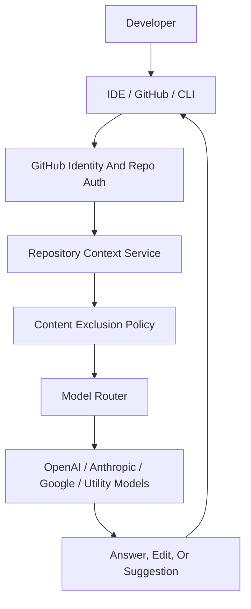
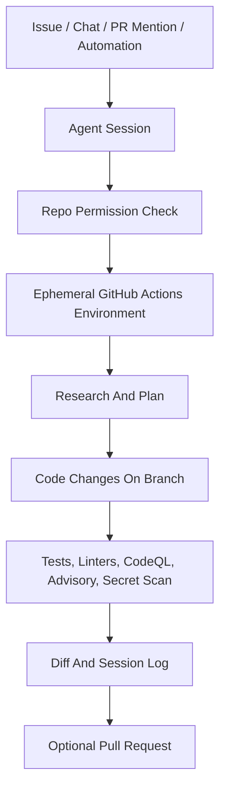

# GitHub Copilot Code-Assist And Coding-Agent Architecture

A public-source case study of GitHub Copilot as a developer-assistance platform spanning inline suggestions, chat, code review, cloud agents, repository context, model choice, and enterprise governance.

---

## 1. Source Framing

This case study uses official GitHub documentation and GitHub Blog posts. It does not claim GitHub's private serving topology, prompt-construction algorithms, ranking models, telemetry schemas, or model-routing internals.

Use the architecture diagrams as interview-grade design models for a Copilot-like product:

- **Source-backed:** supported surfaces, cloud-agent workflow, GitHub Actions-powered ephemeral environment, branch/PR behavior, content exclusion, MCP extension points, pricing model, and security mitigations.
- **Inferred:** gateway decomposition, context assembly, prompt packing, model router, suggestion ranking, and observability layout.

## 2. Problem Statement

### Business Challenge

Copilot must support low-latency code completions in IDEs, contextual chat, PR/code-review workflows, and longer-running coding agents. The product has to balance developer speed with repository permissions, context quality, enterprise governance, cost controls, and human review.

### Functional Requirements

- Generate inline suggestions from editor and repository context.
- Answer codebase questions and propose multi-file edits.
- Run cloud-agent sessions that research, plan, change code, test, and create PRs.
- Respect repository access, content exclusion, and enterprise policy.
- Support model choice and usage-based cost accounting.
- Expose agent session logs and reviewable diffs.

### Scale And Provenance Metrics

| Metric | Value | As of | Source | Notes |
|--------|-------|-------|--------|-------|
| Cloud-agent availability | All paid Copilot plans | Page accessed 2026-06-14 | [About cloud agent](https://docs.github.com/en/copilot/concepts/agents/cloud-agent/about-cloud-agent) | Subject to repository and enterprise disablement. |
| Cloud-agent repository scope | Repositories stored on GitHub, except managed-user-owned or explicitly disabled repositories | Page accessed 2026-06-14 | [About cloud agent](https://docs.github.com/en/copilot/concepts/agents/cloud-agent/about-cloud-agent) | Product availability, not adoption. |
| Cloud-agent execution environment | Ephemeral GitHub Actions-powered development environment | Page accessed 2026-06-14 | [About cloud agent](https://docs.github.com/en/copilot/concepts/agents/cloud-agent/about-cloud-agent) | Used for code exploration, edits, tests, and linters. |
| Cloud-agent hard timeout | 59 minutes per session | Page accessed 2026-06-14 | [About cloud agent](https://docs.github.com/en/copilot/concepts/agents/cloud-agent/about-cloud-agent) | Long tasks must be split. |
| Billing unit | 1 AI credit = USD $0.01 | Page accessed 2026-06-14 | [Models and pricing](https://docs.github.com/en/copilot/reference/copilot-billing/models-and-pricing) | Pricing pages are volatile. |
| Content exclusion | Business/Enterprise admins can configure ignored files for supported Copilot surfaces | Page accessed 2026-06-14 | [Content exclusion](https://docs.github.com/en/copilot/concepts/context/content-exclusion), [cloud-agent limitations](https://docs.github.com/en/copilot/concepts/agents/cloud-agent/about-cloud-agent) | Support is not universal. GitHub docs state Copilot cloud agent does not account for content exclusions and can see or update excluded files; other limitations include indirect IDE context, symlinks, remote filesystems, and unsupported Edit/Agent modes in editors. |
| Agent security checks | CodeQL, dependency advisory checks, and secret scanning are used by default | Page accessed 2026-06-14 | [Risks and mitigations](https://docs.github.com/en/copilot/concepts/agents/cloud-agent/risks-and-mitigations) | Human review is still required. |

## 3. Architecture Evolution

### v1: Inline Completion Assistant

**Approach:** IDE context, cursor position, nearby files, and user code are transformed into a prompt for fast completions.

**What worked**

- Keystroke-level assistance fits developer flow.
- Small context windows keep latency low.
- Suggestions are easy to accept, reject, or edit.

**What breaks at scale**

- Repository-wide reasoning needs more context than nearby code.
- Sensitive files need policy controls.
- Hallucinated APIs require developer review and tests.

### v2: Chat, Model Choice, And Repository Context

**Approach:** Copilot becomes a multi-surface assistant across IDEs, GitHub, CLI, and chat with richer repository context and model selection.

**Design lessons**

- Context access is as important as model quality.
- Model choice creates cost, latency, and governance complexity.
- Utility models can power background features without exposing every routing decision to users.

### v3: Cloud Coding Agent

**Approach:** A task becomes a branch-backed agent session with repository research, planning, edits, validation, session logs, and optional PR creation.

**Design lessons**

- Branch containment limits write blast radius.
- Logs and diffs make autonomous work reviewable.
- Long-running work needs timeout controls and task decomposition.
- Security scanning reduces risk but does not replace human review.
- Cloud-agent governance must not rely on content exclusion, because the cloud agent can see and update excluded files according to GitHub's cloud-agent limitations.

## 4. Key Design Decisions

| Decision | Why It Matters | Trade-off |
|----------|----------------|-----------|
| Keep inline completion latency separate from agent depth | Fast suggestions and slower autonomous work have different SLOs. | Requires multiple orchestration paths. |
| Apply repository permission checks before context assembly | Prevents unauthorized data use in prompts and actions. | Adds authz and policy-cache complexity. |
| Treat content exclusion as surface-specific, not a cloud-agent boundary | Keeps admin expectations accurate: cloud agents can see and update excluded files, so repository access, task scope, scans, and review controls must carry the agent-risk boundary. | More policy surfaces to explain and test. |
| Run cloud agents in ephemeral environments | Isolates task execution and gives a repeatable place to test. | Requires setup scripts, network controls, and timeout handling. |
| Make output branch/PR based | Gives developers normal review and rollback workflows. | Not ideal for tiny interactive edits. |

## 5. Failure Modes

| Failure Mode | Symptom | Mitigation |
|--------------|---------|------------|
| Bad context retrieval | Copilot edits the wrong abstraction or misses repo conventions. | Repository instructions, MCP/tool scoping, code search, human review. |
| Secret or sensitive-file exposure | Excluded, private, or indirectly exposed content influences suggestions or cloud-agent changes; the cloud agent can see and update excluded files. | Content exclusion where supported for eligible surfaces, repo access checks, agent-scope limits, secret scanning, and policy review. |
| Agent overreach | Agent edits broad files or opens a large PR for a narrow issue. | Branch containment, task scope, session timeout, diff review. |
| Unsafe dependency change | Generated patch introduces malicious or vulnerable dependency. | Advisory database checks, lockfile review, dependency policy. |
| Cost runaway | Model/tool loops consume credits quickly. | Budget controls, model selection policy, task splitting, timeout settings. |

## 6. Interview Relevance

Use this case study when asked to design:

- An AI coding assistant.
- A repository-aware chatbot.
- A cloud coding agent that opens pull requests.
- A policy-controlled enterprise AI product.
- A model-router and context-management layer.

Strong interview answer outline:

1. Separate completion, chat, code review, and agent workflows.
2. Resolve identity and repository authorization before collecting context.
3. Apply content exclusion where supported; for cloud-agent workflows, assume exclusions do not protect files and constrain repository access, tools, scans, and diff review.
4. Use different model/tool paths for latency-sensitive completions and branch-backed agents.
5. Make autonomous changes reviewable through branches, logs, scans, and PRs.

## 7. Related Repository Content

| Topic | Repository Link | How It Maps |
|-------|-----------------|-------------|
| API gateway | [HLD Concept](../../03-hld-concepts/api-gateway/) | Auth, routing, request shaping, and throttling for Copilot surfaces. |
| Rate limiting | [HLD Concept](../../03-hld-concepts/rate-limiting/) | Premium request, model, and agent budget controls. |
| Search systems | [HLD Concept](../../03-hld-concepts/search-systems/) | Repository and code-context retrieval. |
| Monitoring | [HLD Concept](../../03-hld-concepts/monitoring-observability/) | Agent session, cost, reliability, and safety metrics. |
| Social post search | [HLD Project](../../04-hld-projects/social-post-search/) | Search and ranking ideas that transfer to code-context retrieval. |
| Safety policy engine | [GenAI LLD](../../06-genai-systems/01-llm-lld-projects/safety-filter-policy-engine/) | Policy checks around prompt, output, and action execution. |
| LLM safety evaluation platform | [GenAI HLD](../../06-genai-systems/02-llm-hld-projects/llm-safety-eval-platform/) | Continuous evaluation and review for generated code and agent behavior. |

## 8. Sources

- [About GitHub Copilot cloud agent](https://docs.github.com/en/copilot/concepts/agents/cloud-agent/about-cloud-agent) - accessed 2026-06-14.
- [Risks and mitigations for GitHub Copilot cloud agent](https://docs.github.com/en/copilot/concepts/agents/cloud-agent/risks-and-mitigations) - accessed 2026-06-14.
- [Content exclusion for GitHub Copilot](https://docs.github.com/en/copilot/concepts/context/content-exclusion) - accessed 2026-06-14.
- [About Model Context Protocol](https://docs.github.com/en/copilot/concepts/context/mcp) - accessed 2026-06-14.
- [Utility models](https://docs.github.com/en/copilot/concepts/models/utility-models) - accessed 2026-06-14.
- [Models and pricing for GitHub Copilot](https://docs.github.com/en/copilot/reference/copilot-billing/models-and-pricing) - accessed 2026-06-14.
- [GitHub Copilot: The agent awakens](https://github.blog/news-insights/product-news/github-copilot-the-agent-awakens/) - 2025-02-06.

---

[Back to Case Studies](../README.md)
