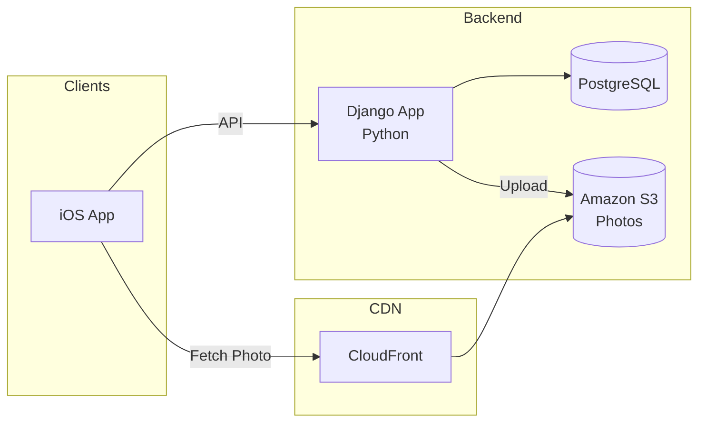
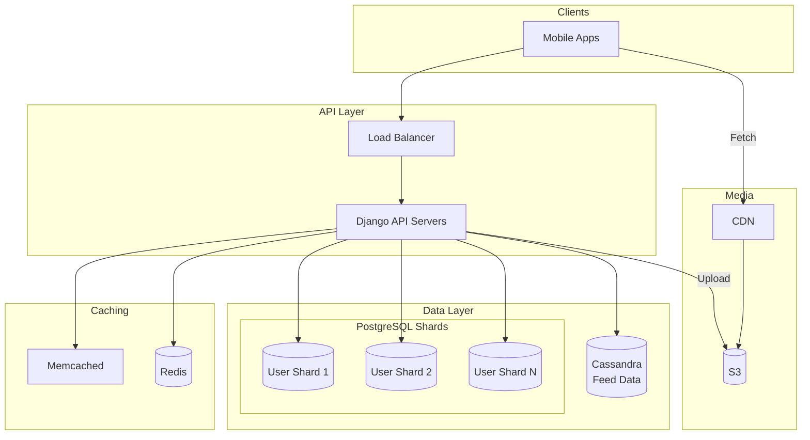
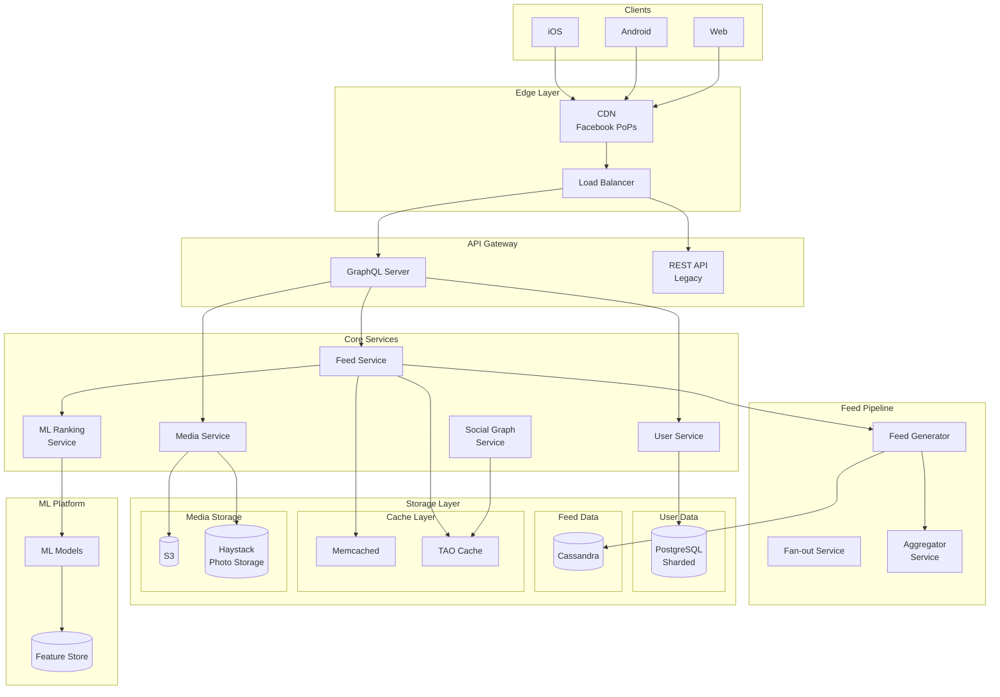
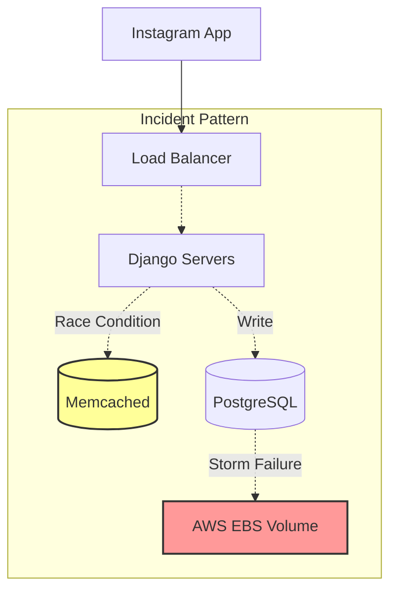

# Instagram Photo Feed Architecture

A deep-dive into how Instagram built their photo sharing platform to serve 2B+ users with 95M+ photos uploaded daily.

---

## 1. Problem Statement

### Business Challenge
Instagram's core experience is the personalized photo and video feed. The challenge is storing and serving billions of photos, generating personalized feeds for 2B+ users, and handling massive engagement (likes, comments) in real-time—all while maintaining fast load times.

### Technical Requirements
- **Functional**: Upload, store, and serve photos/videos; generate personalized feeds; handle social interactions
- **Fast**: Photos load instantly, feeds render in < 1 second
- **Personalized**: ML-ranked feed based on interests and engagement
- **Reliable**: Photos never lost, always available

### Scale Metrics

| Metric | Value | As of | Source | Notes |
|--------|-------|-------|--------|-------|
| Monthly Active Users | 2B+ | Historical/approximate; not current-verified | Instagram public and engineering sources listed below | Global reach |
| Daily Active Users | 500M+ | Historical/approximate; not current-verified | Instagram public and engineering sources listed below | High engagement |
| Photos Uploaded/Day | 95M+ | Historical/approximate; not current-verified | Instagram public and engineering sources listed below | ~1,100 photos/second |
| Likes/Day | 4.2B+ | Historical/approximate; not current-verified | Instagram public and engineering sources listed below | ~48,600 likes/second |
| Total Photos Stored | 100B+ | Historical/approximate; not current-verified | Instagram public and engineering sources listed below | All time |
| Stories/Day | 500M+ | Historical/approximate; not current-verified | Instagram public and engineering sources listed below | 24-hour content |

### Performance Requirements

| Requirement | Target |
|-------------|--------|
| Feed load time | < 1 second |
| Photo upload time | < 5 seconds |
| Like latency | < 100ms |
| Photo availability | 99.999% |
| Feed freshness | < 30 seconds |

---

## 2. Architecture Evolution

### v1: Django + PostgreSQL (2010-2012)

**Approach**: Simple Django application with PostgreSQL, photos on S3.

**What Worked**:
- ✅ Rapid development with Django
- ✅ S3 handled photo storage reliably
- ✅ Simple architecture for small team
- ✅ Acquired 25M users in first year

**What Broke**:
- ❌ PostgreSQL couldn't handle write volume
- ❌ Feed generation too slow (join-heavy)
- ❌ Single database became bottleneck
- ❌ No caching layer

### v2: Sharded PostgreSQL + Cassandra (2012-2015)

**Approach**: Shard PostgreSQL by user_id, add Cassandra for feed data, Redis for caching.

**Key Changes**:
- PostgreSQL sharded by user_id
- Cassandra for feed and activity data
- Redis for caching feeds
- Memcached for general caching
- Fan-out on write for feeds

**Problems Solved**:
- ✅ Horizontal scaling with sharding
- ✅ Fast feed reads from cache
- ✅ Cassandra handled write volume
- ✅ Reduced database load

**New Bottlenecks**:
- ❌ Celebrity posts caused fan-out storms
- ❌ Feed ranking was chronological only
- ❌ Cross-shard queries complex
- ❌ Growing operational complexity

### v3: Current Architecture (2016-Present)

**Approach**: ML-ranked feeds, hybrid fan-out, global multi-region.

**Current Features**:
- ML-ranked "For You" feed
- TAO (Facebook's graph cache) integration
- Haystack for efficient photo storage
- Multi-region with global CDN
- GraphQL API
- Stories, Reels, Explore

---

## 3. Key Design Decisions

### Decision 1: PostgreSQL Sharding by User ID

| Aspect | Details |
|--------|---------|
| **Decision** | Shard PostgreSQL by user_id rather than migrate to NoSQL |
| **Rationale** | Keep relational model for user data, maintain ACID guarantees |
| **Alternatives Considered** | Cassandra for everything, MySQL, DynamoDB |
| **Trade-offs** | Operational complexity, cross-shard joins impossible |
| **Result** | Handled billions of users, maintained data integrity |

### Decision 2: Cassandra for Feed Data

| Aspect | Details |
|--------|---------|
| **Decision** | Use Cassandra for feed storage and activity data |
| **Rationale** | High write throughput, time-series friendly, eventual consistency OK |
| **Alternatives Considered** | Redis (memory limits), PostgreSQL (write bottleneck) |
| **Trade-offs** | Eventual consistency, limited query patterns |
| **Result** | Handles billions of feed entries efficiently |

### Decision 3: Fan-out on Write with Hybrid

| Aspect | Details |
|--------|---------|
| **Decision** | Fan-out on write for normal users, on-demand for celebrities |
| **Rationale** | Balance write amplification with read latency |
| **Alternatives Considered** | Pure fan-out on read, pure fan-out on write |
| **Trade-offs** | Complexity, slight delay for celebrity content |
| **Result** | Fast feeds without celebrity-induced write storms |

### Decision 4: ML-Ranked Feed over Chronological

| Aspect | Details |
|--------|---------|
| **Decision** | Replace chronological feed with ML-ranked feed |
| **Rationale** | Increase engagement, show relevant content |
| **Alternatives Considered** | Chronological only, simple heuristics |
| **Trade-offs** | User complaints, complexity, compute cost |
| **Result** | Significant increase in engagement metrics |

### Decision 5: Haystack for Photo Storage

| Aspect | Details |
|--------|---------|
| **Decision** | Use Facebook's Haystack for photo storage (after FB acquisition) |
| **Rationale** | Optimized for small files, reduces metadata overhead |
| **Alternatives Considered** | Pure S3, custom solution |
| **Trade-offs** | Facebook dependency, migration effort |
| **Result** | More efficient storage, faster retrieval |

---

## 4. Technologies Used

| Component | Technology | Why Chosen | Alternatives |
|-----------|-----------|------------|--------------|
| Primary DB | PostgreSQL (Sharded) | ACID, relational | MySQL, CockroachDB |
| Feed Storage | Cassandra | Write throughput, time-series | DynamoDB, ScyllaDB |
| Cache | Memcached + TAO | Speed, FB integration | Redis |
| Photo Storage | S3 + Haystack | Durability, efficiency | GCS, custom |
| CDN | Facebook PoPs | Global, integrated | CloudFront, Akamai |
| API | Django + GraphQL | Python ecosystem | Node.js, Go |
| Queue | Celery + RabbitMQ | Python integration | Kafka |
| ML Platform | PyTorch | FB standard | TensorFlow |
| Graph Cache | TAO | Social graph queries | Custom |
| Search | Elasticsearch | Content search | Solr, Algolia |

---

## 5. Trade-offs Made

### Consistency vs Availability

| Trade-off | Instagram's Choice | Reasoning |
|-----------|-------------------|-----------|
| Photo uploads | **Strong consistency** | Photos must not be lost |
| Like counts | **Eventual consistency** | Approximate OK for display |
| Feed content | **Eventual consistency** | Slight delay acceptable |
| Follower counts | **Eventual consistency** | Display approximate values |

### Latency vs Completeness

| Trade-off | Instagram's Choice | Reasoning |
|-----------|-------------------|-----------|
| Feed generation | **Pre-computed over complete** | Speed matters more |
| Explore page | **Cached recommendations** | Fresh enough is OK |
| Search results | **Fast approximate** | Relevance over completeness |

### Cost vs Performance

| Trade-off | Instagram's Choice | Reasoning |
|-----------|-------------------|-----------|
| Photo storage | **Multiple sizes cached** | Storage cost for speed |
| Feed caching | **Aggressive caching** | Memory cost for latency |
| CDN | **Extensive edge caching** | Bandwidth cost for speed |

### Simplicity vs Optimization

| Trade-off | Instagram's Choice | Reasoning |
|-----------|-------------------|-----------|
| Database | **Sharded relational** | Familiar but complex |
| Stack | **Python/Django** | Developer velocity |
| Feed ranking | **ML models** | Engagement worth complexity |

---

## 6. Lessons Learned

### What Worked ✅

1. **Django for Rapid Development**: Python enabled fast iteration with small team
2. **PostgreSQL Sharding**: Maintained relational model while scaling
3. **S3 for Photos**: Reliable, durable, simple
4. **Cassandra for Feeds**: Handled write volume elegantly
5. **Facebook Infrastructure**: TAO, Haystack provided scaling solutions

### What Didn't Work Initially ❌

1. **Single PostgreSQL**: Hit limits very quickly
2. **No Caching**: Database hammered by read traffic
3. **Chronological Feed**: Missed important content
4. **In-app Photo Editing**: Had to simplify for performance
5. **Pure Fan-out on Write**: Celebrity accounts caused problems

### Key Pivots 🔄

1. **2012**: Single DB to sharded PostgreSQL
2. **2012**: Facebook acquisition, infrastructure integration begins
3. **2013**: Added Cassandra for feeds
4. **2015**: Stories launched (ephemeral content)
5. **2016**: Algorithmic feed replaces chronological
6. **2020**: Reels launched (short video)
7. **2021**: GraphQL API rollout

---

## 7. Interview Relevance

### When to Reference This Case Study

- **Photo sharing platforms** (Pinterest, Flickr)
- **Social media feeds**
- **Large-scale media storage**
- **Feed ranking systems**
- **Django/Python at scale**

### Key Talking Points

Use these in your interviews:

1. "Instagram shards **PostgreSQL by user_id** for user data, which keeps ACID guarantees while enabling horizontal scaling. Each shard handles millions of users. Cross-shard queries, such as finding all users who liked a photo, require querying multiple shards or using a separate aggregation layer."

2. "They use **Cassandra for feed data** because it handles high write throughput (95M photos/day, 4.2B likes/day) and is optimized for time-series access patterns."

3. "Like Twitter, they use a **hybrid fan-out strategy**—fan-out on write for regular users, but merge celebrity content at read time to avoid write amplification."

4. "Photos are stored in **multiple resolutions on S3/Haystack** (thumbnail, medium, full) and served through CDN to minimize latency regardless of device."

5. "The feed evolved from **chronological to ML-ranked** around 2016, using engagement signals to show content you're more likely to interact with."

### Common Follow-up Questions

| Question | How to Answer |
|----------|---------------|
| "How do you store photos efficiently?" | Multiple resolutions, Haystack for small file optimization, CDN for delivery |
| "How do you generate the feed?" | Fan-out on write to Cassandra, cache in Redis, ML ranking at read time |
| "How do you handle likes at scale?" | Counter cache, eventual consistency, batched writes |
| "How do you shard by user_id?" | Consistent hashing, user_id mod N, lookup service |
| "How does explore/discover work?" | Pre-computed recommendations, collaborative filtering, content-based |
| "How do Stories work?" | Separate storage (ephemeral), different access pattern, 24h TTL |

---

## 8. Related Repo Content

### HLD Concepts Referenced
- [Database Sharding](../../03-hld-concepts/database-sharding/) - PostgreSQL sharding
- [Caching](../../03-hld-concepts/caching/) - Memcached and TAO
- [CDN](../../03-hld-concepts/cdn/) - Photo delivery
- [Message Queues](../../03-hld-concepts/message-queues/) - Celery/RabbitMQ

### Similar HLD Projects
- [News Feed Design](../../04-hld-projects/news-feed/) - Generic feed system

### Design Patterns Applied
- **CQRS**: Separate read/write paths
- **Fan-out Pattern**: Feed distribution
- **Cache-Aside**: Photo and feed caching
- **Sharding Pattern**: Database partitioning

---

## 📚 Sources

- [Instagram Engineering Blog](https://instagram-engineering.com/)
- [High Scalability: "Instagram Architecture"](http://highscalability.com/)
- [Wired: "The Inside Story of How Instagram Grew to 500 Million Users"](https://www.wired.com/)
- [PyCon: "Scaling Instagram" by Mike Krieger](https://www.youtube.com/watch?v=oNA2C1vC8FQ)
- [QCon: "Scaling Instagram Infrastructure"](https://www.infoq.com/presentations/instagram-scale/)

---

## Interview Mapping Update (March 2026)

- Mapped to `04-hld-projects/news-feed/` Instagram variant and `02-lld-projects/instagram-core/` for interview-style practice progression.

## Failures, Incidents and What They Changed

1. **AWS US-East Storm Outage (2012)**
   - **Date**: June 2012
   - **Root Cause**: A severe derecho storm knocked out power to AWS US-East-1, bringing down critical EC2 instances and EBS volumes holding database state.
   - **Blast Radius**: Instagram was completely offline for many users for nearly two days, just weeks after the Facebook acquisition.
   - **Fix**: Re-evaluated disaster recovery, implemented aggressive multi-AZ deployments for Postgres and Redis, and accelerated integration into Facebook's geographically distributed infrastructure.
   - **Interview Lesson**: Cloud availability zones are not immune to massive weather events; cross-region redundancy is mandatory for Tier-1 services.
   - **Source**: [https://aws.amazon.com/message/67457/](https://aws.amazon.com/message/67457/)

2. **Memcached Invalidation Bug (2014)**
   - **Date**: 2014
   - **Root Cause**: A race condition in the photo metadata cache invalidation logic caused old, deleted photos to temporarily reappear in user feeds.
   - **Blast Radius**: User confusion and potential privacy concerns as deleted content became visible again under heavy load.
   - **Fix**: Implemented strict read-through caching patterns with versioning (leasing) to prevent stale cache overwrites.
   - **Interview Lesson**: Cache invalidation is one of the hardest problems in distributed systems; always use atomic operations or lease mechanisms when writing to caches.
   - **Source**: [not public]

3. **Facebook BGP Routing Outage (2021)**
   - **Date**: October 4, 2021
   - **Root Cause**: A faulty configuration change severed the backbone routing between Facebook's global data centers and the internet.
   - **Blast Radius**: Instagram was globally inaccessible for over 6 hours, alongside WhatsApp and Facebook.
   - **Fix**: Auditing of core networking changes and implementation of out-of-band communication methods for engineers.
   - **Interview Lesson**: Deeply coupled monolithic infrastructure (DNS, BGP) can take down completely separate applications (FB, Insta, WhatsApp) simultaneously.
   - **Source**: [https://engineering.fb.com/2021/10/05/networking-traffic/outage-details/](https://engineering.fb.com/2021/10/05/networking-traffic/outage-details/)

## Evolution Timeline

| Year | Scale | Change |
|------|-------|--------|
| 2010 | 1M users | Monolithic Django app on a single EC2 instance, MySQL database, and simple Redis queues. |
| 2012 | 30M users | Acquired by Facebook; heavy usage of Postgres sharding (custom ID generation) and Memcached clusters. |
| 2014 | 300M users | Migration from AWS to Facebook's physical infrastructure; transition to TAO (Facebook's social graph data store). |
| 2016 | 500M users | Switched from chronological feed to an algorithmic feed powered by massive machine learning pipelines. |
| 2020 | 1B+ users | Introduction of Reels, requiring highly optimized video transcoding, CDN delivery, and real-time content ranking. |

## Design It Yourself

**Prompt**: Design a photo-sharing application where users can upload photos, follow other users, and view a personalized feed of photos.
**Hints**:
1. How do you store the actual photo files versus the metadata (likes, captions)?
2. How do you generate unique, time-sortable IDs for billions of photos?
3. Should the feed be generated on-the-fly (pull) or pre-computed in a background queue (push)?
4. How do you handle the caching layer for highly viewed accounts (e.g., celebrities)?
5. What metrics determine the ranking order of the algorithmic feed?

**Link**: Try building this in the [News Feed](../../04-hld-projects/news-feed/) project.

## High-Level Incident Architecture

## Deep Dive: Scaling Data with Sharding
In its early days, Instagram utilized custom Postgres sharding to scale out its relational data. They implemented a logic layer within the application that mapped user IDs to specific physical database shards. This required generating unique, time-sortable IDs (similar to Twitter's Snowflake) within the database itself using PL/pgSQL functions.
This approach allowed them to keep all data for a single user (photos, likes, comments) on the same shard, optimizing read operations for generating personalized feeds. While complex to maintain, this logical sharding strategy was pivotal in managing exponential data growth before their eventual integration with Facebook's massive distributed infrastructure stores like TAO.

This historical context highlights that while modern systems often leverage off-the-shelf distributed databases, custom sharding layers on top of reliable RDBMS systems were crucial stepping stones for many hyper-growth startups.
