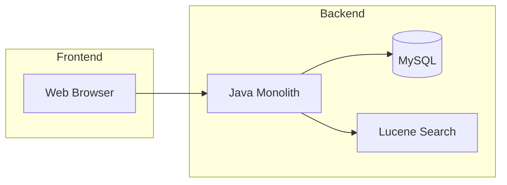
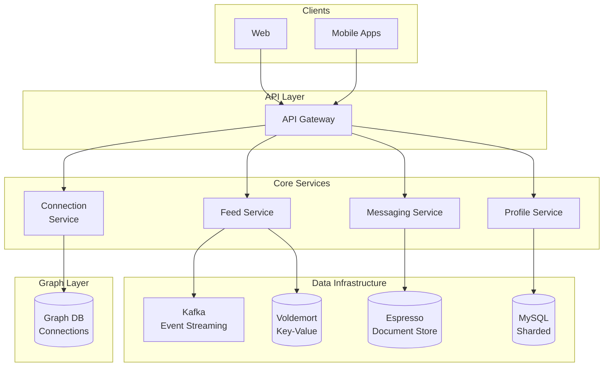
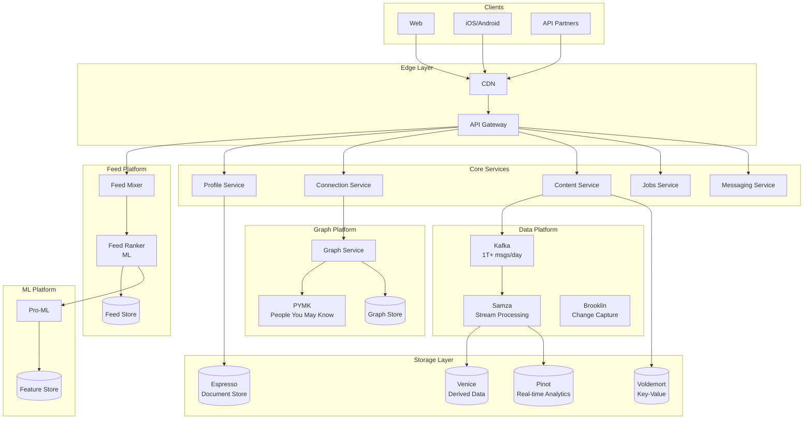
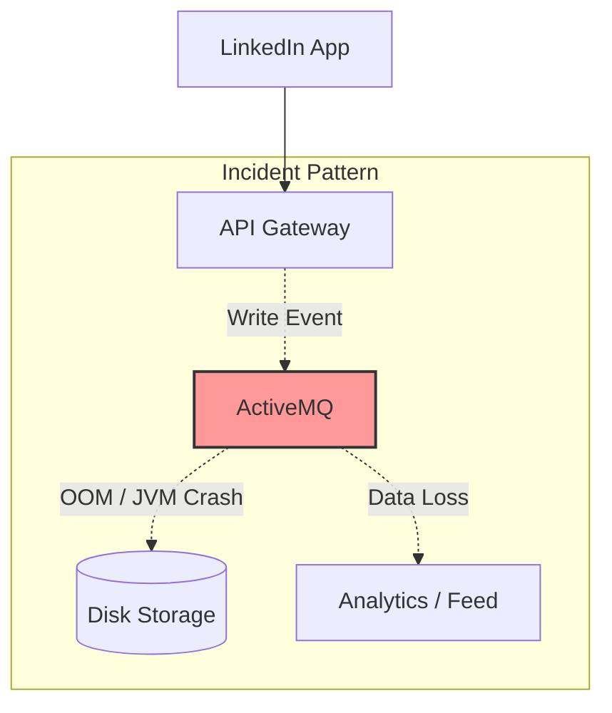

# LinkedIn Professional Feed Architecture

A deep-dive into how LinkedIn built their professional network feed to serve 900M+ members with personalized content.

---

## 1. Problem Statement

### Business Challenge
LinkedIn's core experience is the professional feed—showing relevant posts, job updates, and connections to 900M+ members. The challenge is generating personalized feeds that balance viral content, professional relevance, and user engagement while respecting the "6 degrees of separation" graph structure.

### Technical Requirements
- **Functional**: Personalized feed, job recommendations, connection suggestions, messaging
- **Relevant**: Professional content ranking with engagement signals
- **Real-time**: New posts appear quickly, notifications are instant
- **Graph-aware**: Leverage connection relationships for relevance

### Scale Metrics

| Metric | Value | As of | Source | Notes |
|--------|-------|-------|--------|-------|
| Members | 900M+ | Historical/approximate; not current-verified | LinkedIn public and engineering sources listed below | Professional network |
| Monthly Active Users | 300M+ | Historical/approximate; not current-verified | LinkedIn public and engineering sources listed below | Engaged members |
| Companies | 58M+ | Historical/approximate; not current-verified | LinkedIn public and engineering sources listed below | Business pages |
| Jobs Posted/Week | 100K+ | Historical/approximate; not current-verified | LinkedIn public sources listed below | Job marketplace |
| Messages/Day | 1B+ | Historical/approximate; not current-verified | LinkedIn public and engineering sources listed below | InMail and messaging |
| Countries | 200+ | Historical/approximate; not current-verified | LinkedIn public sources listed below | Global presence |

### Performance Requirements

| Requirement | Target |
|-------------|--------|
| Feed load time | < 1 second |
| Post visibility | < 30 seconds after posting |
| Message delivery | < 1 second |
| Search latency | < 300ms |
| System availability | 99.99% |

---

## 2. Architecture Evolution

### v1: Simple Activity Feed (2003-2010)

**Approach**: MySQL database with simple chronological feed.

**What Worked**:
- ✅ Simple implementation
- ✅ Worked for initial professional network
- ✅ Clear data model

**What Broke**:
- ❌ MySQL couldn't handle connection graph queries
- ❌ Chronological feed missed important updates
- ❌ Search was slow and limited
- ❌ Monolith slowed development

### v2: Graph Database + Kafka (2011-2016)

**Approach**: Graph-based connections, Kafka for real-time, Voldemort for distributed storage.

**Key Changes**:
- Kafka as central event bus
- Graph database for connections
- Voldemort for distributed key-value storage
- Microservices architecture

**Problems Solved**:
- ✅ Real-time updates via Kafka
- ✅ Efficient 1st/2nd/3rd degree queries
- ✅ Independent service scaling
- ✅ Better search with Elasticsearch

**New Bottlenecks**:
- ❌ Feed ranking was basic
- ❌ ML recommendations needed
- ❌ Real-time analytics limited
- ❌ Mobile performance issues

### v3: Current Architecture (2017-Present)

**Approach**: ML-ranked feeds, Pinot for real-time analytics, unified data platform.

**Current Features**:
- ML-ranked feed with engagement prediction
- 1 trillion+ Kafka messages/day
- Real-time analytics with Pinot
- "People You May Know" ML recommendations
- Graph-based relevance scoring

---

## 3. Key Design Decisions

### Decision 1: Kafka as Central Nervous System

| Aspect | Details |
|--------|---------|
| **Decision** | Route all events through Kafka clusters (1T+ messages/day) |
| **Rationale** | Decouple producers/consumers, enable replay, real-time processing |
| **Alternatives Considered** | Direct service calls, RabbitMQ, custom solution |
| **Trade-offs** | Operational complexity, eventual consistency |
| **Result** | Foundation for real-time features, analytics, ML pipelines |

### Decision 2: Build Custom Storage Systems

| Aspect | Details |
|--------|---------|
| **Decision** | Build Voldemort, Espresso, Venice, Pinot for specific needs |
| **Rationale** | Generic solutions didn't meet LinkedIn's scale requirements |
| **Alternatives Considered** | Cassandra, MongoDB, InfluxDB, Elasticsearch |
| **Trade-offs** | High engineering investment, operational overhead |
| **Result** | Optimized for LinkedIn's access patterns; open-sourced |

### Decision 3: Graph-Based Connections

| Aspect | Details |
|--------|---------|
| **Decision** | Dedicated graph store for connection relationships |
| **Rationale** | Efficient degree-of-connection queries (1st, 2nd, 3rd degree) |
| **Alternatives Considered** | Relational joins, Neo4j, general purpose DB |
| **Trade-offs** | Custom development, sync complexity |
| **Result** | Sub-millisecond "People You May Know" queries |

### Decision 4: ML Feed Ranking

| Aspect | Details |
|--------|---------|
| **Decision** | Replace chronological with ML-ranked feed |
| **Rationale** | Maximize engagement and professional value |
| **Alternatives Considered** | Chronological, simple heuristics |
| **Trade-offs** | Compute cost, user transparency |
| **Result** | Significant increase in engagement and time spent |

### Decision 5: Samza for Stream Processing

| Aspect | Details |
|--------|---------|
| **Decision** | Build Samza on top of Kafka for stateful stream processing |
| **Rationale** | Need stateful processing with Kafka integration |
| **Alternatives Considered** | Storm, Spark Streaming |
| **Trade-offs** | Custom development, different from batch |
| **Result** | Powers real-time features; open-sourced to Apache |

---

## 4. Technologies Used

| Component | Technology | Why Chosen | Alternatives |
|-----------|-----------|------------|--------------|
| Event Bus | Kafka | Scale, durability | RabbitMQ, Pulsar |
| Stream Processing | Samza | Stateful + Kafka | Flink, Spark |
| Key-Value | Voldemort | Tunable consistency | DynamoDB |
| Document Store | Espresso | LinkedIn-optimized | MongoDB |
| Derived Data | Venice | Read-only materialized views | Custom |
| Analytics | Pinot | Real-time OLAP | Druid, ClickHouse |
| Graph Store | Custom | Connection queries | Neo4j |
| Search | Galene | LinkedIn-built | Elasticsearch |
| ML Platform | Pro-ML | Feature serving | Feast |
| Backend | Java | Performance | Python, Go |

---

## 5. Trade-offs Made

### Consistency vs Availability

| Trade-off | LinkedIn's Choice | Reasoning |
|-----------|-------------------|-----------|
| Feed updates | **Eventually consistent** | Delay in feed OK |
| Profile changes | **Strongly consistent** | User expects immediate |
| Connection status | **Strongly consistent** | Accurate graph is critical |
| Analytics | **Eventually consistent** | Batch processing is fine |

### Latency vs Freshness

| Trade-off | LinkedIn's Choice | Reasoning |
|-----------|-------------------|-----------|
| Feed ranking | **Pre-computed + real-time blend** | Balance speed and freshness |
| PYMK | **Batch computed** | Complex graph algorithms |
| Search | **Near real-time** | New content should appear |
| Notifications | **Real-time** | Immediate delivery expected |

### Build vs Buy

| Trade-off | LinkedIn's Choice | Reasoning |
|-----------|-------------------|-----------|
| Storage systems | **Build (Voldemort, Espresso, Venice)** | Scale requirements |
| Event streaming | **Build (Kafka)** | Core infrastructure |
| Analytics | **Build (Pinot)** | Real-time OLAP needs |
| ML platform | **Build (Pro-ML)** | Specialized requirements |

---

## 6. Lessons Learned

### What Worked ✅

1. **Kafka Investment**: Became industry standard; powers all real-time features
2. **Custom Storage Systems**: Optimized for LinkedIn's access patterns
3. **Graph-Based Connections**: Efficient degree queries for PYMK
4. **Samza Development**: Stateful stream processing at scale
5. **Open Sourcing**: Kafka, Samza, Pinot became Apache projects

### What Didn't Work Initially ❌

1. **MySQL for Graph**: Couldn't handle connection queries
2. **Chronological Feed**: Users missed important updates
3. **Monolithic Architecture**: Slowed development
4. **Generic Storage Solutions**: Didn't meet scale requirements
5. **Batch-Only Analytics**: Needed real-time for feed ranking

### Key Pivots 🔄

1. **2010**: Start of Kafka development
2. **2011**: Open-source Kafka to Apache
3. **2013**: Samza for stream processing
4. **2014**: Espresso replaces Oracle
5. **2016**: Pinot for real-time analytics
6. **2018**: ML-ranked feed deployed globally
7. **2020**: Venice for derived data serving

---

## 7. Interview Relevance

### When to Reference This Case Study

- **Social network feed design**
- **Professional network design**
- **Graph-based systems**
- **Event streaming architecture**
- **Real-time analytics systems**

### Key Talking Points

Use these in your interviews:

1. "LinkedIn processes **1 trillion+ Kafka messages per day**. They created Kafka specifically for their event streaming needs, and it became the industry standard for event-driven architectures."

2. "For connection recommendations (PYMK), they use a **graph-based approach** that efficiently queries 1st, 2nd, and 3rd-degree connections. The graph is optimized for these specific access patterns."

3. "They built **multiple custom storage systems**: Voldemort (key-value), Espresso (documents), Venice (derived data), and Pinot (real-time analytics)—each optimized for specific access patterns."

4. "The feed uses **ML ranking** to predict engagement. It considers factors like connection strength, content quality, recency, and user history—much more than just chronological ordering."

5. "**Samza** was built for stateful stream processing on top of Kafka. It powers real-time features like notifications, feed updates, and job recommendations."

### Common Follow-up Questions

| Question | How to Answer |
|----------|---------------|
| "How does feed ranking work?" | ML model trained on engagement signals; candidate generation → ranking → diversity injection |
| "How does 'People You May Know' work?" | Graph algorithms considering shared connections, company, school; batch computed for efficiency |
| "Why build custom storage?" | Scale requirements exceeded existing solutions; optimized for specific access patterns |
| "How does Kafka achieve scale?" | Partitioned topics; replicated for durability; consumer groups for parallelism |
| "How do you handle real-time notifications?" | Kafka event → Samza processing → notification service → push to device |
| "How does graph querying work?" | Specialized graph index; degree-based partitioning; cached hot paths |

---

## 8. Related Repo Content

### HLD Concepts Referenced
- [Message Queues](../../03-hld-concepts/message-queues/) - Kafka patterns
- [Database Sharding](../../03-hld-concepts/database-sharding/) - Storage partitioning
- [Microservices Communication](../../03-hld-concepts/microservices-communication/) - Service mesh
- [Caching](../../03-hld-concepts/caching/) - Feed caching

### Similar HLD Projects
- [Distributed Social Graph Engine (Meta TAO)](../../04-hld-projects/social-graph-engine-tao/)
- [Problem Statement: Distributed Partitioned Commit Log Broker](../../04-hld-projects/kafka-distributed-broker/)

### Design Patterns Applied
- **Event Sourcing**: Kafka-based architecture
- **CQRS**: Read-optimized views
- **Graph Pattern**: Connection relationships
- **Lambda Architecture**: Batch + real-time

---

## Failures, Incidents and What They Changed

1. **ActiveMQ Bottleneck (2010)**
   - **Date**: 2010
   - **Root Cause**: LinkedIn originally used ActiveMQ for event tracking. As traffic grew, the broker ran out of memory and fell over under the load of millions of events, preventing data ingestion for analytics and the feed.
   - **Blast Radius**: Complete loss of event tracking and severe delays in feed generation.
   - **Fix**: This failure prompted LinkedIn to develop a custom distributed log that bypassed JVM memory limits by using the OS page cache—this project became Apache Kafka.
   - **Interview Lesson**: Traditional message queues fail under massive throughput because they track per-message state. High-throughput logs must rely on sequential disk I/O and simple offset tracking.
   - **Source**: [https://www.microsoft.com/en-us/research/wp-content/uploads/2017/09/Kafka.pdf](https://www.microsoft.com/en-us/research/wp-content/uploads/2017/09/Kafka.pdf)

2. **Graph Database Migration Outage (2011)**
   - **Date**: 2011 (approximate)
   - **Root Cause**: While migrating their connection graph from Oracle to a custom distributed graph system, a replication lag issue caused the new system to serve inconsistent connection data.
   - **Blast Radius**: Users temporarily saw incorrect connection counts and feed items from users they were not connected to.
   - **Fix**: Reverted back to the old system temporarily, instituted strict dual-write and read-verification mechanisms, and later successfully launched their graph store.
   - **Interview Lesson**: Migrating core data stores requires "dark reads" where the new system is queried but results are compared against the old system without being shown to users until correctness is proven.
   - **Source**: [not public]

3. **Feed Generation Latency Spikes (2014)**
   - **Date**: 2014
   - **Root Cause**: Calculating feed relevance purely at read-time via their monolithic Java services caused extreme GC pauses, leading to p99 latencies over 2 seconds.
   - **Blast Radius**: Noticeable UI lag when opening the LinkedIn app.
   - **Fix**: Moved to a hybrid push/pull architecture (fan-out on write for active users) using Samza for stream processing and Voldemort for serving pre-computed feed caches.
   - **Interview Lesson**: A pure pull model for feeds fails for heavily connected graphs. You must pre-compute feeds for active users asynchronously.
   - **Source**: [https://engineering.linkedin.com/distributed-systems/log-what-every-software-engineer-should-know-about-real-time-datas-unifying](https://engineering.linkedin.com/distributed-systems/log-what-every-software-engineer-should-know-about-real-time-datas-unifying)

## Evolution Timeline

| Year | Scale | Change |
|------|-------|--------|
| 2003 | N/A | Launched with a monolithic Java application and Oracle database. |
| 2010 | N/A | Invented Kafka to handle massive event telemetry and feed data. |
| 2013 | N/A | Transitioned to a microservices architecture. |
| 2015 | N/A | Open-sourced Samza for real-time stream processing of feed updates. |
| 2022 | N/A | Advanced ML models (Venice) introduced for deep personalization. |

## Design It Yourself

**Prompt**: Design a professional networking news feed that handles high-throughput posts, comments, and connection-based relevance.
**Hints**:
1. How do you decide between a push (fan-out-on-write) vs. pull (fan-out-on-read) architecture for feed generation?
2. What role does a distributed commit log (like Kafka) play in decoupling feed ingestion from serving?
3. How do you quickly query second and third-degree connections?
4. How do you inject sponsored content or ads into the feed without disrupting relevance?
5. How do you handle "celebrity" accounts with millions of followers?

**Link**: Try building this in the [News Feed](../../04-hld-projects/news-feed/) project.

## High-Level Incident Architecture

## 📚 Sources

- [Kafka: A Distributed Messaging System for Log Processing](https://www.microsoft.com/en-us/research/wp-content/uploads/2017/09/Kafka.pdf)
- [Samza: Stateful Scalable Stream Processing](https://samza.apache.org/)
- [Pinot: Real-time Distributed OLAP](https://pinot.apache.org/)
- [Venice: LinkedIn's Derived Data Platform](https://engineering.linkedin.com/blog/2022/venice)
- [The Log: What every software engineer should know](https://engineering.linkedin.com/distributed-systems/log-what-every-software-engineer-should-know-about-real-time-datas-unifying)
- [Scaling LinkedIn's feed with machine learning](https://engineering.linkedin.com/blog/2018/06/scaling-linkedin-feed-with-machine-learning)
