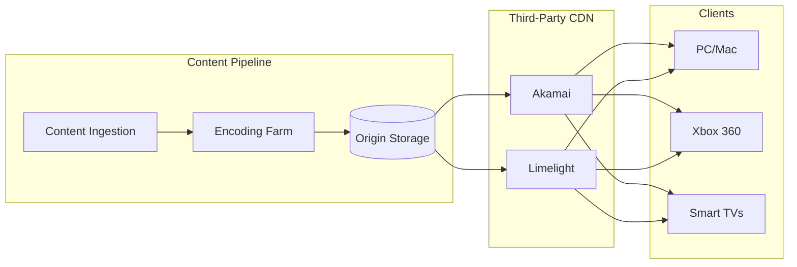
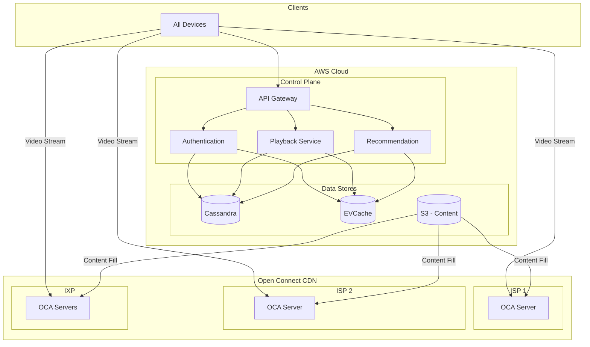
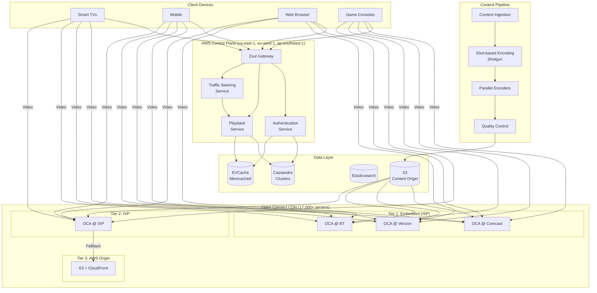
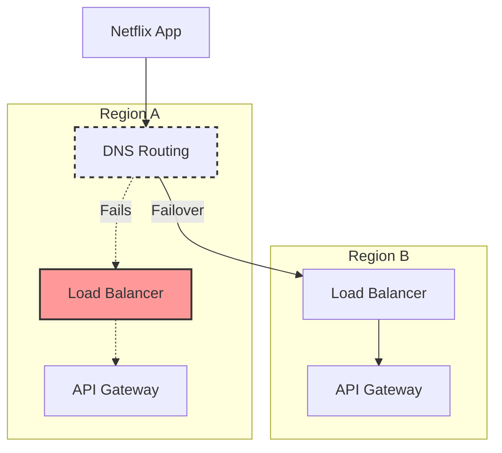

# Netflix Video Streaming Architecture

A deep-dive into how Netflix built the world's largest video streaming platform, handling 15% of global internet traffic.

---

## 1. Problem Statement

### Business Challenge
Netflix transformed from a DVD-by-mail service to the world's leading streaming platform. The challenge is delivering high-quality video to 230M+ subscribers globally with minimal buffering, while handling 15% of all internet traffic during peak hours.

### Technical Requirements
- **Functional**: Stream video on-demand to any device, any quality, anywhere
- **Adaptive**: Adjust quality based on network conditions in real-time
- **Personalized**: Recommend content and personalize thumbnails
- **Reliable**: < 1% buffering rate, instant playback start

### Scale Metrics

| Metric | Value | As of | Source | Notes |
|--------|-------|-------|--------|-------|
| Global Subscribers | 230M+ | Historical/approximate; not current-verified | Netflix public and technical sources listed below | Across 190+ countries |
| Concurrent Streams | 10M+ | Historical/approximate; not current-verified | Netflix public and technical sources listed below | During peak hours |
| Hours Watched/Month | 1 Billion+ | Historical/approximate; not current-verified | Netflix public and technical sources listed below | ~6 hours/subscriber/day |
| Total Content | 17,000+ titles | Historical/approximate; not current-verified | Netflix public and technical sources listed below | Movies + TV series |
| Video Encodes | 100M+ | Historical/approximate; not current-verified | Netflix Tech Blog and Open Connect sources listed below | Different quality/device combinations |
| Internet Traffic | 15% | Historical/approximate; not current-verified | Open Connect and public technical sources listed below | Of total downstream internet traffic |

### Performance Requirements

| Requirement | Target |
|-------------|--------|
| Time to first frame | < 2 seconds |
| Buffering rate | < 1% of playback time |
| Video start failures | < 0.1% |
| Availability | 99.99% |
| Bitrate range | 0.5 Mbps - 16 Mbps (4K HDR) |

---

## 2. Architecture Evolution

### v1: DVD-by-Mail to Streaming (2007-2010)

**Approach**: Initial streaming on own data centers, third-party CDN (Akamai, Limelight).

**What Worked**:
- ✅ Quick launch to market
- ✅ Leveraged existing CDN infrastructure
- ✅ Proved streaming viability

**What Broke**:
- ❌ High CDN costs at scale
- ❌ Limited control over quality
- ❌ Inconsistent performance across regions
- ❌ Data center limitations

### v2: AWS Migration + Open Connect (2011-2015)

**Approach**: Migrate all compute to AWS, build own CDN (Open Connect).

**Key Changes**:
- Complete AWS migration (no more data centers)
- Open Connect CDN with ISP-embedded servers
- Introduced chaos engineering (Chaos Monkey)
- Microservices architecture

**Problems Solved**:
- ✅ 95% cost reduction for CDN
- ✅ Better control over video quality
- ✅ Direct peering with ISPs
- ✅ Scalable compute on AWS

**New Bottlenecks**:
- ❌ Managing thousands of OCA servers
- ❌ Content pre-positioning optimization
- ❌ Multi-region failover complexity

### v3: Current Architecture (2016-Present)

**Approach**: Global-scale CDN, adaptive streaming, ML-driven optimization.

**Current Features**:
- 17,000+ Open Connect Appliances (OCAs) globally
- Shot-based encoding (per-scene quality optimization)
- Predictive pre-positioning of content
- Multi-CDN fallback (Open Connect → AWS → third-party)
- Device-specific encoding profiles

---

## 3. Key Design Decisions

### Decision 1: Build Own CDN (Open Connect)

| Aspect | Details |
|--------|---------|
| **Decision** | Build and operate own CDN instead of relying on third-party providers |
| **Rationale** | Control over quality, cost savings at scale, ISP relationships |
| **Alternatives Considered** | Pure Akamai/CloudFront, hybrid approach |
| **Trade-offs** | Massive upfront investment, operational complexity |
| **Result** | 95% reduction in bandwidth costs, better quality control |

### Decision 2: AWS for Everything Except Streaming

| Aspect | Details |
|--------|---------|
| **Decision** | Use AWS for all compute, storage, and control plane; own CDN for video delivery |
| **Rationale** | Focus on core competency (streaming), let AWS handle infrastructure |
| **Alternatives Considered** | Own data centers, hybrid cloud, multi-cloud |
| **Trade-offs** | AWS dependency, cost at scale, single cloud risk |
| **Result** | Rapid scaling, innovation speed, pioneered cloud-native architecture |

### Decision 3: Per-Title Encoding

| Aspect | Details |
|--------|---------|
| **Decision** | Encode each title with custom settings optimized for its content |
| **Rationale** | Animation needs different settings than live-action; optimize quality per bitrate |
| **Alternatives Considered** | Fixed encoding ladder, genre-based profiles |
| **Trade-offs** | Higher encoding costs, more storage |
| **Result** | 20% bandwidth savings, better quality at lower bitrates |

### Decision 4: Chaos Engineering

| Aspect | Details |
|--------|---------|
| **Decision** | Deliberately inject failures in production (Chaos Monkey, etc.) |
| **Rationale** | Ensure systems gracefully handle failures |
| **Alternatives Considered** | Traditional testing only, staging environments |
| **Trade-offs** | Risk of production incidents, cultural shift needed |
| **Result** | Industry-leading reliability, faster recovery from real failures |

### Decision 5: Microservices + EVCache

| Aspect | Details |
|--------|---------|
| **Decision** | Microservices architecture with EVCache (enhanced Memcached) layer |
| **Rationale** | Independent scaling, resilience, development velocity |
| **Alternatives Considered** | Monolith, Redis, pure Cassandra |
| **Trade-offs** | Operational complexity, network overhead |
| **Result** | 1000+ microservices, teams can deploy independently |

---

## 4. Technologies Used

| Component | Technology | Why Chosen | Alternatives |
|-----------|-----------|------------|--------------|
| CDN | Open Connect | Cost, control, quality | Akamai, CloudFront |
| Cloud | AWS | Scalability, ecosystem | GCP, Azure, own DC |
| API Gateway | Zuul | Netflix-built, flexible | Kong, NGINX |
| Cache | EVCache (Memcached) | Simple, reliable, Netflix-optimized | Redis, Aerospike |
| Database | Cassandra | AP system, write-heavy | DynamoDB, CockroachDB |
| Object Storage | S3 | Durable, scalable | Own storage |
| Search | Elasticsearch | Content search | Solr, Algolia |
| Encoding | Netflix encoding pipeline | Per-title optimization | FFmpeg only |
| Streaming Protocol | DASH + HLS | Adaptive bitrate | HDS, Smooth Streaming |
| Service Mesh | Eureka + Ribbon | Service discovery, load balancing | Consul, Istio |
| Tracing | Atlas + Mantis | Real-time analytics | Prometheus, Datadog |
| ML Platform | Metaflow | Recommendation pipelines | Kubeflow, SageMaker |

---

## 5. Trade-offs Made

### Consistency vs Availability

| Trade-off | Netflix's Choice | Reasoning |
|-----------|-----------------|-----------|
| Viewing history | **Eventual consistency** | Sync can be delayed, not critical |
| Playback session | **Available over consistent** | Users must be able to play |
| Recommendations | **Stale is okay** | Pre-computed, not real-time critical |
| Account info | **Strongly consistent** | Billing, authentication must be accurate |

### Cost vs Performance

| Trade-off | Netflix's Choice | Reasoning |
|-----------|-----------------|-----------|
| CDN | **Own vs third-party** | Upfront cost for long-term savings |
| Encoding | **Per-title optimization** | Higher encoding cost, lower bandwidth |
| Pre-positioning | **Predictive caching** | Storage cost for reduced latency |
| Multi-region | **Active-active** | Redundancy cost for availability |

### Latency vs Quality

| Trade-off | Netflix's Choice | Reasoning |
|-----------|-----------------|-----------|
| Initial quality | **Start low, ramp up** | Fast start > initial quality |
| Buffering | **Quality reduction over buffering** | Continuous playback is paramount |
| Encoding | **Many quality levels** | More choices for network conditions |

### Build vs Buy

| Trade-off | Netflix's Choice | Reasoning |
|-----------|-----------------|-----------|
| CDN | **Build** | Core competency, scale benefits |
| Cloud | **Buy (AWS)** | Not core competency |
| Encoding | **Build** | Competitive advantage |
| Monitoring | **Build (Atlas)** | Unique scale requirements |

---

## 6. Lessons Learned

### What Worked ✅

1. **Open Connect Investment**: Paid off massively at scale with cost and quality benefits
2. **AWS All-In**: Allowed focus on streaming innovation, not infrastructure
3. **Chaos Engineering**: Created resilient systems that handle failures gracefully
4. **Microservices**: Enabled 1000+ engineers to deploy independently
5. **Per-Title Encoding**: Significant bandwidth savings and quality improvements

### What Didn't Work Initially ❌

1. **Third-Party CDN Dependence**: Couldn't control quality or costs at scale
2. **Monolithic Application**: Deployment became a bottleneck with growth
3. **Own Data Centers**: Scaling was too slow for demand
4. **Fixed Encoding Ladder**: Left quality and bandwidth on the table
5. **Synchronous Communication**: Created cascading failures

### Key Pivots 🔄

1. **2008**: DVD focus to streaming priority
2. **2010-2011**: Own data centers to AWS migration
3. **2012**: Third-party CDN to Open Connect
4. **2014**: Fixed encoding to per-title/shot-based encoding
5. **2015**: Monolith to microservices complete
6. **2020**: Edge computing and more ISP partnerships

---

## 7. Interview Relevance

### When to Reference This Case Study

- **Video streaming platform design** (YouTube, Twitch)
- **CDN design questions**
- **Large-scale content delivery**
- **Adaptive bitrate streaming**
- **Global distributed systems**

### Key Talking Points

Use these in your interviews:

1. "Netflix built **Open Connect**, their own CDN with 17,000+ servers embedded directly in ISPs. This gives them control over video quality and reduces costs by 95% compared to third-party CDNs."

2. "They use a **split architecture** - AWS for all control plane operations (authentication, recommendations, playback decisions) and Open Connect for data plane (actual video delivery)."

3. "Netflix pioneered **per-title encoding**, where each piece of content gets custom encoding parameters. An animated film encodes differently than a live-action movie, optimizing quality per bitrate."

4. "Their **chaos engineering** practice includes Chaos Monkey (randomly terminates individual instances) and Chaos Kong (simulates entire region failures) to ensure systems handle failures gracefully at all levels."

5. "They pre-position content to ISP-embedded servers **predictively** - if a show drops Friday, content is pushed to edge servers before the premiere based on predicted popularity."

### Common Follow-up Questions

| Question | How to Answer |
|----------|---------------|
| "How does Netflix handle 4K streaming?" | Explain adaptive bitrate, multiple encodings (100+ per title), client-side quality switching |
| "How do they decide which content to cache where?" | Predictive models based on popularity, geography, time of day; content is pre-positioned |
| "What happens if a user's network degrades?" | Adaptive bitrate reduces quality in real-time, client buffers, no rebuffering |
| "How do they handle new content launches?" | Pre-position to edge, scale up origin, geographic rollout patterns |
| "Why not use a third-party CDN?" | Cost (95% savings), quality control, ISP relationships, performance |
| "How do they ensure reliability?" | Chaos engineering, multi-region, fallback CDN layers, EVCache |

---

## 8. Related Repo Content

### HLD Concepts Referenced
- [CDN](../../03-hld-concepts/cdn/) - Content delivery networks
- [Caching](../../03-hld-concepts/caching/) - EVCache and caching strategies
- [Load Balancing](../../03-hld-concepts/load-balancing/) - Zuul and traffic management
- [Database Sharding](../../03-hld-concepts/database-sharding/) - Cassandra partitioning

### Similar HLD Projects
- [Video Streaming Platform](../../04-hld-projects/video-streaming/)
- [Content Delivery Network (CDN) System](../../04-hld-projects/content-delivery-network/)

### Design Patterns Applied
- **Strategy Pattern**: Different encoding strategies per content type
- **Circuit Breaker**: Hystrix for failure isolation
- **Sidecar Pattern**: Client libraries for service communication

---

## 📚 Sources

- [Netflix Tech Blog](https://netflixtechblog.com/)
- [High Scalability: "A 360 Degree View Of The Entire Netflix Stack"](http://highscalability.com/)
- [Open Connect Overview](https://openconnect.netflix.com/)
- [Netflix OSS](https://netflix.github.io/)
- [QCon: "Mastering Chaos - A Netflix Guide to Microservices"](https://www.infoq.com/presentations/netflix-chaos-microservices/)

## Failures, Incidents and What They Changed

1. **Christmas Eve AWS Outage (2012)**
   - **Date**: December 24, 2012
   - **Root Cause**: An issue with the AWS Elastic Load Balancer (ELB) control plane in the US-East region caused instances to be unable to register/deregister.
   - **Blast Radius**: Streaming was unavailable for many users across the Americas during a peak holiday period.
   - **Fix**: Netflix heavily accelerated their multi-region active-active architecture, ensuring they could evacuate an entire AWS region (e.g., US-East to US-West) within minutes.
   - **Interview Lesson**: Never rely on a single cloud region for high availability; design for stateless regional failover.
   - **Source**: [https://netflixtechblog.com/a-quick-update-on-our-christmas-eve-aws-outage-38cc0872658a](https://netflixtechblog.com/a-quick-update-on-our-christmas-eve-aws-outage-38cc0872658a)

2. **Cassandra Ring Partition (2014)**
   - **Date**: 2014
   - **Root Cause**: A network partition between data centers led to a split-brain scenario in their Cassandra rings, causing inconsistent metadata reads for user profiles.
   - **Blast Radius**: Users experienced degraded personalized recommendations and missing watch history temporarily.
   - **Fix**: Implemented strict quorum reads/writes for critical data and built anti-entropy repair processes to run continuously.
   - **Interview Lesson**: Understand the CAP theorem trade-offs and how eventual consistency can impact the user experience during network failures.
   - **Source**: [not public]

3. **Open Connect Appliance (OCA) Thundering Herd**
   - **Date**: 2016
   - **Root Cause**: After a temporary ISP connection drop, millions of client devices simultaneously reconnected to a newly recovered OCA, overwhelming its TCP stack.
   - **Blast Radius**: Localized buffering and playback failures for users on specific ISPs.
   - **Fix**: Added jitter to client retry logic and implemented connection rate limiting at the OCA level.
   - **Interview Lesson**: Always use exponential backoff with jitter on clients to protect backend infrastructure from thundering herds.
   - **Source**: [https://netflixtechblog.com/fault-tolerance-in-a-high-volume-distributed-system-91ab4faae74a](https://netflixtechblog.com/fault-tolerance-in-a-high-volume-distributed-system-91ab4faae74a)

## Evolution Timeline

| Year | Scale | Change |
|------|-------|--------|
| 2007 | 100K streams | Launched streaming, operating out of physical data centers. |
| 2010 | 10M+ users | Began migration to AWS for control plane, relying on third-party CDNs (Akamai, Limelight). |
| 2012 | 30M+ users | Introduced Open Connect (custom CDN) to handle massive bandwidth requirements and reduce costs. |
| 2016 | 80M+ users | Completed full AWS migration; rolled out global expansion to 130 new countries simultaneously. |
| 2020 | 200M+ users | Advanced AI for encoding (per-title encoding), microservices consolidation, and GraphQL federation at the edge. |

## Design It Yourself

**Prompt**: Design a global video streaming platform where users can browse a personalized homepage and stream videos in various resolutions with minimal buffering.
**Hints**:
1. How do you separate the control plane (browsing) from the data plane (video streaming)?
2. Where should video files be stored to minimize latency for the end user?
3. How does the system adapt when a user's network bandwidth suddenly drops?
4. What metadata needs to be stored for a video asset, and how is it distributed?
5. How do you ensure high availability if a massive data center goes completely offline?

**Link**: Try building this in the [Video Streaming](../../04-hld-projects/video-streaming/) project.

## High-Level Incident Architecture

## Deep Dive: Content Delivery Optimization
Netflix's creation of Open Connect was driven by the unsustainable costs of third-party CDNs given their immense bandwidth requirements. By placing Open Connect Appliances (OCAs) directly within ISP networks worldwide, Netflix significantly localized traffic.
OCAs use predictive pre-positioning algorithms that run during off-peak hours to distribute content before users even request it. These algorithms analyze vast amounts of viewing history, regional preferences, and time-of-day patterns to determine exactly which video files and bitrates should reside on which physical appliance, reducing transit costs and ensuring ultra-fast start times for consumers globally.
