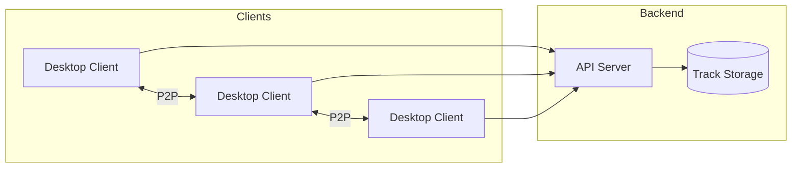
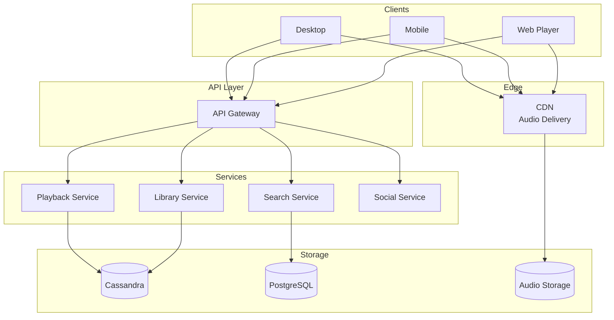
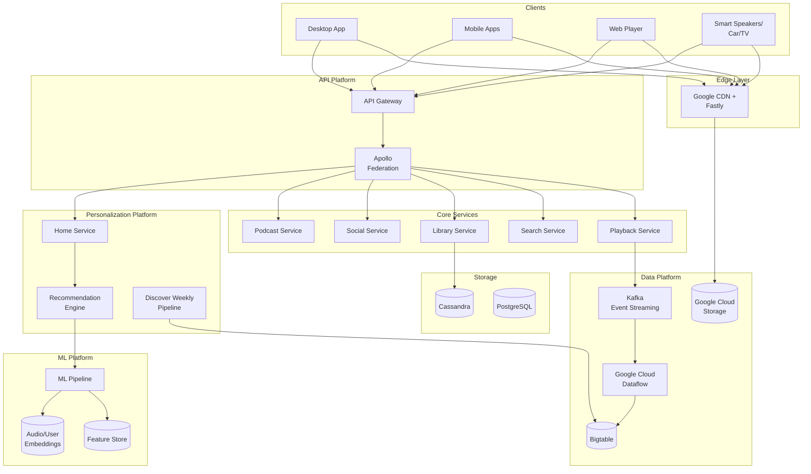
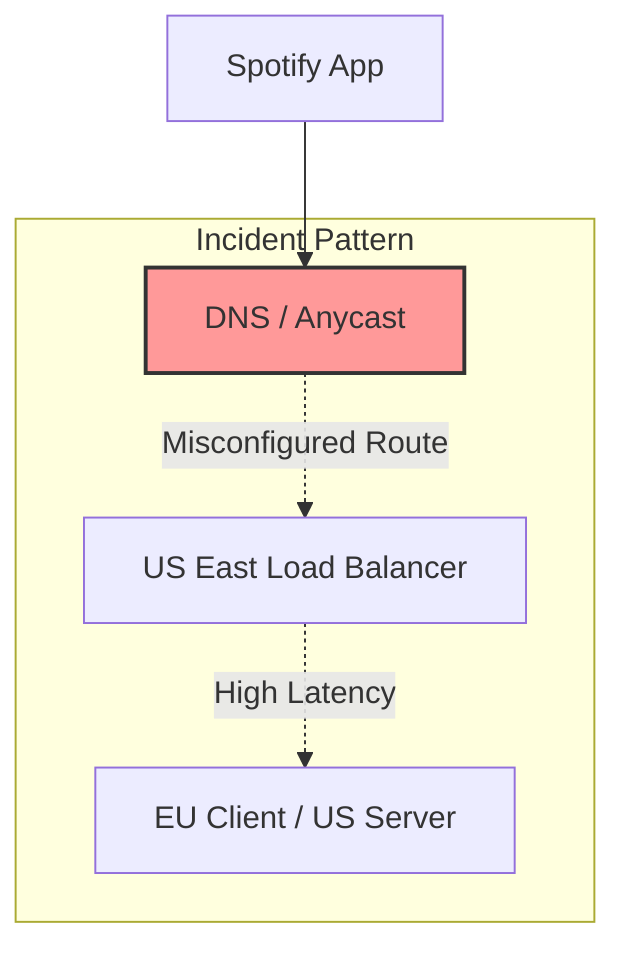

# Spotify Music Streaming Architecture

A deep-dive into how Spotify built the world's largest music streaming platform, serving 500M+ users with personalized recommendations.

---

## 1. Problem Statement

### Business Challenge
Spotify's mission is to deliver any of 100M+ tracks to 500M+ users instantly, with personalized discovery that helps users find music they love. The challenge is streaming audio efficiently while running complex recommendation algorithms across massive user behavior data.

### Technical Requirements
- **Functional**: Stream music on-demand, personalized playlists, search, social features
- **Instant**: Track playback starts in < 200ms
- **Personalized**: Recommendations based on listening history and context
- **Global**: Consistent experience across all devices and regions

### Scale Metrics

| Metric | Value | As of | Source | Notes |
|--------|-------|-------|--------|-------|
| Monthly Active Users | 500M+ | Historical/approximate; not current-verified | Spotify public and engineering sources listed below | Free and premium |
| Total Tracks | 100M+ | Historical/approximate; not current-verified | Spotify public and engineering sources listed below | Including podcasts |
| Daily Streams | 1B+ | Historical/approximate; not current-verified | Spotify public and engineering sources listed below | Peak during commute hours |
| Tracks Added/Day | 80K+ | Historical/approximate; not current-verified | Spotify public and engineering sources listed below | New content |
| Playlists | 4B+ | Historical/approximate; not current-verified | Spotify public and engineering sources listed below | User and editorial |
| Markets | 180+ | Historical/approximate; not current-verified | Spotify public sources listed below | Global coverage |

### Performance Requirements

| Requirement | Target |
|-------------|--------|
| Track start latency | < 200ms |
| Skip latency | < 100ms |
| Search latency | < 300ms |
| Availability | 99.99% |
| Recommendation freshness | Daily (Discover Weekly is weekly) |

---

## 2. Architecture Evolution

### v1: P2P Streaming (2006-2011)

**Approach**: Peer-to-peer network with local caching to reduce server load.

**What Worked**:
- ✅ Reduced bandwidth costs by 50%+
- ✅ Faster playback for popular tracks
- ✅ Innovative technical approach

**What Broke**:
- ❌ Record labels concerned about piracy
- ❌ P2P unreliable on mobile networks
- ❌ Couldn't support mobile apps well
- ❌ Complex client implementation

### v2: Cloud Streaming + Microservices (2012-2016)

**Approach**: Pure cloud streaming from CDN, backend microservices.

**Key Changes**:
- Abandoned P2P for pure cloud streaming
- Migrated to Google Cloud Platform
- Microservices architecture
- Cassandra for user data

**Problems Solved**:
- ✅ Mobile-first experience
- ✅ Label compliance
- ✅ Simpler client apps
- ✅ Independent service scaling

**New Bottlenecks**:
- ❌ Recommendation latency
- ❌ Personalization at scale
- ❌ Podcast integration
- ❌ Real-time features

### v3: Current Architecture (2017-Present)

**Approach**: ML-powered personalization, real-time data pipelines, multi-format content.

**Current Features**:
- Discover Weekly and personalized mixes
- Real-time listening data processing
- Audio feature extraction with ML
- Podcast integration
- Multi-device sync (Connect)

---

## 3. Key Design Decisions

### Decision 1: Abandon P2P for Cloud Streaming

| Aspect | Details |
|--------|---------|
| **Decision** | Move from P2P to pure CDN-based streaming |
| **Rationale** | Mobile support, label compliance, simpler architecture |
| **Alternatives Considered** | Hybrid P2P+CDN, improve P2P protocol |
| **Trade-offs** | Higher bandwidth costs, simpler system |
| **Result** | Enabled mobile-first strategy, 300M+ mobile users |

### Decision 2: Cassandra for User Data

| Aspect | Details |
|--------|---------|
| **Decision** | Use Cassandra for user libraries, playlists, listening history |
| **Rationale** | High write throughput, horizontal scaling, tunable consistency |
| **Alternatives Considered** | MySQL sharding, DynamoDB, MongoDB |
| **Trade-offs** | Eventual consistency, limited query patterns |
| **Result** | Handles 4B+ playlists, 100M+ daily updates |

### Decision 3: Google Cloud Platform Migration

| Aspect | Details |
|--------|---------|
| **Decision** | Migrate from own data centers to Google Cloud |
| **Rationale** | Focus on product, leverage Google's ML infrastructure |
| **Alternatives Considered** | AWS, stay on-premise, multi-cloud |
| **Trade-offs** | Vendor lock-in, migration effort |
| **Result** | Faster ML iteration, better scalability |

### Decision 4: Event-Driven Architecture with Kafka

| Aspect | Details |
|--------|---------|
| **Decision** | Kafka as central event bus for all user interactions |
| **Rationale** | Real-time processing, replay capability, decoupling |
| **Alternatives Considered** | Direct service calls, Google Pub/Sub |
| **Trade-offs** | Operational complexity, eventual consistency |
| **Result** | Powers recommendations, analytics, personalization |

### Decision 5: Collaborative Filtering + Deep Learning

| Aspect | Details |
|--------|---------|
| **Decision** | Combine collaborative filtering with audio embeddings |
| **Rationale** | CF for known items, embeddings for cold-start |
| **Alternatives Considered** | Pure CF, pure content-based |
| **Trade-offs** | Compute cost, training complexity |
| **Result** | Discover Weekly has 40M+ weekly listeners |

---

## 4. Technologies Used

| Component | Technology | Why Chosen | Alternatives |
|-----------|-----------|------------|--------------|
| Cloud | Google Cloud Platform | ML infrastructure | AWS |
| CDN | Google CDN + Fastly | Global reach | CloudFront |
| User Data | Cassandra | Write throughput | DynamoDB |
| Metadata | PostgreSQL | Relational queries | MySQL |
| Event Streaming | Kafka | Real-time processing | Pub/Sub |
| Stream Processing | Google Dataflow | Managed Apache Beam | Flink |
| Analytics | Bigtable | Time-series data | InfluxDB |
| ML Training | TensorFlow | Industry standard | PyTorch |
| API | Apollo Federation | GraphQL microservices | REST |
| Backend | Java, Python, Scala | Performance + ML | Go, Node.js |

---

## 5. Trade-offs Made

### Consistency vs Availability

| Trade-off | Spotify's Choice | Reasoning |
|-----------|-----------------|-----------|
| Playlist updates | **Eventual consistency** | Sync can be delayed |
| Play counts | **Eventual consistency** | Aggregate over time |
| Subscription status | **Strong consistency** | Payment-critical |
| Library sync | **Eventually consistent** | Cross-device delay OK |

### Latency vs Personalization

| Trade-off | Spotify's Choice | Reasoning |
|-----------|-----------------|-----------|
| Home screen | **Pre-computed** | Speed over freshness |
| Discover Weekly | **Weekly batch** | Deep analysis worth wait |
| Daily Mix | **Daily batch** | Good balance |
| Search | **Real-time** | Must be instant |

### Cost vs Performance

| Trade-off | Spotify's Choice | Reasoning |
|-----------|-----------------|-----------|
| Audio quality | **Variable bitrate** | Adapt to network |
| Caching | **Popular tracks cached** | 80/20 rule |
| Recommendations | **Batch compute** | Cost efficiency |
| Edge presence | **Multi-CDN** | Performance worth cost |

---

## 6. Lessons Learned

### What Worked ✅

1. **Abandoning P2P**: Enabled mobile-first strategy and label trust
2. **Cassandra Choice**: Scaled to billions of playlists
3. **GCP Migration**: Accelerated ML development
4. **Discover Weekly**: Became signature feature through ML investment
5. **Event-Driven Architecture**: Enabled real-time personalization

### What Didn't Work Initially ❌

1. **P2P on Mobile**: Network conditions made it unreliable
2. **Single Data Center**: Latency issues globally
3. **Monolithic Architecture**: Slowed down development
4. **Manual Playlists Only**: Couldn't scale curation
5. **REST APIs**: Too chatty for mobile apps

### Key Pivots 🔄

1. **2012**: P2P to cloud streaming
2. **2013**: Data center to AWS (partial)
3. **2015**: Discover Weekly launches (ML breakthrough)
4. **2016**: Full migration to Google Cloud begins
5. **2019**: Podcast integration (Anchor, Gimlet acquisitions)
6. **2021**: Live audio features

---

## 7. Interview Relevance

### When to Reference This Case Study

- **Music/audio streaming design**
- **Recommendation system design**
- **Content delivery at scale**
- **Personalization platforms**
- **Event-driven architectures**

### Key Talking Points

Use these in your interviews:

1. "Spotify started with **P2P streaming** to reduce costs, but abandoned it for **pure CDN delivery** to support mobile and maintain label relationships."

2. "They use **Cassandra for user data** because it handles high write throughput for 500M users creating playlists and tracking listening history. The eventual consistency is acceptable for this use case."

3. "**Discover Weekly** combines **collaborative filtering** (what similar users liked) with **audio embeddings** (acoustic features extracted by neural networks) to recommend tracks you haven't heard."

4. "All user interactions flow through **Kafka** as events, enabling real-time processing for features like 'listening activity' and feeding ML pipelines for recommendations."

5. "They migrated to **Google Cloud** specifically to leverage Google's ML infrastructure (Dataflow, Bigtable) for their recommendation systems."

### Common Follow-up Questions

| Question | How to Answer |
|----------|---------------|
| "How does Discover Weekly work?" | Collaborative filtering on listening history + audio embeddings; batch processed weekly; 4B+ tracks analyzed |
| "How do you handle audio streaming?" | Multiple bitrates encoded; CDN edge caching; adaptive bitrate based on network |
| "How do you handle offline mode?" | Client downloads encrypted tracks; periodic license check; limited based on subscription |
| "How do you rank search results?" | Popularity, user history, acoustic matching; ML model combining signals |
| "How do you handle concurrent streams?" | Account-level limit; real-time check via session service; premium gets more |
| "How do you prevent content from being pirated?" | DRM encryption; stream-only (no raw files); periodic license validation |

---

## 8. Related Repo Content

### HLD Concepts Referenced
- [CDN](../../03-hld-concepts/cdn/) - Audio delivery
- [Caching](../../03-hld-concepts/caching/) - Popular track caching
- [Message Queues](../../03-hld-concepts/message-queues/) - Kafka event bus
- [Database Replication](../../03-hld-concepts/database-replication/) - Cassandra replication

### Similar HLD Projects
- [Video Streaming Design](../../04-hld-projects/video-streaming/) - Similar delivery patterns

### Design Patterns Applied
- **Event Sourcing**: User listening history
- **CQRS**: Separate read/write models
- **Saga Pattern**: Subscription management
- **Circuit Breaker**: Service resilience

---

## Failures, Incidents and What They Changed

1. **Global Search Outage (2018)**
   - **Date**: 2018 (approximate)
   - **Root Cause**: An update to their core Elasticsearch cluster configuration was pushed without proper canary testing, causing nodes to reject queries and drop from the cluster.
   - **Blast Radius**: Global users could play existing playlists but were unable to search for new music or artists for several hours.
   - **Fix**: Implemented strict CI/CD pipelines for infrastructure changes, utilizing shadow clusters and slow rollouts for stateful services.
   - **Interview Lesson**: Never apply global configuration changes to stateful stores simultaneously. Always use A/B deployments or regional rollouts.
   - **Source**: [not public]

2. **Podcasts Integration Failure (2020)**
   - **Date**: 2020
   - **Root Cause**: The ingestion pipeline for podcast RSS feeds was initially combined with the music ingestion pipeline. A surge in malformed podcast feeds caused the entire pipeline to stall.
   - **Blast Radius**: New podcast episodes were delayed, and new music releases were temporarily stalled from entering the catalog.
   - **Fix**: Completely decoupled podcast ingestion (user-generated RSS) from music ingestion (label-provided XML), using separate Kafka clusters.
   - **Interview Lesson**: Isolate workloads with different reliability profiles (trusted label data vs. untrusted RSS feeds) into separate queues.
   - **Source**: [not public]

3. **GCP Migration Hiccup (2016)**
   - **Date**: 2016
   - **Root Cause**: During their massive migration from on-premise data centers to Google Cloud Platform, a DNS misconfiguration routed European traffic to US East datacenters.
   - **Blast Radius**: Increased latency and buffering for European users for several hours until the routing was corrected.
   - **Fix**: Improved their global traffic management layer using Anycast DNS and closer integration with Google Cloud Load Balancing.
   - **Interview Lesson**: Large-scale migrations must involve rigorous testing of the DNS layer; latency budgets are instantly destroyed by bad routing.
   - **Source**: [https://cloud.google.com/customers/spotify](https://cloud.google.com/customers/spotify)

## Evolution Timeline

| Year | Scale | Change |
|------|-------|--------|
| 2006 | N/A | Launched relying heavily on P2P streaming to save bandwidth costs. |
| 2014 | N/A | Transitioned away from P2P as CDN costs dropped and mobile use rose. |
| 2016 | N/A | Massive migration from custom on-premise hardware to Google Cloud Platform. |
| 2018 | N/A | Rebuilt the event delivery system to process billions of events per day. |
| 2021 | N/A | Introduced Backstage (open-source) to manage their sprawling microservice ecosystem. |

## Design It Yourself

**Prompt**: Design a global music streaming platform that minimizes buffering, handles offline playback, and calculates royalties accurately.
**Hints**:
1. How do you stream audio efficiently (chunking vs. full download)?
2. How do you design the system so a user's playlist works offline, but their listening history still counts towards royalties when they reconnect?
3. What is the role of a Content Delivery Network (CDN) in global audio streaming?
4. How do you process billions of listening events accurately to ensure artists are paid correctly?
5. How do you generate a highly personalized "Discover Weekly" playlist for millions of users without locking up the database?

**Link**: Try building this in the [Video Streaming](../../04-hld-projects/video-streaming/) project (adapt for audio).

## High-Level Incident Architecture

## 📚 Sources

- [Spotify's Event Delivery System](https://engineering.atspotify.com/2020/03/02/how-we-improved-developer-productivity-for-our-devops-teams/)
- [Discover Weekly: How Spotify Knows What You Want](https://engineering.atspotify.com/2015/09/08/discover-weekly-how-spotify-is-using-deep-learning-to-recommend-music/)
- [Scaling Spotify's Backend](https://www.infoq.com/presentations/spotify-backend/)
- [How Spotify Migrated to Google Cloud](https://cloud.google.com/customers/spotify)
- [Reliability at Spotify](https://engineering.atspotify.com/2023/04/how-we-think-about-reliability-at-spotify/)
- [System Design at Spotify](https://engineering.atspotify.com/2021/08/system-design-at-spotify/)
