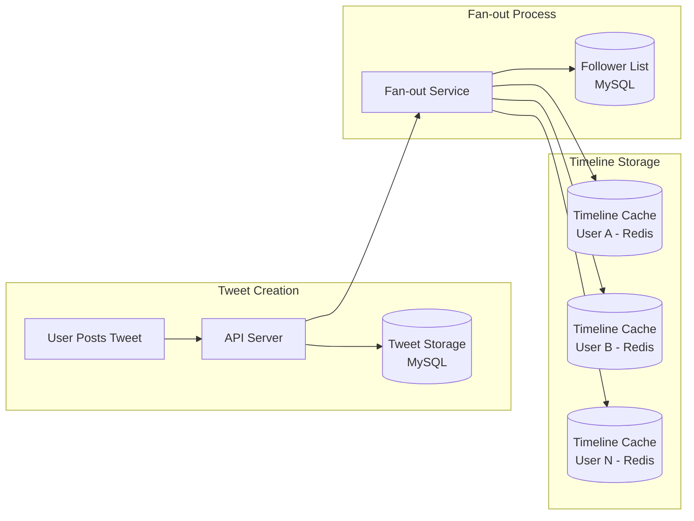
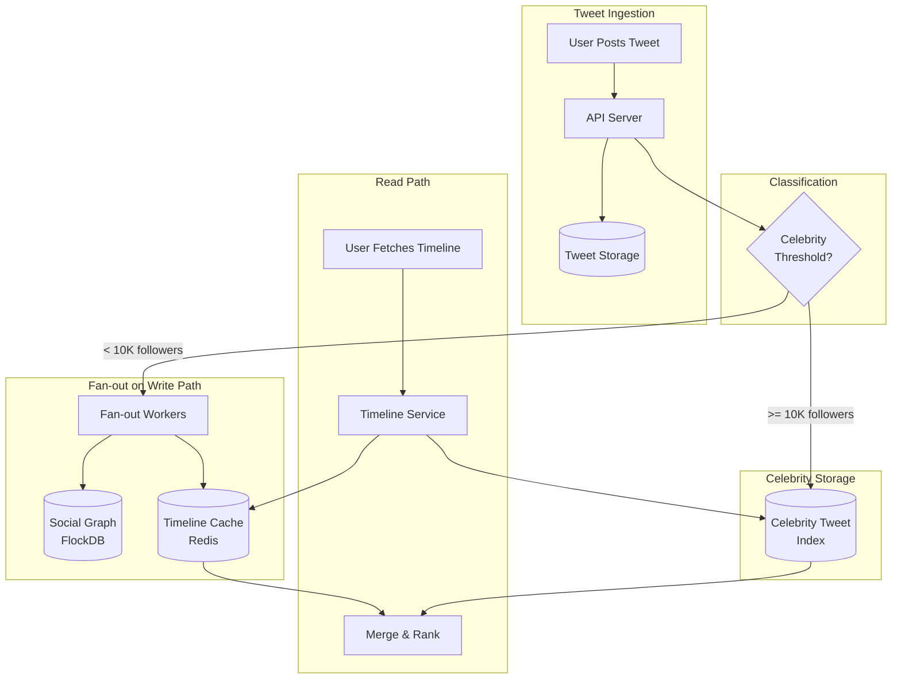
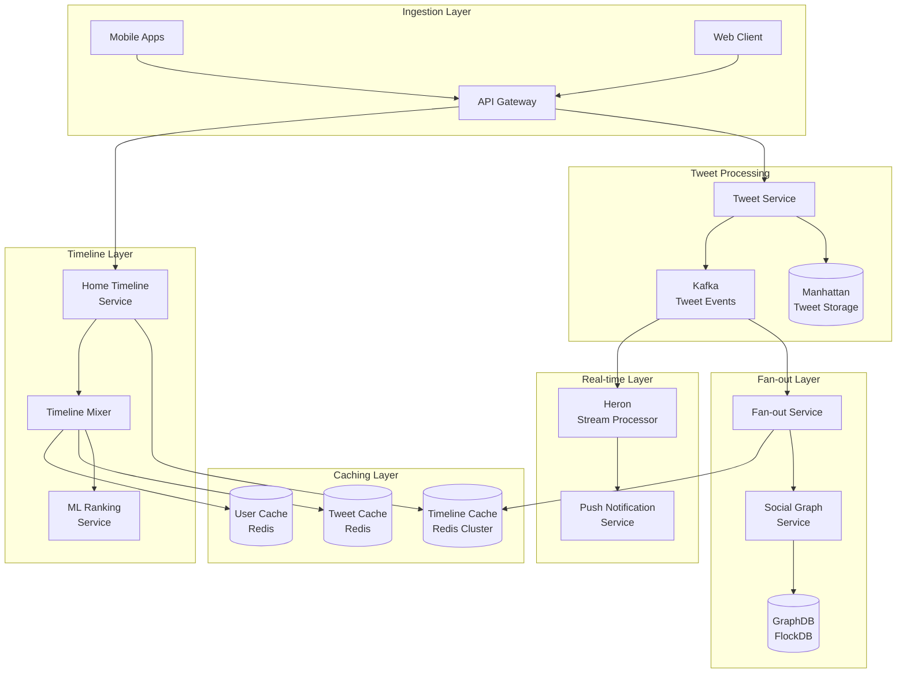
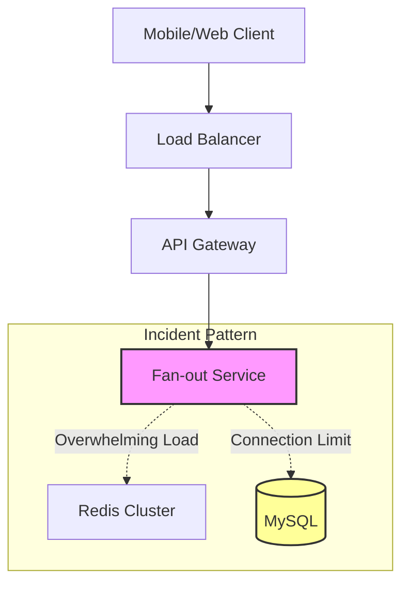

# Twitter Timeline Architecture

A deep-dive into how Twitter built and evolved their timeline system to serve 500M+ users.

---

## 1. Problem Statement

### Business Challenge
Twitter's core product is the home timeline - a personalized feed of tweets from accounts a user follows. The challenge is delivering this timeline in real-time to hundreds of millions of users, including handling "celebrity" accounts with millions of followers.

### Technical Requirements
- **Functional**: Display chronological (later, ranked) timeline of tweets from followed accounts
- **Real-time**: New tweets appear within seconds
- **Personalized**: Each user sees their unique timeline
- **Reliable**: No lost tweets, high availability

### Scale Metrics

| Metric | Value | As of | Source | Notes |
|--------|-------|-------|--------|-------|
| Monthly Active Users | 500M+ | 2023 historical baseline; not current-verified | Twitter/X public and engineering sources listed below | Former MAU-style public baseline |
| Daily Active Users | 250M+ | 2023 historical estimate; not current-verified | Twitter/X public and engineering sources listed below | ~50% DAU/MAU ratio |
| Tweets per day | 500M+ | Historical/approximate; not current-verified | Twitter/X engineering and public sources listed below | ~6,000 tweets/second average |
| Peak tweets/second | 143,000+ | Historical event benchmark; not current-verified | Twitter/X engineering and conference sources listed below | During major events such as World Cup or elections |
| Average followers | 700 | Historical/approximate; not current-verified | Twitter/X public and engineering sources listed below | Median is much lower (~50) |
| Celebrity followers | 100M+ | Historical/approximate; not current-verified | Twitter/X public sources listed below | Large celebrity or public-figure accounts |

### Performance Requirements

| Requirement | Target |
|-------------|--------|
| Timeline fetch latency | < 200ms (p99) |
| Tweet delivery time | < 5 seconds |
| Availability | 99.99% |
| Timeline length | ~800 tweets cached |

---

## 2. Architecture Evolution

### v1: Simple Fan-out on Write (2006-2010)

**Approach**: When a user tweets, immediately push that tweet to all followers' timelines (stored in Redis).

**What Worked**:
- ✅ Fast timeline reads (pre-computed, O(1) lookup)
- ✅ Simple read path
- ✅ Low latency for most users

**What Broke**:
- ❌ **"Lady Gaga Problem"**: Celebrities with 50M+ followers caused massive write amplification (when one write triggers many additional writes—in this case, one tweet required 50M cache updates)
- ❌ A single tweet from a celebrity = 50M Redis writes
- ❌ Tweet delivery could take minutes for celebrity posts
- ❌ Infrastructure costs exploded

### v2: Hybrid Fan-out (2012-2016)

**Approach**: Use fan-out on write for normal users, fan-out on read for celebrities.

**Key Changes**:
- Celebrity threshold: ~10K followers (configurable)
- Introduced FlockDB for social graph
- Added timeline mixing service
- Moved from MySQL to custom storage

**Problems Solved**:
- ✅ Celebrity tweets no longer cause write storms
- ✅ Reduced infrastructure costs by 80%+
- ✅ More predictable latencies

**New Bottlenecks**:
- ❌ Read path complexity increased
- ❌ Timeline mixing adds latency
- ❌ Cold start problem for new users

### v3: Current Architecture (2017-Present)

**Approach**: Hybrid fan-out + ML ranking + real-time stream processing with Kafka.

**Current Features**:
- Real-time stream processing with Heron (successor to Storm)
- ML-based ranking (not just chronological)
- Global Redis cluster with 100s of nodes
- Manhattan: Twitter's custom distributed database
- GraphQL API layer

---

## 3. Key Design Decisions

### Decision 1: Hybrid Fan-out Strategy

| Aspect | Details |
|--------|---------|
| **Decision** | Fan-out on write for users < 10K followers; fan-out on read for celebrities |
| **Rationale** | Balance write amplification cost with read latency |
| **Alternatives Considered** | Pure fan-out on write, pure fan-out on read, tiered caching |
| **Trade-offs** | Increased read complexity, slightly higher read latency |
| **Result** | 80%+ reduction in infrastructure costs while maintaining low latency |

### Decision 2: Redis for Timeline Storage

| Aspect | Details |
|--------|---------|
| **Decision** | Store pre-computed timelines in Redis sorted sets |
| **Rationale** | Sub-millisecond reads, natural ordering, range queries |
| **Alternatives Considered** | Memcached (no data structures), MySQL (too slow), Cassandra (eventual consistency) |
| **Trade-offs** | Higher memory cost, data loss on failure (acceptable with fan-out rebuild) |
| **Result** | p99 latency < 5ms for cached timeline fetches |

### Decision 3: Manhattan over Cassandra

| Aspect | Details |
|--------|---------|
| **Decision** | Build custom distributed database (Manhattan) instead of using Cassandra |
| **Rationale** | Need for multi-tenancy, better consistency guarantees, custom features |
| **Alternatives Considered** | Cassandra, HBase, MySQL shards |
| **Trade-offs** | High engineering investment, operational overhead |
| **Result** | Powers tweets, user data, DMs; handles 100s of millions of QPS |

### Decision 4: Kafka for Event Streaming

| Aspect | Details |
|--------|---------|
| **Decision** | Use Kafka as the central event bus for all tweet events |
| **Rationale** | Decoupling, replay capability, multiple consumers |
| **Alternatives Considered** | RabbitMQ (less scalable), direct RPC (tight coupling) |
| **Trade-offs** | Added latency (few ms), operational complexity |
| **Result** | Powers real-time features, analytics, and fan-out |

### Decision 5: ML Ranking over Chronological

| Aspect | Details |
|--------|---------|
| **Decision** | Replace chronological timeline with ML-ranked "For You" feed |
| **Rationale** | Increase engagement, surface relevant content |
| **Alternatives Considered** | Keep chronological only, simple heuristics |
| **Trade-offs** | User backlash, increased complexity, compute cost |
| **Result** | Significant increase in engagement metrics (controversial among users) |

---

## 4. Technologies Used

| Component | Technology | Why Chosen | Alternatives |
|-----------|-----------|------------|--------------|
| Timeline Cache | Redis Cluster | Sub-ms latency, sorted sets | Memcached |
| Tweet Storage | Manhattan | Custom needs, multi-tenancy | Cassandra, HBase |
| Social Graph | FlockDB | Optimized for graph operations | Neo4j, MySQL |
| Message Queue | Kafka | Durability, replay, scale | RabbitMQ, Pulsar |
| Stream Processing | Heron | Low latency, exactly-once | Storm, Flink |
| API Gateway | Finagle | Scala-native, Twitter-built | nginx, Envoy |
| Service Mesh | TwitterServer | Custom monitoring, tracing | Istio, Linkerd |
| Search | Earlybird | Real-time search, custom | Elasticsearch |
| ML Ranking | Cortex | In-house ML platform | TensorFlow Serving |
| CDN | Own + Akamai | Hybrid approach | CloudFront, Fastly |

---

## 5. Trade-offs Made

### Consistency vs Availability

| Trade-off | Twitter's Choice | Reasoning |
|-----------|-----------------|-----------|
| Timeline consistency | **Eventual consistency** | Missing a tweet for a few seconds is acceptable |
| Tweet storage | **Strong consistency** | Tweets must not be lost |
| Like/RT counts | **Eventual consistency** | Approximate counts are fine |
| Following graph | **Strong consistency** | Must be accurate for fan-out |

### Latency vs Completeness

| Trade-off | Twitter's Choice | Reasoning |
|-----------|-----------------|-----------|
| Timeline fetch | **Speed over completeness** | Return cached data, merge async |
| Celebrity tweets | **Delay for cost savings** | Accept slight delay in celebrity tweet delivery |
| ML ranking | **Pre-compute where possible** | Accept stale rankings for speed |

### Cost vs Performance

| Trade-off | Twitter's Choice | Reasoning |
|-----------|-----------------|-----------|
| Fan-out strategy | **Hybrid** | Balance cost of writes vs reads |
| Redis memory | **Keep hot data only** | 800 tweets cached, older from disk |
| Global redundancy | **Multi-region** | Pay for redundancy for availability |

### Simplicity vs Optimization

| Trade-off | Twitter's Choice | Reasoning |
|-----------|-----------------|-----------|
| Storage | **Custom (Manhattan)** | Optimization worth complexity |
| Social graph | **Custom (FlockDB)** | Standard DBs couldn't handle scale |
| Streaming | **Custom (Heron)** | Better performance than Storm |

---

## 6. Lessons Learned

### What Worked ✅

1. **Hybrid Fan-out Strategy**: The celebrity threshold approach effectively balanced costs and latency
2. **Redis for Hot Data**: Pre-computed timelines in Redis provided excellent read performance
3. **Kafka as Event Backbone**: Decoupling through events enabled independent scaling
4. **Incremental Migration**: Moving from MySQL to Manhattan gradually reduced risk
5. **Investing in Observability**: Custom monitoring enabled rapid debugging

### What Didn't Work Initially ❌

1. **Pure Fan-out on Write**: Couldn't handle celebrity accounts at all
2. **MySQL for Everything**: Hit scaling limits quickly
3. **Monolithic Architecture**: Couldn't deploy or scale independently
4. **Ruby on Rails**: Performance limitations led to Scala/JVM migration
5. **Third-party Solutions**: Off-the-shelf tools didn't meet Twitter's unique needs

### Key Pivots 🔄

1. **2010**: Ruby to JVM migration (Scala + Java)
2. **2012**: Fan-out on write to hybrid approach
3. **2013**: MySQL to Manhattan migration begins
4. **2015**: Storm to Heron for stream processing
5. **2016**: Chronological to algorithmic timeline
6. **2020**: Continued ML investment for "For You" feed

---

## 7. Interview Relevance

### When to Reference This Case Study

- **News feed design questions** (Facebook, Twitter, LinkedIn)
- **Social network timelines**
- **Fan-out strategy discussions**
- **Celebrity/influencer handling**
- **Real-time systems**

### Key Talking Points

Use these in your interviews:

1. "Twitter uses a **hybrid fan-out approach** - fan-out on write for normal users to achieve low read latency, but fan-out on read for celebrities to avoid write amplification. The threshold is around 10K followers."

2. "They store pre-computed timelines in **Redis sorted sets** with about 800 tweets per user. The score is the timestamp, enabling efficient range queries for pagination."

3. "The 'Lady Gaga problem' is a classic example of **write amplification** - a celebrity with 50M followers would require 50M cache writes per tweet, which was unsustainable."

4. "Twitter moved from **purely chronological to ML-ranked feeds** to increase engagement, which required building real-time feature pipelines and ranking infrastructure."

5. "They built **Manhattan** (their own distributed database) because Cassandra couldn't meet their consistency and multi-tenancy requirements at scale."

### Common Follow-up Questions

| Question | How to Answer |
|----------|---------------|
| "How would you handle a user with 100M followers?" | Explain fan-out on read, celebrity detection threshold, async delivery |
| "How do you decide the celebrity threshold?" | Cost analysis - when write cost > read cost, switch to read fan-out |
| "How do you handle real-time updates?" | WebSocket connections, long polling fallback, push notifications |
| "How do you ensure no tweets are lost?" | Persistent queue (Kafka), retry logic, monitoring |
| "How would you add retweets to this design?" | Retweet = new tweet with reference, same fan-out logic applies |
| "How do you handle timeline ranking?" | ML models, pre-compute features, blend in real-time |

---

## 8. Related Repo Content

### HLD Concepts Referenced
- [Load Balancing](../../03-hld-concepts/load-balancing/) - API gateway distribution
- [Caching](../../03-hld-concepts/caching/) - Redis cache strategies
- [Message Queues](../../03-hld-concepts/message-queues/) - Kafka patterns
- [Database Sharding](../../03-hld-concepts/database-sharding/) - Manhattan partitioning

### Similar HLD Projects
- [News Feed / Timeline System](../../04-hld-projects/news-feed/)
- [Social Post Search System](../../04-hld-projects/social-post-search/)

### Design Patterns Applied
- **Observer Pattern**: Fan-out to followers
- **Strategy Pattern**: Different fan-out strategies for different user types
- **Queue-based Load Leveling**: Kafka for async processing

---

## 📚 Sources

- [Twitter Engineering Blog: "The Infrastructure Behind Twitter Scale"](https://blog.twitter.com/engineering)
- [QCon: "Timelines at Scale" by Raffi Krikorian](https://www.infoq.com/presentations/Twitter-Timeline-Scalability/)
- [High Scalability: "How Twitter Handles 3,000 Images Per Second"](http://highscalability.com/)
- [InfoQ: "Twitter's Heron"](https://www.infoq.com/articles/twitter-heron/)

## Failures, Incidents and What They Changed

1. **Justin Bieber Effect (2010)**
   - **Date**: 2010 (Multiple)
   - **Root Cause**: High fan-out load when Justin Bieber tweeted, overwhelming the MySQL replica databases trying to insert tweets into millions of follower timelines synchronously.
   - **Blast Radius**: Global platform slowdowns and "Fail Whale" errors for all users during peak load.
   - **Fix**: Migration to asynchronous fan-out queues and caching timeline structures in Redis (Project Snowflake era).
   - **Interview Lesson**: Use asynchronous workers for fan-out on write to handle celebrity users, or switch to fan-out on read (pull) for massive followers.
   - **Source**: [https://techcrunch.com/2010/09/07/justin-bieber-twitter/](https://techcrunch.com/2010/09/07/justin-bieber-twitter/)

2. **World Cup 2014 Outages**
   - **Date**: July 2014
   - **Root Cause**: Record-breaking Tweets Per Second (TPS) during the World Cup matches exceeded connection pool limits and Redis memory caps.
   - **Blast Radius**: Temporary unavailability of timelines during critical match moments.
   - **Fix**: Optimizing the connection pooling layer, rewriting Ruby core to Scala/JVM for better concurrency, and expanding Redis clusters.
   - **Interview Lesson**: Understand connection limits and memory constraints when dealing with predictable spike events.
   - **Source**: [https://blog.twitter.com/engineering/en_us/a/2014/building-a-distributed-log-for-twitter](https://blog.twitter.com/engineering/en_us/a/2014/building-a-distributed-log-for-twitter)

3. **Data Center Failover Bug**
   - **Date**: 2016
   - **Root Cause**: A misconfiguration during a routine data center failover test caused cascading timeouts across microservices.
   - **Blast Radius**: Brief global outage where timelines failed to load for many regions.
   - **Fix**: Implementing strict circuit breaking at the Finagle RPC layer and ensuring graceful degradation (serving cached timelines instead of failing).
   - **Interview Lesson**: Microservice architectures require strong circuit breakers and fallback mechanisms to prevent cascading failures.
   - **Source**: [not public]

## Evolution Timeline

| Year | Scale | Change |
|------|-------|--------|
| 2006 | Thousands of users | Monolithic Ruby on Rails application, single MySQL database. |
| 2010 | 100M+ users | Moved to asynchronous fan-out, introduced Redis for timeline caching, extracted Core Services in JVM. |
| 2014 | 250M+ users | Microservices architecture (Finagle), specialized graph storage (Flock), scalable datastores (Manhattan). |
| 2018 | 330M+ users | Migration to Google Cloud Platform, heavy reliance on machine learning for algorithmic timelines. |
| 2022 | 400M+ users | Consolidation of services, optimization of ML ranking pipelines, extensive GraphQL usage. |

## Design It Yourself

**Prompt**: Design a system that allows users to post short messages and view a timeline of messages from users they follow. The system must support real-time delivery and handle celebrity accounts with millions of followers.
**Hints**:
1. How do you store the follower graph efficiently?
2. Should you generate the timeline when a user requests it, or pre-compute it?
3. What happens when a user with 50 million followers posts a message?
4. How do you handle pagination in a constantly updating timeline?
5. How can you cache the timeline to reduce database load?

**Link**: Try building this in the [News Feed](../../04-hld-projects/news-feed/) project.

## High-Level Incident Architecture

## Deep Dive: Evolution of Caching Strategies
In the early days, Twitter faced significant challenges with database load due to the sheer volume of read operations required to generate timelines on the fly. This led to the adoption of memory caches, initially Memcached and later Redis.
Redis enabled Twitter to store pre-computed timelines (arrays of tweet IDs) directly in memory, drastically reducing read latency. However, as the user base expanded, managing Redis memory limits became a bottleneck. The engineering team implemented techniques like limiting the timeline cache to a fixed number of recent tweets (e.g., 800) per active user, falling back to database queries for older data or inactive users. This hybrid approach balanced memory costs with performance.

This hybrid caching mechanism, carefully tuned to balance read amplification and memory constraints, became a foundational pattern for handling fan-out read models across the social media industry.
