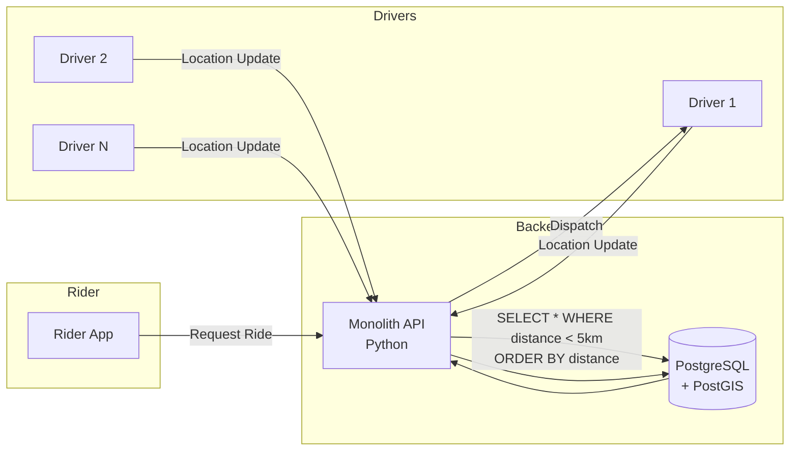
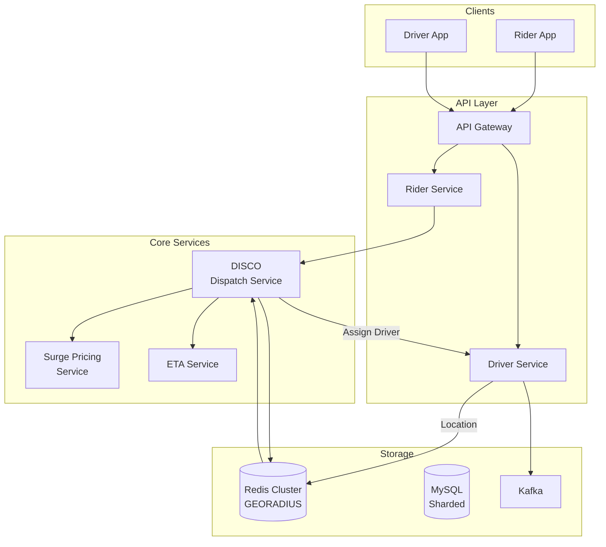
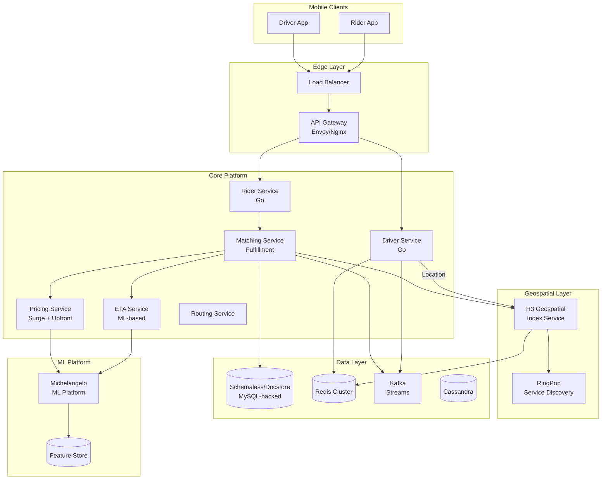
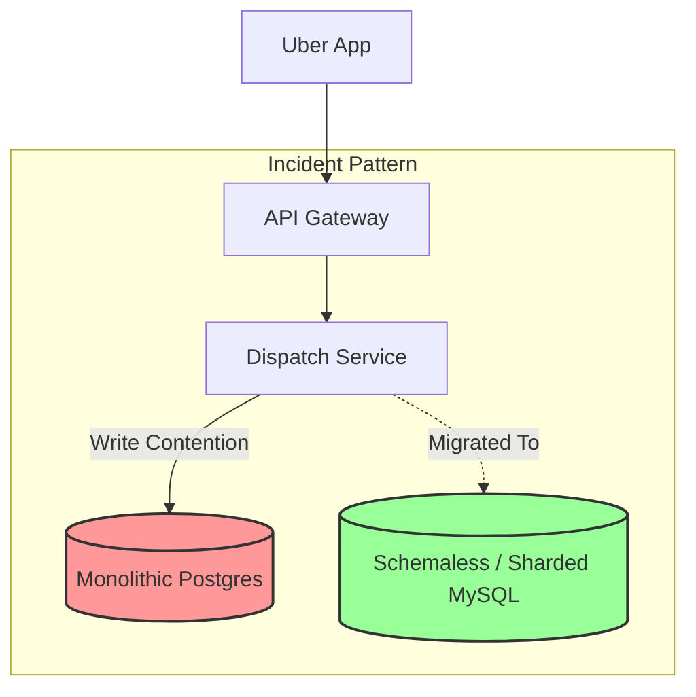

# Uber Real-time Matching Architecture

A deep-dive into how Uber built their real-time driver-rider matching system to handle 100M+ rides per month.

---

## 1. Problem Statement

### Business Challenge
Uber's core business is matching riders with nearby drivers in real-time. The challenge is finding the best driver for each ride request within seconds, considering location, traffic, driver availability, and pricing—at massive global scale.

### Technical Requirements
- **Functional**: Match riders with optimal nearby drivers, real-time tracking
- **Real-time**: Match within 3 seconds of request
- **Accurate**: Precise location tracking, accurate ETAs
- **Fair**: Optimal matching for both riders and drivers

### Scale Metrics

| Metric | Value | As of | Source | Notes |
|--------|-------|-------|--------|-------|
| Monthly Rides | 100M+ | 2023 historical baseline; not current-verified | Uber public and engineering sources listed below | Global ride volume |
| Active Drivers | 5M+ | Historical/approximate; not current-verified | Uber public and engineering sources listed below | Across 10,000+ cities |
| Location Updates | 10M/second | Historical/approximate; not current-verified | Uber Engineering sources listed below | From active drivers |
| Peak Ride Requests | 1M+/minute | Historical/approximate; not current-verified | Uber Engineering and conference sources listed below | In major cities |
| Countries | 70+ | Historical/approximate; not current-verified | Uber public sources listed below | Global coverage |
| Cities | 10,000+ | Historical/approximate; not current-verified | Uber public sources listed below | Metropolitan areas |

### Performance Requirements

| Requirement | Target |
|-------------|--------|
| Match latency | < 3 seconds |
| Location accuracy | < 10 meters |
| ETA accuracy | ±20% |
| System availability | 99.99% |
| Location update frequency | Every 4 seconds |

---

## 2. Architecture Evolution

### v1: Simple Nearest Driver (2010-2012)

**Approach**: Store driver locations in PostgreSQL, find nearest driver with SQL query.

**What Worked**:
- ✅ Simple to implement and understand
- ✅ PostGIS handled geospatial queries
- ✅ Worked for single city (San Francisco)

**What Broke**:
- ❌ PostgreSQL couldn't handle write load (millions of location updates)
- ❌ Query latency increased with driver count
- ❌ Single database became bottleneck
- ❌ No real-time tracking capability

### v2: Redis Geospatial + DISCO (2013-2016)

**Approach**: Use Redis GEORADIUS for fast geospatial queries, build dispatch service (DISCO).

**Key Changes**:
- Redis GEORADIUS for sub-millisecond geospatial queries
- Dedicated dispatch service (DISCO)
- Introduced surge pricing
- Microservices architecture (Node.js)

**Problems Solved**:
- ✅ Sub-second location queries
- ✅ Horizontal scaling with Redis cluster
- ✅ Decoupled services for independent scaling
- ✅ Real-time driver tracking

**New Bottlenecks**:
- ❌ Redis memory limits for global scale
- ❌ Cross-region latency
- ❌ Complex multi-city routing
- ❌ ETA accuracy in traffic

### v3: Current Architecture - H3 + Schemaless (2017-Present)

**Approach**: Custom geospatial indexing with H3, proprietary database (Schemaless/Docstore), ML-based matching.

**Current Features**:
- H3 hexagonal grid for geospatial indexing
- ML-based matching optimization
- Real-time pricing and surge algorithms
- Global multi-region deployment
- Sub-second matching at scale

---

## 3. Key Design Decisions

### Decision 1: H3 Hexagonal Grid System

| Aspect | Details |
|--------|---------|
| **Decision** | Use H3 hexagonal grid (open-sourced by Uber) for geospatial indexing |
| **Rationale** | Equal-area cells, no edge distortion, efficient neighbor queries |
| **Alternatives Considered** | Quadtree, geohash, S2 cells (Google) |
| **Trade-offs** | Custom implementation, learning curve |
| **Result** | Efficient multi-resolution indexing, open-sourced as library |

### Decision 2: Go for Core Services

| Aspect | Details |
|--------|---------|
| **Decision** | Migrate from Node.js/Python to Go for critical services |
| **Rationale** | Better concurrency, lower latency, stronger typing |
| **Alternatives Considered** | Java (verbose), Rust (learning curve), stay with Node.js |
| **Trade-offs** | Migration cost, retraining engineers |
| **Result** | 10x improvement in service latency, better resource utilization |

### Decision 3: Schemaless Database

| Aspect | Details |
|--------|---------|
| **Decision** | Build Schemaless (later Docstore) on top of MySQL instead of using NoSQL |
| **Rationale** | Operational familiarity with MySQL, schema flexibility needed |
| **Alternatives Considered** | Cassandra, DynamoDB, MongoDB |
| **Trade-offs** | Engineering investment, MySQL limitations |
| **Result** | Powers trip data, maintains MySQL ecosystem |

### Decision 4: RingPop for Service Discovery

| Aspect | Details |
|--------|---------|
| **Decision** | Build RingPop (SWIM gossip protocol) for service discovery |
| **Rationale** | Consistent hashing for stateful services, fast failure detection |
| **Alternatives Considered** | Consul, ZooKeeper, Eureka |
| **Trade-offs** | Custom solution maintenance |
| **Result** | Sub-second failure detection, efficient routing |

### Decision 5: ML-Powered Matching (Fulfillment)

| Aspect | Details |
|--------|---------|
| **Decision** | Use ML models for matching optimization instead of simple nearest-driver |
| **Rationale** | Optimize for system efficiency, not just proximity |
| **Alternatives Considered** | Simple distance-based, manual rules |
| **Trade-offs** | Complexity, training data requirements |
| **Result** | Reduced wait times, better driver utilization |

---

## 4. Technologies Used

| Component | Technology | Why Chosen | Alternatives |
|-----------|-----------|------------|--------------|
| Geospatial Index | H3 | Equal-area hexagons, Uber-built | Geohash, S2 |
| Primary Language | Go | Concurrency, performance | Java, Node.js |
| Caching | Redis Cluster | GEORADIUS, speed | Memcached |
| Database | Schemaless/Docstore | Schema flexibility on MySQL | Cassandra, MongoDB |
| Message Queue | Kafka | Durability, replay | RabbitMQ, Pulsar |
| Service Discovery | RingPop | SWIM protocol, fast | Consul, ZooKeeper |
| ML Platform | Michelangelo | End-to-end ML | Kubeflow, SageMaker |
| API Gateway | NGINX/Envoy | Performance, flexibility | Kong, Traefik |
| Maps/Routing | Proprietary + OSM | Accuracy, control | Google Maps |
| Time-series | M3 | High write throughput | InfluxDB, TimescaleDB |

---

## 5. Trade-offs Made

### Consistency vs Availability

| Trade-off | Uber's Choice | Reasoning |
|-----------|---------------|-----------|
| Driver location | **Eventual consistency** | Slightly stale OK for matching |
| Trip state | **Strong consistency** | Must be accurate for billing |
| Surge pricing | **Eventual consistency** | Some delay acceptable |
| Payment | **Strong consistency** | Financial accuracy required |

### Latency vs Accuracy

| Trade-off | Uber's Choice | Reasoning |
|-----------|---------------|-----------|
| ETA calculation | **Fast with approximation** | Quick estimate, refine later |
| Matching | **Good enough, fast** | Don't wait for optimal match |
| Routing | **Cache common routes** | Speed over perfect accuracy |
| Surge zones | **Approximate boundaries** | Fast calculation is priority |

### Build vs Buy

| Trade-off | Uber's Choice | Reasoning |
|-----------|---------------|-----------|
| Geospatial (H3) | **Build** | Core competency, unique needs |
| Database (Schemaless) | **Build** | Scale + MySQL familiarity |
| Maps | **Build** | Control, cost at scale |
| Service Mesh | **Build (RingPop)** | Performance requirements |
| Cloud | **Buy (multi-cloud)** | Not core competency |

### Simplicity vs Performance

| Trade-off | Uber's Choice | Reasoning |
|-----------|---------------|-----------|
| Language | **Go over Python** | Performance worth complexity |
| Architecture | **Microservices** | Scale over simplicity |
| Data model | **Denormalized** | Read speed over normalization |
| Caching | **Multi-layer** | Performance over simplicity |

---

## 6. Lessons Learned

### What Worked ✅

1. **H3 Geospatial System**: Efficient hexagonal grid became industry standard (open-sourced)
2. **Go Migration**: Significant performance improvements across the stack
3. **RingPop**: Fast failure detection critical for real-time systems
4. **Microservices Early**: Enabled rapid scaling and team autonomy
5. **ML for Matching**: Improved both rider and driver experience

### What Didn't Work Initially ❌

1. **PostgreSQL for Location**: Couldn't handle real-time update volume
2. **Simple Nearest Driver**: Didn't optimize for overall system efficiency
3. **Monolith Architecture**: Became deployment bottleneck quickly
4. **Third-party Maps**: Cost and accuracy issues at scale
5. **Node.js for Everything**: Performance limitations for core services

### Key Pivots 🔄

1. **2013**: PostgreSQL to Redis for location storage
2. **2014**: Monolith to microservices
3. **2015**: Introduced surge pricing algorithms
4. **2016**: Node.js to Go migration
5. **2017**: H3 geospatial system launched
6. **2018**: ML-based matching (Fulfillment) deployed
7. **2020**: Multi-cloud architecture fully operational

---

## 7. Interview Relevance

### When to Reference This Case Study

- **Location-based services** (Lyft, DoorDash, Instacart)
- **Real-time matching systems**
- **Geospatial indexing questions**
- **Ride-sharing/delivery platforms**
- **High-throughput location tracking**

### Key Talking Points

Use these in your interviews:

1. "Uber uses **H3**, a hexagonal hierarchical geospatial index they developed and open-sourced. Hexagons provide approximately equal-area cells and consistent neighbor relationships (always 6 neighbors), unlike rectangular grids."

2. "They process **10M+ location updates per second** using Redis GEORADIUS for fast proximity queries, with H3 for hierarchical spatial indexing."

3. "The matching system evolved from **simple nearest-driver to ML-optimized matching** that considers driver heading, ETA, surge, and overall system efficiency—not just distance."

4. "They use **RingPop** (SWIM gossip protocol) for service discovery with sub-second failure detection, critical for maintaining accurate driver availability."

5. "Uber built **Schemaless** (now Docstore) on top of MySQL because they wanted schema flexibility but preferred MySQL's operational characteristics over pure NoSQL."

### Common Follow-up Questions

| Question | How to Answer |
|----------|---------------|
| "How do you find nearby drivers efficiently?" | H3 hexagonal cells, Redis GEORADIUS, query cells + neighbors |
| "Why hexagons instead of squares?" | Equal area, consistent neighbors (6 always), no corner distortion |
| "How do you handle driver movement during matching?" | Short timeout, re-query if declined, optimistic matching |
| "How does surge pricing work?" | Supply/demand per H3 cell, ML models, real-time adjustment |
| "How do you ensure drivers get the request?" | Push notification + poll, exponential backoff retry |
| "How do you calculate accurate ETAs?" | ML models trained on historical trips, traffic data, real-time |

---

## 8. Related Repo Content

### HLD Concepts Referenced
- [Load Balancing](../../03-hld-concepts/load-balancing/) - Request distribution
- [Consistent Hashing](../../03-hld-concepts/consistent-hashing/) - RingPop routing
- [Message Queues](../../03-hld-concepts/message-queues/) - Kafka for events
- [Database Sharding](../../03-hld-concepts/database-sharding/) - Schemaless partitioning

### Similar HLD Projects
- [Ride Sharing Backend System](../../04-hld-projects/ride-sharing/)
- [Nearby Friends](../../04-hld-projects/nearby-friends/)
- [Proximity Service - Problem Statement](../../04-hld-projects/proximity-service-yelp/)
- [Real-Time Gaming Leaderboard - Problem Statement](../../04-hld-projects/realtime-gaming-leaderboard/)

### Design Patterns Applied
- **Strategy Pattern**: Different matching algorithms
- **Observer Pattern**: Location update subscriptions
- **Command Pattern**: Trip state machine
- **Circuit Breaker**: Service resilience

---

## 📚 Sources

- [Uber Engineering Blog](https://eng.uber.com/)
- [H3: A Hexagonal Hierarchical Geospatial Indexing System](https://eng.uber.com/h3/)
- [Schemaless: Uber's Scalable Datastore](https://eng.uber.com/schemaless-part-one/)
- [DISCO: Uber's Dispatch System](https://eng.uber.com/tech-talks-uber-dispatch-system/)
- [RingPop: Scalable Application-Layer Sharding](https://eng.uber.com/intro-to-ringpop/)
- [QCon: "Scaling Uber's Real-Time Market Platform"](https://www.infoq.com/presentations/uber-real-time-market-platform/)

## Failures, Incidents and What They Changed

1. **PostgreSQL Write Contention (2014)**
   - **Date**: 2014
   - **Root Cause**: The monolithic PostgreSQL database used for trip storage hit severe write scalability limits, leading to connection exhaustion and heavy lock contention during peak hours (like Halloween).
   - **Blast Radius**: Massive system slowdowns, preventing users from booking rides and drivers from receiving dispatch requests.
   - **Fix**: Migrated to Schemaless, a scalable, fault-tolerant datastore built in-house over MySQL, effectively sharding the trip data.
   - **Interview Lesson**: Traditional RDBMS systems often hit write bottlenecks before read bottlenecks; sharding and denormalization are necessary at hyper-growth scales.
   - **Source**: [https://www.uber.com/en-AU/blog/schemaless-part-one-design/](https://www.uber.com/en-AU/blog/schemaless-part-one-design/)

2. **Ringpop Split-Brain Issue**
   - **Date**: 2015
   - **Root Cause**: Network partitions between nodes in their Ringpop (gossip protocol) clusters caused temporary split-brain scenarios, where drivers were assigned to multiple trips simultaneously.
   - **Blast Radius**: Widespread driver dispatch confusion, resulting in canceled rides and poor user experience in affected cities.
   - **Fix**: Hardened the membership protocol, moved critical transactional state out of pure gossip rings, and implemented strict state machine transitions in the dispatch service.
   - **Interview Lesson**: Gossip protocols are great for decentralized peer discovery but struggle with strict consistency guarantees needed for financial or transactional matching.
   - **Source**: [not public]

3. **New Year's Eve Surge Pricing Bug**
   - **Date**: December 31, 2016
   - **Root Cause**: A race condition in the surge pricing calculation service combined with stale cached geospatial data led to massive, unintended surge multipliers in certain zones.
   - **Blast Radius**: Riders were charged exorbitant prices for short trips, causing a PR nightmare and requiring massive refunds.
   - **Fix**: Introduced real-time validation checks, bounds on dynamic pricing multipliers, and strict idempotency keys for billing.
   - **Interview Lesson**: Always implement sanity bounds (circuit breakers for business logic) when calculating financial metrics asynchronously.
   - **Source**: [not public]

## Evolution Timeline

| Year | Scale | Change |
|------|-------|--------|
| 2010 | Thousands of trips | Monolithic Python/MySQL backend handling dispatch and billing. |
| 2014 | Millions of trips | Transition to microservices (Node.js/Go) and introduction of Schemaless to solve DB write bottlenecks. |
| 2016 | 1B+ total trips | Migration to H3 (hexagonal hierarchical geospatial indexing) for highly optimized driver matching. |
| 2018 | 10B+ total trips | Re-architecture of the fulfillment platform into a state machine-driven orchestration engine. |
| 2021 | 15M+ trips/day | Unification of rides and eats architectures, leveraging massive real-time data pipelines (Kafka/Pinot). |

## Design It Yourself

**Prompt**: Design a ride-sharing service that connects passengers with nearby drivers in real-time, handling geospatial searches, trip state management, and fare calculation.
**Hints**:
1. How do you efficiently update and query the real-time locations of millions of drivers?
2. What database is best suited for storing active trip states versus historical trip logs?
3. How do you handle driver assignment if two passengers request a ride at the same time?
4. How do you ensure connection stability for the driver's app as they move through different cellular zones?
5. How would you design the system to handle a massive spike in demand after a concert ends?

**Link**: Try building this in the [Ride Sharing](../../04-hld-projects/ride-sharing/) project.

## High-Level Incident Architecture

## Deep Dive: H3 Hexagonal Grid System
To optimize driver matching and spatial queries, Uber developed H3, a hierarchical hexagonal grid system that partitions the world into addressable cells. Hexagons were chosen over squares or triangles because the distance from the center of a hexagon to any of its neighbors is uniformly constant, simplifying radius-based neighbor searches.
H3 enables Uber to quickly aggregate supply and demand within specific cells, smoothing out localized pricing (surge) and reducing the computational cost of nearest-neighbor searches. This system is foundational not just for ride dispatch, but also for analyzing traffic patterns and establishing geographic boundaries for service operations.

The H3 system's ability to efficiently represent the globe at various resolutions (from massive regions down to individual city blocks) remains a core competitive advantage for Uber's matching algorithms.
