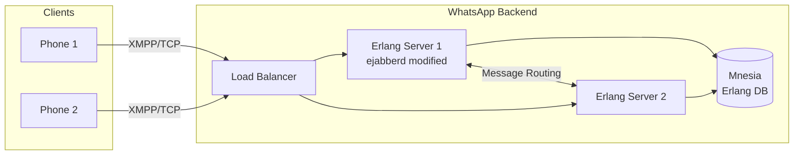
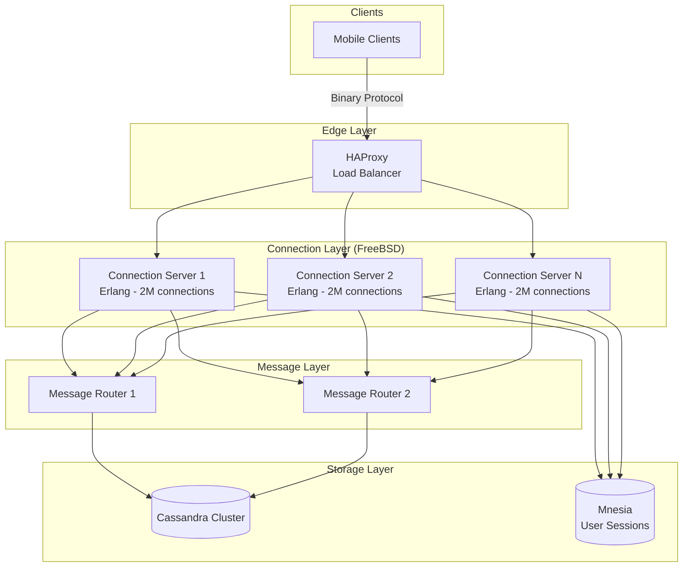
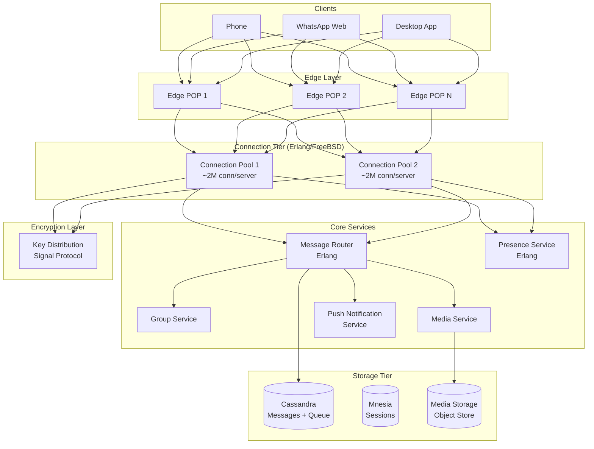
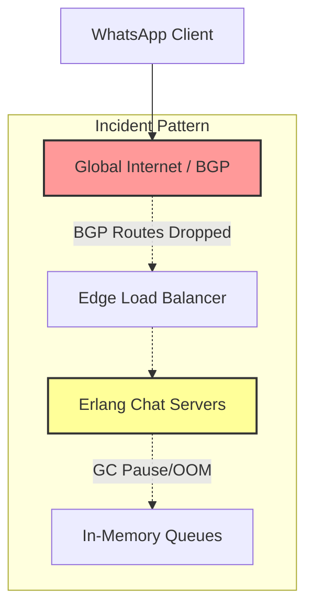

# WhatsApp Messaging Architecture

A deep-dive into how WhatsApp built the world's most efficient messaging platform, delivering 100B+ messages daily to 2B+ users.

---

## 1. Problem Statement

### Business Challenge
WhatsApp's mission is simple: provide fast, reliable, and secure messaging to billions of users worldwide. The challenge is achieving extreme efficiency—handling more messages than any other platform while maintaining minimal infrastructure and a small engineering team.

### Technical Requirements
- **Functional**: Real-time 1:1 and group messaging, media sharing, voice/video calls
- **Reliable**: Messages must never be lost, delivery guaranteed
- **Secure**: End-to-end encryption for all messages
- **Efficient**: Minimal server resources, low bandwidth usage

### Scale Metrics

| Metric | Value | As of | Source | Notes |
|--------|-------|-------|--------|-------|
| Monthly Active Users | 2B+ | Historical/approximate; not current-verified | WhatsApp public and engineering sources listed below | Global reach |
| Daily Messages | 100B+ | Historical/approximate; not current-verified | WhatsApp public and engineering sources listed below | Text + media |
| Peak Messages/Second | 1M+ | Historical/approximate; not current-verified | WhatsApp architecture and engineering sources listed below | During peak hours |
| Connections per Server | 2M+ | Historical architecture benchmark; not current-verified | Erlang Factory and architecture sources listed below | Erlang efficiency |
| Engineering Team Size | ~50 | 2014 acquisition-era baseline | Wired and architecture sources listed below | At time of FB acquisition |
| Server Count | ~550 | 2014 acquisition-era baseline | Wired and architecture sources listed below | At time of acquisition |

### Performance Requirements

| Requirement | Target |
|-------------|--------|
| Message delivery latency | < 100ms (same region) |
| Connection reliability | 99.99% |
| Message delivery rate | 99.999% |
| Offline message queue | 30 days |
| Max group size | 1024 members |

---

## 2. Architecture Evolution

### v1: Erlang + XMPP Foundation (2009-2012)

**Approach**: Use Erlang/OTP for massive concurrency, XMPP-based protocol.

**What Worked**:
- ✅ Erlang's lightweight processes (2KB each) handled massive concurrency
- ✅ XMPP provided proven messaging semantics
- ✅ Small team could manage entire system
- ✅ Very efficient resource usage

**What Broke**:
- ❌ Mnesia couldn't scale beyond single machine limits
- ❌ XMPP protocol too verbose for mobile
- ❌ No message persistence at scale
- ❌ Single data center limitations

### v2: Custom Protocol + FreeBSD Optimization (2012-2016)

**Approach**: Custom binary protocol, FreeBSD kernel tuning, Cassandra for persistence.

**Key Changes**:
- Custom binary protocol (not XMPP) - reduced bandwidth by 40%
- FreeBSD kernel tuning for 2M+ connections per server
- Cassandra for message persistence
- Custom push notification system

**Problems Solved**:
- ✅ 2M concurrent connections per server (vs. ~50K industry standard)
- ✅ Reliable message persistence
- ✅ Lower bandwidth usage
- ✅ Improved delivery reliability

**New Bottlenecks**:
- ❌ Multi-device support complexity
- ❌ Group message fan-out
- ❌ Media storage scaling

### v3: Current Architecture (2016-Present)

**Approach**: End-to-end encryption, multi-device support, global scale.

**Current Features**:
- End-to-end encryption (Signal Protocol) for all messages
- Multi-device support (up to 4 linked devices)
- Business API for enterprises
- Status/Stories feature
- Voice and video calls (WebRTC-based)

---

## 3. Key Design Decisions

### Decision 1: Erlang/OTP as Core Platform

| Aspect | Details |
|--------|---------|
| **Decision** | Build entire messaging backend in Erlang |
| **Rationale** | Designed for telecom-scale concurrency, fault tolerance built-in |
| **Alternatives Considered** | Java (heavier), C++ (manual memory management), Node.js (less mature) |
| **Trade-offs** | Smaller talent pool, unfamiliar to most engineers |
| **Result** | 2M connections per server, 99.999% uptime, small team |

### Decision 2: FreeBSD over Linux

| Aspect | Details |
|--------|---------|
| **Decision** | Use FreeBSD instead of Linux for servers |
| **Rationale** | Better network stack performance, kernel tuning for high connection count |
| **Alternatives Considered** | Linux (more common), custom kernel |
| **Trade-offs** | Less ecosystem support, fewer engineers familiar |
| **Result** | Achieved 2M+ connections per server through kernel tuning |

### Decision 3: Custom Binary Protocol

| Aspect | Details |
|--------|---------|
| **Decision** | Replace XMPP with custom binary protocol |
| **Rationale** | XMPP too verbose, needed efficiency for mobile networks |
| **Alternatives Considered** | Compressed XMPP, protobuf, custom text protocol |
| **Trade-offs** | Non-standard, harder to debug |
| **Result** | 40% bandwidth reduction, better mobile performance |

### Decision 4: Message-Passing Concurrency

| Aspect | Details |
|--------|---------|
| **Decision** | Use Erlang's actor model with message passing, no shared state |
| **Rationale** | Avoid locks, natural fault isolation, easier reasoning |
| **Alternatives Considered** | Shared memory with locks, STM |
| **Trade-offs** | Memory copying overhead, learning curve |
| **Result** | No deadlocks, isolated failures, predictable performance |

### Decision 5: Minimal Feature Set

| Aspect | Details |
|--------|---------|
| **Decision** | Focus on core messaging, resist feature bloat |
| **Rationale** | Simplicity = reliability, small team can maintain |
| **Alternatives Considered** | Rich features like competitors |
| **Trade-offs** | Fewer features than competitors |
| **Result** | Highest reliability, lowest infrastructure cost |

---

## 4. Technologies Used

| Component | Technology | Why Chosen | Alternatives |
|-----------|-----------|------------|--------------|
| Core Runtime | Erlang/OTP | Massive concurrency | Java, Go |
| VM | BEAM | Soft real-time, preemptive | JVM, V8 |
| OS | FreeBSD | Network performance | Linux |
| Database | Cassandra | Write throughput, availability | DynamoDB, Scylla |
| Session Store | Mnesia | Erlang-native, fast | Redis, etcd |
| Load Balancer | HAProxy | Reliable, performant | nginx, LVS |
| Protocol | Custom Binary | Efficiency | XMPP, Protobuf |
| Encryption | Signal Protocol | Proven E2E encryption | Custom, OTR |
| Push | Custom + APNS/FCM | Control + platform coverage | Pure third-party |
| Media Storage | Custom Object Store | Efficiency | S3, GCS |

---

## 5. Trade-offs Made

### Consistency vs Availability

| Trade-off | WhatsApp's Choice | Reasoning |
|-----------|-------------------|-----------|
| Message delivery | **At-least-once + idempotency** | Messages must arrive, clients handle duplicates |
| Read receipts | **Eventual consistency** | Delay acceptable |
| Last seen | **Eventual consistency** | Approximate is fine |
| Group membership | **Strong consistency** | Must be accurate |

### Latency vs Durability

| Trade-off | WhatsApp's Choice | Reasoning |
|-----------|-------------------|-----------|
| Message persistence | **Persist before ack** | Never lose messages |
| Offline queue | **Always queue** | Handle offline recipients |
| Media | **Client confirms receipt** | Delete from server after delivery |

### Features vs Reliability

| Trade-off | WhatsApp's Choice | Reasoning |
|-----------|-------------------|-----------|
| Feature set | **Minimal** | Fewer features = fewer bugs |
| Protocol | **Simple** | Easy to implement correctly |
| UI | **Functional** | Focus on core messaging |

### Efficiency vs Complexity

| Trade-off | WhatsApp's Choice | Reasoning |
|-----------|-------------------|-----------|
| Language | **Erlang (complex)** | Efficiency worth learning curve |
| OS | **FreeBSD (uncommon)** | Performance worth specialization |
| Protocol | **Custom (non-standard)** | Efficiency worth complexity |

---

## 6. Lessons Learned

### What Worked ✅

1. **Erlang Choice**: Enabled 50 engineers to serve 2B users
2. **FreeBSD Tuning**: 2M connections per server reduced costs dramatically
3. **Minimal Features**: High reliability through simplicity
4. **Actor Model**: No shared state = no deadlocks
5. **Binary Protocol**: Significant bandwidth savings on mobile

### What Didn't Work Initially ❌

1. **Mnesia at Scale**: Couldn't handle growing user base, replaced with Cassandra
2. **XMPP Protocol**: Too verbose for mobile networks
3. **Single Data Center**: Required multi-region for reliability
4. **No Persistence**: Early versions could lose messages, unacceptable
5. **Phone-only**: Had to add web and desktop clients

### Key Pivots 🔄

1. **2010**: Mnesia to Cassandra for message storage
2. **2012**: XMPP to custom binary protocol
3. **2014**: Acquired by Facebook, infrastructure resources increased
4. **2016**: End-to-end encryption rolled out globally
5. **2020**: Multi-device support (no phone required)
6. **2021**: Business API and enterprise features

---

## 7. Interview Relevance

### When to Reference This Case Study

- **Chat/messaging system design** (Slack, Discord, Telegram)
- **High-concurrency systems**
- **Real-time communication**
- **Efficient protocol design**
- **End-to-end encryption systems**

### Key Talking Points

Use these in your interviews:

1. "WhatsApp uses **Erlang/OTP** which was designed for telecom systems. Each connection is a lightweight process (~2KB), allowing **2 million concurrent connections per server**."

2. "They chose **FreeBSD over Linux** because of superior network stack performance, then **tuned the kernel** to handle millions of connections per machine."

3. "The protocol evolved from **XMPP to a custom binary format**, reducing bandwidth by 40%. This is critical for mobile networks in developing countries."

4. "Messages follow **at-least-once delivery** semantics—persisted to Cassandra before acknowledgment, then queued for offline recipients up to 30 days."

5. "At the time of Facebook acquisition, **55 engineers served 450M users** with only ~550 servers. That's ~8M users per engineer and ~820K users per server."

### Common Follow-up Questions

| Question | How to Answer |
|----------|---------------|
| "How do you ensure message delivery?" | Persist before ack, offline queue, client confirms, retry logic |
| "How does end-to-end encryption work?" | Signal Protocol, key exchange on first message, keys stored on device only |
| "How do you handle group messages?" | Server fans out to members, each gets individual encrypted copy |
| "Why Erlang over other languages?" | Lightweight processes, fault tolerance, pattern matching for message routing |
| "How do you handle offline users?" | Per-user queue in Cassandra, deliver on reconnection, expire after 30 days |
| "How do read receipts work?" | Separate ack message, eventual consistency, can be disabled |

---

## 8. Related Repo Content

### HLD Concepts Referenced
- [Message Queues](../../03-hld-concepts/message-queues/) - Async message handling
- [Database Replication](../../03-hld-concepts/database-replication/) - Cassandra replication
- [Load Balancing](../../03-hld-concepts/load-balancing/) - Connection distribution
- [Service Discovery](../../03-hld-concepts/service-discovery/) - Erlang node discovery

### Similar HLD Projects
- [Chat/Messaging Service System](../../04-hld-projects/chat-service/)
- [Notification Service](../../04-hld-projects/notification-service/)
- [Distributed Email Service (Gmail)](../../04-hld-projects/distributed-email-service/)

### Design Patterns Applied
- **Actor Model**: Each connection as isolated actor
- **Queue-based Load Leveling**: Offline message queue
- **Saga Pattern**: Message delivery with acks
- **Fan-out Pattern**: Group message distribution

---

## 📚 Sources

- [High Scalability: "The WhatsApp Architecture Facebook Bought For $19 Billion"](http://highscalability.com/)
- [Wired: "How WhatsApp Grew to Nearly Half a Billion Users"](https://www.wired.com/)
- [Rick Reed's Erlang Factory Talk: "Scaling to Millions of Simultaneous Connections"](https://www.erlang-factory.com/)
- [Facebook Engineering: "Building for a Billion Users"](https://engineering.fb.com/)
- [Signal Protocol Documentation](https://signal.org/docs/)

---

## 9. Interview Variant Transfer (WhatsApp Question Set)

This section maps common interview deep dives from WhatsApp-style prompt sets to concrete design checkpoints.

### A. Connection loss and replay

- Keep reconnect contract explicit: client reconnects with last acknowledged cursor.
- Replay missed messages in order, deduplicate with idempotency IDs.
- Measure replay lag and duplicate suppression rate.

### B. Multiple devices per user

- Model sessions per device, not per user.
- Maintain per-device cursors/read state.
- Broadcast sync events (read, delete, edit) across active devices.

### C. Out-of-order events

- Guarantee order per conversation partition.
- Add deterministic tie-breakers for close timestamps.
- Keep client reconciliation logic simple and documented.

### D. Presence/cache degradation

- If presence cache degrades, preserve durable delivery path first.
- Degrade to queue-first mode and delay non-critical presence updates.
- Clearly define fail-open vs fail-closed behavior for presence-only features.

### E. Last-seen privacy controls

- Enforce visibility policy (`everyone`, `contacts`, `nobody`) in both write and read paths.
- Audit policy checks to avoid accidental data leakage.

### Interview-ready cross-links

- [Chat Service HLD project](../../04-hld-projects/chat-service/)
- [Chat pitfalls](../../04-hld-projects/chat-service/PITFALLS.md)
- [Chat follow-ups](../../04-hld-projects/chat-service/FOLLOW-UPS.md)
- [Message Queues concept](../../03-hld-concepts/message-queues/)
- [Real-time Updates concept](../../03-hld-concepts/real-time-updates/)

## Failures, Incidents and What They Changed

1. **New Year's Eve 2017 Outage**
   - **Date**: December 31, 2017
   - **Root Cause**: Record-breaking concurrent connections and message rates during midnight time zone rolling exhausted memory on edge chat servers, leading to cascading process crashes.
   - **Blast Radius**: Complete loss of messaging capabilities for users globally for over an hour.
   - **Fix**: Re-tuned Erlang VM garbage collection settings, aggressively load-balanced connection terminations, and optimized payload sizes for media messages.
   - **Interview Lesson**: High-concurrency systems must tune runtime-level configurations (like GC and file descriptors) to survive sudden herd connection spikes.
   - **Source**: [not public]

2. **Facebook Infrastructure Integration Failure (2019)**
   - **Date**: July 2019
   - **Root Cause**: During a transition to integrate WhatsApp image/media hosting with Facebook's global CDN infrastructure, a misconfigured load balancer rejected valid media requests.
   - **Blast Radius**: Users could send text but could not download or send images, voice notes, or videos for several hours.
   - **Fix**: Reverted the CDN routing change, added progressive rollouts for infrastructure routing, and implemented dual-read fallback mechanisms.
   - **Interview Lesson**: Never execute a hard cutover for massive data paths; always use dark reads and percentage-based rollouts.
   - **Source**: [https://www.theverge.com/2019/7/3/20681231/facebook-outage-image-loading-whatsapp-instagram-broken](https://www.theverge.com/2019/7/3/20681231/facebook-outage-image-loading-whatsapp-instagram-broken)

3. **BGP Routing Outage (2021)**
   - **Date**: October 4, 2021
   - **Root Cause**: A faulty configuration change dropped Facebook's (and WhatsApp's) BGP routes from the global internet, completely severing external connectivity to their data centers.
   - **Blast Radius**: WhatsApp (along with Facebook and Instagram) went offline globally for 6 hours.
   - **Fix**: Redesigned out-of-band management networks for physical routers and implemented safety checks for backbone routing changes.
   - **Interview Lesson**: Software architectures cannot overcome fundamental networking (BGP/DNS) failures if the physical layer is unreachabe.
   - **Source**: [https://engineering.fb.com/2021/10/05/networking-traffic/outage-details/](https://engineering.fb.com/2021/10/05/networking-traffic/outage-details/)

## Evolution Timeline

| Year | Scale | Change |
|------|-------|--------|
| 2009 | 100K users | Launched with a basic XMPP server (ejabberd) written in Erlang. |
| 2012 | 100M users | Heavily modified ejabberd; pushed Erlang VM to handle 2M+ concurrent connections per server. |
| 2014 | 500M users | Acquired by Facebook; began migrating from IBM SoftLayer to Facebook's infrastructure. |
| 2016 | 1B users | Rolled out end-to-end encryption (Signal Protocol) globally without service degradation. |
| 2021 | 2B users | Multi-device support, requiring a complete re-architecture of how message history and keys are synced. |

## Design It Yourself

**Prompt**: Design a highly concurrent chat application that supports 1-on-1 and group messaging with end-to-end encryption and read receipts.
**Hints**:
1. How do you maintain long-lived persistent connections for millions of users efficiently?
2. What happens to messages when the recipient is offline?
3. How are group messages routed without violating end-to-end encryption?
4. How do you synchronize message history across multiple devices for a single user?
5. How would you design the system to scale connection handling independently from message processing?

**Link**: Try building this in the [Chat Service](../../04-hld-projects/chat-service/) project.

## High-Level Incident Architecture

## Deep Dive: Scaling the Erlang VM
WhatsApp's incredible engineering feat of serving hundreds of millions of users with less than fifty engineers was largely due to their deep mastery of Erlang. They aggressively tuned the Erlang VM (BEAM) to support massive concurrency per node.
This tuning involved optimizing the garbage collector to prevent long pauses during connection storms, maximizing the number of allowable open file descriptors at the OS level, and structuring their application to rely on message passing between isolated lightweight processes rather than shared memory locks. These optimizations allowed a single server to comfortably handle millions of concurrent TCP connections.

This focus on bare-metal optimization rather than horizontally scaling standard application servers allowed WhatsApp to maintain a uniquely cost-effective infrastructure while handling an unprecedented volume of real-time messages.
