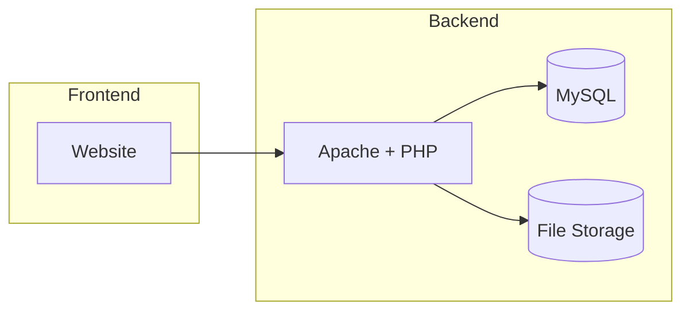
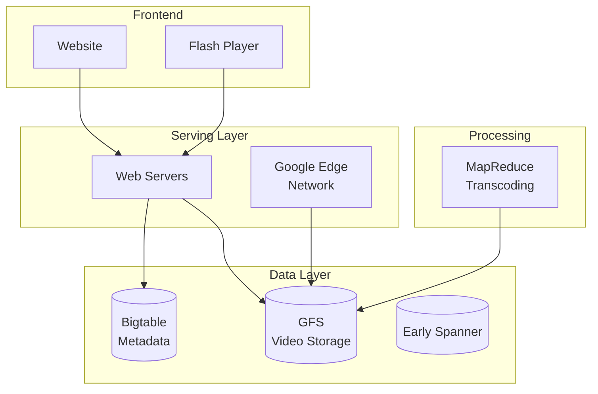
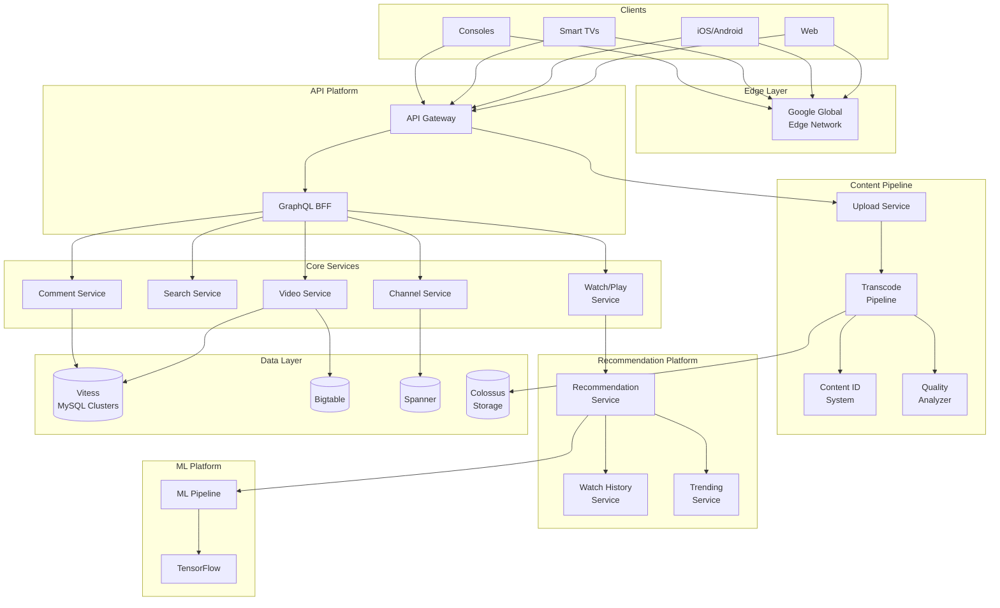
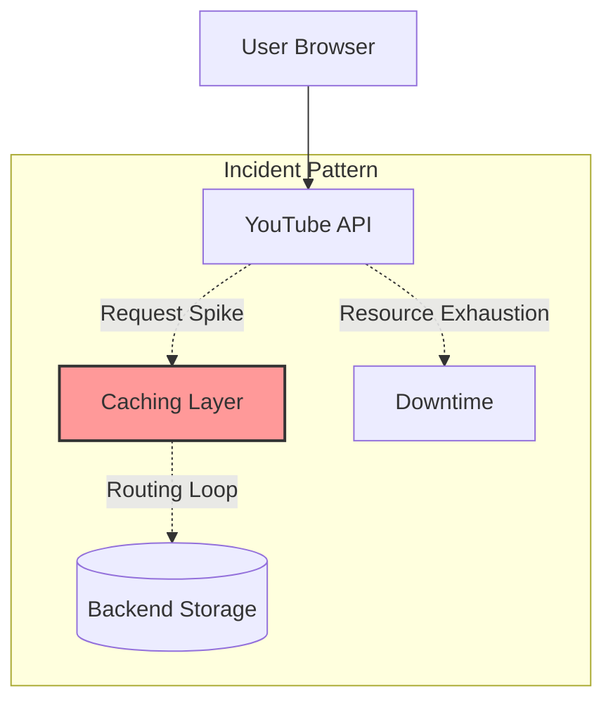

# YouTube Video Platform Architecture

A deep-dive into how YouTube built the world's largest video platform, handling 500 hours of uploads per minute and billions of daily views.

---

## 1. Problem Statement

### Business Challenge
YouTube serves billions of hours of video daily while ingesting 500 hours of new content every minute. The challenge is transcoding videos into multiple formats, storing petabytes of content, delivering globally with low latency, and recommending relevant content to keep users engaged.

### Technical Requirements
- **Functional**: Upload, transcode, store, stream videos; recommendations; comments; live streaming
- **Scalable**: Handle 500 hours uploaded/minute, billions of views/day
- **Fast**: Videos start playing in < 2 seconds
- **Smart**: Recommendations drive 70% of watch time

### Scale Metrics

| Metric | Value | As of | Source | Notes |
|--------|-------|-------|--------|-------|
| Monthly Active Users | 2.5B+ | Historical/approximate; not current-verified | YouTube public and official sources listed below | Second largest search engine |
| Hours Watched/Day | 1B+ | Historical/approximate; not current-verified | YouTube official and public sources listed below | Mobile is majority |
| Upload Rate | 500 hours/min | Historical/approximate; not current-verified | YouTube official and engineering sources listed below | 500 × 60 × 24 = 720,000 upload-hours/day |
| Videos | 800M+ | Historical/approximate; not current-verified | YouTube public and official sources listed below | Across all channels |
| Daily Views | 5B+ | Historical/approximate; not current-verified | YouTube public and official sources listed below | Across all devices |
| Data Centers | 20+ | Historical/approximate; not current-verified | Google/YouTube public technical sources listed below | Global edge network |

### Performance Requirements

| Requirement | Target |
|-------------|--------|
| Video start time | < 2 seconds |
| Buffering rate | < 1% |
| Transcode time | Minutes for most videos |
| Search latency | < 500ms |
| Recommendation latency | < 100ms |

---

## 2. Architecture Evolution

### v1: LAMP Stack (2005-2006)

**Approach**: MySQL database, Apache web server, PHP/Python, video on simple storage.

**What Worked**:
- ✅ Fast initial development
- ✅ Simple architecture for startup
- ✅ Attracted early users

**What Broke**:
- ❌ MySQL couldn't handle metadata volume
- ❌ Storage system couldn't scale
- ❌ Transcoding was manual/slow
- ❌ No global delivery

### v2: Google Infrastructure (2006-2010)

**Approach**: Google acquisition; migrate to Google infrastructure (GFS, Bigtable, MapReduce).

**Key Changes**:
- Migrated to Google's infrastructure
- Bigtable for video metadata
- Google File System for storage
- MapReduce for transcoding

**Problems Solved**:
- ✅ Massive storage scaling (GFS)
- ✅ Metadata at scale (Bigtable)
- ✅ Global CDN delivery
- ✅ Parallel transcoding

**New Bottlenecks**:
- ❌ MySQL still used for some data
- ❌ Recommendation was basic
- ❌ Mobile experience poor
- ❌ Live streaming not supported

### v3: Current Architecture (2010-Present)

**Approach**: Vitess for MySQL scaling, ML recommendations, adaptive streaming, global edge.

**Current Features**:
- Vitess for MySQL horizontal scaling (1000+ shards)
- Deep learning recommendations (70% of views)
- Content ID copyright detection
- Live streaming with ultra-low latency
- Adaptive bitrate streaming (DASH)

---

## 3. Key Design Decisions

### Decision 1: Vitess for MySQL Sharding

| Aspect | Details |
|--------|---------|
| **Decision** | Build Vitess to horizontally shard MySQL instead of migrating away |
| **Rationale** | Keep MySQL semantics; leverage existing expertise |
| **Alternatives Considered** | NoSQL migration, Spanner for everything |
| **Trade-offs** | Complex sharding logic, cross-shard query limitations |
| **Result** | 1000+ MySQL shards; open-sourced Vitess (used by Slack, Pinterest) |

### Decision 2: Bigtable for Video Metadata

| Aspect | Details |
|--------|---------|
| **Decision** | Use Bigtable for video metadata, thumbnails, and statistics |
| **Rationale** | Handles billions of rows, good for time-series data |
| **Alternatives Considered** | MySQL, Spanner, custom solution |
| **Trade-offs** | Limited query patterns, eventual consistency |
| **Result** | Stores metadata for 800M+ videos efficiently |

### Decision 3: Multi-Quality Transcoding

| Aspect | Details |
|--------|---------|
| **Decision** | Transcode each video into 10+ quality levels |
| **Rationale** | Serve best quality for each device/network |
| **Alternatives Considered** | On-demand transcoding, fewer quality levels |
| **Trade-offs** | High storage and compute cost |
| **Result** | Optimal viewing experience globally; 4K/8K support |

### Decision 4: ML-Based Recommendations

| Aspect | Details |
|--------|---------|
| **Decision** | Deep learning for personalized recommendations |
| **Rationale** | Keep users engaged, increase watch time |
| **Alternatives Considered** | Collaborative filtering only, editorial curation |
| **Trade-offs** | Compute cost, training complexity, filter bubbles |
| **Result** | 70% of views come from recommendations |

### Decision 5: Content ID System

| Aspect | Details |
|--------|---------|
| **Decision** | Build automated copyright detection system |
| **Rationale** | Enable copyright holders to monetize or block content |
| **Alternatives Considered** | Manual review, let copyright holders file claims |
| **Trade-offs** | False positives, compute cost |
| **Result** | $2B+ paid to rights holders; automated at upload |

---

## 4. Technologies Used

| Component | Technology | Why Chosen | Alternatives |
|-----------|-----------|------------|--------------|
| MySQL Scaling | Vitess | Horizontal sharding | Spanner, CockroachDB |
| Metadata | Bigtable | Scale, time-series | Cassandra, HBase |
| Video Storage | Colossus (GFS v2) | Petabyte scale | S3, HDFS |
| Global Delivery | Google Edge | Latency, capacity | Akamai, CloudFront |
| Streaming | DASH + HLS | Adaptive bitrate | HDS, Smooth Streaming |
| Transcoding | Custom pipeline | Quality optimization | FFmpeg only |
| ML | TensorFlow | Google standard | PyTorch |
| Search | Google Search | Integrated | Elasticsearch |
| Monitoring | Borgmon/Monarch | Google internal | Prometheus |
| Live Streaming | WebRTC + RTMP | Low latency | HLS only |

---

## 5. Trade-offs Made

### Consistency vs Availability

| Trade-off | YouTube's Choice | Reasoning |
|-----------|-----------------|-----------|
| View counts | **Eventually consistent** | Aggregate is approximate |
| Video status | **Strongly consistent** | Must be accurate |
| Comments | **Eventually consistent** | Delay is OK |
| Subscriptions | **Strongly consistent** | User expectation |

### Storage vs Compute

| Trade-off | YouTube's Choice | Reasoning |
|-----------|-----------------|-----------|
| Transcoding | **Pre-compute all qualities** | Optimize viewing experience |
| Thumbnails | **Pre-generate variants** | Fast page loads |
| Recommendations | **Mix of batch + real-time** | Balance freshness and cost |

### Cost vs Quality

| Trade-off | YouTube's Choice | Reasoning |
|-----------|-----------------|-----------|
| Encoding quality | **High investment** | User experience critical |
| CDN coverage | **Extensive edge** | Latency worth cost |
| Storage | **High redundancy** | Content loss unacceptable |

---

## 6. Lessons Learned

### What Worked ✅

1. **Vitess Investment**: Enabled MySQL to scale to YouTube's needs; became open-source project
2. **Google Infrastructure**: Bigtable, Colossus provided foundation for scale
3. **Deep Learning Recommendations**: Massive engagement increase
4. **Content ID**: Enabled creator ecosystem, rights holder monetization
5. **Adaptive Streaming**: Seamless quality across networks

### What Didn't Work Initially ❌

1. **MySQL Without Sharding**: Hit scale limits quickly
2. **Flash Player**: Security issues, mobile incompatible
3. **Manual Moderation**: Couldn't scale with upload volume
4. **Basic Recommendations**: Low engagement
5. **Single Quality Streaming**: Poor experience on varying networks

### Key Pivots 🔄

1. **2006**: Google acquisition, infrastructure migration
2. **2008**: HD support introduced
3. **2012**: Vitess developed for MySQL sharding
4. **2015**: HTML5 player replaces Flash
5. **2016**: Deep learning recommendations
6. **2017**: Live streaming improvements
7. **2020**: Shorts (TikTok competitor)

---

## 7. Interview Relevance

### When to Reference This Case Study

- **Video streaming platform design**
- **Transcoding pipeline design**
- **Recommendation system design**
- **Content moderation at scale**
- **Database sharding (Vitess)**

### Key Talking Points

Use these in your interviews:

1. "YouTube built **Vitess** to horizontally shard MySQL because they wanted to keep MySQL semantics while scaling to billions of rows. It now powers 1000+ shards and is open-source."

2. "Every uploaded video is **transcoded into 10+ quality levels** from 144p to 8K, stored on Colossus (Google's distributed file system), and served via adaptive bitrate streaming."

3. "**70% of YouTube views** come from recommendations. They use deep learning models trained on watch history, considering factors like watch time, engagement, and freshness."

4. "**Content ID** uses audio/video fingerprinting to automatically detect copyrighted material at upload time. It's how rights holders can choose to monetize or block content."

5. "Metadata for 800M+ videos is stored in **Bigtable**, which handles the massive read/write throughput for view counts, likes, and video information."

### Common Follow-up Questions

| Question | How to Answer |
|----------|---------------|
| "How does video upload work?" | Upload → chunk → store in Colossus → queue for transcoding → generate thumbnails → Content ID check → publish |
| "How do you transcode at scale?" | Parallel processing pipeline; split video into chunks; transcode independently; merge; generate manifest |
| "How do recommendations work?" | Candidate generation (millions → thousands) → ranking (ML model) → re-ranking (diversity, freshness) |
| "How do you handle live streaming?" | RTMP ingest → edge transcoding → DASH/HLS segments → CDN → adaptive playback |
| "How do you ensure video availability?" | Multiple replicas across data centers; erasure coding for efficiency; CDN edge caching |
| "How do you handle comments at scale?" | Vitess sharding by video_id; pagination with cursor; spam detection ML |

---

## 8. Related Repo Content

### HLD Concepts Referenced
- [CDN](../../03-hld-concepts/cdn/) - Video delivery
- [Database Sharding](../../03-hld-concepts/database-sharding/) - Vitess patterns
- [Caching](../../03-hld-concepts/caching/) - Edge caching
- [Message Queues](../../03-hld-concepts/message-queues/) - Processing pipelines

### Similar HLD Projects
- [Video Recommendations](../../04-hld-projects/video-recommendations/)
- [Live Video Streaming Pipeline - Problem Statement](../../04-hld-projects/live-video-streaming-pipeline/)

### Design Patterns Applied
- **Pipeline Pattern**: Transcoding workflow
- **CQRS**: Read vs write optimization
- **Saga Pattern**: Upload processing
- **Content-Based Routing**: Video delivery

---

## Failures, Incidents and What They Changed

1. **Global Outage (2018)**
   - **Date**: October 16, 2018
   - **Root Cause**: A massive internal traffic jam between the caching layer and the underlying storage system, likely caused by a routing misconfiguration, starved the API servers of resources.
   - **Blast Radius**: YouTube, YouTube TV, and YouTube Music were globally inaccessible for roughly two hours.
   - **Fix**: Redesigned internal rate limiting, instituted stricter decoupling between control and data planes, and deployed more resilient fallback caching.
   - **Interview Lesson**: A failure in internal routing can cause cascading resource exhaustion. Systems need aggressive load shedding and circuit breakers between internal microservices.
   - **Source**: [not public]

2. **Vitess Migration Data Inconsistency (2012)**
   - **Date**: 2012 (approximate)
   - **Root Cause**: While migrating from monolithic MySQL to Vitess (their sharded MySQL framework), a bug in cross-shard transaction coordination resulted in orphaned records.
   - **Blast Radius**: Minor metadata inconsistencies (e.g., comment counts not matching actual comments).
   - **Fix**: Built an offline background reconciliation job to repair cross-shard inconsistencies and later improved Vitess's 2PC (two-phase commit) implementation.
   - **Interview Lesson**: Distributed transactions across shards are hard. Always run a background reconciliation process to fix eventual consistency anomalies.
   - **Source**: [https://vitess.io/docs/19.0/overview/](https://vitess.io/docs/19.0/overview/)

3. **Pakistan BGP Hijack (2008)**
   - **Date**: February 24, 2008
   - **Root Cause**: Pakistan Telecom attempted to censor YouTube internally by broadcasting a fake BGP route. This route leaked to the global internet, redirecting YouTube's traffic into a black hole in Pakistan.
   - **Blast Radius**: YouTube was globally unreachable for about two hours.
   - **Fix**: Google rapidly coordinated with major ISPs to broadcast a more specific BGP route, overriding the hijack, and the industry pushed for stricter BGP route filtering (RPKI).
   - **Interview Lesson**: The internet's fundamental protocols lack authentication. Infrastructure must monitor global routing (BGP) to detect and respond to hijacks.
   - **Source**: [https://www.ripe.net/publications/news/industry-developments/youtube-hijacking-a-ripe-ncc-ris-case-study/](https://www.ripe.net/publications/news/industry-developments/youtube-hijacking-a-ripe-ncc-ris-case-study/)

## Evolution Timeline

| Year | Scale | Change |
|------|-------|--------|
| 2005 | N/A | Launched on a simple LAMP stack (Linux, Apache, MySQL, PHP/Python). |
| 2006 | N/A | Acquired by Google; began migrating metadata to Bigtable and video files to Google File System (GFS). |
| 2011 | N/A | Created Vitess to horizontally scale their massive MySQL metadata footprint. |
| 2016 | N/A | Migrated deeply to neural networks (TensorFlow) for video recommendations. |
| 2020 | N/A | Began utilizing specialized hardware (VCUs - Video Coding Units) to dramatically reduce transcoding costs. |

## Design It Yourself

**Prompt**: Design a global video sharing platform that allows user uploads and streams high-definition video with low buffering.
**Hints**:
1. How do you handle large file uploads reliably over slow connections?
2. What happens immediately after a video is uploaded? (Think processing pipeline)
3. How do you efficiently serve video to millions of users? (Hint: CDN and chunking)
4. How do you design the metadata database to handle both highly viewed "viral" videos and a long tail of unwatched videos?
5. How does the recommendation system process billions of events to serve personalized feeds?

**Link**: Try building this in the [Video Streaming](../../04-hld-projects/video-streaming/) project.

## High-Level Incident Architecture

## 📚 Sources

- [Vitess: YouTube's Database Scaling Story](https://vitess.io/docs/19.0/overview/)
- [Deep Neural Networks for YouTube Recommendations](https://research.google/pubs/pub45530/)
- [YouTube's Road to HTML5](https://youtube-eng.googleblog.com/2015/01/youtube-now-defaults-to-html5-video.html)
- [Content ID How It Works](https://support.google.com/youtube/answer/2797370)
- [Argos: Video Coding Units at YouTube](https://blog.youtube/inside-youtube/new-era-video-infrastructure/)
- [YouTube BGP Hijack Case Study](https://www.ripe.net/publications/news/industry-developments/youtube-hijacking-a-ripe-ncc-ris-case-study/)

---

## Interview Mapping Update (March 2026)

- Mapped to `04-hld-projects/realtime-metrics-platform/` Top-K variant and `02-lld-projects/youtube-top-k/` for stream-aggregation interview drills.
