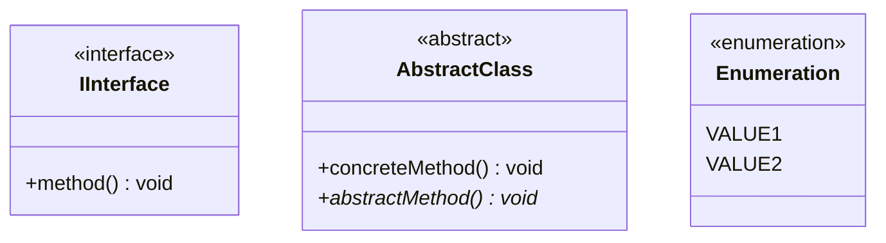
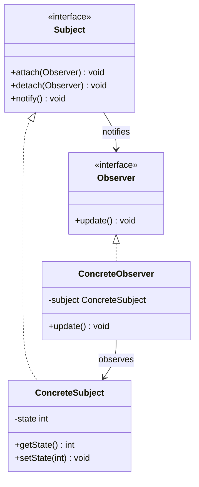
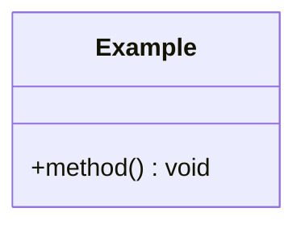
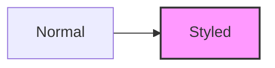

# 📊 Diagrams Library

> Visual diagram library for system design concepts and design patterns.

---

## 📁 Structure

```
diagrams/
├── README.md              # This file
├── components/            # Reusable HLD component diagrams
│   ├── load-balancer.mmd
│   ├── cache-layer.mmd
│   ├── database-cluster.mmd
│   ├── message-queue.mmd
│   ├── api-gateway.mmd
│   └── cdn-network.mmd
└── patterns/              # GoF design pattern class diagrams
    ├── creational/        # 5 patterns
    ├── structural/        # 7 patterns
    └── behavioral/        # 11 patterns
```

---

## 🎨 Diagram Types

| Type | Format | Purpose |
|------|--------|---------|
| **Architecture** | `flowchart TB/LR` | System component relationships |
| **Class** | `classDiagram` | OOP structures and patterns |
| **Sequence** | `sequenceDiagram` | Interaction flows |
| **State** | `stateDiagram-v2` | State transitions |

---

## 📐 UML Notation Reference

### Class Diagram Visibility

| Symbol | Meaning | Example |
|--------|---------|---------|
| `+` | Public | `+getData() string` |
| `-` | Private | `-password string` |
| `#` | Protected | `#validate() bool` |
| `~` | Package/Internal | `~helper() void` |
| `*` | Abstract | `*calculate() float` |

### Relationships

| Notation | Meaning | Mermaid Syntax |
|----------|---------|----------------|
| **Inheritance** | "is-a" (extends) | `Parent <\|-- Child` |
| **Implementation** | Implements interface | `Interface <\|.. Class` |
| **Composition** | Strong "has-a" (lifecycle bound) | `Whole *-- Part` |
| **Aggregation** | Weak "has-a" (independent) | `Container o-- Item` |
| **Association** | Uses/references | `ClassA --> ClassB` |
| **Dependency** | Temporary usage | `ClassA ..> ClassB` |

### Stereotypes



---

## 🔗 Quick Access

### Component Diagrams (HLD)

| Component | Description | File |
|-----------|-------------|------|
| [Load Balancer](./components/load-balancer.mmd) | Traffic distribution with health checks | `flowchart TB` |
| [Cache Layer](./components/cache-layer.mmd) | Cache hit/miss flow | `flowchart LR` |
| [Database Cluster](./components/database-cluster.mmd) | Master-replica replication | `flowchart TB` |
| [Message Queue](./components/message-queue.mmd) | Producer-consumer pattern | `flowchart LR` |
| [API Gateway](./components/api-gateway.mmd) | Gateway with auth/routing | `flowchart TB` |
| [CDN Network](./components/cdn-network.mmd) | Edge caching architecture | `flowchart TB` |
| [Recommendation Feature Store Architecture](../06-genai-systems/02-llm-hld-projects/recommendation-feature-store/diagrams/architecture.mmd) | Recommendation system with feature store | `flowchart TD` |
| [Recommendation Feature Store Sequence](../06-genai-systems/02-llm-hld-projects/recommendation-feature-store/diagrams/sequence.mmd) | Request flow for recommendations | `sequenceDiagram` |
| [Recommendation Feature Store Data Flow](../06-genai-systems/02-llm-hld-projects/recommendation-feature-store/diagrams/data_flow.mmd) | Data pipeline for feature updates | `flowchart LR` |

### Design Pattern Diagrams

#### Creational (5 patterns)

| Pattern | Key Concept | File |
|---------|-------------|------|
| [Singleton](./patterns/creational/singleton.mmd) | Single instance, global access | Private constructor |
| [Factory Method](./patterns/creational/factory-method.mmd) | Defer instantiation to subclasses | Creator hierarchy |
| [Abstract Factory](./patterns/creational/abstract-factory.mmd) | Families of related products | Multiple factories |
| [Builder](./patterns/creational/builder.mmd) | Step-by-step construction | Director + Builder |
| [Prototype](./patterns/creational/prototype.mmd) | Clone existing objects | Clone method |

#### Structural (7 patterns)

| Pattern | Key Concept | File |
|---------|-------------|------|
| [Adapter](./patterns/structural/adapter.mmd) | Interface translation | Target + Adaptee |
| [Decorator](./patterns/structural/decorator.mmd) | Dynamic behavior addition | Wrapper chain |
| [Proxy](./patterns/structural/proxy.mmd) | Access control | Same interface |
| [Facade](./patterns/structural/facade.mmd) | Simplified interface | Subsystem wrapper |
| [Bridge](./patterns/structural/bridge.mmd) | Abstraction-implementation split | Two hierarchies |
| [Composite](./patterns/structural/composite.mmd) | Tree structure | Uniform interface |
| [Flyweight](./patterns/structural/flyweight.mmd) | Shared state | Intrinsic/extrinsic |

#### Behavioral (11 patterns)

| Pattern | Key Concept | File |
|---------|-------------|------|
| [Strategy](./patterns/behavioral/strategy.mmd) | Interchangeable algorithms | Context + Strategy |
| [Observer](./patterns/behavioral/observer.mmd) | Event notification | Subject + Observers |
| [Command](./patterns/behavioral/command.mmd) | Encapsulated requests | Invoker + Command |
| [State](./patterns/behavioral/state.mmd) | State-dependent behavior | Context + States |
| [Template Method](./patterns/behavioral/template-method.mmd) | Algorithm skeleton | Abstract class |
| [Chain of Responsibility](./patterns/behavioral/chain-of-responsibility.mmd) | Request handler chain | Handler hierarchy |
| [Iterator](./patterns/behavioral/iterator.mmd) | Sequential access | Iterator + Aggregate |
| [Mediator](./patterns/behavioral/mediator.mmd) | Centralized communication | Mediator + Colleagues |
| [Memento](./patterns/behavioral/memento.mmd) | State snapshots | Originator + Caretaker |
| [Visitor](./patterns/behavioral/visitor.mmd) | Operations on elements | Double dispatch |
| [Interpreter](./patterns/behavioral/interpreter.mmd) | Grammar interpretation | Expression tree |

---

## 📖 How to Read Diagrams

### Class Diagrams

1. **Start with interfaces/abstractions** - Look for `<<interface>>` or `<<abstract>>`
2. **Follow inheritance arrows** - Solid lines with hollow triangles (▷)
3. **Check compositions** - Filled diamonds (◆) mean lifecycle dependency
4. **Note key methods** - Public methods (+) define the contract

### Architecture Diagrams

1. **Find entry points** - Usually clients/users at top or left
2. **Follow data flow** - Arrows show direction
3. **Note boundaries** - Subgraphs show logical grouping
4. **Check styling** - Colors/dashes indicate special conditions

### Example: Reading a Pattern Diagram



**Reading order:**
1. `Subject` interface defines the contract for observable objects
2. `ConcreteSubject` implements `Subject` and holds state
3. `Observer` interface defines the update contract
4. `ConcreteObserver` implements `Observer` and references the subject
5. Arrows show: Subject notifies Observers, Observers observe Subject

---

## 🛠️ Usage Tips

## 📦 Asset Policy

- Commit Mermaid `.mmd` source files as the canonical diagram artifacts.
- Do not commit generated SVG/PNG files unless a task explicitly asks for rendered export assets.
- Validate syntax with Mermaid preview or CLI when available.
- Use `/tmp` for local render smoke outputs, for example:

```bash
mmdc -i diagrams/patterns/behavioral/observer.mmd -o /tmp/observer.svg
```

If `mmdc` is unavailable, record it as a local tooling blocker and still run
the Markdown link checker for `.mmd` source links.

### Embedding in Markdown

````markdown

````

### Rendering Tools

- **GitHub**: Native mermaid support in README files
- **VS Code**: Mermaid extension for preview
- **Mermaid Live**: [mermaid.live](https://mermaid.live) for testing
- **Mermaid CLI**: optional local render smoke; write output to `/tmp`

### Styling Components



---

## 📚 Resources

- [Mermaid Documentation](https://mermaid.js.org/intro/)
- [UML Class Diagram Tutorial](https://www.visual-paradigm.com/guide/uml-unified-modeling-language/uml-class-diagram-tutorial/)
- [GoF Design Patterns](https://refactoring.guru/design-patterns)

---

[← Back to Main](../README.md)
